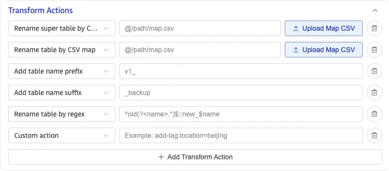
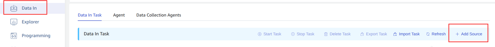
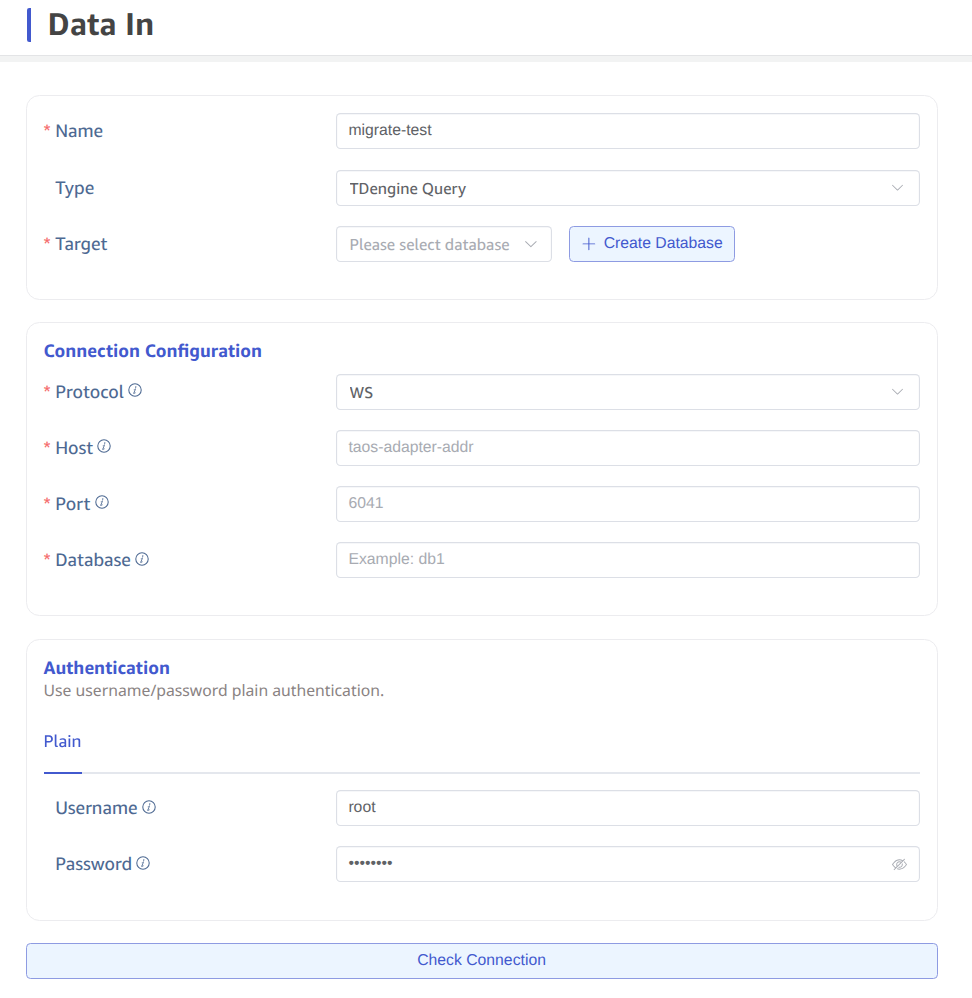
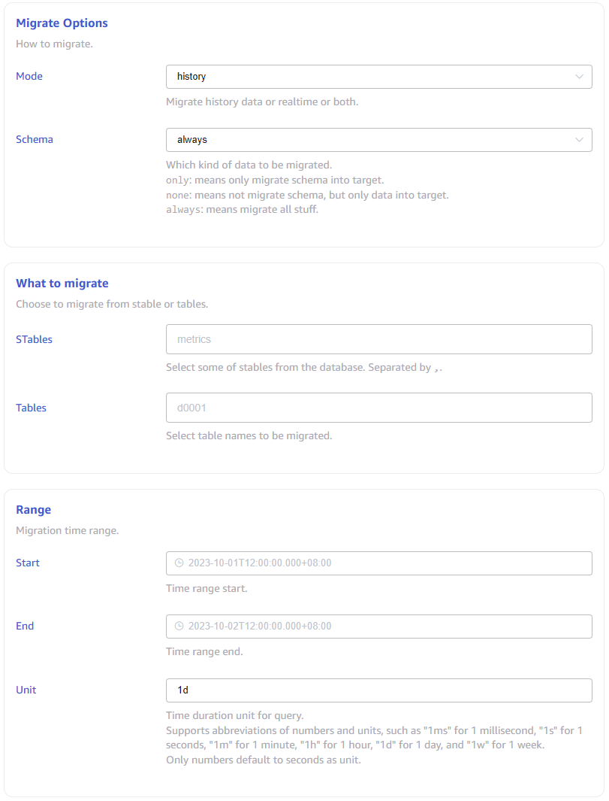
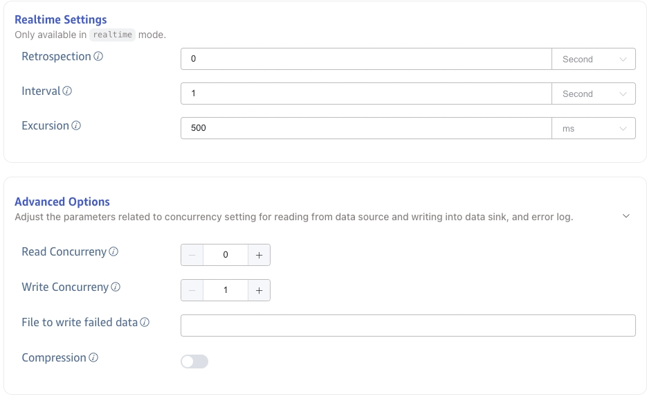

import { Enterprise } from '../resources/_resources.mdx';

<Enterprise/>

This section describes how to create a data migration task through the taosExplorer interface to migrate data from the old version of TDengine(2.4+, 3.0+) to the current cluster.

## Feature Overview

taosX migrates data by querying the source cluster and writing the results to the target database. Specifically, taosX uses the data of a subtable over a period of time as the basic unit of query, and writes the data to be migrated to the target database in batches.

taosX supports three migration modes:

1. **history** mode. This refers to migrating data within a specified time range. If no time range is specified, it migrates all data up to the time the task was created. The task stops once migration is complete.
2. **realtime** mode. It synchronizes data from the time the task is created onwards. The task will continue to run unless manually stopped.
3. **both** mode. It first executes in history mode, then in realtime mode.

Under each migration mode, you can specify whether to migrate the table structure. If "always" is selected, the structure of the table is synchronized to the target database before migrating data. This process may take longer if there are many subtables. If it is certain that the target database already has the same table interface as the source database, it is recommended to choose "none" to save time.

The task saves progress information to the disk during operation, so if the task is paused and then restarted, or if it automatically recovers from an anomaly, the task will not start over from the beginning.

For more options, it is recommended to read the description of each form field on the task creation page in detail.

## Transform Actions

For supported TDengine data sources, including **TDengine Query** and **TDengine Data Subscription**, expand **Transform Actions** when you create or edit a task. Transform actions adjust destination table metadata, such as table names, supertable names, and tags, before taosX writes the data. You can add multiple actions to a task.

The following actions are available:

| Transform action | Effect | Configuration |
| --- | --- | --- |
| Rename super table by CSV map | Maps specified source supertables to destination supertable names and updates the `USING` supertable reference in child-table metadata. | Upload a CSV mapping file or enter the mapping file path. |
| Rename table by CSV map | Rewrites destination table names from the mapping file. For child tables, both the table name and its referenced supertable are updated. | Upload a CSV mapping file or enter the mapping file path. |
| Add table name prefix | Adds a fixed prefix to destination table names. | For example, `v1_` changes `meters` to `v1_meters`. |
| Add table name suffix | Adds a fixed suffix to destination table names. | For example, `_backup` changes `meters` to `meters_backup`. |
| Rename table by regex | Matches and replaces destination table names with a regular expression. | Enter `<regular_expression>::<replacement>`, for example, `^old(?<name>.*)$::new_$name`. |
| Custom action | Configures a valid taosX `-T` transform action that is not provided by the list. | For example, `add-tag:location=beijing` adds a tag named `location` with the value `beijing`. |

Each row in a CSV mapping file contains a source name and a destination name in the format `source_name,target_name`; do not include a header row. After you upload a mapping CSV file, taosExplorer fills in the file reference with the `@` prefix automatically.

## Specific Steps

First, click on the "Data Writing" menu on the left, then click the "Add Data Source" button on the right.

Then enter the task name, such as "migrate-test", and finally select the type "TDengine Query". At this point, the form switches to a form dedicated to migrating data from "TDengine Query", containing a large number of options, each with detailed explanations, as shown in the images below.

After clicking the "Submit" button to submit the task, return to the "Data Source" task list page to monitor the status of the task.
