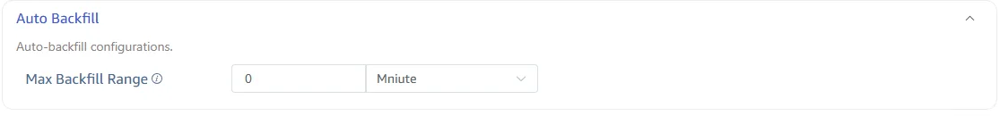

This page describes how to use PI real-time tasks to continuously sync real-time data from the PI system to TDengine, covering task configuration, advanced features, best practices, and troubleshooting.

## Overview

PI real-time tasks continuously subscribe to data changes in the PI system and write newly generated data to TDengine in real time. Typical use cases include:

- **Real-time monitoring**: Sync PI real-time data to TDengine to build real-time dashboards leveraging TDengine's high-performance query capabilities
- **Dual-write transition**: Run both systems in parallel during migration from PI to TDengine
- **Data aggregation**: Aggregate real-time data from multiple PI systems into a unified TDengine cluster

## Creating a PI Real-time Task

### Basic Steps

1. On the Data In page in taosExplorer, click **+Add Data Source**
2. In the **Type** dropdown, select **PI**
3. Configure connection information (see [PI](./index.md))
4. Configure data model (single/multi-column, see [Model Configuration Reference](./03-csv-reference.md))
5. Enable **Auto Sync New Points** as needed and ensure the saved filters include the objects to be added later (see below)
6. Configure restart compensation time and other advanced options
7. Submit the task

### Restart Compensation Time

**Restart compensation time** is a key parameter for PI real-time tasks. When a task is unexpectedly interrupted and restarted, taosX will automatically backfill data from the interruption time to the current time.

| Parameter | Description |
| --------- | ----------- |
| Restart Compensation Time | Sets the maximum time window for automatic backfill after restart |

**Configuration recommendations**:

- Set based on the maximum data loss duration you can tolerate
- For example, if set to 1 hour and the task was interrupted for 30 minutes before restart, taosX will backfill the 30 minutes of data
- If the interruption duration exceeds the compensation time setting, the excess data needs to be manually recovered through a PI backfill task

## Data Sync Behavior

### Single-column Model

- Subscribes to value changes for each PI Point
- When a PI Point's value changes, the new value is written to the corresponding TDengine subtable
- Each PI Point corresponds to one subtable

### Multi-column Model

- Subscribes to PI Point attribute changes for all elements under an AF template
- When a PI Point attribute value of an element changes, the corresponding column in the corresponding subtable is updated
- Each AF element corresponds to one subtable

## Auto Sync New Points

For PI real-time tasks with saved point or AF filters that can be scanned again, enable **Auto Sync New Points** under **Advanced Options**. While the task runs, taosX periodically applies the original rules and adds new matching objects to collection. You do not need to download or upload the initial CSV again or restart the task.

| Scenario | Automatic enrollment |
| --- | --- |
| PI Data Archive Only, filtered by Point name | A new Point whose name matches the saved wildcard is subscribed, with a corresponding target subtable |
| New PI Point attributes on an existing AF template | New attributes are enrolled when the template is already in the task's collection scope; the multi-column model also adds the required columns to its supertable |
| AF Element name or path filter without a template list | New matching elements and their PI Point attributes are enrolled |

See [Dataset Filter Configuration](./07-dataset-filter.md) for filter syntax. Fixed Point lists and fixed CSV configurations without reusable discovery rules do not support automatic enrollment.

### Configuration and Scope

- New rule-based real-time tasks created in the UI keep this option disabled by default; enable it when needed. Editing or copying an existing task preserves its saved value; an older task without the field treats it as disabled. API clients must explicitly set `auto_sync_new_points=true`; omitting it means disabled.
- PI scans every 60 seconds by default. Enrollment also requires schema, model, and subscription processing, so a new object is not enrolled immediately.
- Only real-time data produced after a new object joins collection is collected. Its existing history is not backfilled automatically. Initial enrollment and restart compensation are separate behaviors; use [Historical Data Backfill Guide](./04-backfill-guide.md) when history is required.
- Existing points continue collecting during enrollment. Repeated scans do not duplicate subscriptions or subtables. Objects that do not match the original rules are excluded.
- This feature only adds collection objects. A type change or disappearance from scan results does not automatically alter the existing target schema, delete a subtable, or stop collection.
- An object is not enrolled if its target schema is incompatible or a different point maps to the same write location. Check task logs and adjust the mapping.

### Interaction with Existing Element Sync Options

**Auto Sync New Points** is mutually exclusive with the existing **Sync New Elements** and **Sync Delete Elements** options. Enabling it turns off and disables both older options in the UI. An API request that enables conflicting options is rejected. Tasks that must delete target subtables when source elements are deleted should disable Auto Sync New Points and use the existing element sync options.

Both local and taosX-Agent proxy modes support this feature. Use matching taosX, taosX-Agent, and PI connector versions. See [Failover](./08-failover.md) for the distinction between local restart recovery and migration to another node.

## Multi-column Model Advanced Features

The following advanced options are only available when using **multi-column model real-time tasks**.

### Sync New Elements

| Option | Default | Description |
| ------ | ------- | ----------- |
| Sync New Elements | Enabled | When enabled, the PI connector monitors newly added elements under templates and automatically syncs their data |

This option belongs to the existing element listener mode and is available only when **Auto Sync New Points** is disabled.

**Use case**: When new devices/assets are continuously being added under AF templates in the PI system, no need to manually restart the task or modify configuration.

### Sync Static Attribute Changes

| Option | Default | Description |
| ------ | ------- | ----------- |
| Sync Static Attribute Changes | Enabled | When enabled, changes to non-PI Point attributes (static attributes) are synced to TDengine TAGs |

**Use case**: When static attributes of AF elements such as description, category, location, etc. may be modified, this keeps TDengine TAGs consistent with PI AF.

### Sync Delete Elements

| Option | Default | Description |
| ------ | ------- | ----------- |
| Sync Delete Elements | Enabled | When enabled, the PI connector monitors element deletion events under templates and deletes the corresponding TDengine subtables |

:::warning
When this option is enabled, deleting an element in PI will cause the corresponding subtable in TDengine to be deleted, and **data cannot be recovered**. Use with caution.
:::

### Sync Delete Historical Data

| Option | Default | Description |
| ------ | ------- | ----------- |
| Sync Delete Historical Data | Enabled | When enabled, when data at a specific timestamp is deleted in PI, the corresponding column values in TDengine are set to null |

### Sync Modify Historical Data

| Option | Default | Description |
| ------ | ------- | ----------- |
| Sync Modify Historical Data | Enabled | When enabled, when historical data is modified in PI, the corresponding data in TDengine is also updated |

**Use case**: PI systems may have data correction operations (e.g., manually modifying anomalous values); enabling this option keeps TDengine data consistent with PI.

## Best Practices

### High Availability Deployment

- Recommend using taosX-Agent proxy mode deployment (see [Deployment Architecture](./02-deployment-architecture.md)) to separate the connector from taosX
- Configure a reasonable restart compensation time to ensure no data loss after task restart
- Monitor task status through taosExplorer to detect anomalies promptly

### Performance Tuning

| Tuning Item | Recommendation |
| ----------- | -------------- |
| Batch Size | Adjust based on data density; increase appropriately when there are many points with high data frequency |
| Max Read Delay Per Batch | Adjust based on real-time requirements |
| Log Level | Use `info` or `warn` in production; temporarily switch to `debug` for troubleshooting |

### Task Monitoring

Through the data source list page in taosExplorer, you can view:

- Task running status
- Data write rate
- Last sync time
- Error logs

We recommend regularly checking task status to ensure real-time sync is running normally.

## FAQ

### How to compensate for real-time task data loss?

If the real-time task interruption duration exceeds the restart compensation time setting, you can compensate through the following steps:

1. Record the time period of the task interruption
2. Create a PI backfill task with a time range covering the interruption period
3. Run the backfill task to recover data
4. After backfill is complete, the real-time task continues normal operation

### How to troubleshoot excessive real-time sync latency?

1. **Network latency**: Check the network latency from taosX/taosX-Agent to the PI system
2. **PI system load**: Check the PI Data Archive load
3. **TDengine write bottleneck**: Check the TDengine cluster write performance
4. **Batch size too large**: Reduce the batch size appropriately to lower per-batch processing latency
5. **Log troubleshooting**: Set the log level to `debug` to view detailed processing times

### Do I need to restart the task after adding new points?

- With **Auto Sync New Points** enabled, both models enroll new objects that match the saved rules while the task runs. No restart or initial CSV update is required. The multi-column model also adds columns for new PI Point attributes on an existing template.
- Without this option, the existing **Sync New Elements** option handles only the template element additions supported by that mode.
- Fixed lists, fixed CSV configurations, or objects outside the saved filters require a manual task configuration change. Automatic enrollment does not expand the filter scope.

### Multi-column model TAG values not updating?

Confirm whether the **Sync Static Attribute Changes** option is enabled. If not enabled, TAG values are written only once when the subtable is created and will not be updated afterward.
