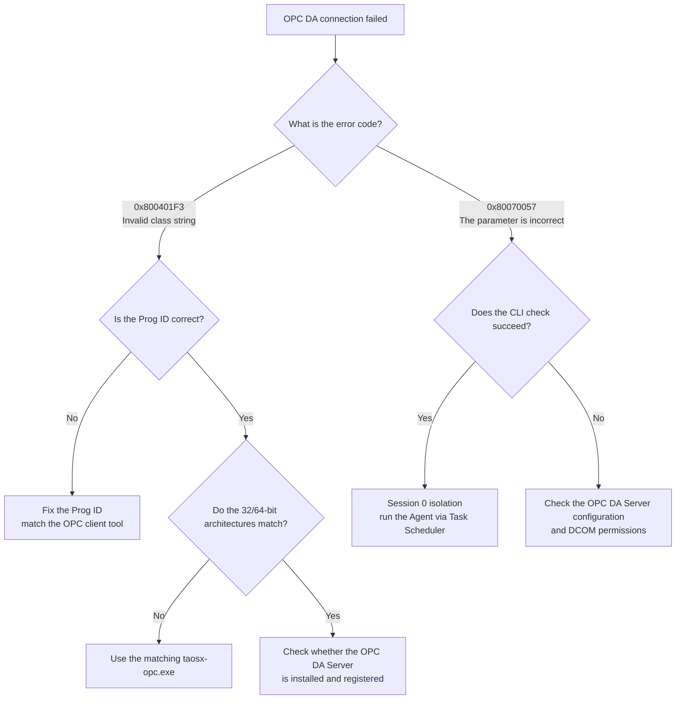

When using `taosx-opc.exe` on Windows or creating an OPC DA data source through taosExplorer, you may encounter connection failures. This page organizes common OPC DA connection errors and their solutions by error code. Before troubleshooting, confirm that the network and deployment environment in [Prerequisites](./index.md#prerequisites) are correctly configured.

## Troubleshooting Flow



## Error 1: Prog ID Error (0x800401F3)

**Error message**

```plaintext
OPC ERROR code:0x800401F3, error:Unknown error, may be system error: Invalid class string
```

**Cause**

`0x800401F3` is the Windows COM error `REGDB_E_CLASSNOTREG`, indicating that the corresponding COM class cannot be found. This is usually because the configured Prog ID is wrong.

**Troubleshooting steps**

1. Open an OPC client tool (such as Rockwell OPC Test Client or Matrikon OPC Explorer).
2. Check the name shown in the **OPC Server Prog ID** field.
3. Make sure the service address in your configuration matches that name exactly. The Prog ID is case-sensitive, and its segments are separated by spaces, not dots.

| Wrong | Correct |
| --- | --- |
| `RSLinx.OPC.Server` (dot-separated) | `RSLinx OPC Server` (space-separated) |
| `rslinx opc server` (wrong case) | `RSLinx OPC Server` (case-sensitive) |

**Solution**

Fix the OPC DA service address in the configuration file or taosExplorer so that the Prog ID exactly matches the one registered in Windows.

:::tip
You can verify the configuration on the command line before operating in taosExplorer:

```shell
C:\TDengine\plugins\opc\taosx-opc.exe check -c config.toml
```

:::

## Error 2: 32/64-bit Mismatch (0x800401F3)

**Symptom and cause**

The same `0x800401F3` occurs, but the Prog ID is confirmed correct. In this case, the bitness (32/64-bit) of `taosx-opc.exe` is usually inconsistent with the COM component registration bitness of the OPC DA Server.

**How to check**

Run the following command in PowerShell to check the bitness of `taosx-opc.exe`:

```powershell
$bytes = [System.IO.File]::ReadAllBytes("C:\TDengine\plugins\opc\taosx-opc.exe")
$peOffset = [BitConverter]::ToInt32($bytes, 0x3C)
$machine = [BitConverter]::ToUInt16($bytes, $peOffset + 4)
if ($machine -eq 0x14c) { "32-bit (x86)" }
elseif ($machine -eq 0x8664) { "64-bit (x64)" }
else { "Unknown: $machine" }
```

**Solution**

Make sure `taosx-opc.exe` matches the COM registration bitness of the OPC DA Server:

- If the OPC DA Server is registered only as 32-bit COM, use the 32-bit `taosx-opc.exe`.
- If the OPC DA Server is registered only as 64-bit COM, use the 64-bit `taosx-opc.exe`.

## Error 3: Connection Failure Through the Agent Service (0x80070057)

**Error message**

```plaintext
OPC ERROR code:0x80070057, error:Unknown error, may be system error: The parameter is incorrect.
```

**Typical scenario**

- Running `taosx-opc.exe check` directly on the command line succeeds.
- The connectivity check through taosExplorer with an Agent proxy fails.

**Cause**

Windows services run in Session 0 (a non-interactive session). Since Windows Vista, Session 0 has been isolated and cannot access COM objects on the interactive desktop. OPC DA is based on DCOM and usually does not work in Session 0.

:::note
Even if "Allow service to interact with the desktop" is checked in the service properties, this option no longer actually takes effect on Windows Vista and later because of Session 0 isolation.
:::

**How to verify**

1. Stop the taosX-Agent service.
2. Run the Agent directly in PowerShell (keep the window open):

```powershell
Stop-Service -Name taosx-agent
cd C:\TDengine
.\taosx-agent.exe
```

3. Go back to taosExplorer and test connectivity.
4. If the connection succeeds now, the problem is confirmed to be Session 0 isolation.

**Solution: Run the Agent with Task Scheduler**

Run the Agent through Windows Task Scheduler so that it runs in the user's interactive session, which works the same as starting it manually in PowerShell and can access OPC DA's DCOM objects normally.

Step 1: Disable the Agent service.

```powershell
Stop-Service -Name taosx-agent
Set-Service -Name taosx-agent -StartupType Disabled
```

Step 2: Create a scheduled task. Open Task Scheduler (`taskschd.msc`), click **Create Task** on the right, and configure it as follows:

| Tab | Setting | Value |
| --- | --- | --- |
| General | Name | `taosX Agent` |
| General | Security options | Run only when user is logged on |
| Triggers | Begin the task | At log on |
| Actions | Program/script | `C:\TDengine\taosx-agent.exe` |
| Actions | Start in (optional) | `C:\TDengine` |
| Settings | Stop the task if it runs longer than | Unchecked |

Step 3: Run and verify.

1. Right-click the scheduled task and select **Run**.
2. Go back to taosExplorer and test the OPC DA connectivity to confirm the connection succeeds.

## Error 4: Server Execution Failed (0x80080005)

**Error message**

```plaintext
OPC ERROR code:0x80080005, error:Unknown error, may be system error: Server execution failed
```

**Possible causes**

The OPC DA server failed to start, or the taosX-Agent service account lacks the required COM/DCOM launch, activation, or access permissions.

**Solution**

First, confirm that the OPC DA server has started successfully. On the Windows host running taosX-Agent, open PowerShell as administrator and stop the Agent service:

```powershell
Stop-Service -Name taosx-agent -ErrorAction Stop
(Get-Service -Name taosx-agent).WaitForStatus('Stopped', '00:00:30')
Get-Process -Name taosx-agent,taosx-agent-srv -ErrorAction SilentlyContinue
```

Once these processes have exited, start the Agent in the foreground using the current Windows login account. Adjust the paths to match your installation:

```powershell
$env:PLUGINS_HOME = 'C:\TDengine\plugins'
$env:LOGS_HOME = 'C:\TDengine\log'
& 'C:\TDengine\taosx-agent.exe' --config 'C:\TDengine\cfg\agent.toml'
```

Keep the window open and repeat the connectivity check in taosExplorer with the same agent and OPC configuration. If the check succeeds in the foreground but fails when the service is restored, check the service account and COM/DCOM permissions. In `services.msc`, open the service properties and use the **Log On** tab to replace the default `LocalSystem` account with the account verified in the foreground, enter its valid password, and restart the service to retest. Before restoring the service, press Ctrl+C to exit the foreground Agent so that two instances do not run simultaneously. If the foreground check also fails, investigate the OPC DA server startup status and Windows event logs.

:::note
If the foreground check succeeds, the problem lies in the service runtime environment (such as Session 0 isolation or service account permissions). To run the Agent stably in an interactive session long-term, deploy it with Task Scheduler as described in [Error 3](#error-3-connection-failure-through-the-agent-service-0x80070057).
:::

## Related Documents

- [OPC DA](./index.md): complete steps for creating an OPC DA data ingestion task
- [Data Ingestion Prerequisites](../00-prerequisites.md): network topology, port allowance, and verification
- [Install taosX-Agent](../01-install-agent.md): download, install, and bring the agent online
