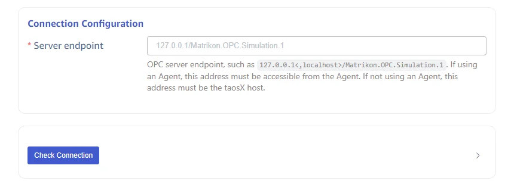
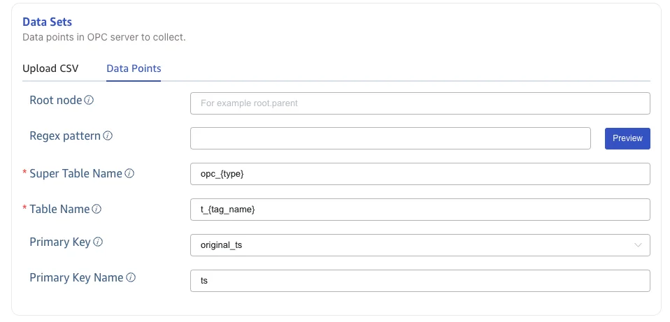
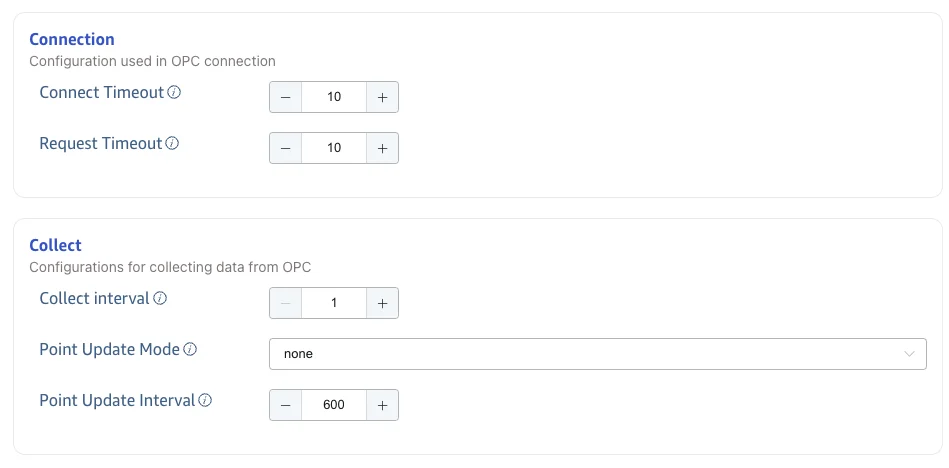
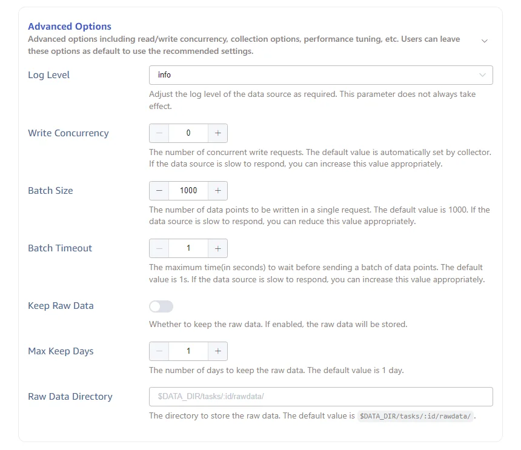
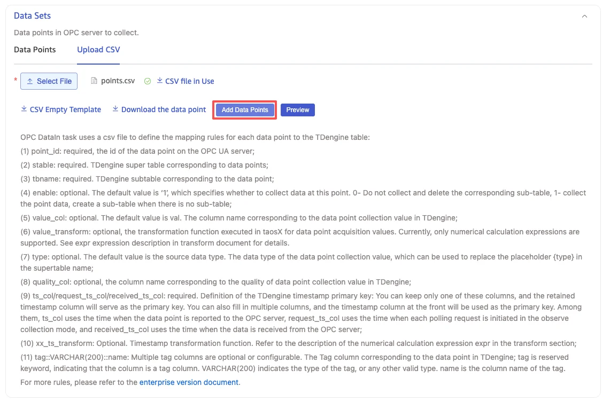
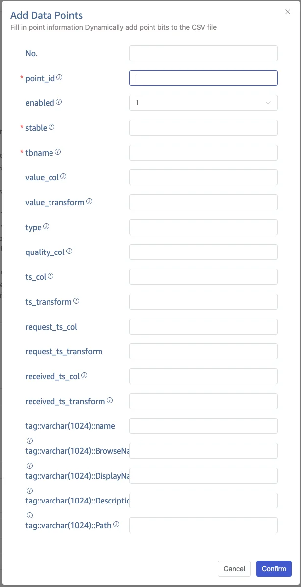

import { AddDataSource, Enterprise } from '../../resources/_resources.mdx';

<Enterprise/>

This section describes how to create data migration tasks through the taosExplorer interface, synchronizing data from an OPC-DA server to the current TDengine cluster.

## Overview

OPC is one of the interoperability standards for secure and reliable data exchange in the field of industrial automation and other industries.

OPC DA (Data Access) is a classic COM-based specification, only applicable to Windows. Although OPC DA is not the latest and most efficient data communication specification, it is widely used. This is mainly because some old equipment only supports OPC DA.

TDengine can efficiently read data from OPC-DA servers and write it to TDengine, achieving real-time data storage.

## Prerequisites

Before starting, confirm that the [data ingestion prerequisites](../00-prerequisites.md) are met. Key points for OPC DA:

- **Deployment environment**: OPC DA communicates over Windows COM/DCOM, so the connector can only run on a Windows host. taosX or taosX-Agent must be deployed on a Windows host that can reach the OPC DA server. If taosX runs on Linux or outside the data source network, you must deploy a taosX-Agent on a Windows host as a proxy.
- **Network connectivity**: When using a taosX-Agent proxy, both the taosX-Agent → taosX (gRPC, default port `6055`) and taosX-Agent → OPC DA server segments must be connected. See [Verify Port Connectivity](../00-prerequisites.md#verify-port-connectivity) for how to allow and verify both segments.
- **COM/DCOM permissions**: The Agent service account needs COM/DCOM launch, activation, and access permissions on the OPC DA server. For common connection errors and troubleshooting, see [Connection Troubleshooting](./02-troubleshooting.md).

## Procedure

### Add a Data Source

<AddDataSource connectorName="OPC DA"/>

### Configure Connection Information

Fill in the **OPC-DA Service Address** (the OPC Server's Prog ID, such as `Matrikon.OPC.Simulation.1`) in the **Connection Configuration** area, for example: `127.0.0.1/Matrikon.OPC.Simulation.1`, and configure the authentication method.

Click the **Connectivity Check** button to check if the data source is available. If the connection fails, follow [Connection Troubleshooting](./02-troubleshooting.md) for the corresponding error code.

### Configure Points Set

**Points Set** can choose between a CSV file template or **Select All Points**; the two modes are mutually exclusive.

#### Upload CSV Configuration File

You can download the CSV blank template and configure the point information according to the template, then upload the CSV configuration file to configure the points; or download the data points according to the configured filter conditions, and download them in the format specified by the CSV template.

Core rules of the CSV file:

- **File encoding**: must be UTF-8 (with or without BOM).
- **Header**: the first line; includes columns such as `tag_name`, `stable`, and `tbname`; `tag_name` is unique within the task.
- **Row**: each row configures one OPC data point.

For the complete column definitions, value rules, and validation requirements, see [CSV Configuration File Reference](./01-csv-reference.md).

#### Selecting Data Points

Data points can be filtered by configuring the **Root Node ID** and **Regular Expression**.

Configure **Supertable Name** and **Table Name** to specify the supertable and subtable where the data will be written.

Configure **Primary Key Column**: select `origin_ts` to use the original timestamp of the OPC data point as the primary key in TDengine; select `request_ts` to use the request timestamp; select `received_ts` to use the received timestamp. Configure **Primary Key Alias** to specify the name of the TDengine timestamp column.

### Collection Configuration

Configure the collection interval, connection timeout, and collection timeout for the task.

- **Connection Timeout**: the timeout for connecting to the OPC server, 10 seconds by default.
- **Collection Timeout**: if no data is returned within the configured time when reading point data from the OPC server, the read fails, 10 seconds by default.
- **Collection Interval**: 10 seconds by default. The interval is counted from the end of the last collection, polling the latest value of each point and writing it to TDengine.

:::note

- The collection interval is a task-level parameter: all points in the same OPC DA Data In task share one collection interval; different scan frequencies per point or point group are not supported within one task.
- If a few points need a higher or lower collection frequency, move them to another OPC DA task (which can point to the same OPC server and the same target database) and set the collection interval for that task.
- To adjust collection parameters such as the collection interval and timeouts, edit and submit the task in taosExplorer. You do not need to reinstall or redeploy taosX-Agent on the OPC server host.

:::

When **Selecting Data Points** is used in **Points Set**, you can configure **Point Update Mode** and **Point Update Interval** in the collection configuration to enable dynamic point updates. **Dynamic point updates** mean that during task runtime, points added to or removed from the OPC server are automatically added to or removed from the current task without restarting it.

- Point update mode: `None`, `Append`, or `Update`.
  - None: dynamic point updates disabled.
  - Append: dynamic point updates enabled, append only.
  - Update: dynamic point updates enabled, append or remove.
- Point update interval: effective when the **Point Update Mode** is `Append` or `Update`. Unit: seconds. Default: 600, minimum: 60, maximum: 2147483647.

### Advanced Options

**Log Level** defaults to `info`; available options are `error`, `warn`, `info`, `debug`, and `trace`.

**Max Write Concurrency** limits the maximum concurrency for writing to taosX. Default: 0, meaning auto.

**Batch Size** sets the number of messages sent in a single batch.

**Batch Delay** sets the maximum delay in seconds for a single send. When the timeout ends, data is sent immediately even if the **Batch Size** is not met.

When **Cache Realtime Data** is enabled, data consumed from OPC DA is first written to a local file; a background task continuously reads from the file and sends data to the downstream consumer. This is intended for traffic shaping when the data rate is high enough that downstream cannot keep up and would otherwise drop messages. Once the backlog is consumed, the file is cleaned up automatically. Disabled by default. For detailed information about this feature, see [Store and Forward](../../../12-operations-and-tooling/03-components/07-taosx-agent/02-store-and-forward.md).

**Cache Data Storage Directory** sets the storage directory for cached data. It defaults to the data directory configured when taosX starts; a custom directory is also allowed. This option is effective only when **Cache Realtime Data** is enabled.

**Save Raw Data** selects whether to save raw data. Default: No.

When raw data is saved, the following two parameters take effect.

**Max Retention Days** sets the maximum retention days for raw data.

**Raw Data Storage Directory** sets the storage path for raw data. If using Agent, the storage path refers to the path on the server where Agent is located; otherwise it is on the taosX server. The path can include placeholders `$DATA_DIR` and `:id` as part of the path.

- Linux: `$DATA_DIR` is `/var/lib/taos/taosx`; the default storage path is `/var/lib/taos/taosx/tasks/<task_id>/rawdata`.
- Windows: `$DATA_DIR` is `C:\TDengine\data\taosx`; the default storage path is `C:\TDengine\data\taosx\tasks\<task_id>\rawdata`.

### Completion

Click **Submit** to complete the creation of the data synchronization task from OPC DA to TDengine, and return to the **Data Source List** page to view the task execution status.

## Add Data Points

While the task is running, click **Edit** and then **Add Data Point** to append a data point to the CSV file. This applies to scenarios where only a few points need to be added and a full re-import of the point table is unnecessary.

Fill in the data point information in the pop-up form.

Click **OK** to complete the addition.

## Point and Metadata Maintenance

### Modify Existing Point Mapping or Enable State

- **Point tags / industrial metadata**: for maintenance of operations-oriented tags and attributes such as description, engineering unit, range, and source path, TDengine IDMP is recommended. IDMP provides asset tree and attribute management, which is better suited for partial batch point changes and per-device metadata maintenance without repeatedly exporting/re-importing the full OPC point table. See the [TDengine IDMP documentation](https://idmpdocs.taosdata.com/). If IDMP is not used and metadata has been stored as TAGs in the database, use the SQL [`ALTER TABLE ... SET TAG`](../../../05-tdengine-sql/02-ddl/02-table.md#modify-subtable-tag-value) to update them, which supports [batch modification](../../../05-tdengine-sql/02-ddl/02-table.md#batch-modify-subtable-tag-value).
- **Enable / disable collection**: adjust `enable` in the corresponding CSV row (`1` to collect, `0` not to collect) and re-upload the task CSV to take effect. When `enable=0`, the subtable corresponding to the point in TDengine is deleted before the task starts (see [CSV Configuration File Reference](./01-csv-reference.md)).
- **Change ingest mapping columns** (such as `stable`, `tbname`, `value_col`, `value_transform`): download the current point CSV, edit the needed rows, and re-upload. You do not need to rebuild the Agent for a few mapping changes; the task stays bound to the same agent.

### CSV Metadata and Fields Stored in TDengine

What OPC DA writes into TDengine is determined by the CSV / point form configuration; unlike OPC UA, it does not automatically import server Item attributes such as Description, Engineering Unit, or Hi/Lo range as TAGs.

| Source | Content That Can Be Written / Affects TDengine |
| --- | --- |
| CSV required / common columns | `tag_name` (OPC point id), `stable`, `tbname`, value column, timestamp columns, etc. |
| CSV `enable` | Whether to collect the point; disabling can delete the corresponding subtable |
| CSV `value_transform` | Rhai expression transform (unit conversion, etc.) applied to the value before writing; the result is still written to the value column |
| CSV `tag::TYPE::name` | Custom TAGs; you can manually fill in fields from the vendor dump such as description, engineering unit, range, and source path |
| Default TAGs | If no tag column is configured and the supertable does not exist, `point_id` and `point_name` are added automatically |

If the vendor provides a dump with fields such as description, unit, and range, the recommended workflow is: organize the points with the CSV template → write description/unit/range into custom `tag::...` columns → upload to create the task. After points are ingested, daily maintenance of tags and industrial metadata is recommended in IDMP; when IDMP is not used, use SQL `SET TAG` to adjust stored TAGs.

For OPC UA's automatic mapping of BrowseName / Description / Path and Property→TAG, see [OPC UA](../05-opcua/index.md) and [OPC UA CSV Mapping Reference](../05-opcua/02-csv-reference.md).

## Task Changes and the Agent

Install the Agent once near the OPC server and keep it running. After that, create, edit, start/stop Data In tasks, adjust collection settings, and append or update the point CSV in taosExplorer (or via [Data Ingestion (Xnode)](../../../05-tdengine-sql/08-cluster-management/02-xnode.md) SQL). In general you do not need to repackage or reinstall the Agent when points change.

You only need to change the Agent host configuration or reinstall when replacing `endpoint` / `token`, upgrading the Agent, or changing host-local options such as store-and-forward directories. Installation steps: [Install taosX-Agent](../01-install-agent.md).

## Frequently Asked Questions

For OPC DA connection failures (Prog ID errors, 32/64-bit mismatch, Session 0 isolation, DCOM permissions, etc.), see [Connection Troubleshooting](./02-troubleshooting.md).

## Related Documents

- [Data Ingestion Prerequisites](../00-prerequisites.md): direct/agent topology and network port requirements
- [CSV Configuration File Reference](./01-csv-reference.md): complete column definitions and rules for the point mapping CSV
- [Connection Troubleshooting](./02-troubleshooting.md): locate and resolve connection failures by error code
- [Install taosX-Agent](../01-install-agent.md): remote agent install and connectivity
- [OPC UA](../05-opcua/index.md): UA point metadata auto-mapping and collection modes
- [TDengine IDMP](../../../19-tdengine-idmp/index.md): point tags and industrial metadata management (recommended)
- [Data Ingestion (Xnode)](../../../05-tdengine-sql/08-cluster-management/02-xnode.md): manage ingest nodes, tasks, and agents with SQL
- [Modify Subtable Tag Value](../../../05-tdengine-sql/02-ddl/02-table.md#modify-subtable-tag-value): batch-update stored TAGs when IDMP is not used
