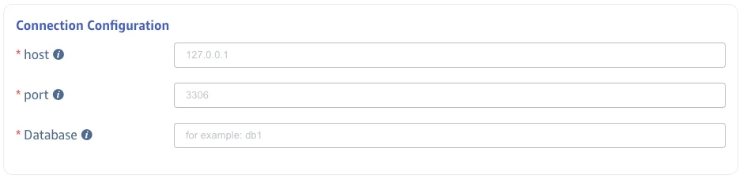
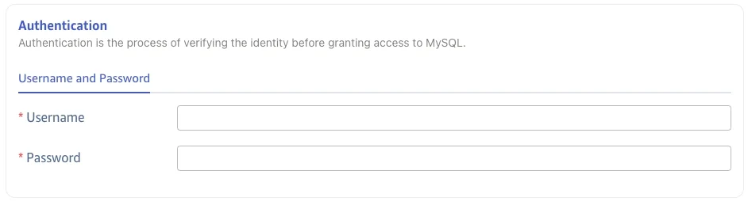
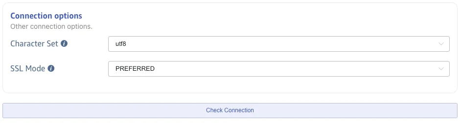
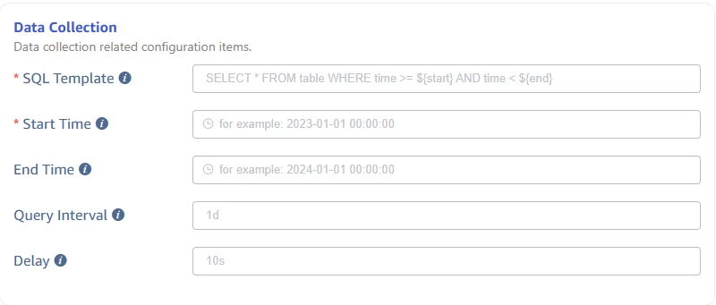
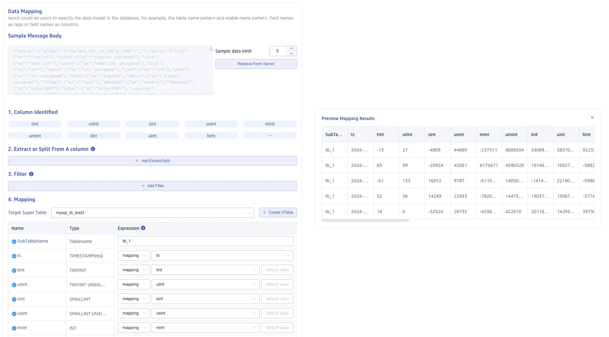
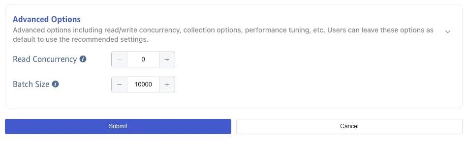

import { AddDataSource, Enterprise } from '../resources/_resources.mdx';

<Enterprise/>

This section describes how to create data migration tasks through the taosExplorer interface, migrating data from MySQL to the current TDengine cluster.

## Overview

MySQL is one of the most popular relational databases. Many systems have used or are using MySQL databases to store data reported by IoT and industrial internet devices. However, as the number of devices in the access systems grows and the demand for real-time data feedback from users increases, MySQL can no longer meet business needs. TDengine TSDB Enterprise can efficiently read data from MySQL and write it into TDengine, achieving historical data migration or real-time data synchronization, and solving the technical pain points faced by businesses. The MySQL data source also supports scheduled window synchronization and data verification.

For synchronization modes, field mapping, type conversion, transaction consistency, and data verification, see [Relational Database Integration](./23-rdb-integration.md).

## Procedure

### Add a Data Source

<AddDataSource connectorName="MySQL"/>

### Configure Connection Information

Fill in the *`connection information for the source MySQL database`* in the **Connection Configuration** area, as shown below:

### Configure Authentication Information

**User** Enter the user of the source MySQL database, who must have read permissions in the organization.

**Password** Enter the login password for the user mentioned above in the source MySQL database.

### Configure Connection Options

**Character Set** Set the character set for the connection. The default character set is utf8mb4. MySQL 5.5.3 supports this feature. If connecting to an older version, it is recommended to change to utf8.
Options include utf8, utf8mb4, utf16, utf32, gbk, big5, latin1, ascii.

**Pipes as Concatenation** (`pipes_as_concat`) controls whether `PIPES_AS_CONCAT` is added to the SQL mode for this connection. When enabled, `||` concatenates strings. When disabled, this mode is not added, but any mode already present in the server session remains; the actual meaning of `||` depends on the final session SQL mode. This option is enabled by default to preserve the behavior of existing MySQL ingestion tasks. Changing it can change the results of existing SQL queries.

**No Engine Substitution** (`no_engine_substitution`) controls whether `NO_ENGINE_SUBSTITUTION` is added to the SQL mode for this connection, preventing MySQL from substituting a storage engine when the requested engine is unavailable. Disabling this option does not remove the mode if it is already present in the server session. This option is enabled by default.

Apache Doris provides a MySQL-compatible endpoint, which taosX connects to using the MySQL driver. By default, the driver adds `PIPES_AS_CONCAT` and `NO_ENGINE_SUBSTITUTION` to the session SQL mode during connection initialization. Doris does not support these modes, so the connection fails before any synchronization query runs. To synchronize Doris data, turn **both options off** (`false`) so the driver does not add these modes, then click **Check Connectivity**. Set these options for other MySQL-compatible databases according to their compatibility requirements, and avoid changing them on existing tasks without checking their queries.

**SSL Mode** Set whether to negotiate a secure SSL TCP/IP connection with the server or the priority of negotiation. The default value is PREFERRED. Options include DISABLED, PREFERRED, REQUIRED.

Then click the **Check Connectivity** button, where users can click this button to check if the information filled in above can normally fetch data from the source MySQL database.

### Configure SQL Query

**Subtable Field** is used to split subtables, it is a select distinct SQL statement that queries non-repeated items of specified field combinations, usually corresponding to the tag in transform:
> This configuration is mainly to solve the problem of data migration disorder, and it needs to be used together with **SQL Template**, otherwise it cannot achieve the expected effect, usage examples are as follows:
>
> 1. Fill in the subtable field statement `select distinct col_name1, col_name2 from table`, which means using the fields col_name1 and col_name2 in the source table to split the subtables of the target supertable
> 2. Add subtable field placeholders in the **SQL Template**, for example `${col_name1} and ${col_name2}` in `select * from table where ts >= ${start} and ts < ${end} and ${col_name1} and ${col_name2}`. At runtime, each placeholder expands to an equality predicate (such as `col_name1='deviceA'` or `col_name2=1`), not a bare column name
> 3. Configure `col_name1` and `col_name2` two tag mappings in **transform**

**SQL Template** is the SQL statement template used for querying, the SQL statement must include time range conditions, and the start and end times must appear in pairs. The time range defined in the SQL statement template consists of a column representing time in the source database and the placeholders defined below.
> SQL uses different placeholders to represent different time format requirements, specifically the following placeholder formats:
>
> 1. `${start}`, `${end}`: Generate MySQL expressions, e.g.: `STR_TO_DATE('2024-03-14 08:00:00','%Y-%m-%d %H:%i:%s')`
> 2. `${start_no_tz}`, `${end_no_tz}`: Generate the same expressions as `${start}`, `${end}`, e.g.: `STR_TO_DATE('2024-03-14 08:00:00','%Y-%m-%d %H:%i:%s')`
> 3. `${start_date}`, `${end_date}`: Represents date only, e.g.: `STR_TO_DATE('2024-03-14','%Y-%m-%d')`
>
> These examples are for a window starting at 2024-03-14T00:00:00Z with the task time zone `+08:00`: the placeholders use the wall-clock time of the window bounds in the task time zone, with second precision. taosX sets the MySQL session `time_zone` to the task time zone, so `TIMESTAMP` columns are compared as absolute instants and `DATETIME` columns are compared as wall-clock time in the task time zone.
>
> To solve the problem of data migration disorder, it is advisable to add sorting conditions in the query statement, such as `order by ts asc`.

**Start Time** The start time for migrating data, this field is required.

**End Time** The end time for migrating data, which can be left blank. If set, the migration task will stop automatically after reaching the end time; if left blank, it will continuously synchronize real-time data and the task will not stop automatically.

Start Time and End Time are absolute instants with a UTC offset; the task time zone does not change the instants they denote. The task time zone is set by the task parameter `time_zone`, which has no field in taosExplorer. If it is not set, the UTC offset of Start Time is used, which is the taosExplorer page time zone in effect when Start Time was set. When you edit an existing task without changing Start Time, the start and end times and the task time zone stay unchanged. `time_zone` accepts only a fixed UTC offset such as `+08:00` or `+0800`, or `UTC` or `Z`. IANA names such as `Asia/Shanghai` are not supported. The offset becomes the MySQL session time zone, so it must be within the range MySQL accepts: `-13:59` to `+14:00` on MySQL 8.0.19 and later, `-12:59` to `+13:00` on earlier versions (taosX checks the former). An invalid value is reported as an error when the task starts or data is previewed. The offset is fixed for the whole task and does not follow daylight saving time. The task time zone determines the values of the time placeholders and how query windows are cut: each query window is at most one Query Interval long and never crosses midnight in the task time zone, so an interval longer than 1 day behaves like 1 day. To use a UTC task time zone, switch the taosExplorer page time zone to UTC before setting Start Time, or set `time_zone=UTC` through the API or CLI. See [Time and Time Zone](./23-rdb-integration.md#time-and-time-zone).

**Query Interval** The time interval for querying data in segments, default is 1 day. To avoid querying a large amount of data at once, a data synchronization sub-task will use the query interval to segment the data retrieval.

**Delay Duration** In real-time data synchronization scenarios, to avoid losing data due to delayed writes, taosX reads only data up to the current time minus the delay duration. When no end time is set or the end time is in the future, the historical part is read up to that point. After that, taosX checks about once per second and reads from the last checkpoint up to the current time minus the delay once that range exceeds 10 seconds (the default of the task parameter `live_sync_min_window`). Query Interval only splits this range into query windows; it does not schedule the queries. For example, with a delay of 60 seconds, a query run at 09:01 reads only data before 09:00. In scheduled window synchronization, the delay sets the safe watermark: the current time minus the delay.

**Schedule** Choose **Continuous Synchronization** or **Scheduled Window Synchronization**. In scheduled mode, set the first scheduled time and a fixed interval in minutes, or set a five-field minute-level Cron expression, and limit each trigger with **Maximum Windows per Run**. Scheduling uses the current time zone of the taosExplorer page. Completed windows save a checkpoint. Windows not finished in one run continue on the next trigger. After a failed run, the next trigger retries from the unconfirmed window. See [Oracle · Scheduled Window Example](./15-oracle.md#scheduled-window-example).

The combination of start time, end time, and schedule selects the synchronization mode. An end time with continuous synchronization is a full migration. A blank end time with continuous synchronization is incremental synchronization. Scheduled window synchronization is scheduled synchronization. See [Synchronization Modes](./23-rdb-integration.md#synchronization-modes).

### Configure Data Mapping

In the **Data Mapping** area, fill in the configuration parameters related to data mapping.

Click the **Retrieve from Server** button to fetch sample data from the MySQL server.

In **Extract or Split from Column**, fill in the fields to extract or split from the message body, for example: split the `vValue` field into `vValue_0` and `vValue_1`, select the split extractor, fill in the separator `,`, and number `2`.

In **Filter**, fill in the filtering conditions, for example: write `Value > 0`, then only data where Value is greater than 0 will be written to TDengine.

In **Mapping**, select the supertable in TDengine to map to, and the columns to map to the supertable.

Click **Preview** to view the results of the mapping.

### Configure Advanced Options

The **Advanced Options** area is collapsed by default, click the `>` on the right to expand it, as shown below:

**Maximum Read Concurrency** The limit on the number of data source connections or reading threads, modify this parameter when the default parameters do not meet the needs or when adjusting resource usage.

**Batch Size** The maximum number of messages or rows sent at once. The default is 10000.

**Data Verification** checks each window against the data written to TDengine. Choose **Off**, **Row Count**, or **Row Count and Digest**. The default is Off. You can also set **Verification Failure Policy** and **Verification Retries**. See [Relational Database Integration · Data Verification](./23-rdb-integration.md#data-verification).

### Configure Exception Handling

import ExceptionHandling from './resources/_03-exception-handling-strategy.mdx'

<ExceptionHandling />

### Completion

Click the **Submit** button to complete the creation of the data synchronization task from MySQL to TDengine, and return to the **Data Source List** page to view the task execution status.
