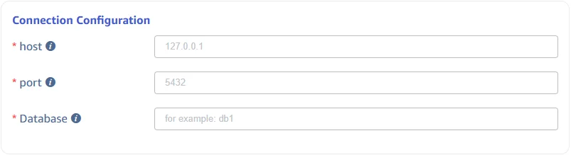
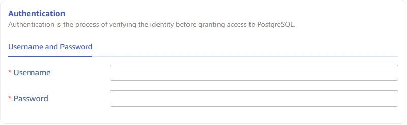
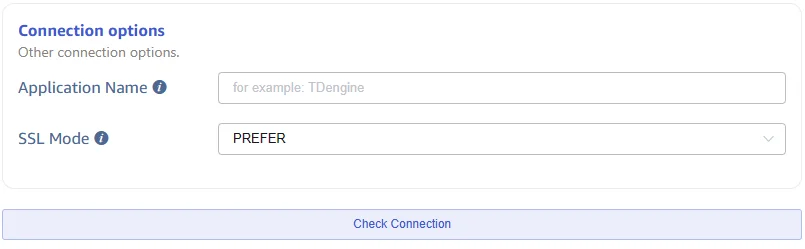
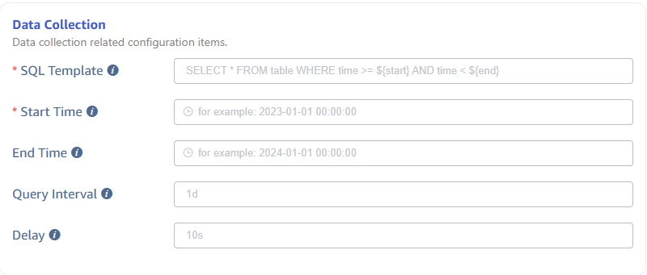
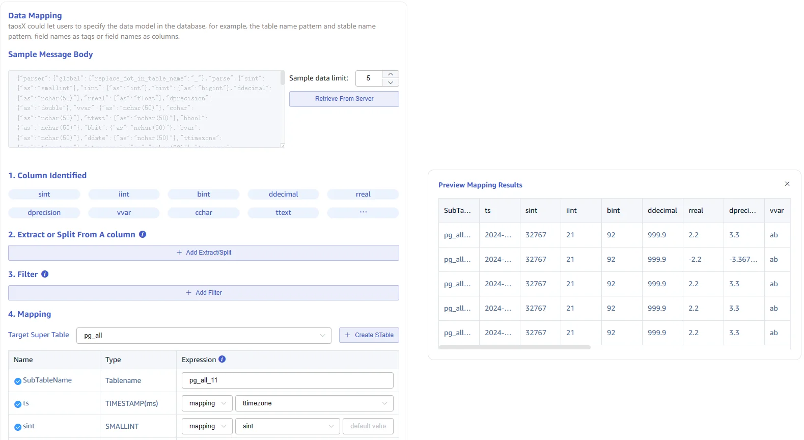
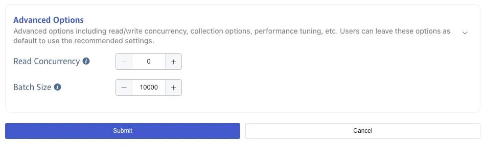

import { AddDataSource, Enterprise } from '../resources/_resources.mdx';

<Enterprise/>

This section describes how to create a data migration task through the taosExplorer interface to migrate data from PostgreSql to the current TDengine cluster.

## Feature Overview

PostgreSQL is a very powerful, open-source client/server relational database management system with many features found in large commercial RDBMSs, including transactions, subselects, triggers, views, foreign key referential integrity, and sophisticated locking capabilities.

TDengine can efficiently read data from PostgreSQL and write it to TDengine, enabling historical data migration or real-time data synchronization.

## Procedure

### Add a Data Source

<AddDataSource connectorName="PostgreSQL" />

### Configure Connection Information

Fill in the *`connection information for the source PostgreSQL database`* in the **Connection Configuration** area, as shown below:

### Configure Authentication Information

**User** Enter the user of the source PostgreSQL database, who must have read permissions in the organization.

**Password** Enter the login password for the user mentioned above in the source PostgreSQL database.

### Configure Connection Options

**Application Name** Set the application name to identify the connected application.

**SSL Mode** Set whether to negotiate a secure SSL TCP/IP connection with the server or the priority of such negotiation. The default value is PREFER. Options include DISABLE, ALLOW, PREFER, REQUIRE.

Then click the **Check Connectivity** button, where users can click this button to check if the information filled in above can normally fetch data from the source PostgreSQL database.

### Configure SQL Query

**Subtable Field** Used to split subtables, it is a select distinct SQL statement querying non-repeated items of specified field combinations, usually corresponding to the tag in transform:
> This configuration is mainly to solve the data migration disorder problem, and it needs to be used in conjunction with **SQL Template**, otherwise, it cannot achieve the expected effect, usage examples are as follows:
>
> 1. Fill in the subtable field statement `select distinct col_name1, col_name2 from table`, which means using the fields col_name1 and col_name2 in the source table to split the subtables of the target supertable
> 2. Add subtable field placeholders in the **SQL Template**, for example `${col_name1} and ${col_name2}` in `select * from table where ts >= ${start} and ts < ${end} and ${col_name1} and ${col_name2}`. At runtime, each placeholder expands to an equality predicate (such as `col_name1='deviceA'` or `col_name2=1`), not a bare column name
> 3. Configure `col_name1` and `col_name2` two tag mappings in **transform**

**SQL Template** Used for the SQL statement template for querying, the SQL statement must include time range conditions, and the start and end times must appear in pairs. The time range defined in the SQL statement template consists of a column representing time in the source database and the placeholders defined below.
> Different placeholders represent different time format requirements in SQL, specifically including the following placeholder formats:
>
> 1. `${start}`, `${end}`: Represents a time string with the task time zone offset, e.g.: `'2024-03-14 08:00:00+08:00'`
> 2. `${start_no_tz}`, `${end_no_tz}`: Represents a time string without time zone, e.g.: `'2024-03-14 08:00:00'`
> 3. `${start_date}`, `${end_date}`: Represents date only, e.g.: `'2024-03-14'`
>
> These examples are for a window starting at 2024-03-14T00:00:00Z with the task time zone `+08:00`: the placeholders use the wall-clock time of the window bounds in the task time zone, with second precision. taosX adds the quotes, so do not wrap the placeholders in quotes. taosX uses the PostgreSQL connection's default session time zone. Use `${start}`, `${end}` with `timestamp with time zone` columns, and use `${start_no_tz}`, `${end_no_tz}` only with `timestamp without time zone` columns that store wall-clock time in the task time zone.
>
> To solve the problem of data migration disorder, sorting conditions should be added to the query statement, such as `order by ts asc`.

**Start Time** The start time for migrating data, this field is required.

**End Time** The end time for migrating data, which can be left blank. If set, the migration task will stop automatically after reaching the end time; if left blank, it will continuously synchronize real-time data and the task will not stop automatically.

Start Time and End Time are absolute instants with a UTC offset; the task time zone does not change the instants they denote. The task time zone is set by the task parameter `time_zone`, which has no field in taosExplorer. If it is not set, the UTC offset of Start Time is used, which is the taosExplorer page time zone in effect when Start Time was set. When you edit an existing task without changing Start Time, the start and end times and the task time zone stay unchanged. `time_zone` accepts only a fixed UTC offset such as `+08:00` or `+0800`, or `UTC` or `Z`. IANA names such as `Asia/Shanghai` are not supported, and an invalid value is reported as an error when the task starts or data is previewed. The offset is fixed for the whole task and does not follow daylight saving time. The task time zone determines the values of the time placeholders and how query windows are cut: each query window is at most one Query Interval long and never crosses midnight in the task time zone, so an interval longer than 1 day behaves like 1 day. To use a UTC task time zone, switch the taosExplorer page time zone to UTC before setting Start Time, or set `time_zone=UTC` through the API or CLI. See [Time and Time Zone](./23-rdb-integration.md#time-and-time-zone).

**Query Interval** The time interval for querying data in segments, default is 1 day. To avoid querying a large amount of data at once, a data synchronization subtask will use the query interval to segment the data retrieval.

**Delay Duration** In real-time data synchronization scenarios, to avoid losing data due to delayed writes, taosX reads only data up to the current time minus the delay duration. When no end time is set or the end time is in the future, the historical part is read up to that point. After that, taosX checks about once per second and reads from the last checkpoint up to the current time minus the delay once that range exceeds 10 seconds (the default of the task parameter `live_sync_min_window`). Query Interval only splits this range into query windows; it does not schedule the queries. For example, with a delay of 60 seconds, a query run at 09:01 reads only data before 09:00.

### Configure Data Mapping

In the **Data Mapping** area, fill in the configuration parameters related to data mapping.

Click the **Retrieve from Server** button to fetch sample data from the PostgreSQL server.

In **Extract or Split from Column**, fill in the fields to extract or split from the message body, for example: split the `vValue` field into `vValue_0` and `vValue_1`, select the split extractor, fill in the separator `,`, and number `2`.

In **Filter**, fill in the filtering conditions, for example: write `Value > 0`, then only data where Value is greater than 0 will be written to TDengine.

In **Mapping**, select the supertable in TDengine to map to, and the columns to map to the supertable.

Click **Preview** to view the results of the mapping.

### Configure Advanced Options

The **Advanced Options** area is collapsed by default, click the `>` on the right to expand it, as shown below:

**Maximum Read Concurrency** Limit on the number of data source connections or read threads. Modify this parameter when the default parameters do not meet the needs or when adjusting resource usage.

**Batch Size** The maximum number of messages or rows sent at once. The default is 10000.

### Configure Exception Handling

import ExceptionHandling from './resources/_03-exception-handling-strategy.mdx'

<ExceptionHandling />

### Completion

Click the **Submit** button to complete the creation of the data synchronization task from PostgreSQL to TDengine. Return to the **Data Source List** page to view the status of the task execution.
