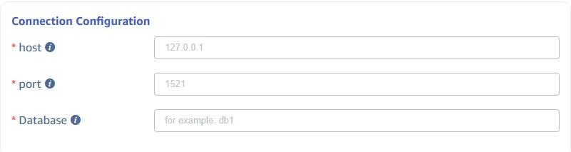
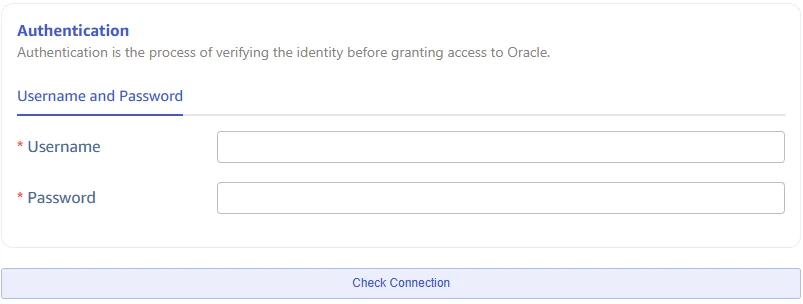
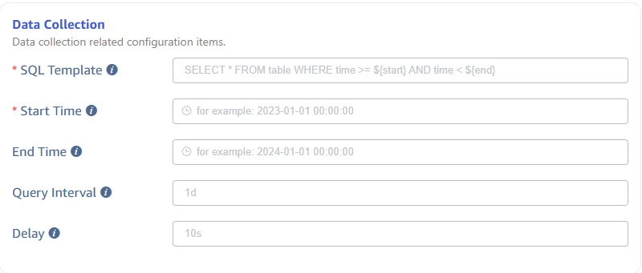
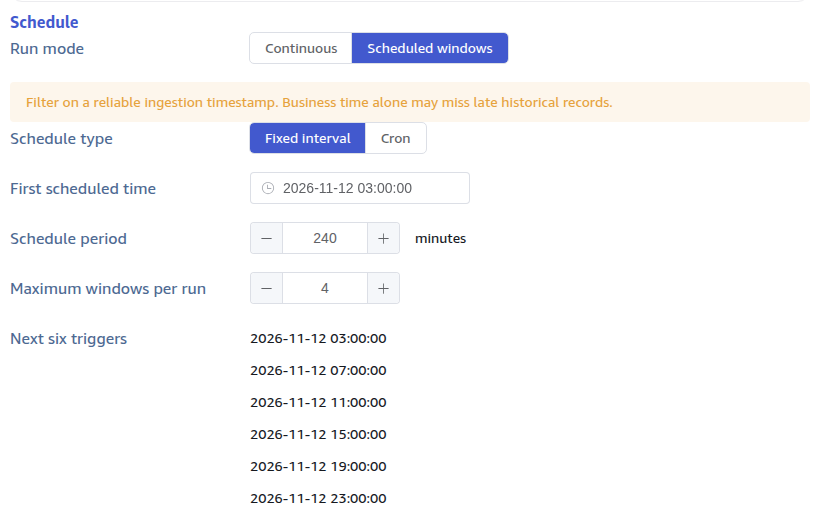
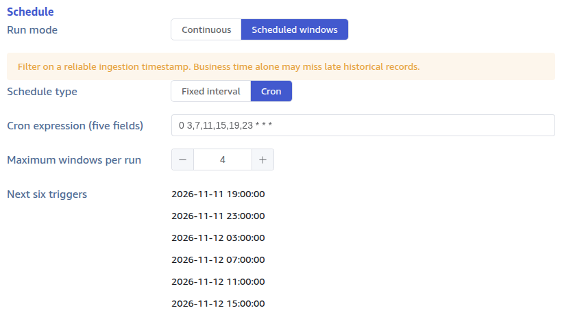
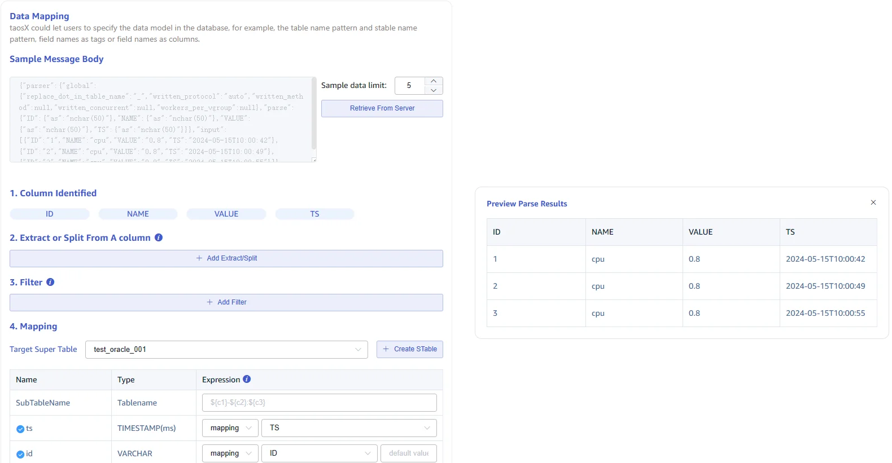
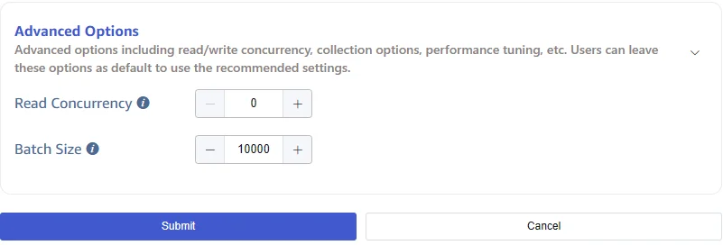

import { AddDataSource, Enterprise } from '../resources/_resources.mdx';

<Enterprise/>

This section describes how to create data migration tasks through the taosExplorer interface, migrating data from Oracle to the current TDengine cluster.

## Feature Overview

The Oracle database system is a popular relational database management system worldwide, known for its good portability, ease of use, and strong functionality, suitable for various large, medium, and small computer environments. It is an efficient, reliable, and high-throughput database solution.

TDengine can efficiently read data from Oracle and write it to TDengine, enabling historical data migration or real-time data synchronization.

taosX also supports scheduled window synchronization triggered by a fixed interval or a Cron expression. If an application loads Oracle in batches every few hours, schedule synchronization after each batch completes to reduce queries during idle periods.

Each scheduled run reads SQL windows from the last successfully saved checkpoint up to a safe watermark calculated as the current time minus the delay. Maximum Windows per Run limits Oracle queries in each run. If a long outage leaves more windows than one run can process, subsequent triggers continue from the checkpoint.

## Procedure

### Add a Data Source

<AddDataSource connectorName="Oracle" />

### Configure Connection Information

Fill in the *`connection information for the source Oracle database`* in the **Connection Configuration** area, as shown below:



### Configure Authentication Information

**User** Enter the user of the source Oracle database, who must have read permissions in the organization.

**Password** Enter the login password for the user mentioned above in the source Oracle database.



Then click the **Check Connectivity** button, where users can click this button to check if the information filled in above can normally access data from the source Oracle database.

### Configure SQL Query

**Subtable Field** is used to split the subtable field, which is a select distinct SQL statement querying non-repeated items of specified field combinations, usually corresponding to the tag in transform:
> This configuration is mainly to solve the problem of data migration disorder. It needs to be used in conjunction with **SQL Template**, otherwise, it cannot achieve the expected effect. Usage examples are as follows:
>
> 1. Fill in the subtable field statement `select distinct col_name1, col_name2 from table`, which means using the fields col_name1 and col_name2 in the source table to split the subtable of the target supertable
> 2. Add subtable field placeholders in the **SQL Template**, for example `${col_name1} and ${col_name2}` in `select * from table where ts >= ${start} and ts < ${end} and ${col_name1} and ${col_name2}`. At runtime, each placeholder expands to an equality predicate (such as `col_name1='deviceA'` or `col_name2=1`), not a bare column name
> 3. Configure the mappings of `col_name1` and `col_name2` as two tags in **transform**

**SQL Template** is the SQL statement template used for querying, which must include time range conditions, and the start and end times must appear in pairs. The time range defined in the SQL statement template consists of a column representing time in the source database and the placeholders defined below.
> Different placeholders represent different time format requirements in SQL, specifically including the following placeholder formats:
>
> 1. `${start}`, `${end}`: Generate Oracle expressions such as `TO_DATE('2024-03-14 08:00:00','YYYY-MM-DD HH24:MI:SS')` using the task's time configuration
> 2. `${start_no_tz}`, `${end_no_tz}`: Also generate Oracle `TO_DATE` expressions without timezone information
> 3. `${start_date}`, `${end_date}`: Represents date only, but since there is no pure date type in Oracle, it will include zero hour, zero minute, and zero second, e.g., 2024-03-14 00:00:00, so be careful when using `date <= ${end_date}` as it does not include data of the day 2024-03-14. In scheduled window mode these placeholders have date precision only: windows within the same day have identical bounds and return no rows, and the window that crosses midnight reads the whole previous day, so use them only with a one-day Query Interval
>
> To solve the problem of data migration disorder, a sorting condition should be added to the query statement, such as `order by ts asc`.

**Start Time** The start time for migrating data, this field is required.

**End Time** The end time for migrating data, which can be left blank. A continuous task stops automatically after reaching this time; if left blank, it continues synchronizing real-time data and does not stop automatically. A scheduled window task does not query beyond the end time. Once its checkpoint reaches the end time, the task completes automatically and its schedule is removed.

**Query Interval** The time interval for querying data in segments, default is 1 day. To avoid querying too much data at once, a data synchronization sub-task will use the query interval to segment the data retrieval.

**Delay Duration** In continuous synchronization, each synchronization task reads data only after the delay duration has elapsed to avoid missing delayed writes. In scheduled window synchronization, it determines the safe watermark: the current time minus the delay. Set it based on the time between the timestamp used in the SQL filter and the point at which the corresponding Oracle row becomes queryable. It does not change scheduled trigger times or recover historical rows inserted after the checkpoint has passed their timestamp.

**Schedule** Choose continuous synchronization or scheduled windows. Scheduled mode accepts a first scheduled time and a fixed period in minutes, or a five-field, minute-level Cron expression. The day-of-month and day-of-week fields cannot both be restricted. Scheduling uses the current Explorer page timezone, and Next Six Triggers is displayed in that timezone. The schedule determines when a run starts, Query Interval sets the length of each SQL window, and Maximum Windows per Run limits how many windows a trigger reads. A completed window advances the checkpoint; any remaining backlog waits for the next scheduled trigger. If a run fails, the task shows as failed and keeps its schedule, and the next scheduled trigger retries from the unconfirmed window. You can stop or restart the task while it is in the failed state.



### Scheduled Window Example

Suppose an application starts loading Oracle at 00:00, 04:00, 08:00, 12:00, 16:00, and 20:00 each day, and each batch takes up to 2.5 hours. Set the Explorer page timezone to `Asia/Shanghai`. Set First Scheduled Time to the next 03:00 and Schedule Period to `240` minutes, or use the Cron expression `0 3,7,11,15,19,23 * * *`. Both schedules trigger about three hours after each batch starts, six times per day. Adjust the times to match when committed rows actually become queryable.

Use a reliable ingestion timestamp for the SQL cursor and preserve the original business timestamp for TDengine. For example, `INGEST_TS` is the Oracle ingestion time and `READING_TS` is when a meter recorded a reading:

```sql
SELECT ID, METER_ID, READING_TS, INGEST_TS, READING_VALUE
FROM METER_READINGS
WHERE INGEST_TS >= ${start} AND INGEST_TS < ${end}
ORDER BY INGEST_TS, ID
```

Start with a Query Interval of `1` hour and Maximum Windows per Run of `4`, then adjust these values to the Oracle capacity. A long outage can require several triggers to clear the backlog; if each run cannot catch up with new data, increase the window limit as capacity allows. Set Delay Duration to cover the maximum gap between the ingestion timestamp and commit visibility. A batch beyond the safe watermark is read on a later trigger. Scheduled synchronization does not automatically revisit old ingestion timestamps after their checkpoint has passed. A retry can reread a window whose checkpoint was not saved, so design the target mapping for idempotent writes.

The following screenshots show fixed interval and Cron settings. Both trigger previews use the Explorer page timezone:





### Configure Data Mapping

In the **Data Mapping** area, fill in the configuration parameters related to data mapping.

Click the **Retrieve from Server** button to get sample data from the Oracle server.

In **Extract or Split from Column**, fill in the fields to extract or split from the message body, for example: split the `vValue` field into `vValue_0` and `vValue_1`, choose the split extractor, fill in the separator `,`, and number `2`.

In **Filter**, fill in the filtering conditions, for example: write `Value > 0`, then only data where Value is greater than 0 will be written to TDengine.

In **Mapping**, select the supertable in TDengine to map to, and the columns to map to the supertable.

Click **Preview** to view the results of the mapping.



### Configure Advanced Options

The **Advanced Options** area is collapsed by default, click the `>` on the right to expand it, as shown below:

**Maximum Read Concurrency** Limit on the number of data source connections or reading threads, modify this parameter when the default parameters do not meet the needs or when adjusting resource usage.

**Batch Size** The maximum number of messages or rows sent at once. The default is 10000.



### Configure Exception Handling

import ExceptionHandling from './resources/_03-exception-handling-strategy.mdx'

<ExceptionHandling />

### Completion

Click the **Submit** button to complete the creation of the data synchronization task from Oracle to TDengine, return to the **Data Source List** page to view the status of the task execution.
