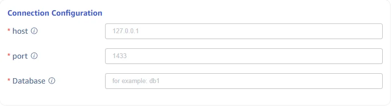
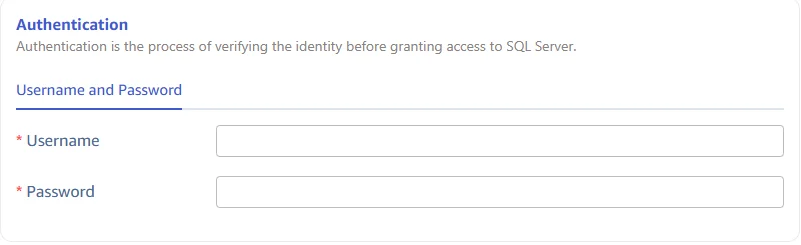
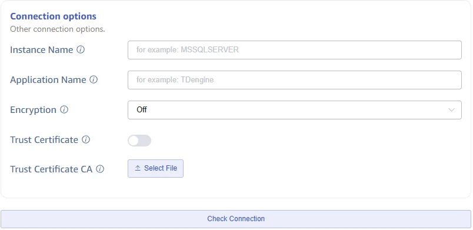
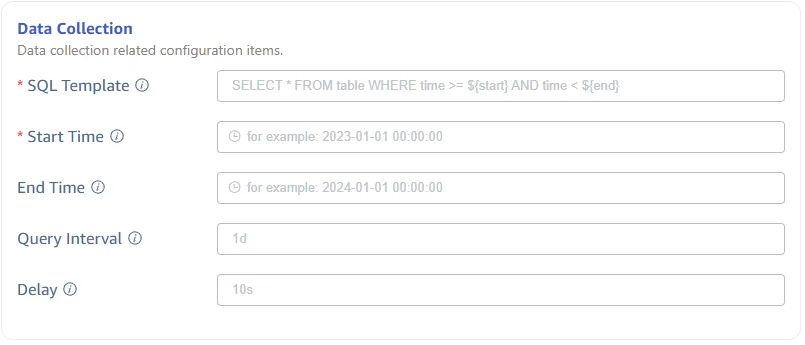
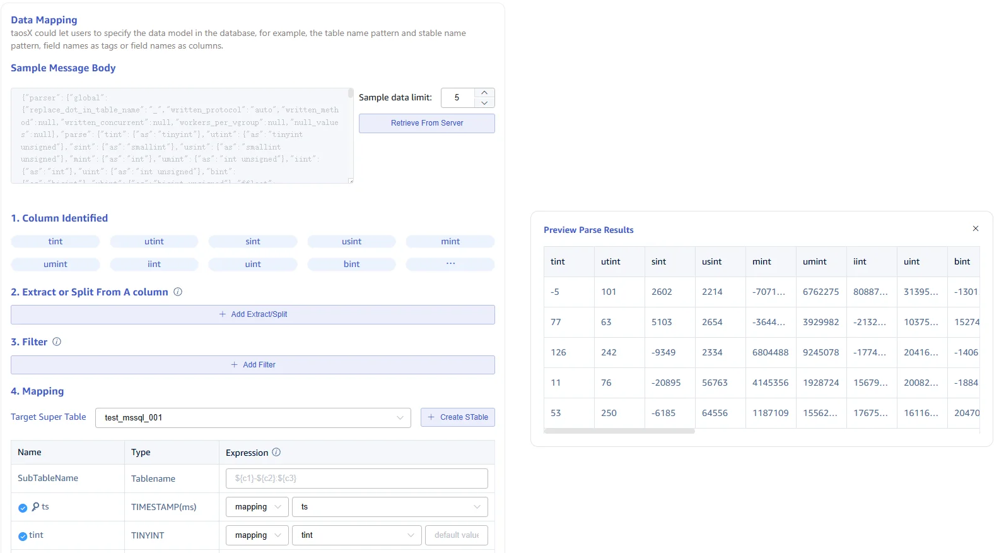
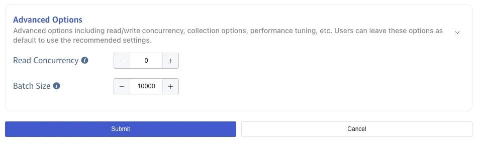

import { AddDataSource, Enterprise } from '../resources/_resources.mdx';

<Enterprise/>

This section describes how to create data migration tasks through the taosExplorer interface, migrating data from Microsoft SQL Server(2016+ or with TLS1.2+ support) to the current TDengine cluster.

## Feature Overview

Microsoft SQL Server is one of the most popular relational databases. Many systems have used or are using Microsoft SQL Server to store data reported by IoT and industrial internet devices. However, as the number of devices in the access systems grows and the demand for real-time data feedback from users increases, Microsoft SQL Server can no longer meet business needs. Starting with TDengine TSDB Enterprise v3.3.2.0, TDengine can efficiently read data from Microsoft SQL Server and write it into TDengine for historical migration or real-time synchronization.

## Procedure

### Add a Data Source

<AddDataSource connectorName="Microsoft SQL Server" />

### Configure Connection Information

Fill in the *`connection information for the source Microsoft SQL Server database`* in the **Connection Configuration** area, as shown below:

### Configure Authentication Information

**User** Enter the user of the source Microsoft SQL Server database, who must have read permissions in the organization.

**Password** Enter the login password for the user mentioned above in the source Microsoft SQL Server database.

### Configure Connection Options

**Instance Name** Set the Microsoft SQL Server instance name (defined in SQL Browser, only available on Windows platform, if specified, the port will be replaced with the value returned from SQL Browser).

**Application Name** Set the application name to identify the connecting application.

**Encryption** Set whether to use an encrypted connection. The default value is Off. Options include Off, On, NotSupported, Required.

**Trust Certificate** Set whether to trust the server certificate. If enabled, the server certificate will not be verified and will be accepted as is (if trust is enabled, the `Trust Certificate CA` field below will be hidden).

**Trust Certificate CA** Set whether to trust the server's certificate CA. If a CA file is uploaded, the server certificate will be verified based on the provided CA certificate in addition to the system trust store.

Then click the **Check Connectivity** button. Users can click this button to check if the information filled in above can normally retrieve data from the source Microsoft SQL Server database.

### Configure SQL Query

**Subtable Field** is used to split subtables, it is a select distinct SQL statement that queries non-repeated items of specified field combinations, usually corresponding to the tag in transform:
> This configuration is mainly to solve the data migration disorder problem, and needs to be used in conjunction with **SQL Template**, otherwise it cannot achieve the expected effect, usage examples are as follows:
>
> 1. Fill in the subtable field statement `select distinct col_name1, col_name2 from table`, which means using the fields col_name1 and col_name2 in the source table to split the subtables of the target supertable
> 2. Add subtable field placeholders in the **SQL Template**, for example `${col_name1} and ${col_name2}` in `select * from table where ts >= ${start} and ts < ${end} and ${col_name1} and ${col_name2}`. At runtime, each placeholder expands to an equality predicate (such as `col_name1='deviceA'` or `col_name2=1`), not a bare column name
> 3. Configure the mappings of `col_name1` and `col_name2` as two tags in **transform**

**SQL Template** is used for the SQL statement template for querying, which must include a time range condition, and the start time and end time must appear in pairs. The time range defined in the SQL statement template consists of a column representing time in the source database and the placeholders defined below.
> SQL uses different placeholders to represent different time format requirements, specifically the following placeholder formats:
>
> 1. `${start}`, `${end}`: Represents a time string with the task time zone offset, e.g.: `'2024-03-14 08:00:00+08:00'`
> 2. `${start_no_tz}`, `${end_no_tz}`: Represents a time string without time zone, e.g.: `'2024-03-14 08:00:00'`
> 3. `${start_date}`, `${end_date}`: Represents date only, e.g.: `'2024-03-14'`
>
> These examples are for a window starting at 2024-03-14T00:00:00Z with the task time zone `+08:00`: the placeholders use the wall-clock time of the window bounds in the task time zone, with second precision. taosX adds the quotes, so do not wrap the placeholders in quotes.
>
> Note: Only `datetime2` and `datetimeoffset` support querying using start/end, `datetime` and `smalldatetime` can only use start_no_tz/end_no_tz for querying, and `timestamp` cannot be used as a query condition.
>
> To solve the problem of data migration disorder, it is advisable to add a sorting condition in the query statement, such as `order by ts asc`.

**Start Time** The start time of the data migration, this field is mandatory.

**End Time** The end time of the data migration, which can be left blank. If set, the migration task will stop automatically after reaching the end time; if left blank, it will continuously synchronize real-time data, and the task will not stop automatically.

Start Time and End Time are absolute instants with a UTC offset; the task time zone does not change the instants they denote. The task time zone is set by the task parameter `time_zone`, which has no field in taosExplorer. If it is not set, the UTC offset of Start Time is used, which is the taosExplorer page time zone in effect when Start Time was set. When you edit an existing task without changing Start Time, the start and end times and the task time zone stay unchanged. `time_zone` accepts only a fixed UTC offset such as `+08:00` or `+0800`, or `UTC` or `Z`. IANA names such as `Asia/Shanghai` are not supported, and an invalid value is reported as an error when the task starts or data is previewed. The offset is fixed for the whole task and does not follow daylight saving time. The task time zone determines the values of the time placeholders and how query windows are cut: each query window is at most one Query Interval long and never crosses midnight in the task time zone, so an interval longer than 1 day behaves like 1 day. To use a UTC task time zone, switch the taosExplorer page time zone to UTC before setting Start Time, or set `time_zone=UTC` through the API or CLI. See [Time and Time Zone](./23-rdb-integration.md#time-and-time-zone).

**Query Interval** The time interval for segmenting data queries, default is 1 day. To avoid querying too much data at once, a data synchronization subtask will use the query interval to segment the data.

**Delay Duration** In real-time data synchronization scenarios, to avoid losing data due to delayed writing, taosX reads only data up to the current time minus the delay duration. When no end time is set or the end time is in the future, the historical part is read up to that point. After that, taosX checks about once per second and reads from the last checkpoint up to the current time minus the delay once that range exceeds 10 seconds. Query Interval only splits this range into query windows; it does not schedule the queries. For example, with a delay of 60 seconds, a query run at 09:01 reads only data before 09:00.

### Configure Data Mapping

Fill in the related configuration parameters in the **Data Mapping** area.

Click the **Retrieve from Server** button to get sample data from the Microsoft SQL Server.

In **Extract or Split from Column**, fill in the fields to extract or split from the message body, for example: split the `vValue` field into `vValue_0` and `vValue_1`, select the split extractor, fill in the separator as `,`, and number as 2.

In **Filter**, fill in the filter conditions, for example: write `Value > 0`, then only data where Value is greater than 0 will be written to TDengine.

In **Mapping**, select the supertable in TDengine to which you want to map, and the columns to map to the supertable.

Click **Preview** to view the results of the mapping.

### Configure Advanced Options

The **Advanced Options** area is collapsed by default, click the `>` on the right to expand it, as shown below:

**Maximum Read Concurrency** Limit on the number of data source connections or reading threads, modify this parameter when default parameters do not meet the needs or when adjusting resource usage.

**Batch Size** The maximum number of messages or rows sent at once. The default is 10000.

### Configure Exception Handling

import ExceptionHandling from './resources/_03-exception-handling-strategy.mdx'

<ExceptionHandling />

### Completion

Click the **Submit** button to complete the creation of the data synchronization task from Microsoft SQL Server to TDengine, and return to the **Data Source List** page to view the status of the task execution.
