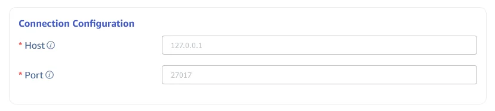
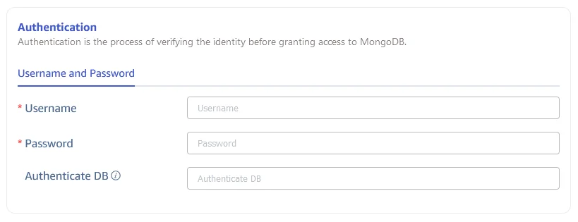
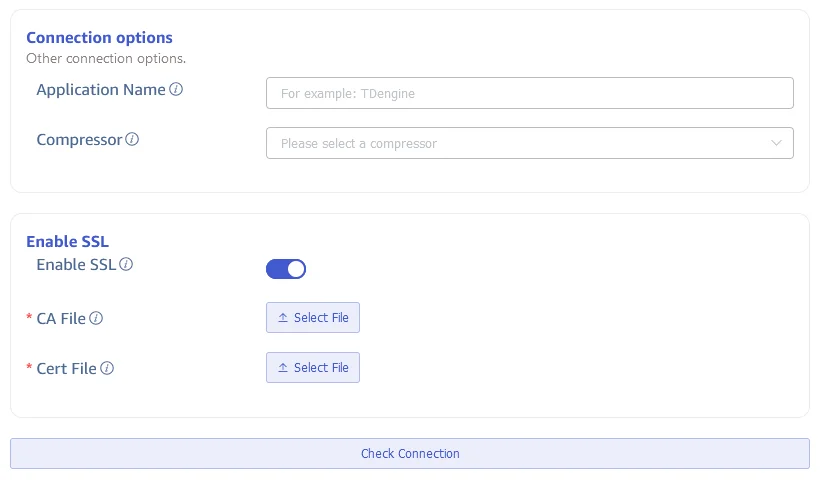
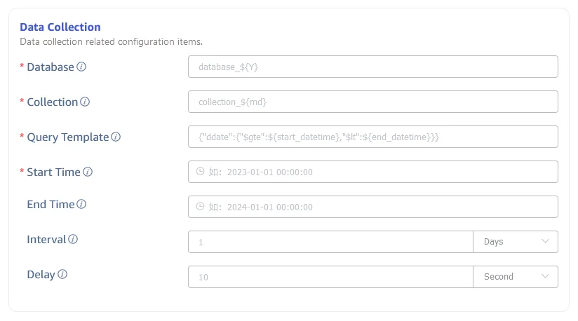
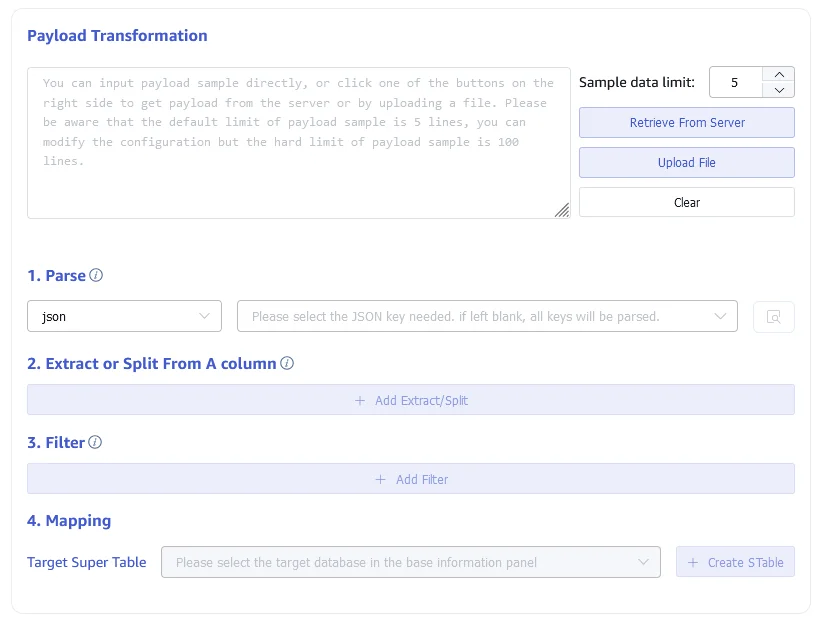
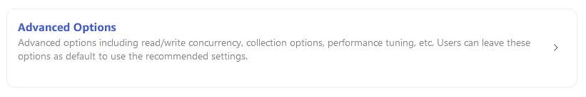

import { AddDataSource, Enterprise } from '../resources/_resources.mdx';

<Enterprise/>

This section describes how to create data migration tasks through the taosExplorer interface, migrating data from MongoDB to the current TDengine cluster.

## Feature Overview

MongoDB is a product that lies between relational and non-relational databases, widely used in content management systems, mobile applications, and the Internet of Things, among other fields. TDengine TSDB Enterprise can efficiently read data from MongoDB and write it into TDengine, achieving historical data migration or real-time data synchronization, and addressing technical pain points faced by businesses.

## Procedure

### Add a Data Source

<AddDataSource connectorName="MongoDB" />

### Configure Connection Information

Fill in the *connection information for the source MongoDB database* in the **Connection Configuration** area, as shown below:

### Configure Authentication Information

**User** Enter the user of the source MongoDB database, who must have read permissions in the MongoDB system.

**Password** Enter the login password for the user mentioned above in the source MongoDB database.

**Authentication Database** The database in MongoDB where user information is stored, default is admin.

### Configure Connection Options

**Application Name** Set the application name to identify the connected application.

**SSL Certificate** Set whether to use an encrypted connection, which is off by default. If enabled, you need to upload the following two files:

&emsp; 1. **CA File** Upload the SSL encryption certificate authority file.

&emsp; 2. **Certificate File** Upload the SSL encryption certificate file.

Then click the **Check Connectivity** button, where users can click this button to check if the information filled in above can normally retrieve data from the source MongoDB database.

### Configure Data Query

**Database** The source database in MongoDB, which can be dynamically configured using placeholders, such as `database_${Y}`. See the table below for a list of available placeholders.

**Collection** The collection in MongoDB, which can be dynamically configured using placeholders, such as `collection_${md}`. See the table below for a list of available placeholders.

|Placeholder|Description|Example Data|
| :-----: | :------------: |:--------:|
|Y|Complete Gregorian year, zero-padded 4-digit integer|2024|
|y|Remainder of the Gregorian year divided by 100, zero-padded 2-digit integer|24|
|M|Integer month (1 - 12)|1|
|m|Integer month (01 - 12)|01|
|B|Full English spelling of the month|January|
|b|Abbreviation of the month in English (3 letters)|Jan|
|D|Numeric representation of the date (1 - 31)|1|
|d|Numeric representation of the date (01 - 31)|01|
|J|Day of the year (1 - 366)|1|
|j|Day of the year (001 - 366)|001|
|F|Equivalent to `${Y}-${m}-${d}`|2024-01-01|
|Ymd|Equivalent to `${Y}${m}${d}`|20240101|
|ymd|Equivalent to `${y}${m}${d}`|240101|
|md|Equivalent to `${m}${d}`|0101|
|dm|Equivalent to `${d}${m}`|0101|
|Yj|Equivalent to `${Y}${j}`|2024001|
|yj|Equivalent to `${y}${j}`|24001|

The placeholders take the date of the query window start in the task time zone.

**Subtable Fields** Fields used to split subtables, usually corresponding to tags in transform, separated by commas, such as col_name1,col_name2.
This configuration is mainly to solve the problem of data migration disorder, and needs to be used in conjunction with **Query Template**, otherwise it cannot achieve the expected effect. Usage examples are as follows:

1. Configure two subtable fields `col_name1,col_name2`
2. Add subtable field placeholders in the **Query Template**, such as `${col_name1}, ${col_name2}` in `{"ddate":{"$gte":${start_datetime},"$lt":${end_datetime}}, ${col_name1}, ${col_name2}}`. At runtime, each placeholder expands to a JSON field filter (such as `"col_name1":"deviceA"`), not a bare field name
3. Configure `col_name1` and `col_name2` two tag mappings in **transform**

**Query Template** is used for querying data with a JSON format query statement, which must include a time range condition, and the start and end times must appear in pairs. The time range defined in the template consists of a time-representing column from the source database and the placeholders defined below.
Different placeholders represent different time format requirements, specifically the following placeholder formats:

1. `${start_datetime}`, `${end_datetime}`: Corresponds to filtering by the backend datetime type field, and is replaced with a BSON Date value (milliseconds) of the window bound, e.g., `{"ddate":{"$gte":${start_datetime},"$lt":${end_datetime}}}` will be converted to `{"ddate":{"$gte":{"$date":{"$numberLong":"1717200000000"}},"$lt":{"$date":{"$numberLong":"1717286400000"}}}}`
2. `${start_timestamp}`, `${end_timestamp}`: Corresponds to filtering by the backend timestamp type field, and is replaced with a BSON Timestamp value whose `t` is the Unix time of the window bound in seconds and whose `i` is 0, e.g., `{"ttime":{"$gte":${start_timestamp},"$lt":${end_timestamp}}}` will be converted to `{"ttime":{"$gte":{"$timestamp":{"t":1717200000,"i":0}},"$lt":{"$timestamp":{"t":1717286400,"i":0}}}}`

These examples are for the window from 2024-06-01T00:00:00Z to 2024-06-02T00:00:00Z. Both sets of placeholders denote absolute instants and do not depend on the task time zone.

**Query Sorting** Sorting conditions during query execution, in JSON format, must comply with MongoDB's sorting condition format specifications, with usage examples as follows:

1. `{"createtime":1}`: MongoDB query results are returned in ascending order by createtime.
2. `{"createdate":1, "createtime":1}`: MongoDB query results are returned in ascending order by createdate and createtime.

**Start Time** The start time for migrating data, this field is mandatory.

**End Time** The end time for migrating data, can be left blank. If set, the migration task will stop automatically after reaching the end time; if left blank, it will continuously synchronize real-time data, and the task will not stop automatically.

Start Time and End Time are absolute instants with a UTC offset; the task time zone does not change the instants they denote. The task time zone is set by the task parameter `time_zone`, which has no field in taosExplorer. If it is not set, the UTC offset of Start Time is used, which is the taosExplorer page time zone in effect when Start Time was set. When you edit an existing task without changing Start Time, the start and end times and the task time zone stay unchanged. `time_zone` accepts only a fixed UTC offset such as `+08:00` or `+0800`, or `UTC` or `Z`. IANA names such as `Asia/Shanghai` are not supported, and an invalid value is reported as an error when the task starts or data is previewed. The offset is fixed for the whole task and does not follow daylight saving time. The task time zone determines the values of the date placeholders in database and collection names and how query windows are cut: each query window is at most one Query Interval long and never crosses midnight in the task time zone, so an interval longer than 1 day behaves like 1 day. To use a UTC task time zone, switch the taosExplorer page time zone to UTC before setting Start Time, or set `time_zone=UTC` through the API or CLI.

**Query Interval** The time interval for segmenting data queries, default is 1 day. To avoid querying too much data at once, a data synchronization subtask will use the query interval to segment the data.

**Delay Duration** In real-time data synchronization scenarios, to avoid losing data due to delayed writes, taosX reads only data up to the current time minus the delay duration. When no end time is set or the end time is in the future, the historical part is read up to that point. After that, taosX checks about once per second and reads from the last checkpoint up to the current time minus the delay once that range exceeds 10 seconds. Query Interval only splits this range into query windows; it does not schedule the queries. For example, with a delay of 60 seconds, a query run at 09:01 reads only data before 09:00.

### Configure Data Mapping

Fill in the data mapping related configuration parameters in the **Payload Transformation** area.

Click the **Retrieve from Server** button to fetch sample data from the MongoDB server.

In **Parsing**, choose from JSON/Regex/UDT to parse the original message body, and click the **Preview** button on the right to view the parsing results after configuration.

In **Extract or Split from Column**, fill in the fields to extract or split from the message body, for example: split the `vValue` field into `vValue_0` and `vValue_1`, select the split extractor, fill in the separator as `,`, number as 2, and click the **Preview** button on the right to view the transformation results after configuration.

In **Filter**, fill in the filtering conditions, for example: write `Value > 0`, then only data where Value is greater than 0 will be written to TDengine, and click the **Preview** button on the right to view the filtering results after configuration.

In **Mapping**, select the supertable in TDengine to which the data will be mapped, as well as the columns to map to the supertable, and click the **Preview** button on the right to view the mapping results after configuration.

### Configure Advanced Options

The **Advanced Options** area is collapsed by default, click the `>` on the right to expand it, as shown below:

**Maximum Read Concurrency** Limit on the number of data source connections or reading threads, modify this parameter when default parameters do not meet the needs or when adjusting resource usage.

**Batch Size** The maximum number of messages or rows sent at once. Default is 10000.

### Configure Exception Handling

import ExceptionHandling from './resources/_03-exception-handling-strategy.mdx'

<ExceptionHandling />

### Completion

Click the **Submit** button to complete the creation of the data synchronization task from MongoDB to TDengine, and return to the **Data Source List** page to view the task execution status.
