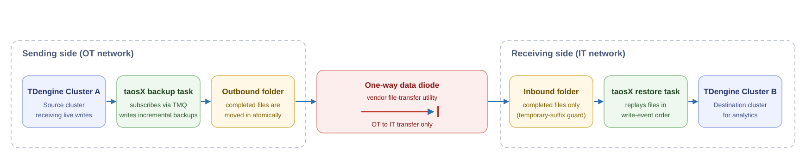

In industrial scenarios such as power and manufacturing, the production network (OT) and the management network (IT) are often isolated by a hardware-enforced one-way data diode. The diode physically permits data to flow only from the OT side to the IT side: no packet, acknowledgement, or control message can travel back from IT to OT, so conventional database replication and data subscription cannot establish a connection across the diode.

For such strictly isolated environments, TDengine Enterprise provides a data diode synchronization solution based on taosX incremental backup and restore: a taosX task on the sending side turns data changes from the source cluster into incremental backup files; the file-transfer utility provided by the diode vendor ferries the files one way to the receiving side, where another taosX task restores them into the destination cluster in order. Throughout the process, TDengine does not need to establish any network session across the diode.

This solution is built on TDengine [subscription-based backup and restoration](../../12-operations-and-tooling/02-operations/10-backup.md#subscription-based-backup-and-restoration).



As shown in the figure:

1. TDengine Cluster A is located on the sending side (OT network) and keeps receiving data writes.
2. The taosX backup task subscribes to data changes in the source database through TMQ and produces incremental backup files (`.z` data files and `.mz` metadata files). Once a file is fully written, the `move.to` parameter moves it into the outbound folder atomically.
3. The diode vendor's file-transfer utility ferries completed files from the outbound folder one way into the inbound folder on the receiving side (IT network).
4. The taosX restore task on the receiving side replays the backup files in write-event order into the target database of TDengine Cluster B.

## When to Use This Solution

Use this solution only when the networks on both sides are separated by a hardware-enforced one-way data diode with no return path of any kind. If the security boundary is only a regular firewall or DMZ, where business data may flow from OT to IT and TCP sessions are bidirectional, prefer the regular synchronization methods.

| Network type | Characteristics | Recommended approach |
| --- | --- | --- |
| Regular firewall or DMZ | Business data flows from OT to IT, and TCP sessions are bidirectional (acknowledgements and login responses can flow back) | Use native TDengine replication, taosX data migration, data subscription, or MQTT (see the other sections on the [Edge-Cloud Synchronization](index.md) page) |
| Hardware-enforced one-way data diode | No packet, acknowledgement, or control message may travel from IT back to OT | Use this solution: taosX incremental backup files + diode file transfer + taosX restore |

**Why normal replication cannot be used**

Normal database replication and standard MQTT are built on bidirectional TCP sessions. Even when application data flows only from OT to IT, the acknowledgements and login responses required by these sessions must travel back from the IT side. A strict data diode blocks this return traffic, so the sessions cannot be established and file ferrying must be used instead.

## Prerequisites

- Software: TDengine Enterprise on both the sending and receiving sides, with the taosX command line available on both sides; a data diode appliance that supports one-way file transfer, with the vendor's file-transfer utility working normally.
- Accounts: the sending-side account has TMQ permission to subscribe to the source database; the receiving-side account has permission to create and write the destination database.
- Clocks: keep system clocks stable on both sides. Backup file names contain millisecond timestamps; a large backward clock adjustment can collide with an earlier backup point. Use a controlled time source within each network and avoid manual backward adjustments during operation.
- Storage: reserve enough space in the outbound and inbound folders to hold the agreed maximum backlog of backup files during an outage.

## Deployment Procedure

### 1. Plan the database mapping and directories

Plan an independent directory chain and target database for each source database on the sending side, and record the mapping in writing. Example:

| OT source | Source database | Outbound folder | Inbound folder | Target database |
| --- | --- | --- | --- | --- |
| Site A | site_a | `/data/diode/out/site_a` | `/data/diode/in/site_a` | site_a_central |
| Site B | site_b | `/data/diode/out/site_b` | `/data/diode/in/site_b` | site_b_central |

Create the directories on both sides:

```shell
# Sending side
mkdir -p /data/taosx/site_a/backup
mkdir -p /data/diode/out/site_a

# Receiving side
mkdir -p /data/diode/in/site_a
```

### 2. Configure the diode and verify file transfer

Install the hardware and configure the file-transfer utility according to the deployment manual of the selected diode vendor. When configuring the diode, register only the service endpoint (a single IP or VIP) of the vendor's file-transfer utility; do not expose any TDengine node address to the diode.

Configure the file-transfer utility as follows:

- Enable a temporary suffix (such as `.temp`) on the receiving side so that in-flight files are invisible to consumers.
- Do not overwrite same-name files; a same-name file should represent the same backup object.
- Archive or delete source files in the outbound folder after a successful transfer to avoid repeated transfers.
- Transfer files in creation order, with one transfer task per source.

Before starting taosX, verify file transfer with an ordinary file:

1. Create a test file in the outbound folder:

   ```shell
   echo "hello" > /data/diode/out/site_a/test.txt
   ```

2. Confirm that the file arrives in the inbound folder:

   ```shell
   ls -al /data/diode/in/site_a
   ```

3. Confirm that files can travel only from the sending side to the receiving side, and not in the reverse direction.
4. Confirm that the receiving side sees a temporary file name during transfer and the final name only after the transfer completes.
5. If the transfer fails, check the file-transfer utility logs and the configuration.

### 3. Start the backup task on the sending side

Run the following command on the sending side:

```shell
taosx run \
  -f 'tmq://192.168.1.100:6030/test?upcoming=now&interval=1s&self.repeat=true' \
  -t 'local:/data/taosx/site_a/backup?move.to=/data/diode/out/site_a' \
  -v
```

**Parameters**

| Parameter | Description |
| --- | --- |
| `upcoming` | Time of the next backup run: an RFC 3339 date-time or `now` (start immediately) |
| `interval` | Interval between consecutive backup runs, for example `60s` for 60 seconds; the production value must be tested against the data volume and the freshness target |
| `self.repeat` | Whether to keep scheduling backup runs; with `true` the command keeps running and produces backup files periodically |
| `move.to` | Directory into which a fully written backup file is moved atomically (the outbound folder); only completed files enter the outbound folder |
| `-v` | Outputs info-level logs to facilitate deployment and troubleshooting |

The example command starts immediately, creates a backup point every second, runs continuously, writes working files to `/data/taosx/site_a/backup`, and moves completed files into the outbound folder `/data/diode/out/site_a`.

### 4. Start the restore task on the receiving side

Run the following command on the receiving side:

```shell
taosx run \
  -f 'local:/data/diode/in/site_a' \
  -t 'taos://192.168.1.101:6030/site_a_central' \
  -v
```

The restore task keeps watching the inbound folder and replays the backup files into the target database `site_a_central` in write-event order.

**Note**

One restore task corresponds to exactly one inbound folder. A restore task does not separate files by source; mixing backup chains from multiple sources in one folder breaks the restore order.

### 5. Verify the synchronization result

1. Write test data on the sending side; for example, use taosBenchmark to simulate writes:

   ```shell
   taosBenchmark -t 1000 -n 100000 -y
   ```

2. Confirm that `.z` and `.mz` backup files are created on the sending side and that completed files are moved into the outbound folder and ferried to the inbound folder.
3. Confirm that the restore task on the receiving side processes the files without errors.
4. Compare the row counts of the source and target databases.
5. Compare a sample of at least the latest 100 rows (timestamps, tags, and values).

## Critical Operating Rules

1. **Restore files in strict order.** Backup files must be replayed in TDengine write-event order. If a later file arrives first, hold it until the earlier file is available; never continue restoring later files while one is missing.
2. **Use an independent backup chain for every source.** Each source database on the sending side has its own outbound folder, transfer task, inbound folder, and restore task; separate target databases are strongly recommended.
3. **Expose only completed files.** On the sending side, `move.to` moves files atomically after they are fully written; on the receiving side, keep the diode temporary suffix as protection, and taosX additionally waits for a stable file size and modification time before consuming a file.
4. **Never replay old files casually.** Re-importing the same file does not create duplicate rows, but replaying an older file after a newer one resets the values at the same table and timestamp to the older values; replaying historical files requires a recovery plan.

## Backup File Naming and Import Behavior

Incremental backup files are named as follows:

```text
{topic}-{timestamp_ms}-{vgroup_id}-{index}.z    # data file
{topic}-{timestamp_ms}-{vgroup_id}-{index}.mz   # metadata/schema file
```

- `topic` is generated from the database, the backup object, and the backup plan.
- `timestamp_ms` is the millisecond timestamp of the backup point; files of the same backup point share this timestamp.
- `vgroup_id` identifies the vgroup that produced the file in parallel.
- `index` is a sequence number starting at 1; it increases when a file rotates because of size or timeout.

Import behavior:

- Re-importing the same file does not create duplicate rows: a row with the same table name and timestamp overwrites the existing row.
- Restoration must follow the write-event order, which is independent of the timestamps inside the rows. TDengine accepts writes with older timestamps, but backup files must be replayed in the original write order.
- Partial and damaged files: `move.to` takes effect only after a file is fully written; the temporary suffix protects the file during transfer; recoverable errors (such as a connection interruption) are retried by taosX 10 times by default with a 5-second interval; if a file is corrupted and cannot be recovered by retry, the restore task exits with an error and the file must be handled manually before the chain continues.

## Aggregating Multiple Sending Sides

Multiple independent sending sides can aggregate data into one receiving TDengine cluster, but every source is an independent backup chain:

| Item | Requirement | Reason |
| --- | --- | --- |
| Outbound/inbound folders | Independent for every source | Mixing chains breaks the restore order |
| Restore tasks | One per inbound folder | Each chain can run, pause, and recover independently |
| Target databases | Strongly recommended to be separate | Prevents mutual overwrite when sources write the same table and timestamp |
| Transfer tasks | One per source | Makes order, backlog, and failure tracking easier |

Recommended chain: one source database corresponds to one backup task, one outbound folder, one transfer rule, one inbound folder, one restore task, and one target database.

## High Availability Recommendations

- The diode faces only the service endpoint of the vendor's file-transfer utility, never a TDengine node; the TDengine cluster addresses on both sides stay within their own networks and do not participate in the diode configuration, so both clusters can be highly available independently.
- Between taosX and the local cluster, WebSocket connectivity through taosAdapter is recommended (`tmq+ws` for backup and `taos+ws` for restore, port 6041), with multiple taosAdapter endpoints or a local load balancer/VIP for client-side high availability.
- TMQ consumer progress is stored in the sending-side cluster, so subscription progress survives a database node failover.
- If the file-transfer endpoint itself requires high availability, use a VIP or floating IP provided by the vendor or network layer; the diode still sees a single service endpoint.

## Operations and Monitoring

Check the following items daily:

| Check item | What to look for |
| --- | --- |
| Backup task | Running, producing new files at the expected interval |
| Outbound folder | No unexpected backlog; sufficient free space |
| Diode transfer | Files transferred in order; no files stuck with a temporary suffix |
| Inbound folder | Files arriving in order and consumed by the correct restore task |
| Restore task | No retry exhaustion, damaged-file errors, or authentication failures |
| Data freshness | Destination data is within the expected end-to-end delay |
| Data quality | Periodic source/destination row-count and sample-value checks pass |
| Staging storage | Free space on both sides covers the agreed maximum outage backlog |

After a task restart, confirm that the next file to restore is the next one in the source event chain; do not copy an entire historical archive back into the active inbound folder unless the recovery plan requires a full ordered replay. Change the backup interval only during a maintenance window, and observe file size and count to confirm that the diode transfer and the restore task keep up.

## Troubleshooting

| Symptom | Likely cause | Action |
| --- | --- | --- |
| No backup files are created | TMQ connection, permission, or source database configuration | Run with `-v`; check connectivity, credentials, and that the source database is receiving writes |
| Backup files stay in the working folder | The `move.to` folder is missing, not writable, or the disk is full | Check directory permissions and free space |
| Files do not cross the diode | Transfer task stopped, wrong folder mapping, or diode configuration issue | Test with an ordinary text file and check the transfer utility logs |
| Files keep the temporary suffix | Transfer incomplete or stalled | Do not consume the file; fix the transfer and wait for completion |
| Restore task stops on a file | Damaged file, target connectivity issue, or retry limit reached | Check taosX logs; after fixing, retransmit the file and restart in order |
| Destination row count is lower | Missing file, out-of-order chain, stopped task, or wrong database mapping | Compare folder sequences and logs; recover the first missing file before continuing |
| Values differ at the same timestamp | An older file was replayed after a newer one, or multiple sources wrote the same table and timestamp | Restore from a known-correct chain; use separate target databases for different sources |
| Filename collision | System clock moved backward or manual file handling reused a name | Stabilize the clock, isolate the files, and confirm the chain before restore |

## Limitations

- taosExplorer does not currently support importing external backup files; cross-diode restore is available only through the taosX command line.
- Out-of-order restore is not supported; a missing file must pause the restore of later files in that chain.
- taosX does not keep a permanent ledger of restored files across runs; re-importing the same file writes the rows again (overwriting the same table and timestamp without creating duplicates).
- Replaying an older backup file resets the values at the same table and timestamp to the older values.
- If a file is corrupted and cannot be recovered by retry, the restore task fails and requires manual intervention.
- Multiple independent sources cannot share one active inbound folder.
- This solution relies on the reliability of the diode vendor's file-transfer utility, including ordering, temporary-suffix, and integrity guarantees.
- High availability of the diode-facing transfer endpoint is provided by the vendor or network layer (for example, VIP or floating IP), not by TDengine clustering.
- This solution does not provide automatic failover of the taosX backup/restore process itself between hosts; validate task orchestration separately on the selected release and deployment platform if required.
