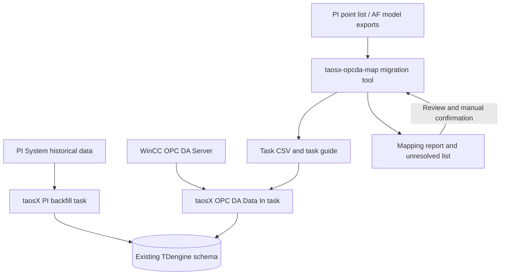

This document describes how to replace a WinCC + PI System data pipeline with WinCC + TDengine end to end, covering historical backfill, point mapping, real-time ingestion, and cutover validation. The plan applies to TDengine TSDB-Enterprise deployments with taosX and Explorer.

## Solution Overview

In a typical industrial site, WinCC acts as the SCADA front end that collects device data and writes it through PI Interface into PI System for long-term archiving. When PI System must be retired (for example, when its license expires or maintenance costs become prohibitive), you can replace it with TDengine while keeping the running WinCC front end in place.

The data pipeline before and after migration:

```text
Original real-time pipeline: WinCC → PI Interface → PI System
Historical migration:        PI System → taosX PI backfill task → TDengine
New real-time pipeline:      WinCC OPC DA Server → taosX OPC DA Data In task → TDengine
```

The solution consists of three complementary parts:

| Component | Purpose | Details |
| --- | --- | --- |
| Historical data migration | Writes historical data from PI System into TDengine | Runs as a taosX PI backfill task; see [PI Historical Data Backfill Guide](../01-no-code-ingestion/04-pi/04-backfill-guide.md) |
| Point mapping | Determines which existing subtable and column each WinCC point should write to | Performed by the `taosx-opcda-map` migration tool, which produces an uploadable task CSV and a mapping report |
| Real-time ingestion | Continuously reads real-time data from WinCC OPC DA into the existing schema | Runs as a taosX OPC DA Data In task; see [OPC DA](../01-no-code-ingestion/06-opcda/index.md) |

Once the historical data has been migrated, the databases, supertables, subtables, and columns already exist in TDengine. The real-time pipeline must write timestamps, values, and quality into these existing locations (for example, timestamps into the existing primary key column, values into the existing value column, and quality into the existing quality column) instead of creating new tables. Point mapping solves this "wiring" problem: for each WinCC OPC DA point it confirms the target subtable, value column, timestamp column, and quality column, and finally produces a task CSV that you can upload in Explorer, along with a human-readable report explaining the basis of every mapping.

## Architecture and Migration Workflow



The recommended implementation order is:

1. **Assess and prepare**: inventory source points, available materials, and the target schema; confirm software versions and account environment.
2. **Backfill historical data**: create a PI backfill task to migrate PI historical data into TDengine and record the migration cutoff point.
3. **Collect point metadata**: use the migration tool to collect the existing TDengine schema, WinCC OPC DA points, and historical materials.
4. **Review mappings**: examine the mapping report, confirm or exclude each unresolved item, and re-run matching with additional naming rules if needed.
5. **Create tasks**: export the task CSVs and create OPC DA Data In tasks in Explorer with the CSVs uploaded.
6. **Pilot and cut over**: validate a small set of points first, onboard the rest in batches, and complete acceptance before retiring the old pipeline.

Steps 1–2 and step 3 have no strict ordering dependency: you can prepare point mapping while the historical backfill is still running.

## Applicability and Boundaries

**Applicable scenarios**

- PI System has been retired or is scheduled for retirement and will no longer be maintained as the archiving system.
- Historical data has been (or is being) migrated to TDengine, and the target databases, supertables, subtables, and columns already exist.
- WinCC is still running and exposes point data through an OPC DA server.
- Real-time collection must resume without changing the existing schema, keeping timestamp, value, and quality semantics consistent with the historical data.

**Solution boundaries**

The migration tool and ingestion pipeline explicitly do not:

- Connect to or depend on an online PI System; all historical information comes from export files the customer retained.
- Modify TDengine in any way: no table creation, alteration, or deletion, and no data writes; all TDengine access is read-only metadata collection.
- Create, start, or modify Data In tasks automatically; you create the tasks in Explorer following the task guide generated by the tool.
- Fill the historical gap during the PI downtime; the OPC DA real-time interface only provides real-time data.

## Prerequisites

| Item | Requirement |
| --- | --- |
| TDengine and taosX | The on-site versions support OPC DA Data In tasks plus quality-column writing and Digital state dictionaries; confirm the exact version combination with official support |
| Windows host | OPC DA is based on COM/DCOM. Collection and task execution must run on a Windows host that can reach the WinCC OPC DA server, typically the host planned for taosX-Agent |
| Execution account | The Windows account used for collection must match the service account under which taosX-Agent actually runs; an interactive login account that can browse points does not imply the service account can access them |
| TDengine account | Metadata collection only requires read-only access to the target databases |
| Historical materials (optional) | Original PI point list (Excel), AF model export (XML), PI Interface configuration, original migration CSVs, WinCC tag tables, and so on, depending on what the customer retained; without them, mapping can still be built from both-side metadata and naming rules, but requires more manual confirmation |
| Quality and enumeration conventions | The encoding semantics of the existing quality column and the Digital state dictionaries, used to keep new data semantically consistent with historical data |

The first time you use the migration tool on a Windows host, run the bundled component registration script once as an administrator to register the 32-bit automation components required by OPC DA access; otherwise collection fails with `Class not registered`.

If TDengine and WinCC are not in the same network zone, run the collections separately in each zone and copy the resulting inventory files to one location for matching; a single machine does not need to reach both sides.

## Implementation Steps

### Step 1: Migrate Historical Data

Follow the [PI Historical Data Backfill Guide](../01-no-code-ingestion/04-pi/04-backfill-guide.md) to create a PI backfill task that writes PI historical data into TDengine. After the backfill completes, verify that the supertables, subtables, and columns in the target database match expectations, and record the historical migration cutoff time for later data-continuity checks.

### Step 2: Collect Metadata from Both Sides and Historical Materials

The migration tool ships as a Windows executable, `taosx-opcda-map.exe`, and requires no installation. Run all commands in one working directory; all inventory and report files are written to that directory.

```bash
# 1. Import historical materials: PI point list and AF model
#    (skip this step if no materials were retained)
taosx-opcda-map import-pi --excel archive_attributes.xlsx --af-xml AFDatabase_Assets.xml

# 2. Collect the existing TDengine schema read-only (password supplied via TAOS_PASSWORD)
taosx-opcda-map scan-tsdb --dsn "taos://root@192.168.1.172:6030" --database archive_backfill

# 3. Collect OPC DA point metadata on each WinCC host
#    (run on each host; use --name to distinguish services)
taosx-opcda-map scan-opcda --name casthouse --host 127.0.0.1 --prog-id OPCServer.WinCC.1 --browse
```

The three collections are independent and can be repeated in a controlled way: when the TDengine schema or WinCC points change, re-run the corresponding collection to refresh the inventory. The tool processes data in batches by database, supertable, and source group, supports rate limiting, and never scans historical data or puts undue load on the OPC server.

### Step 3: Build Mappings and Review

Copy the inventory files produced on each host into one working directory and run matching:

```bash
taosx-opcda-map match
```

Combining historical materials, both-side metadata, customer naming rules, and manual confirmation records, the tool generates mapping candidates by strength of evidence and produces:

- `mapping-report.html`: a locally browsable report showing, for each mapping, which field and which rule were used and why it passed or failed; filterable by device, database, and processing status.
- `unresolved.csv`: the list of unresolved items, including pending, conflicting, incompatible, and unmatched mappings with reasons.
- `target-mappings.csv`: the complete set of target relationships.

Mappings carry one of the following statuses:

| Status | Meaning | Eligible for task CSV |
| --- | --- | --- |
| Adoptable | Clear evidence, unique mapping, structure and data-semantics checks passed | Yes |
| Pending | Candidate only, or type, dictionary, or service binding not yet determined | No |
| Conflicting | Multiple candidates, contradictory rule results, or multiple sources contending for one target value column | No |
| Incompatible | Correspondence found, but unsupported by type, model, or connector capability | No |
| Unmatched | No usable candidate within the scanned scope | No |
| Excluded | Explicitly excluded from this delivery with a recorded reason | Not in CSV, but counted in the report |

To review, copy the rows to process from `unresolved.csv` into `decisions.csv`, fill in the accept, exclude, or exception-mapping decision with a reason, and re-run `match`. Rule adjustments, reviews, and regeneration can be repeated offline until every mapping to onboard reaches the "Adoptable" status. Note that "independent source addresses read from OPC" and "historical subtables to continue writing" are inherently two different counts: one OPC address may feed multiple historical targets (one source, multiple targets). The tool keeps all relationships and splits them across task batches; it never drops targets to deduplicate counts.

### Step 4: Export Task CSVs

```bash
taosx-opcda-map export
```

Before export, the tool runs completeness checks automatically: source addresses in the batch are valid; target databases, tables, and columns exist; all rows are confirmed; point IDs are unique within each file; no disabled rows or automatic naming templates are carried; and the exported files are re-parsed with the matching-version CSV parser to verify content. When any check fails, the export fails with reasons listed; rows that did not pass are never silently dropped.

The export produces:

- `opcda-task-<service>-NNN.csv`: the task configuration uploaded to Explorer, one file per task batch; batches are split automatically per service when the per-batch point limit is exceeded.
- `task-guide.md`: the parameter guide for creating tasks in Explorer.
- `task-manifest.json`: for each CSV, the service, Agent, target instance and database, collection settings, and validation status.

Files generated offline are marked "pending on-site review". After arriving on site, re-run `scan-tsdb` and `scan-opcda` to refresh the inventories, then `match` and `export` again; only after confirming that the target schema, point status, and service identities match the current site can the files be delivered.

### Step 5: Create Real-Time Ingestion Tasks

Follow `task-guide.md` to create OPC DA Data In tasks one by one in Explorer:

1. Select the Agent that runs the task (its execution account has been validated during collection), the OPC service (host and ProgID), and the target database.
2. Set the collection interval and time source as described, turn on "Report Exceptional Values", and turn off "Dynamic Point Update".
3. Upload the `opcda-task-<service>-NNN.csv` file for each task.
4. For the CSV field rules, see [OPC DA CSV Configuration File Reference](../01-no-code-ingestion/06-opcda/01-csv-reference.md).

Do not hand-edit the exported CSVs; change mappings through the customer configuration and decision files, then re-run `match` and `export`, so identical inputs always produce identical files. Do not add disabled rows to a CSV to mean "not onboarded yet": task initialization runs `DROP TABLE IF EXISTS` for disabled rows, which may delete existing historical subtables.

### Step 6: Pilot, Cut Over, and Accept

Onboard a small set of points first and verify that data lands in the correct subtable, value column, and quality column before onboarding the rest in batches. At cutover, record the historical migration cutoff position and the real-time ingestion start time, and verify the following:

- When the task starts, the OPC server may return cached values with old timestamps; during the pilot, check duplicate timestamps and the update behavior of the target database to confirm existing historical rows are not overwritten.
- Timestamps, values, and quality land in the expected existing columns, and historical queries can see the newly ingested data.
- In one-source-multiple-target scenarios, every target subtable receives data, and the duplicated reads stay within WinCC capacity.

Acceptance criteria: every exported mapping has traceable evidence; the delivered batches contain no unresolved conflicts; write locations and value and quality semantics are correct, with no NULL quality caused by missing configuration; all non-exported items and reasons are visible; and the whole process completes without accessing PI System.

## Data Type Conversion

Matching point names only solves "where to write". Historical data carries the data types, values, and quality encodings of the original PI pipeline, and the new pipeline must perform the corresponding data type conversions; otherwise old and new rows in the same column would mean different things.

### Quality Column

The two pipelines use different quality encoding systems. When TDengine collects directly from OPC DA, the quality column stores the raw OPC DA quality code; the PI migration pipeline instead stores state numbers from the PI SYSTEM digital state set. The same Good data point is `192` in OPC DA and, after translation by PI Interface, state number `0` in the historical database — two representations of the same quality state in two systems.

The OPC DA quality is a 16-bit integer whose low 8 bits are divided into `QQSSSSLL`: QQ is the quality category (Bad, Uncertain, Good), SSSS is the substatus, and LL is the limit field. PI Interface does not perform numeric conversion; it "interprets" OPC quality bits into the PI quality model: good values are stored with state number `0`, while bad qualities store no value and instead record the corresponding digital state number. The common mapping is:

| OPC DA quality bit | OPC definition | PI state name | Historical quality column |
| --- | --- | --- | --- |
| `192` (0xC0) | Good | (value stored directly) | `0` |
| `216` (0xD8) | Good-Local Override | Value stored; substituted with `/SG` | `0` / `306` |
| `0` (0x00) | Bad (non-specific) | Bad | `307` |
| `4` (0x04) | Bad-Configuration Error | Configure | `240` |
| `8` (0x08) | Bad-Not Connected | Not Connect | `314` |
| `12` (0x0C) | Bad-Device Failure | Unit Down | `213` |
| `16` (0x10) | Bad-Sensor Failure | Equip Fail | `215` |
| `20` (0x14) | Bad-Last Known Value | Scan Timeout | `300` |
| `24` (0x18) | Bad-Comm Failure | Comm Fail | `313` |
| `28` (0x1C) | Bad-Out of Service | Out of Serv | `312` |
| `32` (0x20) | Bad-Waiting for Initial Data | Bad Input | `255` |
| `64` (0x40) | Uncertain (non-specific) | Value stored by default; Doubtful with `/SQ=Y` | `0` / `308` |
| `68` (0x44) | Uncertain-Last Usable Value | No_Sample (with `/SQ=Y`) | `301` |
| `80`-`83` | Uncertain-Sensor Not Accurate | Invalid Data / Under Range / Over Range | `299` / `251` / `252` |
| `84`-`87` | Uncertain-EU Exceeded | Inp OutRange / Under LCL / Over UCL | `294` / `259` / `258` |
| `88`-`91` | Uncertain-Sub-Normal | Bad_Quality (with `/SQ=Y`) | `224` |

Reading notes:

- The quality bits in the table exclude the LL limit bits (`+1` low, `+2` high, `+3` constant); for example, `193` is Good with a low limit, and the mapping rule is unchanged.
- How Uncertain quality is stored depends on the `/SQ` parameter of the original PI Interface: by default the value is stored with state number `0`; with `/SQ=Y` the value is not stored and the corresponding state number from the table is written instead. Confirm the original interface parameters during implementation so the new pipeline behaves consistently with the historical data.
- State numbers come from the PI SYSTEM digital state set, where numbers 193-320 are reserved by the Data Archive. The values above are common SYSTEM states; verify the exact numbering against the state set exported from the on-site PI server.
- The historical database may also contain states generated by the PI interface or server itself (such as `246` I/O Timeout, `311` Intf Shut, `254` Shutdown); these are not mapped from OPC quality bits, and the new pipeline neither needs to nor can reproduce them.

Every collection target must be configured with an existing quality column (`quality_col` is mandatory and must not be empty), and the written quality must not be NULL; the state numbers written to the quality column must follow the same state set as the historical data in the target database. The task must have "Report Exceptional Values" enabled so that abnormal times and quality returned by the server are preserved; raw OPC quality codes are kept in diagnostic records.

The conversion is executed by the `pi_compatible_v1` quality continuation strategy in taosX and the OPC connector, which requires matching version capability; confirm the on-site versions with official support before deployment. Until the capability is ready, you can temporarily use the raw-quality passthrough mode to validate the collection flow, but the quality column then receives raw OPC quality codes (such as `192`), which are inconsistent with the state-number system of the historical data; this mode is for process validation only and is not a formal delivery.

### Digital State Dictionaries

Historical Digital targets store state names (such as `Idle` or `Charge`), while OPC DA usually returns raw numeric or Boolean codes. Such targets must be configured with a confirmed code-to-state-name dictionary (`value_map`), sourced from an AF enumeration set export or a customer-confirmed mapping table. Targets missing a dictionary are treated as incompatible and excluded from the task CSV; when an unknown code outside the dictionary arrives at run time, a NULL value and abnormal quality are written, and the raw value is recorded in diagnostics instead of defaulting to 0 or an arbitrary state.

### Data Value Scaling

Scaling, offsetting, and similar conversions previously done by PI Interface are restored based on the conversion-factor column of the PI point list: for points whose factor is not 1, the tool automatically generates a `value_transform` numeric expression without similarity inference. Automatically generated conversions are listed together in the mapping report for business review before upload.

## FAQ

**Can we migrate without retaining the PI point list and AF model?**

Yes. Skip `import-pi`, run both-side metadata collection directly, add naming conversion rules in the customer configuration, and confirm candidates one by one manually. When the two sides share no naming relationship and no offline material exists, the tool produces no guessed mappings; the report lists the specific materials to supply.

**Why do "independent address count" and "target mapping count" in the report not match?**

They are inherently different: one OPC address may feed multiple historical targets (one source, multiple targets), and the tool keeps all relationships across split task batches. Trust the categorized counts in the report; the entire WinCC service is not expected to have the same point count as all TDengine tables.

**What if the scan result is marked "incomplete"?**

Possible causes include reaching the point limit, partial branch read failures, or insufficient permissions. The inventory marks the failed scope and reason; narrow the scope and scan again instead of treating a partial result as complete.

**Which steps must re-run after changing rules or decisions?**

When only the customer configuration or decision files change, re-run `match` and `export`; when on-site objects may have changed, re-run the corresponding collection commands first to refresh the inventories.

**How are batches controlled for very large point counts?**

The tool splits task CSVs automatically by source group and configured batch size. The actual batch capacity depends on verified on-site capacity of WinCC and taosX; validate with small batches before scaling up.

## Obtaining the Migration Tool and Support

The `taosx-opcda-map` migration tool is provided by TDengine official technical support. If your site runs WinCC + PI System and you are considering replacing it with WinCC + TDengine, contact official support to obtain the migration tool, confirm version capabilities, and get implementation assistance.
