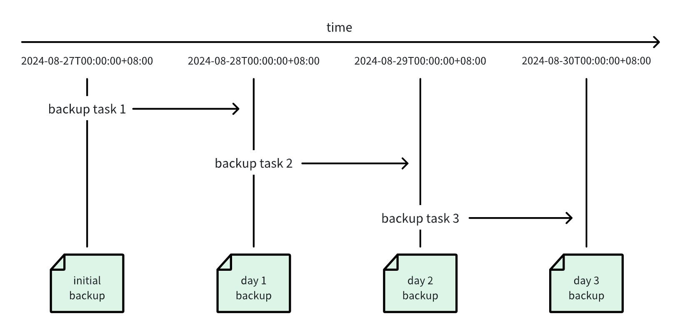

You can back up the data in your TDengine cluster and restore it in the event that data is lost or damaged.

## Full Cluster Backup and Restoration

TDengine TSDB Enterprise supports full backup and restoration at the cluster level. Backups are performed online, while restoration is performed offline. This feature is suitable for restoring an entire cluster to the original cluster or to another cluster with the same topology.

### Create a Full Backup

Use the SQL command `CREATE FULL BACKUP` to create a full backup. The syntax is as follows:

```sql
CREATE FULL BACKUP ON DNODE <dnode_id> TO <backup_path> [WITH PASSWORD <password>] [PARALLEL <n>];
```

Here, `dnode_id` specifies the dnode that executes the backup task, and `backup_path` specifies the backup directory. To encrypt the backup data, use the `WITH PASSWORD` clause and provide a `password`.

`PARALLEL <n>` specifies the number of vgroups to back up in parallel. The default value is `1` (serial backup), and the value must be greater than or equal to `1`. When the cluster has many vgroups, increasing this value can significantly shorten the backup time. However, a very high concurrency increases disk I/O pressure, so set it based on disk capabilities and system load.

**Notes**

1. Time-series data can be read and written during a backup. However, because a backup involves reading and writing a large amount of data, running backups during periods of low system activity is recommended.
2. Metadata can be read during a backup, but do not add, delete, or modify metadata.
3. Data encryption has a significant impact on backup and restoration performance. Choose whether to enable it based on your actual requirements. Keep the password secure, the data cannot be restored if it is lost.
4. Only one backup task can be running at a time.

For example, the following command creates a full backup on dnode `1`, saves the backup data to `/backup`, and encrypts the backup data with the password `Abcd1234`:

```sql
CREATE FULL BACKUP ON DNODE 1 TO '/backup' WITH PASSWORD 'Abcd1234';
```

The following command creates a full backup on dnode `1` and backs up the vgroups with 4 parallel tasks:

```sql
CREATE FULL BACKUP ON DNODE 1 TO '/backup' PARALLEL 4;
```

After the backup succeeds, a subdirectory is created under the backup directory based on the backup time. This subdirectory is the backup chain directory, such as `/backup/20260824094003`. Specify this backup chain directory when restoring data.

### View Backup Status

Use `SHOW BACKUPS` to view backup tasks and historical backup records:

```sql
SHOW BACKUPS;
```

For example:

```shell
taos> show backups;
       id       |  status   |     chain      | database | full | encrypted |    size    | vgroups |       start_time        |      update_time        |
=======================================================================================================================================================
 20260824094003 | succeeded | 20260824094003 | *        |    1 |         1 |  136760311 |   4/4   | 2026-08-24 09:40:03.324 | 2026-08-24 09:42:50.061 |
 20260819153410 | succeeded | 20260819153410 | *        |    1 |         0 |      11592 |   0/0   | 2026-08-19 15:34:10.340 | 2026-08-19 15:34:20.007 |
 20260819153420 | cancelled | 20260819153420 | *        |    1 |         0 |          0 |   0/0   | 2026-08-19 15:34:20.498 | 2026-08-19 15:34:20.498 |
Query OK, 3 row(s) in set (0.007715s)
```

The columns are described below:

| Column | Description |
| --- | --- |
| `id` | Backup ID. |
| `status` | Backup status: `running`, `succeeded`, `failed`, or `cancelled`. |
| `chain` | Backup chain ID. |
| `database` | Database of the backup. `*` means the whole cluster. |
| `full` | Whether this is a full backup. `1` means full backup. |
| `encrypted` | Whether the backup is encrypted. `1` means encrypted. |
| `size` | Total size of the backup files, in bytes. |
| `vgroups` | Number of vgroups backed up and the total number to back up, in the format `<finished>/<total>`. |
| `start_time` | Backup start time. |
| `update_time` | Time when the backup record was last updated. |

Only backups with the `succeeded` status can be used for restoration.

### Cancel a Backup

You can cancel a running backup with `KILL BACKUP`:

```sql
KILL BACKUP <backup_id>;
```

After cancellation, the backup record remains available and its status changes to `cancelled`.

For example:

```sql
KILL BACKUP 20260824094003
```

### Restore Data

Perform data restoration from an operating system terminal. The command syntax is as follows:

```shell
taosd --restore <backup_chain_path> [--password <password>] [--verify=0|1|2] [--parallel <n>] [--verbose]
```

Here:

- `backup_chain_path` is the backup chain directory created during the backup. The backup chain path may differ between backup and restoration if the storage device is mounted at a different path.
- `password` is the password used to encrypt the backup data. It is required only for encrypted backups.
- `verify` specifies whether to verify backup data integrity before restoration. The default value is `1`, which enables verification. If you are certain that the backup data is complete, you can use `0` to skip verification and reduce restoration time. Specify `2` to verify data integrity without performing restoration.
- `parallel` specifies the number of vnodes to restore in parallel. The default value is `1` (serial restoration), and the value must be greater than or equal to `1`. When there are many vnodes, increasing this value can significantly shorten the verification and restoration time.
- Because restoration involves interactive prompts, only logs closely related to restoration are printed by default. If an error occurs, rerun the restoration with `verbose` to print more diagnostic information.

**Notes**

1. Data restoration is performed offline. Prevent other applications from accessing the cluster throughout the restoration process.
2. Run the restoration once on each dnode in the target cluster.
3. The number of dnodes in the target cluster must be the same as in the source cluster.
4. If backup integrity verification fails, restoration is skipped and no existing data is modified. However, the existing data on a dnode is cleared when restoration begins. This data cannot be rolled back even if restoration subsequently fails.
5. Restoration only restores mnode, vnode, and snode data. anode, bnode, qnode, and xnode are stateless nodes and must be handled manually after restoration.

For example, the following command decrypts and restores the backup chain at `/backup/20260824094003`:

```shell
taosd --restore /backup/20260824094003 --password Abcd1234
```

Follow these steps to restore data:

**Step 1:** Prepare the software and hardware environment for all dnodes in the target cluster. The number of target dnodes must be the same as in the source cluster.

**Step 2:** Start all dnodes and use the `CREATE DNODE` command to add all dnodes to the cluster.

**Step 3:** Stop all dnodes.

**Step 4:** Run the restoration command separately on each dnode (this step can be executed parallelly on all dnodes to reduce overall restoration time).

- **Step 4.1:** Start restoration with the appropriate options described above.
- **Step 4.2:** `taosd` verifies the integrity of the backup data. If verification fails, restoration fails immediately and the remaining steps are skipped.
- **Step 4.3:** `taosd` checks version compatibility. Using the same `taosd` version as the one used for the backup is recommended. If the version numbers differ, `taosd` asks whether to continue. You must enter `YES` in uppercase to continue; any other input exits the restoration.
- **Step 4.4:** `taosd` informs you that the existing data on the dnode will be deleted and cannot be rolled back. You must enter `YES` in uppercase to continue; any other input exits the restoration.
- **Step 4.5:** `taosd` restores the data and prints progress information. This step may take a long time depending on the amount of data. Wait for it to complete.
- **Step 4.6:** After restoration completes, `taosd` prints `restore completed successfully`.

**Step 5:** Start all dnodes and check that the cluster and its data are functioning correctly.

**Step 6:** Manually restore anode, bnode, qnode, and xnode as needed.

**Step 7:** After the cluster is restored, reconnect other applications and resume normal use.

## Data Backup and Restoration Using taosdump

taosdump is an open-source tool that supports backing up data from a running TDengine cluster and restoring the backed-up data to the same or another running TDengine cluster. taosdump can back up the database as a logical data unit or back up data records within a specified time period in the database. When using taosdump, you can specify the directory path for data backup. If no directory path is specified, taosdump will default to backing up the data in the current directory.

### Back Up Data with taosdump

Below is an example of using taosdump to perform data backup.

```shell
taosdump -h localhost -P 6030 -D dbname -o /file/path
```

After executing the above command, taosdump will connect to the TDengine cluster at localhost:6030, query all data in the database dbname, and back up the data to /file/path.

When using taosdump, if the specified storage path already contains data files, taosdump will prompt the user and exit immediately to avoid data overwriting. This means the same storage path can only be used for one backup. If you see related prompts, please operate carefully to avoid accidental data loss.

### Restore Data with taosdump

To restore data files from a specified local file path to a running TDengine cluster, you can execute the taosdump command by specifying command-line parameters and the data file path. Below is an example code for taosdump performing data restoration.

```shell
taosdump -i /file/path -h localhost -P 6030
```

After executing the above command, taosdump will connect to the TDengine cluster at localhost:6030 and restore the data files from /file/path to the TDengine cluster.

## Subscription based Backup and Restoration

TDengine Enterprise implements incremental backup and recovery of data by using data subscription. The backup and recovery functions of TDengine Enterprise include the following concepts:

1. Incremental data backup: Based on TDengine's data subscription function, all data changes of **the backup object** (including: addition, modification, deletion, metadata change, etc.) are recorded to generate a backup file.
2. Data recovery: Use the backup file generated by incremental data backup to restore **the backup object** to a specified point in time.
3. Backup object: The object that the user backs up can be a **database** or a **supertable**.
4. Backup plan: The user creates a periodic backup task for the backup object. The backup plan starts at a specified time point and periodically executes the backup task at intervals of **the backup cycle.** Each backup task generates a **backup point** .
5. Backup point: Each time a backup task is executed, a set of backup files is generated. They correspond to a time point, called **a backup point** . The first backup point is called **the initial backup point** .
6. Restore task: The user selects a backup point in the backup plan and creates a restore task. The restore task starts from **the initial backup point** and plays back the data changes in **the backup file** one by one until the specified backup point ends.

### Incremental Backup Example



1. The user creates a backup plan to execute the backup task every 1 day starting from 2024-08-27 00:00:00 .
2. The first backup task was executed at 2024-08-27 00:00:00, generating an initial backup point .
3. After that, the backup task is executed every 1 day, and multiple backup points are generated .
4. Users can select a backup point and create a restore task .
5. The restore task starts from the initial backup point, applies the backup points one by one, and restores to the specified backup point.

### Back Up Data in TDengine Enterprise

1. In a web browser, open the taosExplorer interface for TDengine. This interface is located on port 6060 on the hostname or IP address running TDengine.
2. In the main menu on the left, click **Management** and open the **Backup** tab.
3. Under **Backup Plan**, click **Create New Backup** to define your backup plan.
     1. **Database:** Select the database that you want to backup.
     2. **Super Table:** (Optional) Select the supertable that you want to backup. If you do not select a supertable, all data in the database is backed up.
     3. **Next execution time:** Enter the date and time when you want to perform the initial backup for this backup plan. If you specify a date and time in the past, the initial backup is performed immediately.
     4. **Backup Cycle:** Specify how often you want to perform incremental backups. The value of this field must be less than the value of `WAL_RETENTION_PERIOD` for the specified database.
     5. **Retry times:** Enter how many times you want to retry a backup task that has failed, provided that the specific failure might be resolved by retrying.
     6. **Retry interval:** Enter the delay in seconds between retry attempts.
     7. **Directory:** Enter the full path of the directory in which you want to store backup files.
     8. **Backup file max size:** Enter the maximum size of a single backup file. If the total size of your backup exceeds this number, the backup is split into multiple files.
     9. **Compression level:** Select **fastest** for the fastest performance but lowest compression ratio, **best** for the highest compression ratio but slowest performance, or **balanced** for a combination of performance and compression.
4. Users can enable S3 dumping to upload backup files to the S3 storage service. To enable S3 dumping, the following information needs to be provided:
     1. **Endpoint**: The address of the S3 endpoint.
     2. **Access Key ID**: The access key ID for authentication.
     3. **Secret Access Key**: The secret access key for authentication.
     4. **Bucket**: The name of the target bucket.
     5. **Region**: The region where the bucket is located.
     6. **Object Prefix**: A prefix for backup file objects, similar to a directory path on S3.
     7. **Backup Retention Period**: The retention duration for local backups. All files older than `current time - backup_retention_period` must be uploaded to S3.
     8. **Backup Retention Count**: The number of local backups to retain. Only the latest `backup_retention_size` backup files are kept locally.
5. Click **Confirm** to create the backup plan.

You can view your backup plans and modify, clone, or delete them using the buttons in the **Operation** columns. Click **Refresh** to update the status of your plans. Note that you must stop a backup plan before you can delete it. You can also click **View** in the **Backup File** column to view the backup record points and files created by each plan.

### Restore Data in TDengine Enterprise

1. Locate the backup plan containing data that you want to restore and click **View** in the **Backup File** column.
2. Determine the backup record point to which you want to restore and click the Restore icon in the **Operation** column.
3. Select the backup file timestamp and target database and click **Confirm**.

### Restore to Another Cluster with the taosx CLI

In addition to creating a restore task in taosExplorer, you can copy the backup files to another cluster and restore them with the `taosx` command-line interface.

#### Backup Directory

New task-level backups are stored directly in the task ID directory:

```text
<backup-root>/
└── <task_id>/
    ├── .taosx-backup-layout
    ├── <topic>-<timestamp>-<vgroup>-<index>.z
    ├── <topic>-<timestamp>-<vgroup>-<index>.mz
    └── ...
```

New task-level backup writers create the hidden `.taosx-backup-layout` marker in the task ID directory. It declares whether backup artifacts are stored directly in the task directory (`task_dir`) or in the historical `-1` subdirectory (`legacy_job_dir`). When the marker is present, `taosx` treats it as authoritative and does not probe the alternative layout. Preserve the marker and do not edit or recreate it manually.

The layout marker is not an HA lock. During an upgrade, do not let an older `taosx` version that does not recognize the marker and a newer version write the same backup task concurrently. Stop the backup task and confirm that the old process has exited before switching versions. After a `task_dir` marker has been created, do not resume the same task and backup root with an older version that does not recognize the marker, even after the newer process has exited. Otherwise, the old and new files are written to different directories. To roll back, use a new task ID or a new backup root instead of appending to the existing backup chain.

Only jobs that were actually split from a task use a `<task_id>/<job_id>` subdirectory. A task-level backup does not require a job directory or a job ID in the restore command. The restore process automatically recognizes task-level directories created by earlier versions.

To restore a backup from an actual job, copy the job directory that contains the `.z` and `.mz` files and point `local:` directly to the copied directory. The following procedure uses a task-level backup as an example.

#### Procedure

1. Stop the backup task on Cluster A, or make sure that the backup point to restore has been created.
2. Copy the complete task directory to Cluster B and preserve its directory hierarchy and original backup file names. For example:

   ```shell
   rsync -a /backup/10/ user@cluster-b:/tmp/10/
   ```

   Copy the complete task directory, including the hidden `.taosx-backup-layout` file. `rsync -a` preserves hidden files; do not copy with a shell glob such as `/backup/10/*`, because it omits hidden files. An incremental restore requires the complete file chain from the initial backup point through the target point. Copy `.mz` files as well when they are present in the backup directory.
3. Recursively verify that the task directory contains backup files on Cluster B:

   ```shell
   find /tmp/10 -type f \( -name '.taosx-backup-layout' -o -name '*.z' -o -name '*.mz' \) -print
   ```

4. Specify the copied task directory directly after `local:`. The following example restores the backup for task `10` to the `db01` database on Cluster B:

   ```shell
   taosx run \
     -f 'local:/tmp/10?to=now&watch=false' \
     -t 'taos:///db01' \
     -vv
   ```

   For a historical task-level directory without a layout marker, you can specify the layout explicitly to skip legacy compatibility detection:

   ```shell
   # Backup files are stored directly in /tmp/10
   taosx run \
     -f 'local:/tmp/10?to=now&watch=false&layout=task_dir' \
     -t 'taos:///db01' \
     -vv

   # Backup files are stored in /tmp/10/-1
   taosx run \
     -f 'local:/tmp/10?to=now&watch=false&layout=legacy_job_dir' \
     -t 'taos:///db01' \
     -vv
   ```

   The `layout` parameter applies only to task-level backups. When a layout marker is present, an explicit `layout` must match it or the restore fails. A read-only restore does not create a layout marker.
5. Check the `taosx` logs for the number of files and rows processed, and query the target cluster to verify the restored data. A zero exit code alone does not prove that data was restored.

If neither a layout marker nor an explicit `layout` is present, `taosx` performs legacy compatibility detection and logs the warning `backup layout marker is missing; using legacy layout detection`. Only in this case, if backup files exist both directly in the task directory and in its historical `-1` subdirectory, does the restore report a directory-layout conflict. Verify both locations and consolidate the complete chain in a separate restore directory before retrying. Do not overwrite files with the same name when their contents differ.

## Troubleshooting

### Port Access Exception

A port access exception is indicated by the following error:

```text
Error: tmq to td task exec error

Caused by:
    [0x000B] Unable to establish connection
```

If you encounter this error, check whether the data source FQDN is connected and whether port 6030 is listening and accessible.

### Connection Issues

A connection issue is indicated by the task failing to start and reporting the following error:

```text
Error: tmq to td task exec error

Caused by:
    0: WebSocket internal error: IO error: failed to lookup address information: Temporary failure in name resolution
    1: IO error: failed to lookup address information: Temporary failure in name resolution
    2: failed to lookup address information: Temporary failure in name resolution
```

The following are some possible errors for WebSocket connections:

- "Temporary failure in name resolution": DNS resolution error. Check whether the specified IP address or FQDN can be accessed normally.
- "IO error: Connection refused (os error 111)": Port access failed. Check whether the port is configured correctly and is enabled and accessible.
- "IO error: received corrupt message": Message parsing failed. This may be because SSL was enabled using the WSS method, but the source port is not supported.
- "HTTP error: *": Confirm that you are connecting to the correct taosAdapter port and that your LSB/Nginx/Proxy has been configured correctly.
- "WebSocket protocol error: Handshake not finished": WebSocket connection error. This is typically caused by an incorrectly configured port.

### WAL Configuration

A WAL configuration issue is indicated by the task failing to start and reporting the following error:

```text
Error: tmq to td task exec error

Caused by:
    [0x038C] WAL retention period is zero
```

To resolve this error, modify the WAL retention period for the affected database:

```sql
ALTER DATABASE test WAL_RETENTION_PERIOD 3600;
```
