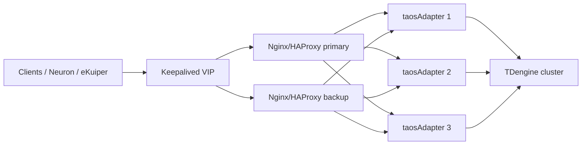

## Overview

taosAdapter is a stateless access layer: any instance can accept requests and forward them to the TDengine cluster through taosc. You can therefore deploy multiple taosAdapter instances on separate hosts and put Nginx or HAProxy in front for load balancing, health checks, and failover.

This page covers:

- prerequisites and topology for multi-instance deployments;
- health check endpoints and the difference between active and passive checks;
- complete Nginx and HAProxy configurations;
- TLS/mTLS;
- high availability for the load balancer itself;
- verification, troubleshooting, and the relationship with connector-side high availability.

Use this page when:

- clients can only be configured with one address, such as HTTP, InfluxDB, or OpenMetrics clients, Neuron, or eKuiper;
- you need a unified TLS/mTLS entry point;
- you need active health checks to remove failed instances quickly;
- connector versions are too old to support `adapterHa` or `adapterList`.

A load balancer only removes the taosAdapter single point of failure. It does not replace TDengine replication and failover. Deploying every taosAdapter on the same host also does not protect against host failure.

Recommended topology:



## Prerequisites

- Deploy at least two, preferably three, taosAdapter instances on separate hosts; all instances must connect to the same TDengine cluster.
- Use the same version and consistent configuration on every instance. Set a different `instanceId` on each instance so logs are distinguishable. See [Basic Configuration](02-configuration.md#basic-configuration).
- Every taosAdapter instance must be able to reach the taosd cluster. Configure replication or a TDengine cluster so the database layer is not a single point of failure.
- taosAdapter registers itself with TDengine and can be inspected through `performance_schema.perf_instances`. See [Registration Configuration](02-configuration.md#registration-configuration).
- The network from the load balancer to taosAdapter and from taosAdapter to taosd must be reachable. For cross-host deployments, check firewalls, DNS, and time synchronization.
- Do not place all taosAdapter instances on the same host; a host failure would take them all down.

## Health Checks

taosAdapter exposes `GET /-/ping` for health checks:

- Returns HTTP `200` when healthy.
- Returns HTTP `503` when memory usage exceeds `pauseAllMemoryThreshold`. When `pauseQueryMemoryThreshold` is exceeded, requests with `action=query` return `503`. See [Memory limit configuration](02-configuration.md#memory-limit-configuration).
- The endpoint requires no authentication, so load balancers and external probes can call it periodically.

For InfluxDB clients, taosAdapter also supports `GET|HEAD /influxdb/v1/ping`, which returns `204` normally and `200` with `verbose=true`. For load balancer health checks, use `/-/ping` rather than a write endpoint.

| Capability | Nginx Open Source | Nginx Plus / third-party module | HAProxy |
| --- | --- | --- | --- |
| Passive checks (`max_fails`/`fail_timeout`) | Yes | Yes | Yes |
| Active checks | No | Nginx Plus or `nginx_upstream_check_module` | Yes |
| WebSocket long connections | Yes | Yes | Yes |
| TLS/mTLS | Yes | Yes | Yes |
| Best fit | Existing Nginx, passive removal is acceptable | Enterprise Nginx | Active checks and precise failover |

## Nginx Load Balancing and Failover

### Complete configuration

The following example uses three taosAdapter instances, terminates TLS at Nginx, and routes REST, WebSocket, and InfluxDB writes with appropriate timeouts and retry policies.

```nginx
# WebSocket upgrade, while keeping upstream keepalive for ordinary HTTP.
map $http_upgrade $connection_upgrade {
    default upgrade;
    ''      '';
}

upstream taosadapter {
    least_conn;
    server adapter-a.internal:6041 max_fails=3 fail_timeout=10s;
    server adapter-b.internal:6041 max_fails=3 fail_timeout=10s;
    server adapter-c.internal:6041 max_fails=3 fail_timeout=10s;
    keepalive 64;
}

server {
    listen 443 ssl http2;
    server_name tsdb.example.com;
    ssl_certificate     /etc/nginx/certs/server.crt;
    ssl_certificate_key /etc/nginx/certs/server.key;
    ssl_protocols       TLSv1.2 TLSv1.3;
    ssl_ciphers         HIGH:!aNULL:!MD5;
    client_max_body_size 64m;

    # REST, JSON, OpenTSDB and other ordinary HTTP requests.
    # POST is not retried here; arbitrary SQL may not be idempotent.
    location / {
        proxy_pass http://taosadapter;
        proxy_http_version 1.1;
        proxy_set_header Host $host;
        proxy_set_header X-Real-IP $remote_addr;
        proxy_set_header X-Forwarded-For $proxy_add_x_forwarded_for;
        proxy_set_header X-Forwarded-Proto $scheme;
        proxy_set_header Connection "";
        proxy_connect_timeout 5s;
        proxy_send_timeout    300s;
        proxy_read_timeout    300s;
        proxy_next_upstream error timeout http_502 http_503 http_504;
        proxy_next_upstream_tries 3;
    }

    # WebSocket: long-lived connections need their own timeouts.
    location /ws {
        proxy_pass http://taosadapter;
        proxy_http_version 1.1;
        proxy_set_header Upgrade $http_upgrade;
        proxy_set_header Connection $connection_upgrade;
        proxy_set_header Host $host;
        proxy_set_header X-Real-IP $remote_addr;
        proxy_set_header X-Forwarded-For $proxy_add_x_forwarded_for;
        proxy_set_header X-Forwarded-Proto $scheme;
        proxy_connect_timeout 5s;
        proxy_send_timeout    3600s;
        proxy_read_timeout    3600s;
        proxy_next_upstream error timeout http_502 http_503 http_504;
        proxy_next_upstream_tries 3;
    }

    # InfluxDB v1 writes: POST may be retried after connection/read failures.
    # Same-timestamp points overwrite, so retries are generally safe for
    # schemaless writes. Do not apply non_idempotent to arbitrary SQL.
    location /influxdb/v1/ {
        proxy_pass http://taosadapter;
        proxy_http_version 1.1;
        proxy_set_header Host $host;
        proxy_set_header X-Real-IP $remote_addr;
        proxy_set_header X-Forwarded-For $proxy_add_x_forwarded_for;
        proxy_set_header X-Forwarded-Proto $scheme;
        proxy_set_header Connection "";
        proxy_connect_timeout 5s;
        proxy_send_timeout    300s;
        proxy_read_timeout    300s;
        proxy_next_upstream error timeout http_502 http_503 http_504 non_idempotent;
        proxy_next_upstream_tries 3;
    }

    # Optional: expose the adapter health check through the LB.
    location = /-/ping {
        proxy_pass http://taosadapter/-/ping;
        access_log off;
    }
}
```

Notes:

- `least_conn` distributes by current connection count and suits long-lived connections and mixed workloads. No session affinity is required because taosAdapter is stateless.
- `max_fails=3 fail_timeout=10s` is a passive check: remove an instance for 10 seconds after three failures. Nginx Open Source has no active health checks.
- `keepalive 64` requires `proxy_http_version 1.1`; ordinary HTTP requests reuse upstream connections through `proxy_set_header Connection ""`, while WebSocket uses `$connection_upgrade`.
- `proxy_read_timeout` is 300 seconds for ordinary queries and 3600 seconds for WebSocket. Tune these values to your query duration and idle-connection behavior.
- `proxy_next_upstream_tries 3` allows at most three attempts per request, including the first.
- `location /` does not retry POST; `location /influxdb/v1/` retries writes with `non_idempotent`. Confirm the write semantics first: InfluxDB line protocol and schemaless writes overwrite a duplicate point with the same child table and timestamp, so retries are usually safe. Arbitrary REST SQL may not be idempotent, so do not enable `non_idempotent` globally.
- `client_max_body_size` must cover bulk write bodies; the example uses 64 MiB.
- `location = /-/ping` lets external probes or a second-level load balancer check Nginx-to-backend connectivity. For Nginx itself, use `nginx -t` plus process and port probes.

### Nginx active health checks

Nginx Open Source does not provide active health checks. If you need them:

- Nginx Plus: use `health_check` in `location`, for example:

  ```nginx
  upstream taosadapter {
      zone taosadapter 64k;
      least_conn;
      server adapter-a.internal:6041 max_fails=3 fail_timeout=10s;
      server adapter-b.internal:6041 max_fails=3 fail_timeout=10s;
      server adapter-c.internal:6041 max_fails=3 fail_timeout=10s;
  }

  server {
      location / {
          proxy_pass http://taosadapter;
          health_check interval=3s fails=3 passes=2 uri=/-/ping;
      }
  }
  ```

- Use a module such as `nginx_upstream_check_module`;
- Or use HAProxy, described below.

The `health_check` syntax varies by Nginx version. Check the documentation for your version before deploying.

### Nginx high availability

A single Nginx instance becomes a new single point of failure. For production, use two Nginx instances with a Keepalived VIP, or a managed cloud load balancer. Synchronize configuration and certificates between the two Nginx nodes; see “Load Balancer High Availability” below.

## HAProxy Load Balancing and Failover

HAProxy supports active health checks and is a good fit when you need fast removal of failed instances and precise control over retries and sessions. The following example targets HAProxy 2.2+; adjust the syntax for older versions.

### Complete configuration

```haproxy
global
    log stdout format raw local0
    maxconn 20000
    stats socket /var/run/haproxy/admin.sock mode 660 level admin

defaults
    log global
    mode http
    option httplog
    option redispatch
    retries 3
    timeout connect 5s
    timeout client 3600s
    timeout server 3600s
    timeout http-request 10s
    timeout http-keep-alive 10s
    timeout queue 30s
    timeout tunnel 1h
    default-server inter 3s fall 3 rise 2

frontend taosadapter_fe
    bind *:6041
    # TLS termination:
    # bind *:6041 ssl crt /etc/haproxy/certs/taos.pem ssl-min-ver TLSv1.2
    # mTLS: add "verify required ca-file /etc/haproxy/certs/client-ca.crt" to bind.
    default_backend taosadapter_be

backend taosadapter_be
    balance leastconn
    option httpchk GET /-/ping
    http-check expect status 200
    http-reuse safe
    # Optional: drop existing sessions when an instance is marked down.
    # on-marked-down shutdown-sessions
    server adapter-a adapter-a.internal:6041 check
    server adapter-b adapter-b.internal:6041 check
    server adapter-c adapter-c.internal:6041 check
```

Notes:

- `option httpchk GET /-/ping` plus `http-check expect status 200` performs active health checks. `inter 3s fall 3 rise 2` checks every 3 seconds, removes after three consecutive failures, and restores after two consecutive successes.
- `balance leastconn` distributes by connection count; no session affinity is required.
- `option redispatch` and `retries 3` allow a connection failure to be retried on another instance. HAProxy 2.1+ supports `retry-on`, for example `retry-on conn-failure empty-response 502 503 504`, but this can also amplify duplicate writes. Use it only on retry-safe paths such as InfluxDB or schemaless writes.
- `timeout tunnel 1h` covers WebSocket tunnels; `timeout client/server 3600s` covers long-lived connections. Shorten the REST timeouts as needed.
- `http-reuse safe` reuses upstream connections; `timeout http-keep-alive` controls idle connections.
- `on-marked-down shutdown-sessions` closes established sessions when an instance is removed, prompting clients to reconnect to a healthy instance. Enable it when this behavior suits your long-lived connections.
- `stats socket` exposes runtime backend state. To add an HTTP statistics page, add `stats uri /haproxy?stats` to a frontend.

### Active checks and failover

HAProxy active checks can detect failures sooner than Nginx passive checks. Recommended settings:

- Set `inter` to 2–5 seconds, `fall` to 2–3, and `rise` to 2.
- Use `/-/ping` as the health check path and expect status `200`.
- Enable `timeout tunnel` for long-lived connections so WebSocket is not cut off by ordinary timeouts.
- If you need precise retries, use `retry-on` only on idempotent paths.
- HAProxy automatically re-adds a recovered instance; observe it through the stats socket or statistics page.

## Health Check and Retry Semantics

When a load balancer retries a request, distinguish whether the request reached taosAdapter:

- Connection failure, connection timeout, or no response yet: usually safe to try another instance.
- A response with a 5xx status: the error may come from taosAdapter or from downstream TDengine. Confirm the request is idempotent before retrying.
- Writes: a duplicate write with the same child table and timestamp usually overwrites. InfluxDB line protocol, OpenMetrics, and schemaless writes can use this behavior to make retries safe.
- DDL, privilege, and task SQL: usually not idempotent; do not retry automatically.

Recommendations:

- Separate ordinary REST SQL from retry-safe write paths (the example uses `location /` and `location /influxdb/v1/`).
- Enable Nginx `non_idempotent` or HAProxy `retry-on` only on retry-safe paths.
- Use deterministic timestamps in the client or data source so duplicate writes can overwrite cleanly.
- Monitor retry counts and duplicate-write symptoms so failover does not amplify data problems.

## TLS and mTLS

### Nginx

- Terminate HTTPS/WSS at Nginx with `ssl_certificate` and `ssl_certificate_key`. The certificate SAN must match the hostname clients use.
- For mutual TLS, add `ssl_client_certificate /etc/nginx/certs/client-ca.crt;` and `ssl_verify_client on;`.
- Nginx-to-taosAdapter traffic is HTTP by default and should stay on a controlled network. To encrypt it, change `proxy_pass` to `https://taosadapter` and configure `proxy_ssl_verify on`, `proxy_ssl_trusted_certificate`, and `proxy_ssl_name`.
- taosAdapter's own SSL configuration is described in [SSL](02-configuration.md#ssl). Certificate generation and full-trace transport security are covered in [Full-Trace Transport Security](../../../11-security-guide/02-full-trace-transport.md#11-appendix-generate-a-self-signed-certificate).

### HAProxy

- Terminate TLS with `bind *:6041 ssl crt /etc/haproxy/certs/taos.pem ssl-min-ver TLSv1.2`. The PEM file should contain the certificate, private key, and optional intermediate certificates.
- For mutual TLS, add `verify required ca-file /etc/haproxy/certs/client-ca.crt` to the bind line.
- For upstream TLS to taosAdapter, add `ssl verify required ca-file /etc/haproxy/certs/adapter-ca.crt` to each `server` line. If the certificate SAN differs from the address, use `sni`/`verifyhost` to specify the verification name.
- When rotating certificates, update the HAProxy configuration and certificate files, validate with `haproxy -c -f`, and reload gracefully.

## Load Balancer High Availability

Nginx or HAProxy itself can fail. Recommended practices:

- Use two load balancer nodes with a Keepalived VIP; clients only use the VIP.
- Keep backends, health checks, TLS certificates, and routing configuration identical on both nodes.
- Have Keepalived monitor the load balancer process or a local health endpoint and move the VIP on failure.
- In cloud environments, prefer a managed load balancer with cross-AZ backends and a `/-/ping` health check.
- A single load balancer should at least have DNS multiple A records or a standby address, but that is not strongly consistent failover.

Keepalived example (on the primary node use `state MASTER` and `priority 100`; on the backup use `state BACKUP` and `priority 90`, keeping everything else the same):

```text
vrrp_script chk_haproxy {
    script "/usr/bin/pgrep -x haproxy >/dev/null"
    interval 2
    weight -20
}

vrrp_instance VI_TAOSADAPTER {
    state MASTER
    interface eth0
    virtual_router_id 51
    priority 100
    advert_int 1
    authentication {
        auth_type PASS
        auth_pass <password>
    }
    virtual_ipaddress {
        192.168.10.100/24 dev eth0
    }
    track_script {
        chk_haproxy
    }
}
```

Notes:

- `pgrep` only checks whether the process exists; it does not prove the backend is healthy. For production, use a local health endpoint, the HAProxy stats socket, or an Nginx status page for a more precise check.
- Synchronize configuration, certificates, and firewall rules between the primary and backup nodes. VRRP requires multicast/protocol traffic to be allowed.
- After a failover, verify the VIP, health checks, and backend connections.

## Verification and Troubleshooting

### Verification checklist

1. Access `GET /-/ping` through the load balancer and confirm `200`; also check `/-/ping` on each taosAdapter directly.
2. Run a REST query and write through the load balancer; connect a WebSocket client and confirm `101 Switching Protocols`.
3. Keep a WebSocket connection open longer than `proxy_read_timeout`/`timeout tunnel` and confirm it is not closed early.
4. Stop one taosAdapter instance and confirm new requests still succeed; inspect Nginx/HAProxy logs and health status.
5. Verify TLS/mTLS: certificate SAN, client certificate, CA, and upstream verification.
6. Simulate a write retry after failover and confirm duplicates overwrite as expected, or confirm that non-idempotent paths are excluded from retries.
7. Stop all taosAdapter instances and confirm the load balancer returns a clear 5xx; restore an instance and confirm it is re-added automatically.
8. Stop one load balancer node and confirm the VIP moves and clients still work.

### Common problems

| Symptom | Possible cause | Action |
| --- | --- | --- |
| 502/504 | taosAdapter unreachable, query timeout, wrong upstream port | Check `/-/ping`, `proxy_connect_timeout`, `proxy_read_timeout`, and taosAdapter logs |
| WebSocket handshake 400 | Missing `Upgrade`/`Connection` headers, or `/ws` handled by a generic location | Add upgrade headers and long timeouts for `/ws` |
| Frequent disconnects | `proxy_read_timeout`/`timeout server` too short | Increase the WebSocket and long-query timeouts |
| Duplicate writes | `non_idempotent`/`retry-on` enabled for non-idempotent requests | Enable retries only for overwrite-safe writes; use deterministic timestamps |
| All requests return 503 | All taosAdapter instances removed, or `/-/ping` returns 503 due to memory thresholds | Check instance health, memory, and `pauseAllMemoryThreshold` |
| TLS handshake failure | Certificate SAN, CA, or client certificate mismatch | Check the chain, SAN, and `verify` configuration |
| Failover does not happen | VRRP blocked by a firewall, or Keepalived configuration mismatch | Check VRRP traffic, `virtual_router_id`, authentication, and priorities |

## Relationship with Connector-Side High Availability

TDengine connectors for C/C++, Go, Python, Node.js, JDBC, Rust, and C# support `adapterHa`, `adapterList`, or multiple endpoints. When enabled, a connector requests the list of available taosAdapter instances and performs client-side load balancing and failover. In that case Nginx or HAProxy is optional. Connector-side HA is the natural choice for TDengine connectors, especially applications that use WebSocket directly; Nginx or HAProxy is for non-connector clients or when you need a unified TLS/mTLS entry point.

The two approaches can be combined, but do not retry writes at both layers; doing so can amplify duplicate writes.

Trade-offs between connector-side HA and a load balancer:

| Scenario | Recommendation |
| --- | --- |
| The application uses a TDengine connector that supports `adapterHa`/`adapterList` | Prefer connector-side HA to avoid an extra network hop and operational overhead |
| The client is HTTP, InfluxDB, Neuron, eKuiper, or another non-connector client | Use Nginx or HAProxy |
| You need a unified TLS/mTLS entry point or want to hide backend topology | Use Nginx or HAProxy; connectors can still target the LB |
| Both connectors and a load balancer are used | Retry writes at only one layer to avoid amplification |

See the [connector reference](../../../10-developer-guide/08-connectors-reference/01-cpp.mdx) for connector parameters and version requirements. For Neuron ingestion, see [Neuron integration](../../../13-ecosystem-integrations/01-collection/11-Neuron.md#encrypted-transport-and-high-availability-optional).

## References

- [taosAdapter configuration](02-configuration.md)
- [taosAdapter SSL](02-configuration.md#ssl)
- [Full-trace high availability](../../../11-security-guide/04-full-trace-availability.md)
- [Full-trace transport security](../../../11-security-guide/02-full-trace-transport.md)
- [Connector reference](../../../10-developer-guide/08-connectors-reference/01-cpp.mdx)
