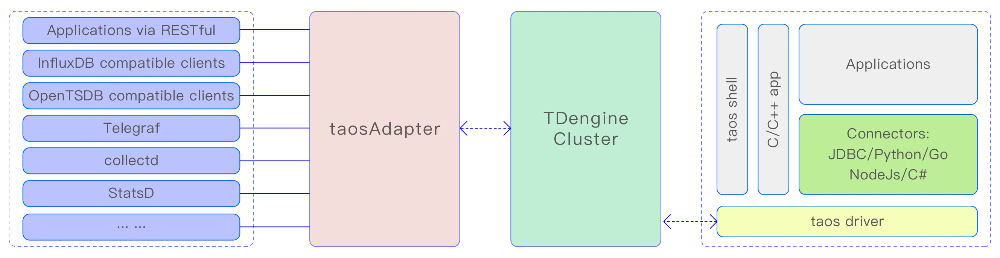

taosAdapter is a companion tool for TDengine, serving as a bridge and adapter between the TDengine cluster and applications. It provides an easy and efficient way to ingest data directly from data collection agents (such as Telegraf, StatsD, collectd, etc.). It also offers InfluxDB/OpenTSDB compatible data ingestion interfaces, allowing InfluxDB/OpenTSDB applications to be seamlessly ported to TDengine.
The connectors of TDengine in various languages communicate with TDengine through the WebSocket interface, hence the taosAdapter must be installed.

The architecture diagram is as follows:



## Manual Structure

- [Data Ingestion Interfaces](01-data-ingestion.md): WebSocket, RESTful, InfluxDB, OpenTSDB, and collection-agent write paths.
- [Configuration Reference](02-configuration.md): basic, SSL, registration, CORS, connection pool, logging, environment variables, and more.
- [Operations and Monitoring](03-operations.md): recording SQL/STMT to CSV and monitoring metrics.
- [High Availability](04-high-availability.md): multiple instances, Nginx/HAProxy load balancing, health checks, failover, and TLS/mTLS.

## Feature List

The taosAdapter provides the following features:

- WebSocket Interface:
  Supports executing SQL, schemaless writing, parameter binding, and data subscription through the WebSocket protocol.
- InfluxDB v1 write interface:
  [https://docs.influxdata.com/influxdb/v2.0/reference/api/influxdb-1x/write/](https://docs.influxdata.com/influxdb/v2.0/reference/api/influxdb-1x/write/)
- Compatible with OpenTSDB JSON and telnet format writing:
  - [http://opentsdb.net/docs/build/html/api_http/put.html](http://opentsdb.net/docs/build/html/api_http/put.html)
  - [http://opentsdb .net/docs/build/html/api_telnet/put.html](http://opentsdb.net/docs/build/html/api_telnet/put.html)
- collectd data writing:
  collectd is a system statistics collection daemon, visit [https://collectd.org/](https://collectd.org/) for more information.
- StatsD data writing:
  StatsD is a simple yet powerful daemon for gathering statistics. Visit [https://github.com/statsd/statsd](https://github.com/statsd/statsd) for more information.
- icinga2 OpenTSDB writer data writing:
  icinga2 is a software for collecting check results metrics and performance data. Visit [https://icinga.com/docs/icinga-2/latest/doc/14-features/#opentsdb-writer](https://icinga.com/docs/icinga-2/latest/doc/14-features/#opentsdb-writer) for more information.
- TCollector data writing:
  TCollector is a client process that collects data from local collectors and pushes it to OpenTSDB. Visit [http://opentsdb.net/docs/build/html/user_guide/utilities/tcollector.html](http://opentsdb.net/docs/build/html/user_guide/utilities/tcollector.html) for more information.
- OpenMetrics data collection and writing:
  OpenMetrics is an emerging standard in the field of cloud-native monitoring. It extends and standardizes the Prometheus metric format and has become the de facto standard for modern monitoring tools. Visit [OpenMetrics Specification](https://github.com/prometheus/OpenMetrics/blob/main/specification/OpenMetrics.md) for more information.
- Supports Prometheus remote_read and remote_write:
  remote_read and remote_write are Prometheus's data read-write separation cluster solutions. Visit [https://prometheus.io/blog/2019/10/10/remote-read-meets-streaming/#remote-apis](https://prometheus.io/blog/2019/10/10/remote-read-meets-streaming/#remote-apis) for more information.
- node_exporter data collection and writing:
  node_exporter is an exporter of machine metrics. Visit [https://github.com/prometheus/node_exporter](https://github.com/prometheus/node_exporter) for more information.
- JSON data writing:
  Supports writing JSON-formatted data to TDengine TSDB through the RESTful interface.
- RESTful API:
  [RESTful API](../../../10-developer-guide/08-connectors-reference/10-rest-api.mdx)

See [Data Ingestion Interfaces](01-data-ingestion.md) for details on each interface.

## Installation

taosAdapter is part of the TDengine server software. If you are using TDengine server, you do not need any additional steps to install taosAdapter. If you need to deploy taosAdapter separately from the TDengine server, you should install the complete TDengine on that server to install taosAdapter. If you need to compile taosAdapter from source code, you can refer to the [Build taosAdapter](https://github.com/taosdata/taosadapter/blob/3.0/README.md) document.

After the installation is complete, you can start the taosAdapter service using the command `systemctl start taosadapter`.

## Service Management

### Starting/Stopping taosAdapter

On Linux systems, the taosAdapter service is managed by default by systemd. Use the command `systemctl start taosadapter` to start the taosAdapter service. Use the command `systemctl stop taosadapter` to stop the taosAdapter service.

### Upgrading taosAdapter

taosAdapter and TDengine server need to use the same version. Please upgrade taosAdapter by upgrading the TDengine server.
taosAdapter deployed separately from taosd must be upgraded by upgrading the TDengine server on its server.

### Removing taosAdapter

Use the command rmtaos to remove the TDengine server software, including taosAdapter.

## Dynamic Configuration

### Dynamically Modify Log Level

Starting from **3.3.5.0 version**, taosAdapter supports dynamic modification of log level through HTTP interface. Users can dynamically adjust the log level by sending HTTP PUT request to /config interface. The authentication method of this interface is the same as /rest/sql interface, and the configuration item key-value pair in JSON format must be passed in the request body.

The following is an example of setting the log level to debug through the curl command:

```shell
curl --location --request PUT 'http://127.0.0.1:6041/config' \
-u root:taosdata \
--data '{"log.level": "debug"}'
```

### Monitor Configuration File Changes

Starting from version **3.3.6.34**/**3.4.0.0**, taosAdapter supports monitoring configuration file changes and automatically updates the following configurations:

- `log.level` log level parameter
- `rejectQuerySqlRegex` rejected query SQL list configuration parameter

## IPv6 Support

Starting from **version 3.3.6.13**, taosAdapter supports IPv6. No additional configuration is required.
taosAdapter automatically detects the system's IPv6 support: when available, it enables IPv6 and simultaneously listens on both IPv4 and IPv6 addresses.

## Changes after upgrading httpd to taosAdapter

In TDengine server version 2.2.x.x or earlier, the taosd process included an embedded HTTP service(httpd). As mentioned earlier, taosAdapter is a standalone software managed by systemd, having its own process. Moreover, there are some differences in configuration parameters and behaviors between the two, as shown in the table below:

| **#** | **embedded httpd**  | **taosAdapter**                                            | **comment**                                                                                                                                                                                                                                        |
|-------|---------------------|------------------------------------------------------------|----------------------------------------------------------------------------------------------------------------------------------------------------------------------------------------------------------------------------------------------------|
| 1     | httpEnableRecordSql | --logLevel=debug                                           |                                                                                                                                                                                                                                                    |
| 2     | httpMaxThreads      | n/a                                                        | taosAdapter automatically manages the thread pool, this parameter is not needed                                                                                                                                                                    |
| 3     | telegrafUseFieldNum | Please refer to taosAdapter telegraf configuration methods |                                                                                                                                                                                                                                                    |
| 4     | restfulRowLimit     | restfulRowLimit                                            | The embedded httpd defaults to outputting 10240 rows of data, with a maximum allowable value of 102400. taosAdapter also provides restfulRowLimit but does not impose a limit by default. You can configure it according to actual scenario needs. |
| 5     | httpDebugFlag       | Not applicable                                             | httpdDebugFlag does not affect taosAdapter                                                                                                                                                                                                         |
| 6     | httpDBNameMandatory | Not applicable                                             | taosAdapter requires the database name to be specified in the URL                                                                                                                                                                                  |
