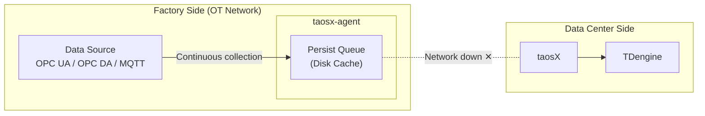
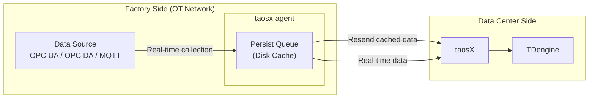

## Overview

In industrial data collection scenarios, taosX-Agent is typically deployed on the factory side (OT network) and communicates with taosX on the data center side via VPN or dedicated lines. When the network is interrupted (e.g., VPN disconnection, weekend shutdowns), data collected during the outage would be lost without a caching mechanism.

**Store and Forward** addresses this: when the network between taosX-Agent and taosX is interrupted, taosX-Agent continues receiving data from the data source and caches it on local disk. After the network recovers, it automatically resends the data that has not been confirmed to taosX.

:::note
Store and Forward caches only data that taosX-Agent has already received. Cached data is synchronized to disk periodically. If the host loses power suddenly or the disk fails, the most recently cached data may be lost.
:::

**During network outage**: Agent continues collecting data and writes it to local disk cache.

**After network recovery**: Cached data is automatically resent and real-time data synchronization resumes.

## Use Cases

| Scenario | Description |
| --- | --- |
| Unstable VPN | VPN between factory and data center may disconnect periodically |
| Planned downtime | Data center network goes offline during weekends or maintenance, while factory must continue data collection |
| Poor network quality | Remote sites with limited bandwidth and occasional disconnections |

:::note
Store and Forward is currently supported for real-time collection tasks with **OPC UA**, **OPC DA**, and **MQTT** data sources.
:::

## How to Enable

Store and Forward is enabled through the advanced options of a data ingestion task, not through the Agent's own configuration.

When creating or editing an OPC UA / OPC DA / MQTT data ingestion task in taosExplorer, configure the following parameters in **Advanced Options**:

| Parameter | DSN Parameter | Default | Description |
| --- | --- | --- | --- |
| **Cache Real-time Data** | `persist_data_enable` | `false` | Whether to enable disk-level data caching (Store and Forward) |
| **Cache Data Directory** | `persist_data_dir` | `$DATA_DIR/tasks/:id/persist_queue/` | Directory for storing cached data |

Turn on the **Cache Real-time Data** toggle to enable Store and Forward.

## How It Works

When Store and Forward is enabled, Agent creates a **persist_queue** (persistent queue) internally. The data flow is split into two paths — write and read:

### Write Path (Data Source → Local Disk)

1. The connector (e.g., taosx-opc) collects data from the data source and passes it to Agent via an IPC pipe.
2. Agent serializes the data and writes it to persist_queue disk files.
3. After a batch is fully written to the cache file, Agent tells the connector that the batch has been received. The data has not been written to TDengine yet.

### Read Path (Local Disk → taosX)

1. persist_queue reads cached data from the disk files.
2. Agent sends the data to taosX.
3. After taosX writes the data to TDengine, it returns the result for that batch.
4. Agent updates the breakpoint in send order. The breakpoint advances only after every earlier batch has been confirmed.

### Breakpoint Recovery

persist_queue records the confirmed read position in a breakpoint database. After the network recovers or Agent restarts, it continues reading and sending cached data from that position.

If taosX has written a batch but the confirmation is lost because of a network interruption, Agent sends that batch again. Store and Forward therefore guarantees that data is written at least once. In a few cases, duplicate data may be produced.

### Confirmation and Failure Handling

Agent treats a batch as delivered only after it receives the write result from taosX. Each case is handled as follows:

| Condition | Handling |
| --- | --- |
| Data is written successfully | Confirm the batch and continue sending subsequent data |
| The data source ends normally | Send the remaining cached data, confirm all of it, and then end the task normally |
| The data itself is invalid, and the task is configured to archive abnormal data | Archive the invalid data, write the rest normally, and keep the task running |
| Network interruption, taosX temporarily unavailable, or delivery timeout | Keep the unconfirmed data and resend it after reconnecting automatically |
| Authentication failure, configuration error, version mismatch, or another write error that cannot be recovered automatically | The task reports the error and stops. Unconfirmed data stays in the cache. Restart the task after the problem is resolved |

Archiving abnormal data saves invalid data when it can, but it does not guarantee a complete archive. If the archive queue is full or writing the archive file fails, some invalid data may not be archived. This does not affect normal writes of the remaining data.

Check the task status and logs for failures, retries, and recovery. An online Agent means only that the connection is healthy. It does not mean the data has been written to TDengine. See [Configuration Reference](./01-configuration.md#delivery-window-and-timeout) for the send window and delivery timeout.

### Behavior During Network Outage

When the network between Agent and taosX is interrupted:

1. **Continue caching data**: The connector continues receiving data from the data source and writes it to persist_queue for as long as local disk space allows.
2. **Pause sending**: Unconfirmed data is not skipped. After data that has been sent but not confirmed reaches the send window limit, Agent pauses sending new data.
3. **Automatic resend on recovery**: After Agent reconnects to taosX, it resumes reading cached data from the persist_queue starting at the breakpoint position.

## Behavior Comparison: Enabled vs. Disabled

| Behavior | Disabled (Default) | Enabled |
| --- | --- | --- |
| Data buffering | In-memory only (default 64 batches) | Disk-based persistent queue (capacity limited only by disk space) |
| Agent ↔ taosX disconnect | Unconfirmed data stays in memory. New data is no longer accepted after the memory buffer is full | Data continues to be written to local disk and is resent automatically after the network recovers |
| Reconnection strategy | Reconnect automatically on a network error. A write error that cannot be recovered automatically stops the task | Reconnect automatically on a network error. A write error that cannot be recovered automatically stops the task |
| After Agent restarts | Data in memory cannot be recovered | Continue sending from the breakpoint on disk |
| Data confirmation | Confirmed only after taosX writes the data to TDengine | Confirmed only after taosX writes the data to TDengine |
| Write latency | Low (in-memory direct transfer) | Slightly increased (requires disk write and read) |

:::warning
When Cache Real-time Data is enabled, data must be written to local disk first and then read from disk before being reported to taosX. This increases end-to-end latency from the data source to TDengine TSDB writes. If your scenario is highly sensitive to write latency and the network environment is stable, you may choose not to enable this feature.
:::

## Disk Space Considerations

When Store and Forward is enabled, cached data occupies disk space on the Agent host. Please note:

- **Cache capacity is limited only by disk space**: During prolonged network outages, cached data will continue to grow.
- **Ensure sufficient disk space**: Estimate the required space based on data collection volume and expected maximum outage duration. For example, 1,000 OPC UA points updating once per second may generate hundreds of MB to several GB of cached data per day (depending on data types and sizes).
- **After resend completes**: Cache files that have been confirmed as successfully sent are automatically cleaned up.

:::tip
You can configure the **Cache Data Directory** to point to a disk partition with sufficient space.
:::
