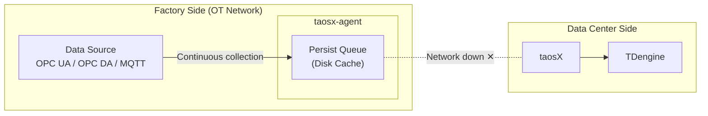
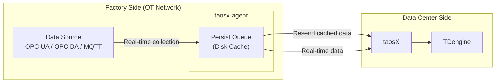
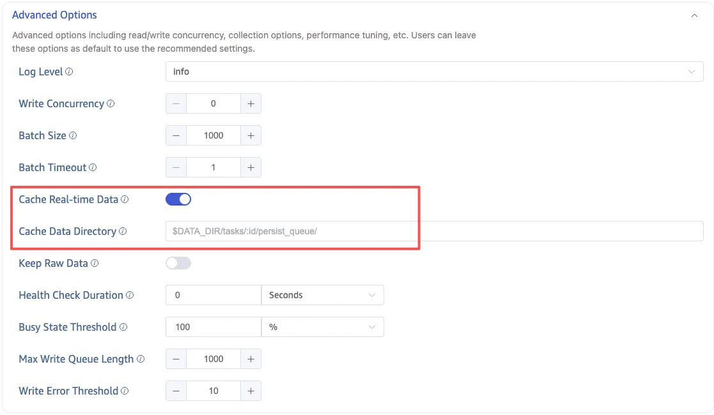

## Overview

In industrial data collection scenarios, taosX-Agent is typically deployed on the factory side (OT network) and communicates with taosX on the data center side via VPN or dedicated lines. When the network is interrupted (e.g., VPN disconnection, weekend shutdowns), data collected during the outage would be lost without a caching mechanism.

The **Store and Forward** feature buffers data already accepted by taosX-Agent. During a network outage, it continues receiving and writing data to disk when the source adapter and local capacity permit, then resends unconfirmed batches after connectivity recovers. It does not independently guarantee capture of every source event or zero data loss after a power failure or disk failure.

**During network outage**: Agent continues collecting data and writes it to local disk cache.

**After network recovery**: Cached data is automatically resent and real-time data synchronization resumes.

## Use Cases

| Scenario | Description |
| --- | --- |
| Unstable VPN | VPN between factory and data center may disconnect periodically |
| Planned downtime | Data center network goes offline during weekends or maintenance, while factory must continue data collection |
| Poor network quality | Remote sites with limited bandwidth and occasional disconnections |

:::note
Store and Forward is currently supported for **OPC UA**, **OPC DA**, and **MQTT** data source types in real-time collection tasks. Delivery protocol v2 does not automatically add raw PI message persistence, model recovery, or C# adaptation; these require separate implementation and validation.
:::

## How to Enable

Store and Forward is enabled through the advanced options of a data ingestion task, not through the Agent's own configuration.

When creating or editing an OPC UA / OPC DA / MQTT data ingestion task in taosExplorer, configure the following parameters in **Advanced Options**:

| Parameter | DSN Parameter | Default | Description |
| --- | --- | --- | --- |
| **Cache Real-time Data** | `persist_data_enable` | `false` | Whether to enable disk-level data caching (Store and Forward) |
| **Cache Data Directory** | `persist_data_dir` | `$DATA_DIR/tasks/:id/persist_queue/` | Directory for storing cached data |

Turn on the **Cache Real-time Data** toggle to enable Store and Forward.

## How It Works

When Store and Forward is enabled, Agent creates a **persist_queue** (persistent queue) internally. The data flow is split into two paths — write and read:

### Write Path (Data Source → Local Disk)

1. The connector (e.g., taosx-opc) collects data from the data source and passes it to Agent via an IPC pipe.
2. Agent serializes the data and writes it to persist_queue disk files.
3. After a complete batch is appended to the queue file, the applicable IPC path returns an acceptance ACK to the connector. The queue uses batch writes, flushes, and periodic synchronization. This ACK does not mean the target write has completed or each record has been fsynced, and it does not guarantee recovery after sudden power loss.

### Read Path (Local Disk → taosX)

1. The persist_queue reader reads data from the disk files.
2. Data is sent to taosX via Arrow Flight RPC.
3. taosX returns a batch outcome after target writes complete. Explicit data errors submitted to the configured archive policy produce a distinct handled outcome after all remaining valid data is written.
4. taosX-Agent validates the outcome and advances the breakpoint only through consecutive completed batches. It cannot skip a failed or incomplete batch.

### Breakpoint Recovery

persist_queue records the consecutively confirmed read position in a breakpoint database. After connectivity recovers or taosX-Agent restarts, it resumes reading uncommitted data from that position. If a target write completes but its confirmation is lost, replay may produce duplicates. Delivery is at least once, not exactly once. Process restart recovery depends on adapter support and intact queue files.

### Confirmation and Failure Handling

This section describes forwarding paths using delivery protocol v2. Receiving data or placing it in memory does not confirm a target write, and heartbeats do not prove batch progress.

| Condition | Behavior |
| --- | --- |
| Normal writes complete | Return a completed outcome and allow consecutive progress to advance |
| Input ends normally | Finish pending queue appends, delivery confirmations, and checkpoint updates before completing. Normal EOF itself is not a failure |
| Explicit data error with an archive policy | Submit abnormal data to the existing archive and finish remaining valid writes before continuing. Do not count this as normal write success |
| Archive queue full, consumer exit, or asynchronous file failure | Abnormal-data logs may be discarded. Delivery does not wait for archive file completion and is not blocked again |
| Disconnection, temporary unavailability, or delivery timeout | Retain unconfirmed batches, reconnect with backoff, and replay |
| Authentication, configuration, protocol, dependency, or unknown write error | Report the error and stop the task without advancing failed batches. Resolve the cause before resuming |

Archiving is best effort. It does not guarantee a complete record of abnormal data or automatic restoration from archive files. Task activities and logs report failures, retries, and recovery; an online Agent does not prove data has reached the target. See [Configuration Reference](./01-configuration.md#delivery-window-and-timeout) for window and timeout settings.

### Behavior During Network Outage

When the network between Agent and taosX is interrupted:

1. **Buffer collected data**: The connector continues receiving and writing data to persist_queue when adapter support, local disk space, and buffer capacity permit. Events not captured from the source are outside the queue guarantee.
2. **Retain delivery progress**: Unconfirmed batches do not advance the consumption position. When the in-flight window is full, the queue reader waits for existing deliveries to complete.
3. **Automatic resend on recovery**: After Agent reconnects to taosX, it resumes reading cached data from the persist_queue starting at the breakpoint position.

## Behavior Comparison: Enabled vs. Disabled

| Behavior | Disabled (Default) | Enabled |
| --- | --- | --- |
| Data buffering | In-memory only (default 64 batches) | Disk-based persistent queue (capacity limited only by disk space) |
| Agent ↔ taosX disconnect | Retain unconfirmed batches in the same process and apply backpressure when the window fills | Buffer to disk when adapter support and capacity permit, then resend |
| Reconnection strategy | Retry transport failures with backoff; stop on explicit writer errors | Retry transport failures with backoff; stop on explicit writer errors |
| Process restart recovery | In-memory batches cannot be recovered | Resume from the consecutively committed disk checkpoint |
| Delivery progress | Wait for a target batch outcome; memory intake does not mean completion | Wait for a target batch outcome before advancing disk consumption; acceptance ACK follows append |
| Write latency | Low (in-memory direct transfer) | Slightly increased (requires disk write and read) |

:::warning
When Cache Real-time Data is enabled, data must be written to local disk first and then read from disk before being reported to taosX. This increases end-to-end latency from the data source to TDengine TSDB writes. If your scenario is highly sensitive to write latency and the network environment is stable, you may choose not to enable this feature.
:::

## Disk Space Considerations

When Store and Forward is enabled, cached data occupies disk space on the Agent host. Please note:

- **Cache capacity is limited only by disk space**: During prolonged network outages, cached data will continue to grow.
- **Ensure sufficient disk space**: Estimate the required space based on data collection volume and expected maximum outage duration. For example, 1,000 OPC UA points updating once per second may generate hundreds of MB to several GB of cached data per day (depending on data types and sizes).
- **After resend completes**: Cache files that have been confirmed as successfully sent are automatically cleaned up.

:::tip
You can configure the **Cache Data Directory** to point to a disk partition with sufficient space.
:::
