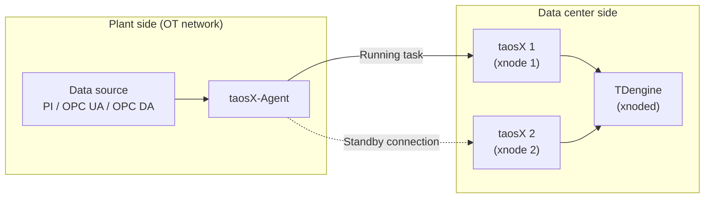

## Overview

One taosX-Agent can connect to multiple taosX instances at the same time. Each taosX instance in the cluster is registered as an xnode, and xnoded schedules a task that collects through this Agent onto one of those taosX instances. When a taosX instance stops, the task moves to another taosX instance that the same Agent is connected to and continues collecting. The task configuration does not need to change.



## Typical Deployment

- Deploy at least two taosX instances and register each one in the same TDengine cluster with `CREATE XNODE`. See [Data Ingestion (Xnode)](../../../05-tdengine-sql/08-cluster-management/02-xnode.md).
- Deploy one taosX-Agent on the network where the data source is located, and set `endpoint` to the addresses of all taosX instances.
- When creating a collection task, select this Agent (choose it from the **Agent** drop-down in taosExplorer, or set the Agent ID with `VIA` in SQL).

:::warning
Deploying two Agents, each connected to one taosX instance, does not provide high availability. A collection task is bound to a single Agent and is not reassigned to another Agent.
:::

## Configuration

### Register xnodes Before Creating the Agent

When you create an Agent in taosExplorer, the system reads all currently registered xnodes and generates `endpoint` with their addresses separated by commas. Register every taosX instance before creating the Agent.

An xnode registered after the Agent is created is not added to the existing Agent configuration. Append the new address to `endpoint` in `agent.toml` and restart taosX-Agent.

### Example

```toml
# gRPC addresses of multiple taosX instances, separated by commas
endpoint = "http://taosx-1:6055,http://taosx-2:6055"

# Token generated when creating the Agent in taosExplorer
token = "<your_token>"
```

:::note

- The generated addresses come from the URL used in `CREATE XNODE`. If that URL is reachable only from the local host, such as `localhost`, change it to an address that the taosX-Agent host can reach.
- Addresses of registered xnodes that are currently offline are also included in the generated `endpoint`.
- taosX-Agent must be able to reach the gRPC port of every taosX instance (6055 by default).

:::

## Failover

1. After xnoded finds that a taosX instance has been offline for about 30 seconds, it starts reassigning the tasks on that instance.
2. For each task that collects through the Agent, xnoded starts the task on the connected taosX instance that has the most available memory.
3. taosX-Agent stops collection on the previous connection and starts it on the new connection only after the previous collection has exited. If that exit cannot be confirmed, the start fails and two copies do not run at the same time.
4. Stale start, stop, and cancel commands from the previous taosX instance, and late task status from that instance, are ignored. The task keeps running on the new taosX instance.

Only running tasks are reassigned. A task that is stopped or stopping is not reassigned.

## Scope and Limits

| Scenario | Result |
| --- | --- |
| One taosX instance stops, and the Agent is still connected to another | The task moves to the other taosX instance and collection continues |
| taosX-Agent stops, or it disconnects from every taosX instance | Collection stops. The task is not reassigned to another Agent |
| Multiple Agents are deployed, and each Agent connects to only one taosX instance | This is not high availability. The task runs only on the Agent it is bound to |

Keep the following in mind:

- Failover does not guarantee that no data is lost, and it does not guarantee that data is written only once. For local caching and replay when the network between taosX-Agent and taosX is interrupted, see [Store and Forward](./02-store-and-forward.md).
- Confirming that the previous collection has exited before starting the new one takes effect only after taosX-Agent is upgraded. In a mixed deployment with older components, normal start and stop still work, but stale command replay is not strictly rejected.
