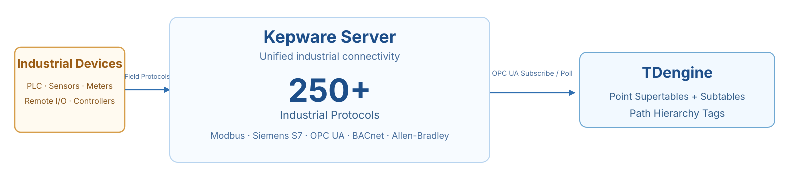
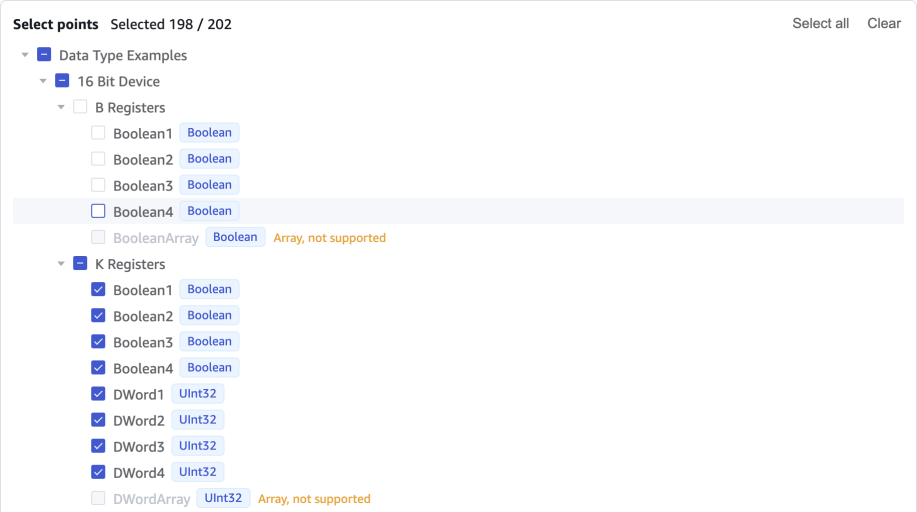

[Kepware Server](https://www.ptc.com/en/products/kepware) is PTC's industrial connectivity platform. It provides communication drivers for more than 150 industrial protocols, including Modbus, Siemens S7, OPC UA, and BACnet. This guide uses Kepware Server 7.1 as an example and describes how to read Kepware points through the taosX OPC UA connector and write them to TDengine. After you purchase TDengine TSDB-Enterprise, Taos Data can procure the EMQX Neuron software license.

This guide describes two onboarding methods:

- **Install-time onboarding**: Run an installation command on the Kepware Windows host. The command configures the client certificate, database, taosExplorer integration, and OPC UA task automatically, so no manual operation is required in taosExplorer after installation.
- **One-click onboarding**: For environments where Kepware is already deployed. Enter the endpoint and credentials on the **Data In → Data Collection Agents → Kepware** page in taosExplorer; taosExplorer scans points, generates the mapping, and creates the collection task automatically.

| Method | Kepware preinstalled | Use case | taosExplorer operation |
| --- | --- | --- | --- |
| Install-time onboarding | No | Kepware Server is not installed yet | None |
| One-click onboarding | Yes | Kepware is deployed and an existing project must be connected | Wizard required |

Both methods use the same data plane: taosX collects Kepware points through OPC UA and writes each point to TDengine as a single-column model. Each OPC UA point maps to one child table, and the complete browse path (`Path`) is stored as a tag for later device-level queries or IDMP import.

<figure style={{width: 'fit-content', margin: '0 auto'}}>

<br/>
*Kepware and TDengine integration architecture*

</figure>

taosExplorer reads point metadata from the Kepware Config API in read-only mode for point validation. Scanning, CSV generation, and task creation are still performed by the taosX OPC UA connector.

Kepware integrations support both subscription and polling collection modes, which can be selected in the taosExplorer wizard. Install-time onboarding uses subscription by default; polling requires a collection interval from 1 to 86400 seconds.

## Install-Time Onboarding

:::note

Install-time onboarding relies on the `apex` tool, which is not yet released. It is planned for release in early November 2026. Stay tuned.

:::

This section applies to environments where Kepware Server is not installed yet. The installation is performed by the `apex` tool supplied with the TDengine Enterprise installation package. It checks Kepware, trusts the client certificate, creates the database, registers the integration in taosExplorer, and creates the OPC UA task automatically. `apex` reads component versions and default settings from the TDengine installation package, so it must use the same version as the TDengine server.

Kepware install-time onboarding is released with TDengine TSDB **3.4.3.9**. Before 3.4.3.9 is generally available, use the corresponding pre-release installation package. Packages older than 3.4.3.9 do not provide the install-time onboarding capability described in this section.

### Prerequisites

- TDengine TSDB 3.4.3.9 or later.
- The `apex` tool supplied with the TDengine Enterprise installation package.
- **Kepware Server does not need to be preinstalled**: the installation checks or installs Kepware, enables the Config API, generates and trusts the client certificate, creates the database, registers the taosExplorer integration, and creates the OPC UA task.
- No extra network configuration is required for a same-host installation. For a cross-host installation, the Kepware host must be able to reach port `6060` on the TDengine host, and the TDengine host must be able to reach port `49320` and Config API ports `57412`/`57512` on the Kepware host.
- Installation creates the `kepware` database and integration record automatically and uses subscription mode by default. If fixed-interval sampling is required, choose polling in one-click onboarding.

:::tip

For a same-host installation, no connection parameters are required. For a cross-host installation, specify the address of the TDengine host. See [Cross-Host Installation](#cross-host-installation) for the other parameters.

:::

### Same-Host Installation

When TDengine and Kepware Server are deployed on the same host, run the following command as an administrator on the Kepware Windows host:

```bash
apex install all
```

The installation performs the following steps:

- Installs or checks TDengine, taosExplorer, and taosX;
- Installs or checks Kepware Server and the example project;
- Generates the taosX OPC UA client keypair;
- Enables and checks the Config API;
- Confirms that the OPC UA endpoint uses `Basic256Sha256 + SignAndEncrypt + UserName`;
- Adds the taosX public certificate to Kepware Trusted Clients;
- Creates the `kepware` database;
- Scans points, selects all collectable points, and creates the taosX OPC UA task;
- Starts the task and verifies the first batch of data.

Install-time onboarding writes all collectable points in the current Kepware project (excluding arrays) to `kepware`, including the test points in the example project. Channels, devices, and tags in the Kepware project are not modified or deleted. To connect real business points, delete this integration and create a new one with only the required points selected. Existing sample data in the target database is retained; delete it manually if it is no longer needed.

After installation, Kepware is connected to the local TDengine instance and no endpoint, database, or integration configuration is required in taosExplorer. A typical output is shown below:

```text
[apex] Checking Kepware Server...
[apex] Installing/checking taosExplorer and taosX...
[apex] Generating taosX OPC UA client certificate...
[apex] Enabling Kepware Config API...
[apex] Checking OPC UA endpoint: Basic256Sha256 / SignAndEncrypt / UserName...
[apex] Trusting taosX client certificate...
[apex] Creating database kepware...
[apex] Scanning Kepware project...
[apex] 202 collectable points selected.
[apex] Creating OPC UA task: kepware_<host>_<id>
[apex] OPC UA task started.
[apex] Verification passed: 202/202 tables have new data.
[apex] Kepware integration registered with taosExplorer.
```

### Cross-Host Installation

When TDengine runs on another host, run the following command as an administrator on the Kepware Windows host:

```bash
apex install kepware --tdengine-host 192.168.1.100
```

Replace `192.168.1.100` with the IP address or domain name of the TDengine host. Other parameters use their default values. To customize the TDengine username, password, or other parameters, append the options in the following table:

| Parameter | Default | Description |
| --- | --- | --- |
| `--tdengine-host` | Local host | TDengine host IP address or domain name; required for cross-host installation |
| `--tdengine-port` | `6041` | taosAdapter REST port |
| `--tdengine-user` | `root` | TDengine username; must have permission to create databases and write to the target database |
| `--tdengine-password` | `taosdata` | TDengine user password |
| `--explorer-port` | `6060` | taosExplorer port |
| `--database` | `kepware` | Business database; created if it does not exist |
| `--kepware-user` | `Administrator` | OPC UA and Config API username |
| `--kepware-password` | Interactive input | OPC UA and Config API password; avoids writing it to shell history |
| `--config-api-url` | Derived from the Kepware host | Defaults to `http://<kepware-host>:57412` |
| `--certificate` / `--private-key` | Generated during installation | Absolute paths to the certificate and private key on the TDengine host; the private key never leaves TDengine |

Cross-host installation performs the same checks and configuration. After installation, Kepware is registered with taosExplorer on the specified TDengine host, and the write path is configured. The output is similar to the same-host output, with the integration registered at `http://192.168.1.100:6060`. If TDengine is installed on the same host, `--tdengine-host` can be omitted.

### View the Result in taosExplorer

After installation, log in to taosExplorer and go to **Data In → Data Collection Agents → Kepware**. The automatically created integration is displayed. A status of **Verified** means that the task is running and every expected child table for this integration has data.

Open the integration details to view the task name, number of points, latest check result, and logs. The execution log shows the latest 10 entries, newest first.

The corresponding taosX task appears under **Data In → Data In Tasks** with type OPC UA and target database `kepware`. The task is managed by taosExplorer; install-time onboarding does not require manual OPC UA sync task configuration.

## One-Click Onboarding

This method applies when Kepware is already deployed but no integration has been created in taosExplorer.

### Prerequisites

- TDengine TSDB 3.4.3.9 or later.
- Kepware Server is installed and licensed, and the Simdemo example project is loaded, or real channels, devices, and tags are configured.
- The OPC UA endpoint uses the `Basic256Sha256` security policy and `SignAndEncrypt` security mode. User authentication uses `UserName`; do not use `Anonymous`.
- The Configuration API (Config API) is enabled and accessible at:

  ```text
  http://192.168.1.100:57412/config/v1/project?content=serialize
  ```

  The default HTTPS port is `57512`. The Config API account should have read-only permission. The examples in this guide use the same username and password as OPC UA.
- Client certificate trust has been configured. See [Client Certificate](#client-certificate).
- The Kepware host can reach port `6060` on the TDengine host, and the TDengine host can reach port `49320` and Config API ports `57412`/`57512` on the Kepware host.

### 1. Create the Target Database

Create the business database in the taosExplorer SQL editor or a TDengine client if it does not exist:

```sql
CREATE DATABASE IF NOT EXISTS kepware;
```

### 2. Open the Kepware Page

Log in to taosExplorer, go to **Data In → Data Collection Agents → Kepware**, and click **Add Kepware Integration**.

### 3. Enter Connection Information

| Setting | Example | Description |
| --- | --- | --- |
| OPC UA endpoint | `opc.tcp://192.168.1.100:49320` | Kepware OPC UA endpoint |
| Username | `Administrator` | OPC UA username; also used as the default Config API account |
| Password | — | OPC UA password |
| Target database | `kepware` | Tables are written to this database; it must already exist |
| Collection mode | Subscription / Polling | Subscription by default; choose polling for fixed-interval sampling |
| Collection interval | `10` | Displayed only in polling mode; unit: seconds |
| Config API URL | `http://192.168.1.100:57412` | Derived from the OPC UA endpoint when left empty |
| Client certificate | `/etc/taos/taosx/opc/client.pem` | Absolute path on the TDengine host |
| Client private key | `/etc/taos/taosx/opc/client-key.pem` | Absolute path on the TDengine host |

The current wizard always uses `Basic256Sha256 + SignAndEncrypt`; the security policy cannot be changed on the page. If the target environment uses another policy, change it to this combination first.

### 4. Select Points

Click **Scan Points**. taosExplorer performs the following steps:

1. Browses OPC UA points through taosX.
2. Reads tag metadata through the Config API.
3. Validates data types, path lengths, and duplicate points.
4. Generates the point preview and CSV mapping.

The preview shows the number of points and a path sample. A point selection tree appears below the preview and selects all collectable points by default. Clear the selection or deselect individual points as needed. Uncollectable points are disabled with a reason. Scanning fails when no collectable point exists; point conflicts are also checked when the integration is created.

<figure style={{width: 'fit-content', margin: '0 auto'}}>

<br/>
*The point selection tree selects all points by default; deselect points as needed*

</figure>

### 5. Create the Task

After confirming the selected points, click **Create Task**. taosExplorer uploads the CSV of selected points to the taosX instance that performed the scan, then creates and starts an Xnode OPC UA task. The task writes to the target database with the TDengine credentials of the current user. Token/TOTP sessions cannot be used to create integrations.

### 6. Check Data

After creation, open the integration details and click **Check Data**. The statuses are described below:

| Status | Meaning |
| --- | --- |
| Running | The task has started but the first data verification has not completed |
| Verified | The task is running and every expected child table for this integration has data |
| Awaiting Data | The task is running, but some expected child tables have no data yet; check again later |
| Failed | The task does not exist, has not started, is not running, or the check failed |

The check counts only the child tables planned by this integration, not tables owned by other integrations in the same database. The task must be running; otherwise the check fails. Polling mode requires data within `max(3 × collection interval, 60 seconds)`. Subscription mode writes only when a point value changes, so an integration whose values never change can remain in **Awaiting Data** indefinitely; this does not by itself mean the subscription is broken. Change a point value in Kepware and check again.

While running or verified, the details page shows only **Check Data** and **Delete Integration**. A **Restart** action appears only when the integration status is **Failed** or **Interrupted**; it starts the existing task without rescanning points. Deleting the integration stops and deletes the task. The integration record is removed only after the task is deleted or confirmed absent; if the task still exists, the page reports an error and keeps the record so you can retry. After the task is gone, the system makes a best effort to remove the uploaded point CSV from the taosX upload directory. A cleanup failure does not affect task deletion, and CSVs left by historical tasks are not removed. Data in the target database is retained.

## Verify the Result

A status of **Verified** on the integration details page means verification passed. You can also check the latest receive time of each child table in the taosExplorer SQL editor:

```sql
SELECT tbname, COUNT(*) AS rows, MAX(rts) AS latest_rts
FROM kepware.opc_double
PARTITION BY tbname
LIMIT 20;
```

Points of different data types are stored in different supertables. First list the available supertables:

```sql
SELECT DISTINCT stable_name
FROM information_schema.ins_tables
WHERE db_name = 'kepware'
  AND stable_name LIKE 'opc%';
```

`rts` is the taosX receive time. The `latest_rts` value of every expected child table should be later than the task creation time; in polling mode it should also fall within the latest collection window. Subscription mode does not write continuously when values are unchanged, so `latest_rts` alone cannot prove that the subscription is healthy.

## Display Data in IDMP (Optional)

IDMP is a separate system. After the Kepware integration is created, IDMP imports node data and attributes from the TDengine point child tables, then builds the asset hierarchy in the element browser from `Path`; it does not import an empty tree. IDMP 2.0.2.0 and later automatically creates virtual tables for OPC imports, so no manual table creation is required.

1. Configure a TDengine TSDB connection in **IDMP Admin → Connections**.
2. Open **More → Import from OPC** for that connection.
3. Select the `kepware` database. The `opc_bool`, `opc_int`, `opc_double`, `opc_varchar`, and other supertables in the database are listed separately.
4. For each supertable to import, set:
   - Path: `Path`
   - Value column: `val`
   - Quality column: `quality`
   - Path start level: `1`
5. Complete the import. IDMP builds the element hierarchy from `Path`: every path level except the point name becomes an element, and the point becomes an attribute of the last-level element instead of a separate leaf element. `val` and `quality` are mapped to the automatically created virtual table.

In the Kepware Simdemo project, a sample `Path` is `Objects.Data Type Examples.16 Bit Device.K Registers.Double1`. Setting the path start level to `1` ignores the first `Objects` segment and starts the hierarchy at `Data Type Examples`. The imported element tree is shown below; the number of points for each element is in parentheses:

```text
Channel_1
└── Device_1 (2 points: Tag_1, Tag_2)
Data Type Examples
├── 16 Bit Device
│   ├── B Registers (4 points: Boolean1–Boolean4)
│   ├── K Registers (36 points: Long1, Double1, …)
│   ├── R Registers (36 points: Boolean1, DWord1, …)
│   └── S Registers (4 points: String1–String4)
└── 8 Bit Device
    ├── B Registers (4 points: Boolean1–Boolean4)
    ├── K Registers (44 points: Char1, Byte1, …)
    ├── R Registers (44 points: Char1, Byte1, …)
    └── S Registers (4 points: String1–String4)
Simulation Examples
└── Functions (24 points: Ramp1–Ramp8, Random1–Random8, Sine1–Sine4, User1–User4)
```

Select an element such as `K Registers` to view the real-time values and quality of its points in the properties panel. In this example, IDMP automatically created 10 virtual tables after the import; point values are written to the virtual tables as attribute columns, and no manual table creation is required.

For more information, see [TDengine IDMP](../../19-tdengine-idmp/index.md).

## High Availability and Store-and-Forward (Optional)

The data reliability of a Kepware integration is determined by the taosX deployment, not by the point mapping.

### Store and Forward

To avoid data loss during a network outage, deploy **taosX-Agent** and enable **Cache Real-Time Data** (`persist_data_enable`) in the OPC UA collection task. The Agent writes data to a local persistent queue first and resends it after the network recovers. The current Kepware wizard does not expose this switch; configure it according to the taosX-Agent deployment guide in production. For configuration and limitations, see [Store and Forward](../../12-operations-and-tooling/03-components/07-taosx-agent/02-store-and-forward.md).

### taosX High Availability

taosX supports multi-XNode high availability. Tasks are scheduled on healthy XNodes and can migrate automatically when a node fails. Planned maintenance can use `DRAIN XNODE`. See [Full-Trace High Availability](../../11-security-guide/04-full-trace-availability.md) and [Data Ingestion (Xnode)](../../05-tdengine-sql/08-cluster-management/02-xnode.md).

The Kepware wizard uploads the point CSV to one XNode only. When a task migrates or is scheduled to another XNode, that node must be able to read the same CSV. Multi-XNode production deployments should put the taosX data directory on shared storage. Without shared storage, CSV-based tasks do not have reliable cross-node migration: a task may fail because `csv_config_file` cannot be found.

## Current Limitations

- Arrays, ByteString, Guid, NodeId, ExtensionObject, Variant, and structures are not supported. Arrays are excluded during scanning; other unsupported points are disabled during manual selection.
- Paths containing `\.` are not supported.
- If the taosX task or the Kepware password is changed externally, the taosExplorer record is not synchronized automatically. Recreate the integration.
- When multiple Kepware integrations write to the same database, NodeId, Path, and generated child table names must be unique. This check covers only integrations managed by taosExplorer, not manually created taosX tasks.
- In a multi-XNode deployment, the point CSV is uploaded to one XNode only. Without shared storage, a task that migrates to another XNode may be unable to read the CSV.

## FAQ

| Symptom | Cause | Resolution |
| --- | --- | --- |
| Config API returns 401 | Incorrect username, password, or permission | Check the Config API account and confirm that HTTP/HTTPS services are enabled |
| Config API connection refused | Port closed or service not started | Check the `57412`/`57512` firewall rules and the Kepware service |
| OPC UA connection refused | OPC UA service not started or port closed | Check port `49320` and the Kepware runtime |
| `BadSecurityChecksFailed` | The taosX client certificate is not trusted | Trust the certificate in Kepware Trusted Clients, then restart the runtime |
| `StatusBadCertificateURIInvalid` | The client certificate is missing the taosX ApplicationUri | Regenerate the certificate with `URI:urn:taosx-opc:client` in the SAN, then trust it |
| Cannot read the client certificate | The path is not absolute or the file is not PEM | Check the path on the taosX host, the PEM encoding, and private-key permissions |
| No points found during scanning | The project is not loaded or contains no variables | Open Simdemo or the real project and confirm that tags are running |
| Creation failed: unsupported type | ByteString, Guid, structure, and similar types | Use a scalar type in Kepware; the point is disabled during manual selection |
| Creation failed: `\.` | IDMP cannot restore an escaped dot | Rename the Kepware tag |
| Points with unchanged values have no new data | Subscription mode reports only value changes | Recreate with polling mode if fixed-period data is required; if the check is the only symptom, change a point value in Kepware to verify the path |
| Task created but no data | Task not started, target database empty, or network unavailable | Check the task status and logs under **Data In → Data In Tasks** and confirm that taosX can write to TDengine |
| Details remain in Awaiting Data | The task is not running, some points have no new data, or subscribed values have not changed | Confirm that the task is running and the points are changing; for subscription mode, change a point value and check again |
| Incorrect IDMP hierarchy | Incorrect path start level | Set it to `1` to ignore the `Objects` prefix |

## Appendix

### Data Model and Path

One OPC UA point in Kepware maps to one TDengine child table. Points of the same data type share a supertable. taosX creates the tables automatically from the CSV mapping:

| OPC UA / taosX | TDengine object |
| --- | --- |
| NodeId | Child table name generated by the `t_{ns}_{id#/_}` rule |
| Complete browse path | `Path` tag, for example `Objects.Channel1.Device1.TagGroup.Tag` |
| Collected value | `val` measurement column |
| Quality code | `quality` measurement column |
| Source timestamp / receive timestamp | `ts` / `rts` |
| Data type | Supertable `opc_{type}`, for example `opc_double` or `opc_int` |

`Path` retains the complete `Objects.` prefix and is not stripped automatically, so the hierarchy can be restored later in IDMP or SQL:

```text
Objects.Simdemo.Device1.TagGroup.Temperature
```

For supported types and restrictions, see [Current Limitations](#current-limitations).

### Client Certificate

For environments where Kepware is not installed yet, `apex` generates and trusts the client certificate automatically. For environments where Kepware is already installed, confirm the trust relationship as follows.

Production environments should always use `Basic256Sha256 + SignAndEncrypt`. TDengine uses the client certificate to authenticate to Kepware, and Kepware trusts only certificates that have been added to Trusted Clients.

1. Generate or prepare a client keypair on the TDengine host. The certificate SAN must contain the ApplicationUri `urn:taosx-opc:client`; keep the private key only on the TDengine host.
2. In the Kepware OPC UA Configuration Manager, open **Trusted Clients**, import the TDengine public certificate, and select **Trust**. If the first connection fails, you can also select the certificate from the Rejected/Untrusted list and trust it.
3. You can also add the public certificate to `UA Server\TrustedClients.xml` in the Kepware project. The path and format depend on the target environment.
4. Restart or reinitialize the Kepware runtime.

:::note

The **Client Certificate** and **Client Private Key** fields in the taosExplorer wizard are **absolute paths on the TDengine host**, for example `/etc/taos/taosx/opc/client.pem`, not paths on the browser host. The certificate and private key must be PEM-encoded and provided as a pair.

:::

### Multiple Databases for One Kepware Instance

An integration can specify only one target database, and all selected points are written to that database. You can create multiple integrations for the same Kepware instance as long as they use different target databases, for example to write different channels, devices, or point groups to different databases.

For example:

| Integration | Kepware instance | Selected points | Target database |
| --- | --- | --- | --- |
| Integration A | Same instance | Points under Channel_1 | `db_a` |
| Integration B | Same instance | Points under Channel_2 | `db_b` |

Notes:

- Only one integration can be created for the same Kepware instance and the same database. Do not split the same instance and database into multiple integrations.
- Point selection is performed per point. Points are not routed to different databases by Channel or Device automatically; select points separately in each integration.
- The same points can be written to different databases, but this duplicates reads and writes and is generally not recommended.
