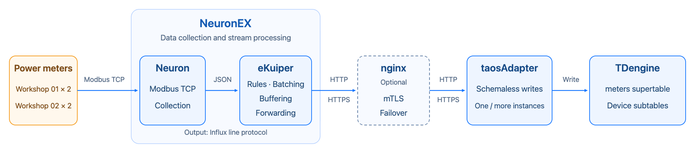
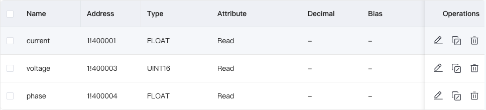
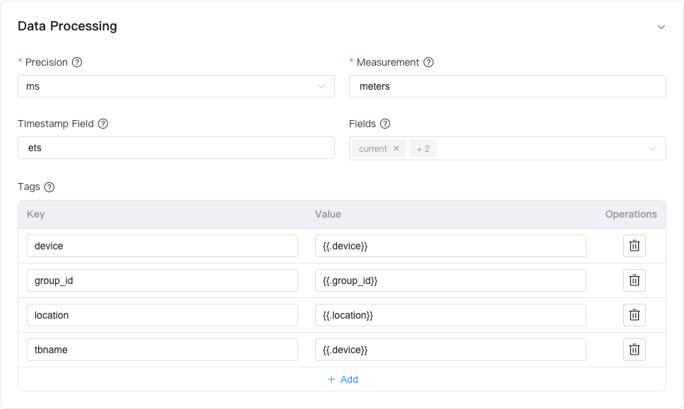
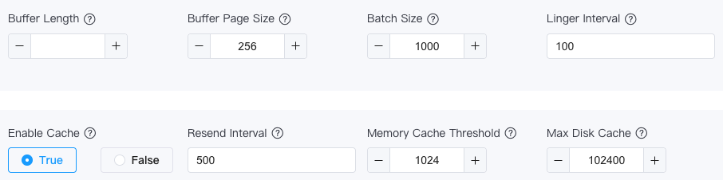

import NeuronPrerequisites from './resource/_neuron-prerequisites.mdx'
import NeuronMapping from './resource/_neuron-mapping.mdx'
import NeuronOneClick from './resource/_neuron-one-click.mdx'

[Neuron](https://github.com/emqx/neuron) is an industrial IoT connectivity platform developed by EMQ. It supports industrial protocols such as Modbus, OPC UA, and BACnet. [eKuiper](https://github.com/lf-edge/ekuiper) is an open-source, lightweight edge stream processing engine. It processes data with SQL and forwards results through output actions called sinks. [NeuronEX](https://docs.emqx.com/en/neuronex/latest/) is EMQ's industrial edge data collection and processing software. It combines Neuron's protocol connectivity with eKuiper's stream processing and provides a unified web interface for configuring data collection, processing, and forwarding.

This guide describes two ways to write data collected by Neuron to TDengine:

- **One-click onboarding**: On the edge gateway page of TDengine Explorer, enter the Neuron address and credentials; Explorer automatically configures the data stream, processing rules, and collection subscriptions. Suitable for most scenarios.
- **Manual onboarding**: Manually configure the data stream, processing rule, and InfluxDB v1 write action in the NeuronEX interface. Suitable when you need custom tags, business attributes, or data transformation.

Both methods share the same data plane: Neuron sends collection reports to eKuiper; eKuiper extracts measurement columns and tags, encodes them as Influx line protocol, and sends batches to taosAdapter; schemaless writes automatically create the supertable and subtables. This integration can ingest data from the more than 70 industrial protocols supported by Neuron, subject to the version and license.

<figure style={{width: 'fit-content', margin: '0 auto'}}>

<br/>
*Neuron and TDengine integration architecture*

</figure>

As shown in the figure, solid arrows indicate data flow, and the dashed box indicates the optional nginx component. Neuron converts device data into JSON collection reports; eKuiper extracts measurement columns and tags, encodes them as Influx line protocol, and sends batches to taosAdapter; schemaless writes automatically create the supertable and subtables. To use mutual TLS (mTLS) or taosAdapter failover, deploy nginx as described later in this guide.

<NeuronPrerequisites />

<NeuronMapping />

<NeuronOneClick />

## Manual Onboarding

This section demonstrates the complete manual onboarding process in the NeuronEX interface using four Modbus TCP power meters as an example, for users who need custom tags, business attributes, or data transformation. **The meters are only an example — you can follow the same procedure with other devices**: replace step 3 with the collection configuration for your own device (select the appropriate protocol plugin, create a collection group, and add tags). The remaining steps (creating the database, stream, processing rule, and write action) are independent of the device type and are performed identically.

### Example Data Model

This example uses two power meters in each of two workshops at one factory. Each meter reports current, voltage, and phase once per second. All four devices share the `meters` supertable and write to separate subtables. Each device uses a collection group named `electrical_readings`.

| Device name, subtable name, and `device` tag | `group_id` | `location` |
| --- | --- | --- |
| `workshop01_meter01` | `1` | `Factory01.Workshop01` |
| `workshop01_meter02` | `1` | `Factory01.Workshop01` |
| `workshop02_meter01` | `2` | `Factory01.Workshop02` |
| `workshop02_meter02` | `2` | `Factory01.Workshop02` |

TDengine stores `Factory01.Workshop01` as the complete `location` tag value. IDMP can later split the value at the period into the hierarchy `Factory01 → Workshop01`.

The business fields follow the [meters data modeling example](../../04-quick-start/03-data-modeling.md). The first [schemaless write](../../10-developer-guide/04-schemaless.md) automatically creates the tables with the following types:

| Category | Fields | Automatically generated type |
| --- | --- | --- |
| Timestamp column | `_ts` | `TIMESTAMP` |
| Measurement columns | `current`, `phase` | `DOUBLE` |
| Measurement column | `voltage` | `BIGINT` |
| Tags | `location`, `group_id`, `device` | `NCHAR` |

The Influx line protocol encoding determines the actual field types, which differ from the standard meters example. Tag values containing only ASCII characters still produce `NCHAR` columns.

### Data Mapping in This Example

In NeuronEX, first add the meter devices and configure their connections, then create a collection group and set its collection interval, and finally add tags such as current, voltage, and phase, specifying a register address and data type for each tag. Collection data maps to TDengine as follows:

| Neuron data | TDengine object | Configuration |
| --- | --- | --- |
| Device name, `node_name` | Subtable name and `device` TAG | The rule outputs `device`; the sink maps it to both `tbname` and the `device` tag |
| Collection group name, `group_name` | Filters reports entering the rule | SQL selects the `electrical_readings` group; the sink's `measurement` setting independently specifies the supertable name |
| Tags `values.current`, `values.voltage`, and `values.phase` | Measurement columns `current`, `voltage`, and `phase` | SQL extracts the tags; the sink's `fields` setting selects the columns to write |
| Report timestamp, `timestamp` | Timestamp column `_ts` | SQL outputs `ets`; the sink sets `tsFieldName=ets` and `precision=ms` |
| Location and business group | TAGs `location` and `group_id` | SQL assigns attributes based on the device name; the sink's `tags` setting selects the tags |

In this example, each complete collection report from a meter becomes one row in its corresponding subtable. Current, voltage, and phase map to three measurement columns.

A Neuron tag is a collection point and maps to a measurement column. A TDengine TAG is a subtable attribute. `group_id` is a business group identifier configured separately from the collection group name. You can also map `group_name` to a TAG, but the group name must remain fixed for a given subtable.

### Configuration Procedure

#### 1. Create a Database

Run the following statement in a TDengine SQL client. Do not manually create the supertable or subtables.

```sql
CREATE DATABASE IF NOT EXISTS neuron_meters_demo PRECISION 'ms';
```

#### 2. Check the Direct Connection Endpoint

Run the following command on the NeuronEX host or inside its container. Replace `adapter-host` with the actual taosAdapter hostname or IP address.

```bash
curl -i http://adapter-host:6041/influxdb/v1/ping
```

A `204 No Content` response indicates that the endpoint is reachable. The InfluxDB v1 client calls this endpoint at startup. If it returns `404`, check the path and confirm that TDengine is version 3.4.3.6 or later. NeuronEX can connect directly to taosAdapter without nginx. For encrypted transport or taosAdapter failover, configure nginx as described in [Encrypted Transport and High Availability](#encrypted-transport-and-high-availability-optional).

#### 3. Configure Modbus Collection

1. Go to **Data Collection → South Devices**. Add four **Modbus TCP** devices with the example names and configure their connections.

   | Setting | Value | Purpose |
   | --- | --- | --- |
   | Connection mode | Client | Initiates a connection to the meter |
   | IP address and port | Actual meter IP address and port, typically `502` | Identifies the device to read |
   | Connection timeout | `3000ms` | Limits the wait for an unresponsive request |
   | Command send interval | `20ms` | Sets the interval between requests on the same connection; separate from the collection interval |
   | 32-bit byte order | Follow the device manual, for example `ABCD` | Decodes floating-point values correctly |

2. Create an `electrical_readings` collection group under each device. Set the interval to `1000ms` and add the following three read tags.

   | Tag name | Type | Example address | Registers used |
   | --- | --- | --- | --- |
   | `current` | `FLOAT` | `1!400001` | 400001, 400002 |
   | `voltage` | `UINT16` | `1!400003` | 400003 |
   | `phase` | `FLOAT` | `1!400004` | 400004, 400005 |

   Use the addresses specified in the device register map. `1!` specifies unit ID 1. A `FLOAT` occupies two registers, so tag addresses must not overlap. Different device nodes can use the same register addresses.

   

3. Save and start the devices. Confirm that each device is running and connected. In **Data Collection → Data Monitoring**, select each device and collection group, then verify that all three values are correct and continue to update.
4. Go to **Data Collection → North Apps**. Subscribe the built-in `DataProcessing` application to the `electrical_readings` group on all four devices to send reports to eKuiper. Creating devices and a rule does not automatically create this subscription.

#### 4. Create a Data Stream

A stream defines the field structure of collection reports. Rules read data from this stream.

1. Go to **Data Processing → Sources → Create Stream** and enter the following settings.

   | Setting | Value |
   | --- | --- |
   | Name | `meters_stream` |
   | Source type | `Neuron` |
   | Configuration Key | `default` |
   | Stream Format | `JSON` |
   | Whether the schema stream | Enabled |
   | Shared | `True` |

2. Add the following fields. Set `values` to `STRUCT` and add the three measurement fields beneath it.

   | Field | Type | Purpose |
   | --- | --- | --- |
   | `timestamp` | `BIGINT` | Report timestamp in milliseconds |
   | `node_name` | `STRING` | Device name |
   | `group_name` | `STRING` | Collection group name |
   | `values` | `STRUCT` | Collection of measurement values |
   | `values.current` | `FLOAT` | Current |
   | `values.voltage` | `BIGINT` | Integer voltage |
   | `values.phase` | `FLOAT` | Phase |

3. Save the stream and confirm that its schema includes all tags to be written.

An explicit schema preserves voltage as an integer instead of treating schemaless JSON numbers as floating-point values. `BIGINT` is an eKuiper integer type and does not specify the Modbus register width. Enable **Shared** to let multiple rules reuse the same source.

#### 5. Create a Data Processing Rule

1. Go to **Data Processing → Rules → Create Rule** and set the rule ID to `meters_to_tdengine`.
2. Enter the following statement in the SQL editor.

   ```sql
   SELECT values.current AS current,
          values.voltage AS voltage,
          values.phase AS phase,
          timestamp AS ets,
          node_name AS device,
          CASE WHEN node_name IN ("workshop01_meter01", "workshop01_meter02")
               THEN "1" ELSE "2" END AS group_id,
          CASE WHEN node_name IN ("workshop01_meter01", "workshop01_meter02")
               THEN "Factory01.Workshop01" ELSE "Factory01.Workshop02" END AS location
   FROM meters_stream
   WHERE group_name = "electrical_readings"
     AND node_name IN ("workshop01_meter01", "workshop01_meter02",
                       "workshop02_meter01", "workshop02_meter02")
   ```

   This SQL selects reports from the four meters' `electrical_readings` groups, extracts current, voltage, and phase, preserves the original timestamp and device name, and assigns the location and business group identifier by device name. The device name determines the subtable name; location and business group are written as TAGs.

3. Click **Add Action**, select **InfluxDB v1**, and configure the write action in the next step.

All four devices share one rule. When adding or replacing devices of the same type, update the northbound application subscriptions, device filter, and location and business group mappings in SQL. A separate rule for each device is unnecessary.

If collection reports contain metadata such as location and business group identifiers, declare those fields in the stream and select them directly in SQL as TAG values. This reduces per-device mapping configuration. This example assigns these attributes with `CASE` expressions.

#### 6. Configure the InfluxDB v1 Action

The following JSON is a complete InfluxDB v1 action configuration and corresponds to the interface settings below. Replace the address, username, and password.

```json
{
  "addr": "http://adapter-host:6041/influxdb/v1?table_name_key=tbname",
  "username": "<tdengine_username>",
  "password": "<tdengine_password>",
  "database": "neuron_meters_demo",
  "measurement": "meters",
  "precision": "ms",
  "tsFieldName": "ets",
  "fields": [
    "current",
    "voltage",
    "phase"
  ],
  "tags": {
    "tbname": "{{.device}}",
    "device": "{{.device}}",
    "group_id": "{{.group_id}}",
    "location": "{{.location}}"
  },
  "sendSingle": true,
  "batchSize": 1000,
  "lingerInterval": 100,
  "enableCache": true,
  "memoryCacheThreshold": 1024,
  "bufferPageSize": 256,
  "maxDiskCache": 102400,
  "resendInterval": 500
}
```

1. Enter the following settings under **Connection**, replacing the address and account details with actual values.

   | Setting | Value |
   | --- | --- |
   | Address (`addr`) | `http://adapter-host:6041/influxdb/v1?table_name_key=tbname` |
   | Username (`username`) | Dedicated TDengine write account |
   | Password (`password`) | Password for that account |
   | Database (`database`) | `neuron_meters_demo` |

   Keep `/influxdb/v1` in the address. The client appends `/ping` or `/write` and preserves the query parameters. Enter the username and password in separate fields. In production, use a dedicated write account and restrict access to configuration files, exported files, and management APIs.

2. Configure the field and tag mappings under **Data Processing**.

   | Setting | Value |
   | --- | --- |
   | Precision (`precision`) | `ms` |
   | Measurement (`measurement`) | `meters` |
   | Timestamp Field (`tsFieldName`) | `ets` |
   | Fields (`fields`) | `current`, `voltage`, `phase` |
   | Tag `tbname` | `{{.device}}` |
   | Tag `device` | `{{.device}}` |
   | Tag `group_id` | `{{.group_id}}` |
   | Tag `location` | `{{.location}}` |

   `table_name_key=tbname` uses `tbname` to name the subtable without storing it as a TAG. `device` preserves the device identity. Select only the three measurement columns in `fields` to avoid writing helper fields such as `ets` as measurement columns.

   

3. Expand **Sink Properties**, set **Enable Cache** (`enableCache`) to `True`, and configure batching and caching as follows.

   | Setting | Value | Purpose |
   | --- | --- | --- |
   | Batch size (`batchSize`) | `1000` | Sends when the batch size is reached |
   | Linger Interval (`lingerInterval`) | `100` | Waits this many milliseconds for an incomplete batch |
   | Enable cache (`enableCache`) | `True` | Enables the sink cache |
   | Memory cache threshold (`memoryCacheThreshold`) | `1024` | Sets the in-memory message threshold |
   | Buffer page size (`bufferPageSize`) | `256` | Sets the number of messages per disk page |
   | Maximum disk cache (`maxDiskCache`) | `102400` | Sets the disk cache message limit |
   | Resend interval (`resendInterval`) | `500` | Sets the resend interval in milliseconds |

   A batch is sent when either `batchSize` is reached or `lingerInterval` expires, whichever occurs first. Low traffic does not have to fill a batch of 1,000 rows. A cached message can contain a batch of rows, so message counts do not directly indicate row counts or the supported outage duration. Refer to the documentation for your eKuiper version for parameter details.

   

4. Submit the action, then save and start the rule.

:::note

The NeuronEX interface sets `sendSingle=true` by default to evaluate dynamic tags for each row. It does not send a separate HTTP request for each row. Retain this parameter when configuring a rule through JSON. Data is still sent in batches according to the settings above, and each device writes to its own subtable. Actual latency also includes queueing and network calls.

:::

:::warning

Writes to the same subtable with the same millisecond timestamp overwrite existing data. Use globally unique subtable names and preserve report timestamps. Explicitly update subtable TAGs when attributes such as location change.

:::

## Verify the Results

Regardless of the onboarding method, confirm ingestion through query results — a running rule or a successful ping does not confirm that data is being written. The following SQL uses the database and table names from the manual onboarding example; for one-click onboarding, substitute your target database and mapped supertable names.

1. In a TDengine SQL client, check the automatically generated schema and device tags.

   ```sql
   DESCRIBE neuron_meters_demo.meters;

   SELECT DISTINCT TBNAME, device, group_id, location
   FROM neuron_meters_demo.meters;
   ```

   There should be four subtables with field types and tags matching the example data model.

2. Query the latest data and compare it with **Data Collection → Data Monitoring**. Replace the subtable name to check all four devices.

   ```sql
   SELECT _ts, current, voltage, phase
   FROM neuron_meters_demo.workshop01_meter01
   ORDER BY _ts DESC LIMIT 5;
   ```

3. Repeat the following query a few seconds apart to confirm that the row count increases in all four subtables.

   ```sql
   SELECT TBNAME, COUNT(*)
   FROM neuron_meters_demo.meters PARTITION BY TBNAME;
   ```

## Monitor Operation

Rule runtime metrics are viewed on the Neuron side: in NeuronEX, go to **Data Processing → Rules**, find the rule (`meters_to_tdengine` in the manual onboarding example; rules created by one-click onboarding are also listed there), and click **More → Statistics** to view the statistics cards for each stage. Key metrics:

| Metric | Expected status or action |
| --- | --- |
| `connection_status` | The sink connection status is `Connected` |
| Input and output counts | Counts continue to increase; units can differ before and after batching, so batch counts are not database row counts |
| `buffer_length` | The cache length can fluctuate temporarily but should fall again |
| `exceptions_total`, `last_exception` | No exceptions during normal operation; check the count and most recent error if an exception occurs |

## Display Data in IDMP (Optional)

In IDMP, configure a TDengine TSDB connection under **Admin Console → Connections**. For that connection, select **More → Easy Import**, then select `neuron_meters_demo.meters`.

Set the `device` tag as a path with path start level `0` and expression `${device}`; set the `location` tag as a path with path start level `1` and expression `${location}`. Import `group_id` as a static attribute. `location` is split at periods into factory and workshop levels, and `device` (the subtable name) becomes the leaf meter element.

After import, open the **Element Explorer** to view the following hierarchy. Select a meter to view its `current`, `voltage`, and `phase` measurement attributes.

```text
Factory01
├── Workshop01
│   ├── workshop01_meter01
│   └── workshop01_meter02
└── Workshop02
    ├── workshop02_meter01
    └── workshop02_meter02
```

For detailed import instructions, see [Build Data Models from TDengine TSDB](https://idmpdocs.tdengine.com/data-ingestion/building-data-models-from-tsdb/). This ingestion example does not include unit information. To add units or configure conversions, see [Units of Measure](https://idmpdocs.tdengine.com/libraries/uom/).

## Store and Forward

The InfluxDB v1 sink in eKuiper provides buffering and forwarding for this integration. When a downstream service is temporarily unavailable, the sink caches data if capacity is available and the error is retryable. After connectivity recovers, it resends data with the original subtable names and report timestamps. Rules created by one-click onboarding already have the cache enabled (batching at 1,000 rows or 100 ms) and need no additional configuration.

To use this feature:

- Confirm that eKuiper includes the Influx v1 retry fix in [PR #4201](https://github.com/lf-edge/ekuiper/pull/4201). Without it, resending might fail. Before deployment, provide EMQX with the NeuronEX and bundled eKuiper versions and confirm that the fix is included.
- For manual onboarding, under **Data Processing → Rules**, edit the rule's **InfluxDB v1** action. Expand **Sink Properties**, set **Enable Cache** (`enableCache`) to `True`, and configure capacity and the resend interval. See the parameter table and screenshot in [Configure the InfluxDB v1 Action](#6-configure-the-influxdb-v1-action). Mount the eKuiper data directory on persistent storage.
- Monitor disk space, cache length, and exceptions. If the backlog keeps growing, adjust the collection interval, batching settings, or collection group assignments.

A build containing the fix passed connection outage and recovery testing, and all test data was resent successfully. Authentication, permission, or schema errors can also be retried continuously and block subsequent data; correct these errors manually. Errors during data conversion or Influx point construction do not necessarily trigger retries.

:::warning

A process crash or host failure can lose data held in memory or in transit. Data can also be lost if cache capacity is exhausted.

:::

For parameter details, see [eKuiper Sink Cache and Sending Mechanism](https://ekuiper.org/docs/en/latest/guide/sinks/overview.html).

## Encrypted Transport and High Availability (Optional)

For mTLS or taosAdapter failover, deploy nginx and change the sink address to the nginx endpoint. A basic direct HTTP connection does not require this configuration. For one-click onboarding, enter the nginx address as the **TDengine Address** in the wizard.

### Configure mTLS and Multiple taosAdapter Instances

This example uses a three-node TDengine cluster with one taosAdapter instance on each node, all connected to the same cluster. nginx validates client certificates, distributes requests among the three instances, and switches to another instance if an upstream fails.

1. Install nginx and add the following configuration in the `http` context. Replace the domain, upstream addresses, and certificate paths. The server certificate SAN must match `ingest.example.com`.

   ```nginx
   upstream taosadapter {
       least_conn;
       server adapter-a.internal:6041 max_fails=2 fail_timeout=10s;
       server adapter-b.internal:6041 max_fails=2 fail_timeout=10s;
       server adapter-c.internal:6041 max_fails=2 fail_timeout=10s;
   }

   server {
       listen 8443 ssl;
       client_max_body_size 32m;
       server_name ingest.example.com;
       ssl_certificate /etc/nginx/certs/server.crt;
       ssl_certificate_key /etc/nginx/certs/server.key;
       ssl_client_certificate /etc/nginx/certs/client-ca.crt;
       ssl_verify_client on;
       ssl_protocols TLSv1.2 TLSv1.3;

       location /influxdb/v1/ {
           proxy_pass http://taosadapter;
           proxy_connect_timeout 3s;
           proxy_read_timeout 60s;
           proxy_next_upstream error timeout http_502 http_503 http_504 non_idempotent;
           proxy_next_upstream_tries 3;
       }
   }
   ```

2. Run `nginx -t` to check the configuration, then start or reload nginx. In the rule's InfluxDB v1 action, set the address to `https://ingest.example.com:8443/influxdb/v1?table_name_key=tbname`. nginx forwards both ping and write requests to taosAdapter.
3. Under the action's **Connection** settings, upload the client certificate, private key, and server CA certificate. Set **Skip Certification Verification** to `False`. For file-based configuration, use the following parameters. Certificate paths must be readable by eKuiper; mount the certificates when using containers.

   ```json
   {
     "rootCaPath": "/etc/ekuiper/certs/server-ca.crt",
     "certificationPath": "/etc/ekuiper/certs/client.crt",
     "privateKeyPath": "/etc/ekuiper/certs/client.key",
     "insecureSkipVerify": false
   }
   ```

4. Save the action and start the rule. Follow [Verify the Results](#verify-the-results) to confirm that data continues to arrive. Disable temporary plaintext endpoints in production.

For HTTPS with server authentication only, remove `ssl_client_certificate` and `ssl_verify_client` from nginx, and remove the sink's client certificate and private key settings. Retain CA verification. The example uses HTTP from nginx to taosAdapter, which requires a controlled network. Configure upstream HTTPS separately if encryption is required on that connection.

`proxy_next_upstream_tries 3` limits each request to three attempts, including the first attempt. `non_idempotent` allows a failed POST to be sent to another instance. Retries preserve the subtable name, timestamp, and measurement values so that writes with the same key handle duplicates. Failed batches rely on the sink cache for resending.

### Configure High Availability at Each Layer

| Layer | Deployment requirement | Considerations |
| --- | --- | --- |
| nginx | A pair of hosts with a Keepalived VIP, or an existing highly available load balancer; the sink uses a shared domain | Synchronize configuration and certificates; the domain must match the certificate |
| taosAdapter | One instance on each of three nodes, connected to the same TDengine cluster | Multiple instances on one host do not protect against host failure |
| TDengine | Configure clustering and replication according to the version and license; see [Deployment Management](../../12-operations-and-tooling/02-operations/index.md) | The standalone database configuration in this example does not provide database high availability |
| NeuronEX | Synchronize configuration according to the [official primary/backup guide](https://docs.emqx.com/en/neuronex/latest/best-practise/master-backup.html); normally only the primary collects data | Collection can pause during failover; current Modbus register values generally cannot recover historical readings |
| Edge-to-center network | Enable the sink cache and monitor capacity | See [Store and Forward](#store-and-forward) for recovery limits |

Validate primary/backup and cluster failover for the actual deployment topology.

## Performance Reference

### Test Configuration

The following results are from an existing performance test and are provided for capacity planning. The test covered normal connectivity with caching and nginx mTLS enabled. The test versions below differ from the direct connection functional verification environment described earlier.

| Item | Configuration |
| --- | --- |
| Hardware | Intel Xeon E5-2696 v4, 22 physical cores, 44 logical cores, 64 GiB RAM, NVMe |
| Deployment | Ubuntu 24.04, Linux x86_64, all components running as native processes on one host |
| Neuron | Open-source version 2.15.0, custom build with a Modbus transaction ID rollover fix |
| eKuiper | `2.4.2+pr4201-perfcore` test build with an Influx error classification fix |
| TDengine | Enterprise Edition 3.4.3.6; ms precision, `VGROUPS 16`, `WAL_LEVEL 1`, `WAL_FSYNC_PERIOD 3000` |
| Collection | 16 drivers × 4 groups × 128 logical meters × 3 measurements, totaling 24,576 configured tags; 100ms interval |
| Northbound | 8 applications subscribe to separate collection groups; 8 groups per application, each application with its own source, rule, and output action |
| Batching and security | 100ms batch interval, `batchSize=10000`, about 1,024 rows per request on average; cache enabled, `bufferLength=20000`, `disableBufferFullDiscard=true`, nginx mTLS, CA verification |

The test read the simulator bundled with Neuron over Modbus, reusing registers across groups. The 8,192 logical meters do not represent 8,192 physical devices. Each row contains three collected values; tag values are excluded from measurement value throughput.

### Reference Results

| Metric | Measured result |
| --- | ---: |
| Net increase in database rows | 147,524,815 rows |
| Average ingestion throughput | **81,913.81 rows/s** |
| Equivalent measurement value update throughput | **245,741.42 values/s** |
| Throughput range across sampling intervals | 80,359.68–83,470.95 rows/s |
| Report-to-successful-response p99 | **1,171ms** |
| Maximum latency using the same definition | 2,054.33ms |
| Sampled peak sink queue | 82 batches, later returning to zero; final queue length was zero |

Throughput is calculated from the net increase in database rows, with three collected values per row. Measurement value throughput is not the number of configured tags. The p99 is measured from the report timestamp to the successful taosAdapter response, at 1ms resolution. It includes batching wait time, queueing, and downstream calls, and excludes Modbus collection time.

After collection stopped and the cache drained, the rule's valid output row count, the row count represented by successful requests, the number of unique subtable name/timestamp combinations, and the database row count matched. Reconciliation excludes reports with missing values that the rule filtered out.

Neuron and eKuiper each used about 6.6 logical cores on average. Neuron resident memory was about 73MiB, eKuiper's sampled peak was about 275MiB, and nginx overhead was small. Neither resident memory nor the sink queue showed sustained growth.

These results support capacity planning and do not represent TDengine's write limit or a performance guarantee for official releases. Retest with actual devices, rules, field counts, networks, and hardware, and reserve capacity. To scale further, partition collection groups across multiple Neuron instances with corresponding eKuiper instances, allocate separate CPU resources, and use unique subtable names. Multi-instance scaling ratios have not been verified.

## Troubleshooting

| Symptom | Checks and actions |
| --- | --- |
| One-click onboarding reports "No acquisition groups with readable points were found" | Configure device collection in Neuron first; confirm devices are running and connected, with tag values visible in **Data Monitoring** |
| One-click onboarding fails with a subtable name conflict | The subtable name conflicts with an existing table in the database; set a **Table Name Prefix** for the integration to distinguish it, and confirm that same-named measurement columns have compatible types |
| Data stops being written after the TDengine password is changed | Click **Refresh Configuration** on the integration detail page to update the rules with the current login credentials |
| The detail page shows "Configuration Preserved; Verification Pending" | Confirm that Neuron is collecting and the rules are running in eKuiper, then click **Check Data** to verify again |
| Incorrect collected values | Check the unit ID, register addresses, byte order, and whether floating-point addresses overlap |
| A rule stops automatically after starting | Check whether the license includes data processing; a rule running under a test license can stop after 60 minutes |
| HTTPS connection fails | Check the CA, server certificate SAN, client certificate, and certificate paths inside the container |
| Cache length keeps increasing in the statistics | Adjust collection intervals, batching settings, or collection group assignments to prevent sustained sending rates below collection rates |
| Data is not resent despite caching being enabled | Confirm the version includes the retry fix described in [Store and Forward](#store-and-forward), then check error classification, disk space, and cache capacity |

## References

- [eKuiper InfluxDB v1 Sink](https://ekuiper.org/docs/en/latest/guide/sinks/plugin/influx.html)
- [eKuiper Sink Cache and Sending Mechanism](https://ekuiper.org/docs/en/latest/guide/sinks/overview.html)
- [Neuron Open Source Documentation](https://docs.emqx.com/en/neuron/latest/)
- [NeuronEX Configuration](https://docs.emqx.com/en/neuronex/latest/configuration/introduction.html)
