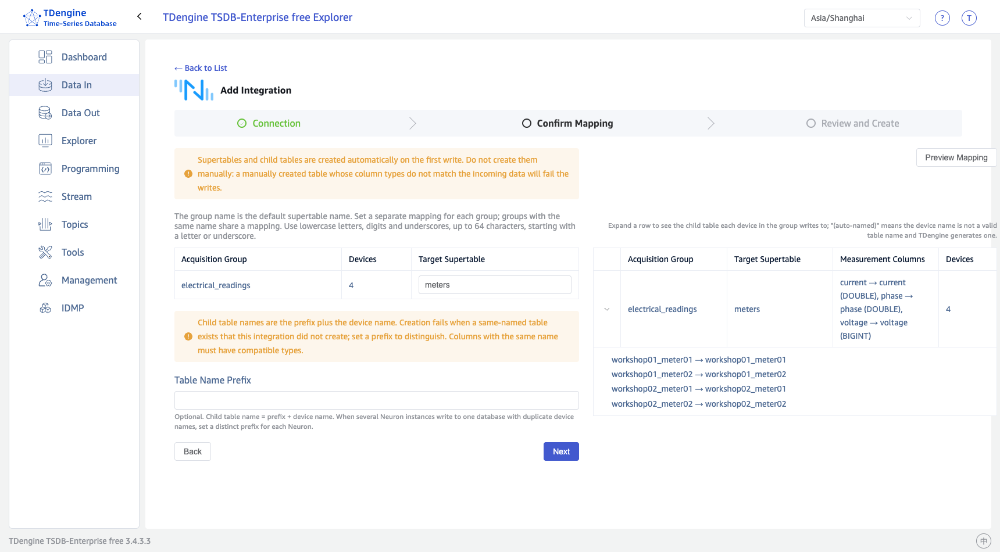

## One-Click Onboarding

One-click onboarding is completed in TDengine Explorer. No manual configuration in NeuronEX or eKuiper is required.

### 1. Open the Onboarding Wizard

Log in to TDengine Explorer, select **Data In** in the left navigation, switch to the **Edge Gateways** tab, and click the **Neuron** card.

### 2. Enter Connection Information

The upper part of the page is the Neuron connection information:

| Setting | Description |
| --- | --- |
| Name | Optional. Shown in the list and detail pages; the Neuron address is used when empty |
| Neuron URL | The Neuron management API address, such as `http://neuron-host:7000` |
| Neuron Username / Neuron Password | The Neuron login credentials |
| eKuiper Port | **Required for open-source Neuron only**: the management port of eKuiper deployed on the Neuron host, default `9081`. NeuronEX discovers its built-in eKuiper automatically, so this setting is not needed |

Below the divider is the TDengine write information:

| Setting | Description |
| --- | --- |
| TDengine Address | The REST address of taosAdapter in the current cluster (default port `6041`). **The Neuron gateway must be able to reach this address** — use a hostname or IP reachable from Neuron, not a loopback address |
| Target Database | Select a database in the current cluster; the database must be created beforehand. Supertables and subtables are created automatically by schemaless writes — **do not create them manually**. A manually created table whose column types do not match the incoming data will fail the writes |

Click **Next** when finished. If the connection or validation fails, you stay on this page and the error is shown; fix the issue as prompted and try again.

### 3. Confirm the Mapping

The left side of the page lists the device count and target supertable for each collection group. The supertable name defaults to the collection group name and can be changed individually; groups with the same name share one mapping. When multiple Neuron gateways write to the same database with duplicate device names, set a distinct prefix for each gateway in **Table Name Prefix**. Click **Preview Mapping** to review the measurement columns of each group and the subtable each device writes to on the right (up to 10 devices per group), or click **Next** directly.

<figure style={{width: 'fit-content', margin: '0 auto'}}>

 
*Confirming collection group and column mappings*

</figure>

### 4. Review and Create

The confirmation page summarizes the configuration to be created: Neuron address, eKuiper stream, TDengine address, target database, subtable naming rule, fixed tags, and write account. Review it and click **Create Integration**.

Explorer automatically performs the following:

- Creates or reuses the shared eKuiper stream (one stream is shared by all Neuron integrations);
- Creates an InfluxDB v1 write rule for each collection group, with the sink cache enabled and batching at 1,000 rows or 100 ms;
- Adds missing collection subscriptions (Neuron northbound subscriptions), leaving existing subscriptions unchanged;
- Checks subtable naming conflicts and refuses to create the integration with an explanatory message when a same-named subtable belongs to someone else.

Existing eKuiper configuration is never overwritten or deleted automatically. Rules write data using your current TDengine login account; **after changing that account's password, click Refresh Configuration on the detail page to update the rules**.

### 5. Check Status and Logs

After creation, the detail page opens: the upper part shows the integration configuration and mappings, and the **Execution Log** panel below shows the latest 10 configuration and verification records, newest first.

A status of **Verified** means the rules are running and new data keeps appearing in every subtable. Other statuses: **Configuring/Verifying** means a background task is running; **Configuration Preserved; Verification Pending** means the configuration has been delivered but new data has not been observed yet; **Failed/Interrupted** — check the logs for the cause and retry.

The detail page provides two actions:

- **Refresh Configuration**: Re-delivers the stream and rules with the original configuration. Use it to recover after changing the TDengine password or after the rules are modified or deleted on the eKuiper side.
- **Check Data**: Runs data verification again to check whether each subtable has new data.

After configuration, data is written by Neuron through eKuiper directly to TDengine and **does not depend on Explorer staying online**; closing the Explorer page does not affect collection.
