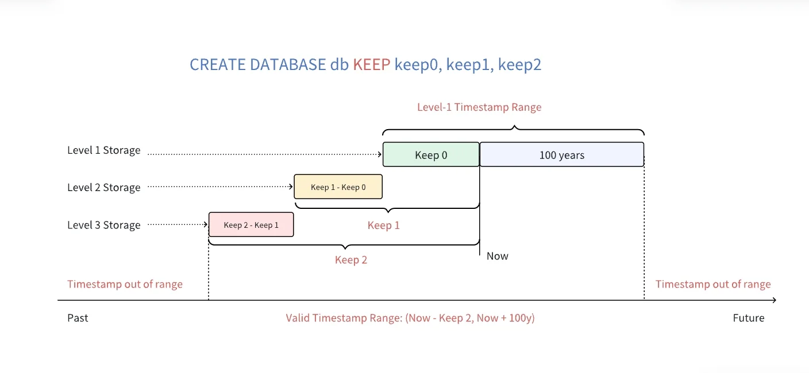

本文介绍标准 SQL 的 `INSERT` 写入语法。如需通过连接器高效写入，或按行协议自动建表，还可使用：

- [参数绑定](../../10-developer-guide/03-stmt.md)：STMT / STMT2 预编译写入，适合高吞吐场景
- [无模式写入](../../10-developer-guide/04-schemaless.md)：兼容 InfluxDB / OpenTSDB 等行协议，可按写入数据自动创建超级表与子表

下面的例子沿用同一组表：超级表 `meters` 的数据列是 `ts`、`current`、`voltage`、`phase`，标签列是 `location`、`groupId`；`d1001` 和 `d1002` 是它的子表。时间戳范围、相同主键覆盖，以及多个 vnode 上的部分成功，见 [写入行为](#写入行为)。

## 写入语法

写入数据支持两种语法：普通写入语法和超级表写入语法。普通写入语法中，紧跟 `INSERT INTO` 的表名是子表名或普通表名；超级表写入语法中，紧跟 `INSERT INTO` 的表名是超级表名。

### 普通写入语法

```sql
INSERT INTO
    tb_name
        [USING stb_name [(tag1_name, ...)] TAGS (tag1_value, ...) [TTL value] [COMMENT 'string']]
        [(field1_name, ...)]
        VALUES (field1_value, ...) [(field1_value2, ...) ...] | FILE csv_file_path
    [tb2_name
        [USING stb_name [(tag1_name, ...)] TAGS (tag1_value, ...) [TTL value] [COMMENT 'string']]
        [(field1_name, ...)]
        VALUES (field1_value, ...) [(field1_value2, ...) ...] | FILE csv_file_path
    ...];

INSERT INTO tb_name [(field1_name, ...)] subquery
```

### 超级表写入语法

```sql
INSERT INTO
    stb1_name [(field1_name, ...)]
        VALUES (field1_value, ...) [(field1_value2, ...) ...] | FILE csv_file_path
    [stb2_name [(field1_name, ...)]
        VALUES (field1_value, ...) [(field1_value2, ...) ...] | FILE csv_file_path
    ...];

INSERT INTO stb_name (tbname, field1_name, ...) subquery
```

### 子句说明

- `tb_name` / `stb_name`：可以写成 `db_name.tb_name`；不写库名时使用当前数据库。虚拟表、系统库中的表和联邦查询的外部表不能作为写入目标。
- `USING ... TAGS`：写入时按超级表自动建表，见 [写入时自动建表](#写入时自动建表)。`TTL` 和 `COMMENT` 只在新建子表时生效，含义与 [数据表](../02-ddl/02-table.md) 中的同名选项相同。
- `(field1_name, ...)`：列清单。未出现的列填 `NULL`；时间戳主键列必须出现，表定义了复合主键时，第二主键列也必须出现。向超级表写入时必须给出列清单，并包含 `tbname`，见 [向超级表写入](#向超级表写入)。
- `VALUES`：每个括号是一行，多行之间、多张表之间的逗号都可以省略。值的写法见下文。
- `FILE`：从客户端本地的 CSV 文件读取数据，见 [从文件写入](#从文件写入)。
- `subquery`：把查询结果写入目标表，查询可以放在括号里，见 [从查询结果写入](#从查询结果写入)。

`VALUES` 中的值可以是：

- 常量：数值（含十六进制 `0x10`、二进制 `0b1010`）、`TRUE` / `FALSE`、用单引号括住的字符串，以及 `NULL`。
- 时间：`NOW`、`TODAY`、时间字符串或长整型时间戳，以及与时间单位的加减，例如 `NOW + 1s`、`TODAY - 1d`。
- 函数：`TO_BASE64`、`FROM_BASE64`、`MD5`、`SHA`、`SHA1`、`SHA2`、`AES_ENCRYPT`、`AES_DECRYPT`、`SM4_ENCRYPT`、`SM4_DECRYPT`，函数说明见 [函数](../04-data-query/03-function.md)。

## 示例

### 插入一条记录

指定已经创建好的子表或普通表，用 `VALUES` 写入一行：

```sql
INSERT INTO d1001 VALUES (NOW, 10.2, 219, 0.32);
```

值的顺序与表的列顺序一致。同一条语句里多个 `NOW` 会得到同一个时间戳，见 [时间戳](#时间戳)。

### 插入多条记录

多行可以省略逗号，也可以按标准 SQL 用逗号分隔：

```sql
INSERT INTO d1001 VALUES ('2021-07-13 14:06:32.272', 10.2, 219, 0.32) (1626164208000, 10.15, 217, 0.33);

INSERT INTO d1001 VALUES ('2021-07-13 14:06:32.272', 10.2, 219, 0.32), (1626164208000, 10.15, 217, 0.33);
```

一次插入多行时，不要把每行的时间戳都写成 `NOW`，可以写成 `NOW`、`NOW + 1s` 这样的不同值。

### 指定列插入

无论一行还是多行，都可以只给部分列赋值。语句里没有出现的列自动填 `NULL`。主键时间戳必须出现，且不能为 `NULL`。

```sql
INSERT INTO d1001 (ts, current, phase) VALUES ('2021-07-13 14:06:33.196', 10.27, 0.31);
```

### 向多个表插入记录

一条语句可以向多张表写入，每张表都可以指定列。表与表之间的逗号可以省略：

```sql
INSERT INTO d1001 VALUES ('2021-07-13 14:06:34.630', 10.2, 219, 0.32) ('2021-07-13 14:06:35.779', 10.15, 217, 0.33)
            d1002 (ts, current, phase) VALUES ('2021-07-13 14:06:34.255', 10.27, 0.31);
```

这些子表可能分布在不同 vnode 上。某个 vnode 写入失败时，其他 vnode 已经写入的数据不会回滚，见 [部分写入成功](#部分写入成功)。

## 写入时自动建表

写入时如果表可能还不存在，用 `USING` 按超级表自动建表。表已经存在时，不会建新表，也不会修改标签值。自动建表必须给出超级表名和 `TAGS`。

```sql
INSERT INTO d21001 USING meters TAGS ('California.SanFrancisco', 2) VALUES ('2021-07-13 14:06:32.272', 10.2, 219, 0.32);
```

可以只指定部分标签列，其余标签列为 `NULL`：

```sql
INSERT INTO d21005 USING meters (groupId) TAGS (2) VALUES ('2021-07-13 14:06:33.196', 10.15, 217, 0.33);
```

新建子表时可以同时指定生命周期和注释：

```sql
INSERT INTO d21004 USING meters TAGS ('California.SanFrancisco', 2) TTL 30 COMMENT 'from gateway' VALUES (NOW, 10.2, 219, 0.32);
```

一条语句里可以给多张表自动建表：

```sql
INSERT INTO d21001 USING meters TAGS ('California.SanFrancisco', 2) VALUES ('2021-07-13 14:06:34.630', 10.2, 219, 0.32) ('2021-07-13 14:06:35.779', 10.15, 217, 0.33)
            d21002 USING meters (groupId) TAGS (2) VALUES ('2021-07-13 14:06:34.255', 10.15, 217, 0.33)
            d21003 USING meters (groupId) TAGS (2) (ts, current, phase) VALUES ('2021-07-13 14:06:34.255', 10.27, 0.31);
```

语句会先完整解析再执行。下面这条语句不会出现「数据写失败但表已经建成」的结果：

```sql
INSERT INTO d1001 USING meters TAGS ('Beijing.Chaoyang', 2) VALUES ('a');
```

## 从文件写入

除了 `VALUES`，也可以从 CSV 文件读取数据。文件使用英文逗号分隔，时间戳和字符串用英文单引号括住，不需要表头。例如 `/tmp/csvfile.csv` 的内容为：

```csv
'2021-07-13 14:07:34.630', 10.2, 219, 0.32
'2021-07-13 14:07:35.779', 10.15, 217, 0.33
```

```sql
INSERT INTO d1001 FILE '/tmp/csvfile.csv';
```

使用 `FILE` 时注意：

- 文件路径是客户端所在机器上的路径，文件必须使用 UTF-8 编码。
- 通过 taosAdapter 代理连接时不支持 `FILE`。
- 同一条语句里出现 `FILE` 后，后面的表不能再使用 `VALUES`。

如仅需创建子表，参见 [数据表](../02-ddl/02-table.md#批量创建子表)。

### 自动建表并写入

```sql
INSERT INTO d21001 USING meters TAGS ('California.SanFrancisco', 2) FILE '/tmp/csvfile.csv';
```

一条语句里可以给多张表从各自的文件写入。表已经存在时，不会修改标签值：

```sql
INSERT INTO d21001 USING meters TAGS ('California.SanFrancisco', 2) FILE '/tmp/csvfile_21001.csv'
            d21002 USING meters (groupId) TAGS (2) FILE '/tmp/csvfile_21002.csv';
```

## 从查询结果写入

`INSERT ... SELECT` 把一条查询的结果写入已经存在的普通表或子表，不必先导出再导入。查询可以包含过滤、表达式、聚合和窗口，结果列必须能够按位置写入目标列。查询中不能引用联邦查询的外部表。

整表复制时，查询结果的列顺序与目标表一致：

```sql
INSERT INTO d1002 SELECT * FROM d1001;
```

整个查询也可以放进括号。这里的括号表示子查询，不是列清单：

```sql
INSERT INTO d1002 (SELECT * FROM d1001);
```

指定目标列时，括号里是列名，查询结果按这个顺序写入。没有出现的列填 `NULL`，时间戳不能省略：

```sql
INSERT INTO d1002 (ts, current)
SELECT ts, current FROM d1001 WHERE current > 10;

INSERT INTO d1002 (ts, phase, current)
SELECT ts, phase, current + 1 FROM d1001;
```

查询也可以是窗口聚合。下面的语句把 `d1001` 按分钟降采样，每分钟写入一行平均电流、最大电压和记录数。`_wstart` 是窗口起始时间，写入目标表的时间戳列：

```sql
CREATE TABLE d1001_stat (ts TIMESTAMP, avg_current DOUBLE, max_voltage INT, cnt BIGINT);

INSERT INTO d1001_stat
SELECT _wstart, avg(current), max(voltage), count(*)
FROM d1001
WHERE ts >= '2021-07-13 14:00:00' AND ts < '2021-07-13 15:00:00'
INTERVAL(1m);
```

列按位置对齐，不按列名对齐。查询结果的列数或类型无法写入目标列时，语句失败。例如 `tb1` 的列是 `ts`、`f1`、`f2`，`tba` 的列是 `ts`、`f1`、`f2`、`f3`，且对应列的类型不同：

```sql
CREATE TABLE tb1 (ts TIMESTAMP, f1 INT, f2 BINARY(200));
CREATE TABLE tba (ts TIMESTAMP, f1 BINARY(10), f2 BIGINT, f3 DOUBLE);

-- 列数和类型都对不上
INSERT INTO tba SELECT * FROM tb1;

-- 查询的 ts、f1、f2 分别写入 ts、f2、f1，f3 为 NULL
INSERT INTO tba (ts, f2, f1) SELECT * FROM tb1;
```

向超级表写入查询结果时，列清单的第一列必须是 `tbname`，见 [向超级表写入](#向超级表写入)。

## 向超级表写入

向超级表写入时，列清单里必须有 `tbname`，用来指定子表名。`tbname` 是字符串，不用转义，不能包含点号 `.`，也不能为空。参数绑定只有 STMT2 支持这种写法，STMT 不支持，见 [参数绑定](../../10-developer-guide/03-stmt.md)。

子表不存在时按给出的标签建表。子表已经存在时，语句里的标签值不会修改已有标签。列清单里没有任何标签列时，新建子表的标签全部为 `NULL`。

```sql
INSERT INTO meters (tbname, location, groupId, ts, current, voltage, phase)
            VALUES ('d31001', 'California.SanFrancisco', 2, '2021-07-13 14:06:34.630', 10.2, 219, 0.32)
            ('d31001', 'California.SanFrancisco', 2, '2021-07-13 14:06:35.779', 10.15, 217, 0.33)
            ('d31002', NULL, 2, '2021-07-13 14:06:34.255', 10.15, 217, 0.33);
```

从查询结果写入时同样要列出列，并且 `tbname` 是列清单的第一列，也是查询结果的第一列。下面的语句在 `d31004` 不存在时自动建表：

```sql
INSERT INTO meters (tbname, location, groupId, ts, current, voltage, phase)
SELECT 'd31004', 'California.SanFrancisco', 2, ts, current, voltage, phase
FROM d1001;
```

一条查询结果里有多个子表名时，按 `tbname` 分组后再写入。下面的语句从子表 `d1001` 读出数据，写入新子表：

```sql
INSERT INTO meters (tbname, location, groupId, ts, current, voltage, phase)
SELECT concat('copy_', tbname), 'California.SanFrancisco', 2, ts, current, voltage, phase
FROM d1001
PARTITION BY tbname;
```

分组和窗口可以一起用。下面的语句把 `meters` 的每张子表按分钟降采样，写入超级表 `meters_1m`：子表名由原子表名加 `_1m` 生成，标签沿用原子表的标签。`PARTITION BY` 中列出 `location` 和 `groupId`，查询结果才能输出这两个标签列：

```sql
CREATE STABLE meters_1m (ts TIMESTAMP, avg_current DOUBLE, max_voltage INT, cnt BIGINT)
    TAGS (location BINARY(64), groupId INT);

INSERT INTO meters_1m (tbname, location, groupId, ts, avg_current, max_voltage, cnt)
SELECT concat(tbname, '_1m'), location, groupId, _wstart, avg(current), max(voltage), count(*)
FROM meters
WHERE ts >= '2021-07-13 14:00:00' AND ts < '2021-07-13 15:00:00'
PARTITION BY tbname, location, groupId
INTERVAL(1m);
```

也可以从 CSV 写入。文件必须使用 UTF-8 编码，列顺序与列清单一致。例如 `/tmp/csvfile_stb.csv` 的内容为：

```csv
'd31003', 'California.SanFrancisco', 2, '2021-07-13 14:08:34.630', 10.2, 219, 0.32
```

```sql
INSERT INTO meters (tbname, location, groupId, ts, current, voltage, phase)
            FILE '/tmp/csvfile_stb.csv';
```

## 写入行为

### 时间戳

插入的每一行都必须包含时间戳，且时间戳不能为 `NULL`。

同一张表中主键相同的行只保留一行：没有复合主键时按时间戳判断，有复合主键时按时间戳和第二主键列共同判断。复合主键的定义见 [数据表](../02-ddl/02-table.md#创建表)。

不同时间戳格式受数据库时间精度的影响不同。字符串格式的时间戳不受所在数据库时间精度影响；长整型格式的时间戳会受到所在数据库时间精度影响。例如，时间戳 `2021-07-13 16:16:48` 的 Unix 秒数为 `1626164208`。在毫秒精度下需要写作 `1626164208000`，在微秒精度下需要写作 `1626164208000000`，在纳秒精度下需要写作 `1626164208000000000`。

一次插入多行时，不要把时间戳都写成 `NOW`。否则这些行会使用同一个时间戳，可能相互覆盖，导致这些行无法全部保存。`NOW` 在执行时解析为该 SQL 语句的客户端时间，同一条语句里的多个 `NOW` 会被替换成同一个值。

允许插入的最大时间戳为当前时间加上 100 年。例如当前时间为 `2024-11-11 12:00:00` 时，允许插入的最大时间戳为 `2124-11-11 12:00:00`。允许插入的最小时间戳取决于数据库的 `KEEP` 设置。企业版支持三级存储，可以设置多个 `KEEP` 时间。如下图所示，如果数据库的 `KEEP` 配置为 `100h,100d,3650d`，允许的最小时间戳为当前时间减去 3650 天。时间戳在 `[Now - 100h, Now + 100y)` 内的数据会保存在一级存储，时间戳在 `[Now - 100d, Now - 100h)` 内的数据会保存在二级存储，时间戳在 `[Now - 3650d, Now - 100d)` 内的数据会保存在三级存储。社区版不支持多级存储功能，只能配置一个 `KEEP` 值；如果配置多个，则取其最大值。如果时间戳不在有效时间范围内，TDengine 将返回错误 `Timestamp out of range`。



### 部分写入成功

一条 `INSERT` 会先完整解析，再发往涉及的 vnode。多个子表可能分布在不同 vnode 上，每个 vnode 独立写入。某个 vnode 因网络或磁盘故障写入失败时，不会回滚其他 vnode 已经写入的数据。
