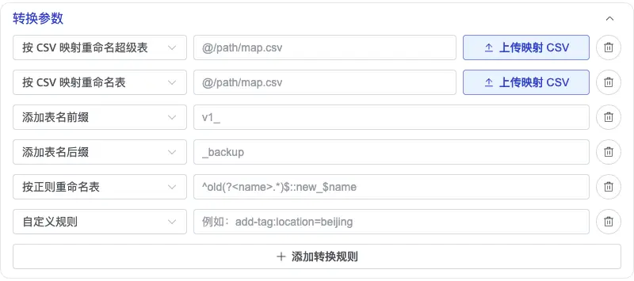
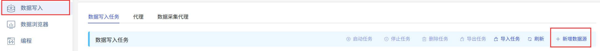
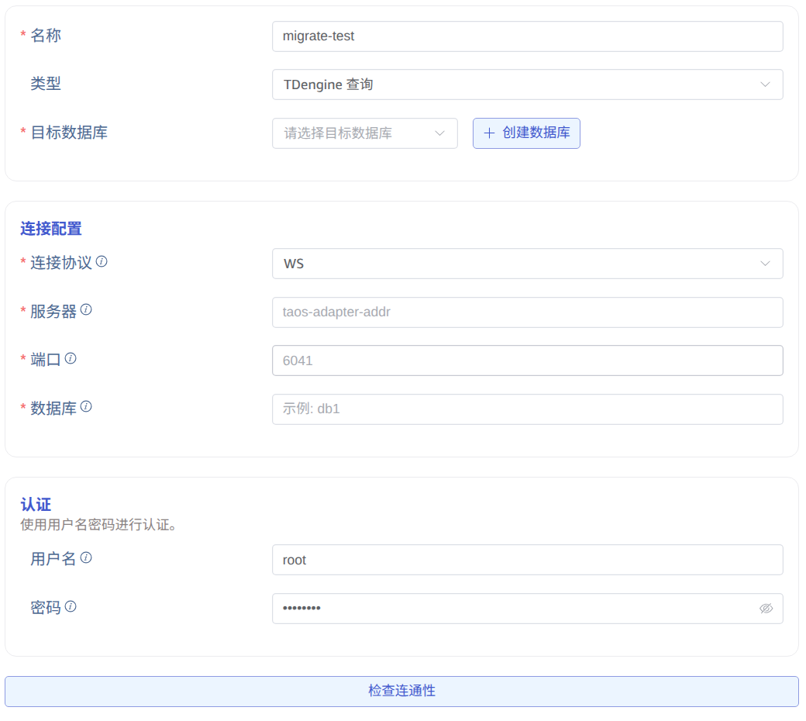
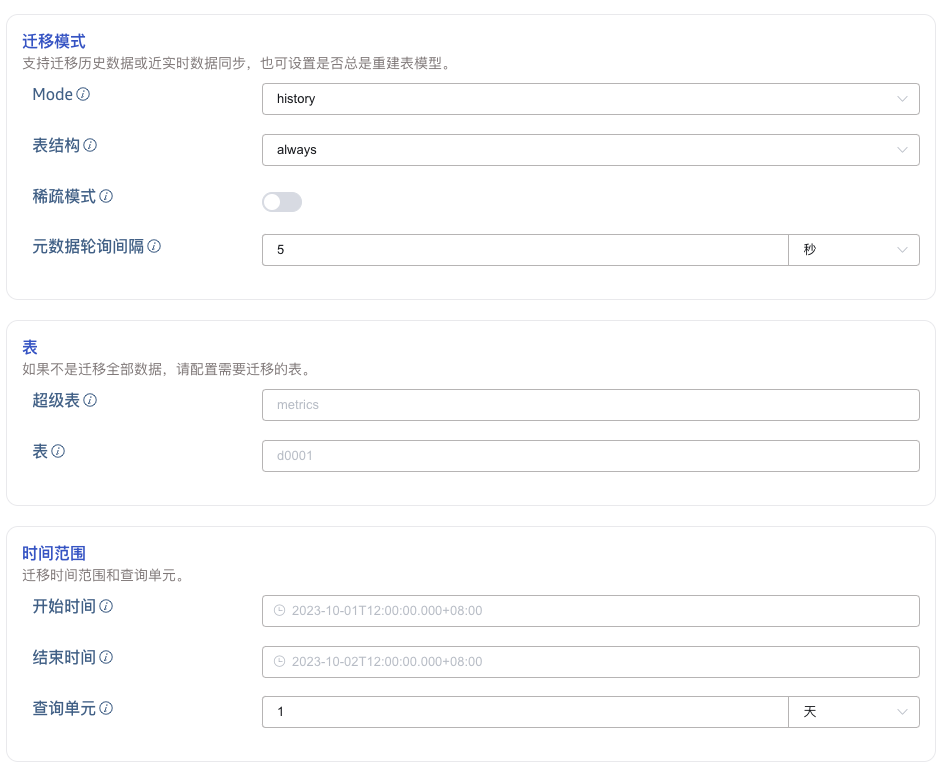
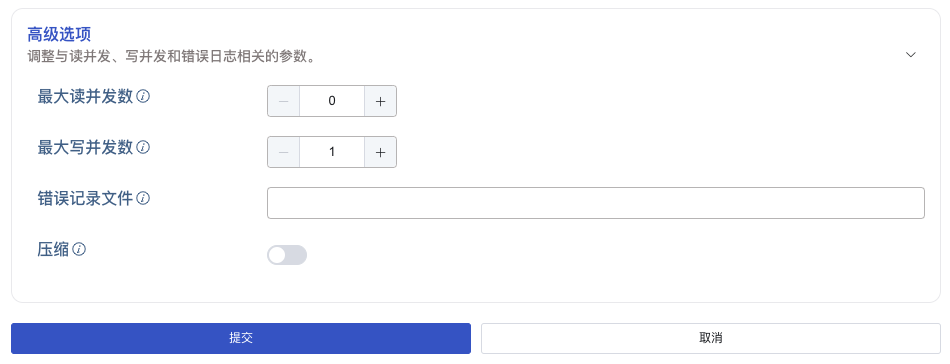

本节讲述如何通过 taosExplorer 界面创建数据迁移任务，从旧版本 TDengine（`v2.4+`、`v3.0+`）迁移到当前集群。

## 功能概述

taosX 通过 SQL 查询源集群数据，并把查询结果写入到目标数据库。具体实现上，taosX 以一个子表的一个时间段的数据作为查询的基本单元，将要迁移的数据分批写入目标数据库。

taosX 支持三种迁移模式：

1. **history** 模式。指迁移指定时间范围内的数据，若不指定时间范围，则迁移截至创建任务前的所有数据。迁移完则任务停止。
2. **realtime** 模式。同步从任务创建时间起之后的数据，若不手动停止任务则任务会持续运行。
3. **both** 模式。先执行 history 模式，再执行 realtime 模式。

每种迁移模式下，都可以指定是否迁移表结构。如果选择了“always”, 则会先同步表的结构到目标数据库再迁移数据。如果子表数量比较多这个过程可能会比较长。如果确定目标数据库已经有了和源数据库相同的表结构，建议选择“none”以节省时间。

任务在运行过程中会保存进度信息到硬盘上，因此如果暂停任务后重新启动，或任务自动从异常中自动恢复，任务并不会从头开始进行。

更多选项建议详细阅读创建任务页面每个表单字段的说明。

## 转换参数

对于支持该功能的 TDengine 数据源（包括 **TDengine 查询** 和 **TDengine 数据订阅**），创建或编辑任务时可以展开 **转换参数**，在数据写入目标库前调整表结构中的表名、超级表名和标签。可为一个任务添加多条转换规则。

可选择的转换规则如下：

| 转换规则 | 作用 | 配置说明 |
| --- | --- | --- |
| 按 CSV 映射重命名超级表 | 将指定源超级表映射为目标超级表名，并同步更新子表的 `USING` 超级表引用。 | 上传 CSV 映射文件，或填写映射文件路径。 |
| 按 CSV 映射重命名表 | 根据映射文件改写目标表名；子表的名称及其关联的超级表引用会同步更新。 | 上传 CSV 映射文件，或填写映射文件路径。 |
| 添加表名前缀 | 为目标表名添加固定前缀。 | 例如输入 `v1_`，将 `meters` 改为 `v1_meters`。 |
| 添加表名后缀 | 为目标表名添加固定后缀。 | 例如输入 `_backup`，将 `meters` 改为 `meters_backup`。 |
| 按正则重命名表 | 使用正则表达式匹配并替换目标表名。 | 输入格式为 `<正则表达式>::<替换文本>`，例如 `^old(?<name>.*)$::new_$name`。 |
| 自定义规则 | 配置下拉列表未提供的有效 taosX `-T` 转换动作。 | 例如 `add-tag:location=beijing` 会添加名为 `location`、值为 `beijing` 的标签。 |

CSV 映射文件每行包含一对源名称和目标名称，格式为 `source_name,target_name`，不包含表头。上传映射 CSV 后，taosExplorer 会自动填入带 `@` 前缀的文件引用。

## 具体步骤

首先，点击左侧“数据写入”菜单，然后点击右侧“+ 新增数据源”按钮。

然后输入任务名称，比如“migrate-test”, 最后选择类型“TDengine 查询”。此时，表单切换为从 "TDengine 查询" 迁移数据专用的表单，包含了大量选项，每种选项都有详细的说明，如下图所示。

点击“提交”按钮提交任务后，回到“数据源”任务列表页面，可以监控任务的运行情况。
