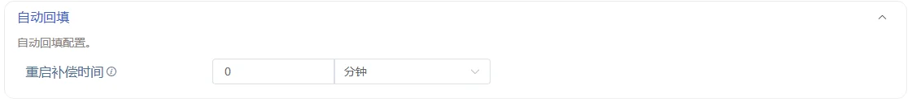

本页介绍如何使用 PI 实时任务将 PI 系统的实时数据持续同步到 TDengine，涵盖任务配置、高级功能、最佳实践和常见问题排查。

## 概述

PI 实时任务用于持续订阅 PI 系统的数据变化，将新产生的数据实时写入 TDengine。典型使用场景包括：

- **实时监控**：将 PI 实时数据同步到 TDengine，利用 TDengine 的高性能查询能力构建实时仪表板
- **双写过渡**：在从 PI 向 TDengine 迁移过程中，两套系统并行运行
- **数据汇聚**：将多个 PI 系统的实时数据汇聚到统一的 TDengine 集群

## 创建 PI 实时任务

### 基本步骤

1. 在 taosExplorer 的数据写入页面，点击 **+新增数据源**
2. 在 **类型** 下拉列表中选择 **PI**
3. 配置连接信息（详见 [PI](./index.md)）
4. 配置数据模型（单列/多列，详见 [模型配置参考](./03-csv-reference.md)）
5. 按需开启 **自动同步新增点位**，并确认保存的筛选条件覆盖后续需要接入的对象（见下文）
6. 配置重启补偿时间和其他高级选项
7. 提交任务

### 重启补偿时间

**重启补偿时间** 是 PI 实时任务的一个关键参数。当任务因故意外中断后重启时，taosX 会自动回填从中断时刻到当前时刻这段时间内的数据。

| 参数 | 说明 |
| --- | --- |
| 重启补偿时间 | 设置重启后自动回填的最大时间窗口 |

**配置建议**：

- 根据你能容忍的最大数据丢失时间来设置
- 例如，设置为 1 小时，则如果任务中断了 30 分钟后重启，taosX 会回填这 30 分钟的数据
- 如果中断时间超过了补偿时间的设置，超出部分的数据需要通过 PI backfill 任务手动补录

## 数据同步行为

### 单列模型

- 订阅每个 PI Point 的值变化
- 当 PI Point 的值发生变化时，将新值写入对应的 TDengine 子表
- 每个 PI Point 对应一张子表

### 多列模型

- 订阅 AF 模板下所有元素的 PI Point 属性变化
- 当某个元素的某个 PI Point 属性值发生变化时，更新对应子表的对应列
- 每个 AF 元素对应一张子表

## 自动同步新增点位

对于保存了可重新扫描的点位或 AF 筛选规则的 PI 实时任务，可在 **高级选项** 中开启 **自动同步新增点位**。任务运行后，taosX 按原规则定期扫描，将新增且仍符合条件的对象加入采集，无需重新下载或上传初始 CSV，也无需重启任务。

| 场景 | 自动接入行为 |
| --- | --- |
| PI Data Archive Only，按 Point 名称筛选 | 新建 Point 的名称匹配保存的通配符时，创建目标子表并加入实时采集 |
| 已有 AF 模板新增 PI Point 属性 | 模板已在任务采集范围内时，接入新增属性；多列模型同时为对应超级表增加所需列 |
| AF Element 名称或路径筛选，未限定模板列表 | 新建且仍匹配原规则的元素及其 PI Point 属性加入采集 |

筛选语法见 [Dataset Filter 配置](./07-dataset-filter.md)。固定 Point 列表或没有可重放筛选规则的固定 CSV 不支持自动扩采。

### 配置与生效范围

- 页面新建规则型实时任务默认关闭该选项，可按需手工开启。编辑或复制已有任务时保留其已保存的值；旧任务缺少该配置时按关闭处理。通过 API 创建任务时，应显式设置 `auto_sync_new_points=true`，省略时按关闭处理。
- PI 默认每 60 秒扫描一次。新对象不是立即接入，还需等待下一轮扫描及建表、模型更新和订阅完成。
- 仅采集新增对象接入后产生的实时数据，不自动回填其已有历史数据。首次接入与任务重启后的补偿行为分别配置；如需历史数据，使用 [历史数据回填](./04-backfill-guide.md)。
- 增量接入期间已有点继续采集；重复扫描不会重复订阅或重复创建子表。不匹配原规则的对象不会接入。
- 此功能只增加采集对象。已有对象类型变化或从扫描结果消失时，不自动修改其目标结构、删除子表或停止采集。
- 源对象映射到不兼容的目标结构，或不同点位映射到相同写入位置时，冲突对象不会接入；检查任务日志并调整映射。

### 与原有元素同步选项的关系

**自动同步新增点位** 与原有 **同步新增元素**、**同步删除元素** 互斥。开启后，页面关闭并禁用这两个旧选项；通过 API 同时开启时会拒绝配置。需要按源端元素删除目标子表的任务，应关闭自动同步新增点位，继续使用原有元素同步选项。

本地和 taosX-Agent 代理模式均支持此功能。taosX、taosX-Agent 与 PI 连接器应使用相匹配的版本。本机重启恢复与跨节点迁移的区别见 [故障转移](./08-failover.md)。

## 多列模型高级功能

以下高级选项仅在使用 **多列模型的实时任务** 时可用。

### 同步新增元素

| 选项 | 默认值 | 说明 |
| --- | --- | --- |
| 同步新增元素 | 开启 | 打开后，PI 连接器会监听模板下新增的元素，自动同步其数据 |

此选项用于未开启 **自动同步新增点位** 的原有元素监听模式，不能与新选项同时开启。

**使用场景**：当 PI 系统中持续有新设备/资产被添加到 AF 模板下时，无需手动重启任务或修改配置。

### 同步静态属性变化

| 选项 | 默认值 | 说明 |
| --- | --- | --- |
| 同步静态属性变化 | 开启 | 打开后，所有非 PI Point 属性（静态属性）的值变化会同步到 TDengine TAG |

**使用场景**：当 AF 元素的描述信息、分类、位置等静态属性可能被修改时，保持 TDengine TAG 与 PI AF 一致。

### 同步删除元素

| 选项 | 默认值 | 说明 |
| --- | --- | --- |
| 同步删除元素 | 开启 | 打开后，PI 连接器监听模板下删除元素的事件，同步删除 TDengine 对应子表 |

:::warning
开启此选项后，PI 中删除元素将导致 TDengine 中对应子表被删除，**数据不可恢复**。请谨慎使用。
:::

### 同步删除历史数据

| 选项 | 默认值 | 说明 |
| --- | --- | --- |
| 同步删除历史数据 | 开启 | 打开后，PI 中某个时间点的数据被删除时，TDengine 对应时间对应列的数据会被置空 |

### 同步修改历史数据

| 选项 | 默认值 | 说明 |
| --- | --- | --- |
| 同步修改历史数据 | 开启 | 打开后，PI 中历史数据被修改时，TDengine 对应时间的数据也会更新 |

**使用场景**：PI 系统中可能存在数据修正的操作（如手动修改异常值），开启此选项可以保持 TDengine 与 PI 数据一致。

## 最佳实践

### 高可用部署

- 建议使用 taosX-Agent 代理模式部署（参见 [部署架构](./02-deployment-architecture.md)），将连接器与 taosX 分离
- 配置合理的重启补偿时间，确保任务重启后不会丢失数据
- 通过 taosExplorer 监控任务状态，及时发现异常

### 性能调优

| 调优项 | 建议 |
| --- | --- |
| 批次大小 | 根据数据密度调整，点位多且数据频率高时适当增大 |
| 单次读取最大延迟 | 根据实时性要求调整 |
| 日志级别 | 生产环境使用 `info` 或 `warn`，排查问题时临时切换到 `debug` |

### 任务监控

通过 taosExplorer 的数据源列表页面可以查看：

- 任务运行状态
- 数据写入速率
- 最近一次同步时间
- 错误日志

建议定期检查任务状态，确保实时同步正常运行。

## 常见问题

### 实时任务数据丢失如何补偿？

如果实时任务中断时间超过了重启补偿时间的设置，可以通过以下步骤补偿：

1. 记录任务中断的时间段
2. 创建一个 PI backfill 任务，时间范围覆盖中断时段
3. 运行回填任务补录数据
4. 回填完成后，实时任务继续正常运行

### 实时同步延迟过大如何排查？

1. **网络延迟**：检查 taosX/taosX-Agent 到 PI 系统的网络延迟
2. **PI 系统负载**：检查 PI Data Archive 的负载情况
3. **TDengine 写入瓶颈**：检查 TDengine 集群的写入性能
4. **批次大小过大**：适当减小批次大小，降低单次处理延迟
5. **日志排查**：将日志级别调整为 `debug`，查看详细的处理耗时

### 新增点位后需要重启任务吗？

- 开启 **自动同步新增点位** 且新对象符合任务保存的筛选规则时，单列和多列模型均可在运行中接入，无需重启或更新初始 CSV。已有模板新增 PI Point 属性时，多列模型会自动扩列。
- 未开启该选项时，原有 **同步新增元素** 只处理其支持的模板元素新增场景。
- 使用固定列表、固定 CSV，或新对象不在原筛选范围内时，需要手动调整任务配置；自动同步不会扩大筛选范围。

### 多列模型的 TAG 值不更新？

确认是否开启了 **同步静态属性变化** 选项。如果未开启，TAG 值只在子表创建时写入一次，后续不会更新。
