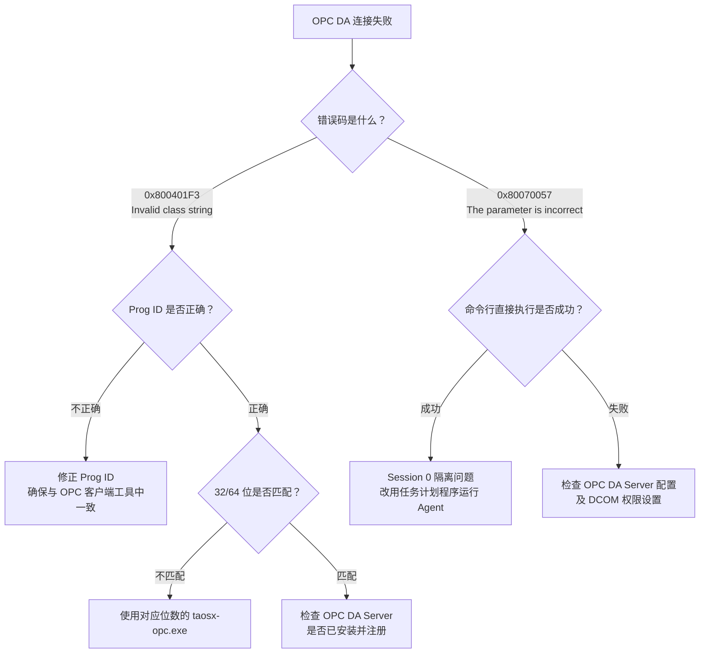

在 Windows 上使用 `taosx-opc.exe` 或通过 taosExplorer 创建 OPC DA 数据源时，可能遇到连接失败。本文按错误码整理常见的 OPC DA 连接问题及解决方案。排查前建议先确认 [前置条件](./index.md#前置条件) 中的网络与部署环境无误。

## 排查流程



## 错误一：Prog ID 错误（0x800401F3）

**错误信息**

```plaintext
OPC ERROR code:0x800401F3, error:Unknown error, may be system error: Invalid class string
```

**原因**

`0x800401F3` 是 Windows COM 错误 `REGDB_E_CLASSNOTREG`，表示找不到对应的 COM 类，通常是因为配置中的 Prog ID 写错。

**排查步骤**

1. 打开 OPC 客户端工具（如 Rockwell OPC Test Client、Matrikon OPC Explorer）。
2. 查看 **OPC Server Prog ID** 字段中显示的名称。
3. 确保配置中的服务地址与该名称完全一致。Prog ID 大小写敏感，且各段之间使用空格分隔，而不是点。

| 错误写法 | 正确写法 |
| --- | --- |
| `RSLinx.OPC.Server`（用点分隔） | `RSLinx OPC Server`（用空格分隔） |
| `rslinx opc server`（大小写不对） | `RSLinx OPC Server`（大小写敏感） |

**解决方案**

修改配置文件或 taosExplorer 中的 OPC DA 服务地址，确保 Prog ID 与 Windows 注册表中注册的完全一致。

:::tip
可以先用命令行验证配置是否正确，再到 taosExplorer 中操作：

```shell
C:\TDengine\plugins\opc\taosx-opc.exe check -c config.toml
```

:::

## 错误二：32/64 位不匹配（0x800401F3）

**现象与原因**

同样是 `0x800401F3`，但 Prog ID 确认无误。此时多为 `taosx-opc.exe` 的位数（32/64 位）与 OPC DA Server 注册的 COM 组件位数不一致。

**排查方法**

在 PowerShell 中执行以下命令检查 `taosx-opc.exe` 的位数：

```powershell
$bytes = [System.IO.File]::ReadAllBytes("C:\TDengine\plugins\opc\taosx-opc.exe")
$peOffset = [BitConverter]::ToInt32($bytes, 0x3C)
$machine = [BitConverter]::ToUInt16($bytes, $peOffset + 4)
if ($machine -eq 0x14c) { "32-bit (x86)" }
elseif ($machine -eq 0x8664) { "64-bit (x64)" }
else { "Unknown: $machine" }
```

**解决方案**

确保 `taosx-opc.exe` 与 OPC DA Server 的 COM 注册位数一致：

- OPC DA Server 只有 32 位 COM 注册时，使用 32 位的 `taosx-opc.exe`。
- OPC DA Server 只有 64 位 COM 注册时，使用 64 位的 `taosx-opc.exe`。

## 错误三：通过 Agent 服务连接失败（0x80070057）

**错误信息**

```plaintext
OPC ERROR code:0x80070057, error:Unknown error, may be system error: The parameter is incorrect.
```

**典型场景**

- 在命令行中直接执行 `taosx-opc.exe check` 成功。
- 通过 taosExplorer 选择 Agent 代理执行连通性检查失败。

**原因**

Windows 服务运行在 Session 0（非交互式会话）中。从 Windows Vista 开始，Session 0 被隔离，无法访问交互式桌面的 COM 对象；OPC DA 基于 DCOM，在 Session 0 中通常无法正常工作。

:::note
即使在服务属性中勾选「允许服务与桌面交互」，由于 Session 0 隔离机制，该选项在 Windows Vista 及以上版本中已不再真正生效。
:::

**验证方法**

1. 停止 taosX-Agent 服务。
2. 在 PowerShell 中直接运行 Agent（保持窗口打开）：

```powershell
Stop-Service -Name taosx-agent
cd C:\TDengine
.\taosx-agent.exe
```

3. 回到 taosExplorer 测试连通性。
4. 如果此时连接成功，则确认是 Session 0 的问题。

**解决方案：使用任务计划程序运行 Agent**

通过 Windows 任务计划程序运行 Agent，使其运行在用户的交互式会话中，与手动在 PowerShell 中启动效果一致，可以正常访问 OPC DA 的 DCOM 对象。

第一步：停用 Agent 服务。

```powershell
Stop-Service -Name taosx-agent
Set-Service -Name taosx-agent -StartupType Disabled
```

第二步：创建计划任务。打开任务计划程序（`taskschd.msc`），点击右侧 **创建任务**，按下表配置：

| 选项卡 | 设置项 | 值 |
| --- | --- | --- |
| 常规 | 名称 | `taosX Agent` |
| 常规 | 安全选项 | 只在用户登录时运行 |
| 触发器 | 开始任务 | 登录时 |
| 操作 | 程序或脚本 | `C:\TDengine\taosx-agent.exe` |
| 操作 | 起始于 | `C:\TDengine` |
| 设置 | 如果任务运行超过以下时间则停止 | 取消勾选 |

第三步：启动并验证。

1. 右键该计划任务，选择 **运行**。
2. 回到 taosExplorer 测试 OPC DA 连通性，确认连接成功。

## 错误四：服务器执行失败（0x80080005）

**错误信息**

```plaintext
OPC ERROR code:0x80080005, error:Unknown error, may be system error: Server execution failed
```

**可能原因**

OPC DA 服务器未能正常启动，或 taosX-Agent 服务运行账号缺少所需的 COM/DCOM 启动、激活或访问权限。

**解决方法**

先确认 OPC DA 服务器已正常启动。在 taosX-Agent 所在 Windows 主机上，以管理员身份打开 PowerShell，停止 Agent 服务：

```powershell
Stop-Service -Name taosx-agent -ErrorAction Stop
(Get-Service -Name taosx-agent).WaitForStatus('Stopped', '00:00:30')
Get-Process -Name taosx-agent,taosx-agent-srv -ErrorAction SilentlyContinue
```

确认上述进程均已退出后，使用当前 Windows 登录账号前台启动 Agent，路径按实际安装位置调整：

```powershell
$env:PLUGINS_HOME = 'C:\TDengine\plugins'
$env:LOGS_HOME = 'C:\TDengine\log'
& 'C:\TDengine\taosx-agent.exe' --config 'C:\TDengine\cfg\agent.toml'
```

保持窗口打开，在 taosExplorer 中使用同一代理和 OPC 配置重新检查连通性。若前台成功、恢复服务后失败，重点检查服务账号与 COM/DCOM 权限；可在 `services.msc` 的服务属性“登录”页，将默认的 `LocalSystem` 改为前台验证成功的账号并填写有效密码，重启服务复测。恢复服务前，先按 Ctrl+C 退出前台 Agent，避免同时运行两个实例。若前台仍失败，继续检查 OPC DA 服务器启动状态及 Windows 事件日志。

:::note
前台验证成功说明问题出在服务运行环境（如 Session 0 隔离或服务账号权限）。若希望 Agent 长期稳定运行在交互式会话中，推荐按上文 [错误三](#错误三通过-agent-服务连接失败0x80070057) 使用任务计划程序方式部署。
:::

## 相关文档

- [OPC-DA](./index.md)：创建 OPC DA 数据接入任务的完整步骤
- [数据接入前置条件](../00-prerequisites.md)：网络拓扑、端口放通与检查方法
- [安装 taosX-Agent](../01-install-agent.md)：Agent 的下载、安装与上线
