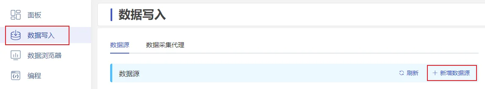
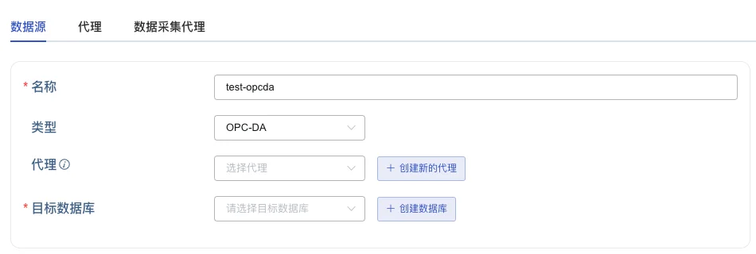
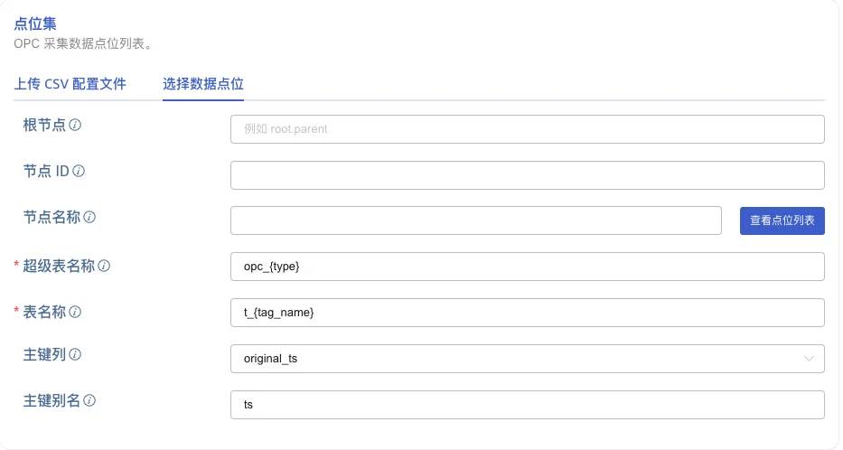
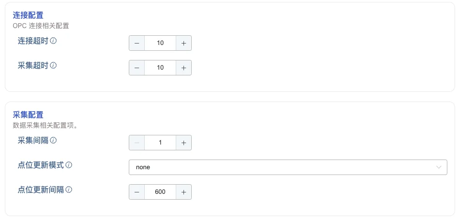
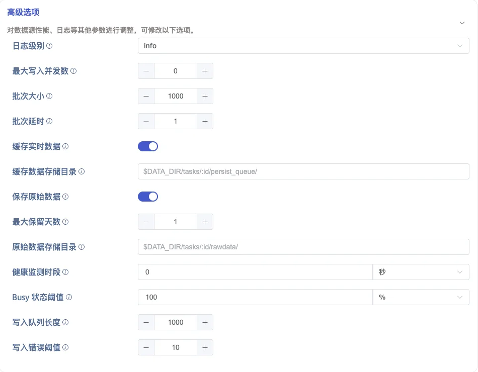
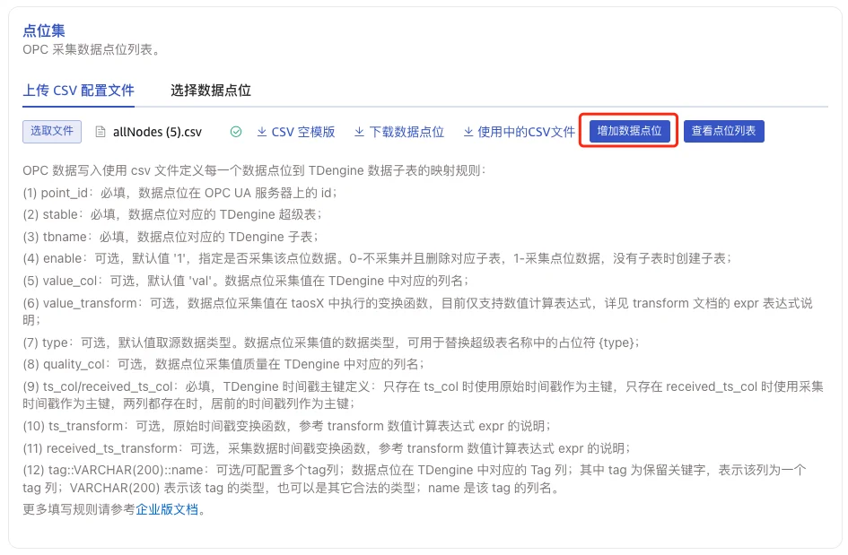
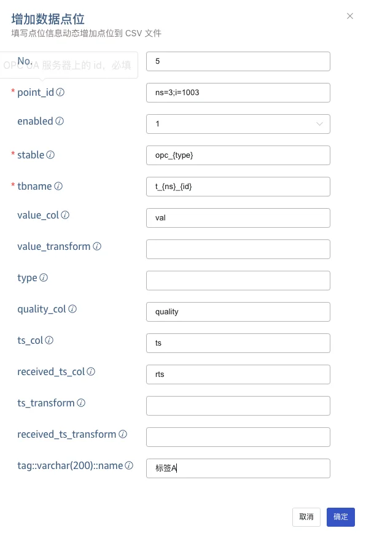

本节讲述如何通过 taosExplorer 界面创建数据写入任务，从 OPC DA 服务器同步数据到当前 TDengine 集群。

## 功能概述

OPC 是工业自动化领域和其他行业中安全可靠地交换数据的互操作标准之一。OPC DA（数据访问）是一种经典的基于 COM 的规范，仅适用于 Windows。尽管 OPC DA 不是最新和最高效的数据通信规范，但它被广泛使用。这主要是因为一些旧设备只支持 OPC DA。

TDengine 可以高效地从 OPC DA 服务器读取数据并将其写入 TDengine，以实现实时数据入库。

## 前置条件

开始前，请先确认满足 [数据接入前置条件](../00-prerequisites.md)，重点包括：

- **部署环境**：OPC DA 基于 Windows COM/DCOM 通信，连接器只能运行在 Windows 主机上，taosX 或 taosX-Agent 必须部署在能够访问 OPC DA 服务器的 Windows 主机上。若 taosX 部署在 Linux 或非数据源网段，则必须通过在 Windows 主机上部署 taosX-Agent 代理接入。
- **网络连通**：使用 taosX-Agent 代理时，需分别保证 taosX-Agent → taosX（gRPC 默认端口 `6055`）、taosX-Agent → OPC DA 服务器两段网络连通；两段网络的放行与检查方法见 [数据接入前置条件](../00-prerequisites.md#检查端口连通性)。
- **COM/DCOM 权限**：Agent 服务账号需要具备 OPC DA 服务器 COM/DCOM 的启动、激活与访问权限，常见连接错误的配置与排查方法见 [连接问题排查](./02-troubleshooting.md)。

## 数据接入

### 新增数据源

在数据写入页面中，点击 **+新增数据源** 按钮，进入新增数据源页面。

### 配置基本信息

在 **名称** 中输入任务名称，例如针对环境温湿度监控的任务，取名为 **environment-monitoring**。

在 **类型** 下拉列表中选择 **OPC-DA**。

**代理** 是非必填项。当 taosX 无法直接连接 OPC DA 服务器时，需要在可访问 OPC DA 服务器的 Windows 主机上部署 taosX-Agent 作为代理 —— 此时只要 taosX ↔ taosX-Agent、taosX-Agent ↔ OPC DA 服务器两段网络分别连通即可。如果 taosX 服务运行在可访问 OPC DA 服务器的 Windows 主机上，则无需配置代理。需要时，可以在下拉框中选择已有代理，或点击右侧的 **+创建新的代理** 按钮新建。代理的网络要求（端口放通与检查方法）见 [数据接入前置条件](../00-prerequisites.md)。

在 **目标数据库** 下拉列表中选择一个目标数据库，也可以先点击右侧的 **+创建数据库** 按钮创建一个新的数据库。

### 配置连接信息

在 **连接配置** 区域填写 **OPC-DA 服务地址**（即 OPC Server 的 Prog ID，如 `Matrikon.OPC.Simulation.1`），例如：`127.0.0.1/Matrikon.OPC.Simulation.1`，并配置认证方式。

点击 **连通性检查** 按钮，检查数据源是否可用。如果连接失败，请根据错误码参照 [连接问题排查](./02-troubleshooting.md) 处理。

### 配置点位集

**点位集** 可选择使用 CSV 文件模板或 **选择所有点位**，两种方式互斥。

#### 上传 CSV 配置文件

你可以下载 CSV 空模板并按模板配置点位信息，然后上传 CSV 配置文件来配置点位；或者根据所配置的筛选条件下载数据点位，并以 CSV 模板所制定的格式下载。

CSV 文件的核心规则：

- **文件编码**：必须为 UTF-8（with BOM 或 without BOM 均可）。
- **Header**：第一行；包含 `tag_name`、`stable`、`tbname` 等列；`tag_name` 在整个任务中唯一。
- **Row**：每行配置一个 OPC 数据点位。

完整的列定义、取值规则与校验要求，参见 [CSV 配置文件参考](./01-csv-reference.md)。

#### 选择数据点位

可以通过配置 **根节点 ID**、**节点 ID**、**节点名称** 作为过滤条件，对点位进行筛选。

通过配置 **超级表名**、**表名称**，指定数据要写入的超级表、子表。

配置 **主键列**，选择 origin_ts 表示使用 OPC 点位数据的原始时间戳作 TDengine 中的主键；选择 request_ts 表示使用数据的请求时间戳作 TDengine 中的主键；选择 received_ts 表示使用数据的接收时间戳作 TDengine 中的主键。配置 **主键别名**，指定 TDengine 时间戳列的名称。

### 采集配置

在采集配置中，配置当前任务的采集间隔、连接超时、采集超时等选项。

如图所示，其中：

- **连接超时**：配置连接 OPC 服务器超时时间，默认为 10 秒。
- **采集超时**：向 OPC 服务器读取点位数据时如果超过设定时间未返回数据，则读取失败，默认为 10 秒。
- **采集间隔**：默认为 10 秒，数据点位采集间隔，从上次采集数据结束后开始计时，轮询读取点位最新值并写入 TDengine。

:::note

- 采集间隔是任务级参数：同一 OPC DA Data In 任务内的所有点位共用一个采集间隔，不支持在同一任务内按单个点位或点位分组设置不同扫描频率。
- 若少数点位需要更高或更低的采集频率，请将它们拆到另一个 OPC DA 任务（可指向同一 OPC 服务器与同一目标库），并为该任务单独设置采集间隔。
- 调整采集间隔、超时等采集参数时，在 taosExplorer 中编辑并提交该任务即可；无需在 OPC 服务器侧重新安装或重新部署 taosX-Agent。

:::

当 **点位集** 中使用 **选择数据点位** 方式时，采集配置中可以配置 **点位更新模式** 和 **点位更新间隔** 来启用动态点位更新。**动态点位更新** 是指，在任务运行期间，OPC Server 增加或删除了点位后，符合条件的点位会自动添加到当前任务中，不需要重启 OPC 任务。

- 点位更新模式：可选择 `None`、`Append`、`Update`三种。
  - None：不开启动态点位更新；
  - Append：开启动态点位更新，但只追加；
  - Update：开启动态点位更新，追加或删除；
- 点位更新间隔：在“点位更新模式”为 `Append` 和 `Update` 时生效。单位：秒，默认值是 600，最小值：60，最大值：2147483647。

### 高级选项

如上图所示，配置高级选项对性能、日志等进行更加详尽的优化。

**日志级别** 默认为 `info`，可选项有 `error`、`warn`、`info`、`debug`、`trace`。

在 **最大写入并发数** 中设置写入 taosX 的最大并发数限制。默认值：0，表示 auto，自动配置并发数。

在 **批次大小** 中设置每次写入的批次大小，即：单次发送的最大消息数量。

在 **批次延时** 中设置单次发送最大延时（单位为秒），当超时结束时，只要有数据，即使不满足 **批次大小**，也立即发送。

当 **缓存实时数据** 选项开启时，OPC 消费的数据会先存入本地文件中，本地文件的数据会被后台任务持续读出并发送给下游处理。当 OPC 数据流量巨大，下游无法及时处理造成数据消费卡顿导致数据丢弃时使用，即用于流量削峰，当数据消费完毕后，会自动清理文件。此功能默认关闭。关于该功能的详细原理和配置说明，请参考 [存储转发](../../../12-operations-and-tooling/03-components/07-taosx-agent/02-store-and-forward.md)。

在 **缓存数据存储目录** 中可填写数据缓存的存储目录路径，默认为 taosX 启动时配置的数据目录，也可以填写自定义目录。此选项仅在 **缓存实时数据** 选项开启时有效。

在 **保存原始数据** 中选择是否保存原始数据。默认值：否。

当保存原始数据时，以下 2 个参数配置生效。

在 **最大保留天数** 中设置原始数据的最大保留天数。

在 **原始数据存储目录** 中设置原始数据保存路径。若使用 Agent，则存储路径指的是 Agent 所在服务器上路径，否则是 taosX 服务器上路径。路径中可使用占位符 `$DATA_DIR` 和 `:id` 作为路径中的一部分。

- Linux 平台，$DATA_DIR 为 /var/lib/taos/taosx，默认情况下存储路径为 `/var/lib/taos/taosx/tasks/<task_id>/rawdata` 。
- Windows 平台， $DATA_DIR 为 C:\TDengine\data\taosx，默认情况下存储路径为 `C:\TDengine\data\taosx\tasks\<task_id>\rawdata` 。

### 提交任务

点击 **提交** 按钮，完成创建 OPC DA 到 TDengine 的数据同步任务，回到 **数据源列表** 页面可查看任务执行情况。

## 增加数据点位

在任务运行中，点击 **编辑**，点击 **增加数据点位** 按钮，追加数据点位到 CSV 文件中。适用于只需新增少量点位、不必重导全量点表的场景。

在弹出的表单中，填写数据点位的信息。

点击 **确定** 按钮，完成数据点位的追加。

## 点位与元数据维护

### 修改已有点位映射或启用状态

- **点位标签 / 工业元数据**：描述、工程单位、量程、源路径等面向运维与资产侧的标签与属性维护，建议在 TDengine IDMP 中完成。IDMP 提供资产树与属性管理能力，更适合局部批量改点、按设备维护元数据，而无需反复导出/重导全量 OPC 点表。详见 [TDengine IDMP 文档](https://idmpdocs.taosdata.com/)。若未使用 IDMP、且元数据已作为库内 TAG 落库，可用 SQL [`ALTER TABLE … SET TAG`](../../../05-tdengine-sql/02-ddl/02-table.md#修改标签值)，支持[批量修改标签值](../../../05-tdengine-sql/02-ddl/02-table.md#批量修改标签值)。
- **启用 / 停用采集**：在 CSV 中调整对应行的 `enable`（`1` 采集，`0` 不采集），重新上传该任务的 CSV 后生效。`enable=0` 时，任务启动前会删除该点位在 TDengine 中对应的子表（见 [CSV 配置文件参考](./01-csv-reference.md)）。
- **修改接入映射列**（如 `stable`、`tbname`、`value_col`、`value_transform`）：下载当前点位 CSV，改所需行后重新上传。不必为改几个点而重建 Agent；任务仍绑定同一代理。

### CSV 元数据与 TDengine 落库字段

OPC DA 通过 CSV / 点位表单配置的内容，决定写入 TDengine 的表结构与标签；不会像 OPC UA 那样自动把服务器 Item 的 Description、Engineering Unit、Hi/Lo 量程等属性导入为 TAG。

| 来源 | 可写入 / 影响 TDengine 的内容 |
| --- | --- |
| CSV 必填 / 常用列 | `tag_name`（OPC 点 id）、`stable`、`tbname`、采集值列与时间戳列等 |
| CSV `enable` | 是否采集该点；停用时可删除对应子表 |
| CSV `value_transform` | 写入前对数值做 Rhai 表达式变换（单位换算等），结果仍写入数值列 |
| CSV `tag::TYPE::name` | 自定义 TAG；可手工填入描述、工程单位、量程、源路径等供应商 dump 中的字段 |
| 默认 TAG | 未配任何 tag 列且超级表不存在，自动添加 `point_id`、`point_name` |

若供应商提供含描述、单位、量程等字段的 dump，推荐流程：按 CSV 模板整理点位 → 将描述/单位/量程等写入自定义 `tag::…` 列 → 上传创建任务。点位接入后，标签与工业元数据的日常维护建议在 IDMP 中进行；未使用 IDMP 时，可用 SQL `SET TAG` 调整已入库 TAG。

OPC UA 侧对 BrowseName / Description / Path 以及 Property→TAG 的自动映射，见 [OPC UA](../05-opcua/index.md) 与 [OPC UA CSV 映射参考](../05-opcua/02-csv-reference.md)。

## 任务变更与 Agent

Agent 在 OPC 服务器附近安装一次并保持运行即可。之后在 taosExplorer（或通过 [数据接入（Xnode）](../../../05-tdengine-sql/08-cluster-management/02-xnode.md) SQL）上创建、编辑、启停 Data In 任务、调整采集参数、追加或更新点位 CSV，一般无需为点位变更重新打包或重装 Agent。

仅在以下情况需要改动 Agent 本机配置或重装：更换 `endpoint` / `token`、升级 Agent 版本、调整 Agent 本机高级项（如存储转发目录）等。安装步骤见 [安装 taosX-Agent](../01-install-agent.md)。

## 常见问题

OPC DA 连接失败的排查（Prog ID 错误、32/64 位不匹配、Session 0 隔离、DCOM 权限等）见 [连接问题排查与解决](./02-troubleshooting.md)。

## 相关文档

- [数据接入前置条件](../00-prerequisites.md)：直连/代理拓扑与网络端口要求
- [CSV 配置文件参考](./01-csv-reference.md)：点位映射 CSV 的完整列定义与规则
- [连接问题排查](./02-troubleshooting.md)：按错误码定位并解决连接失败
- [安装 taosX-Agent](../01-install-agent.md)：远程代理安装与连通
- [OPC UA](../05-opcua/index.md)：UA 点位元数据自动映射与采集模式
- [TDengine IDMP](../../../19-tdengine-idmp/index.md)：点位标签与工业元数据管理（推荐）
- [数据接入（Xnode)](../../../05-tdengine-sql/08-cluster-management/02-xnode.md)：用 SQL 管理接入节点、任务与 Agent
- [修改标签值](../../../05-tdengine-sql/02-ddl/02-table.md#修改标签值)：未使用 IDMP 时批量更新已入库 TAG
