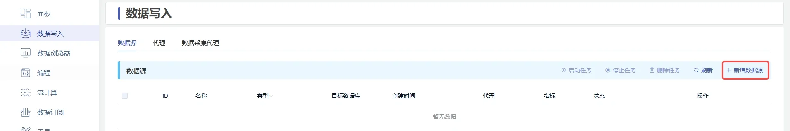
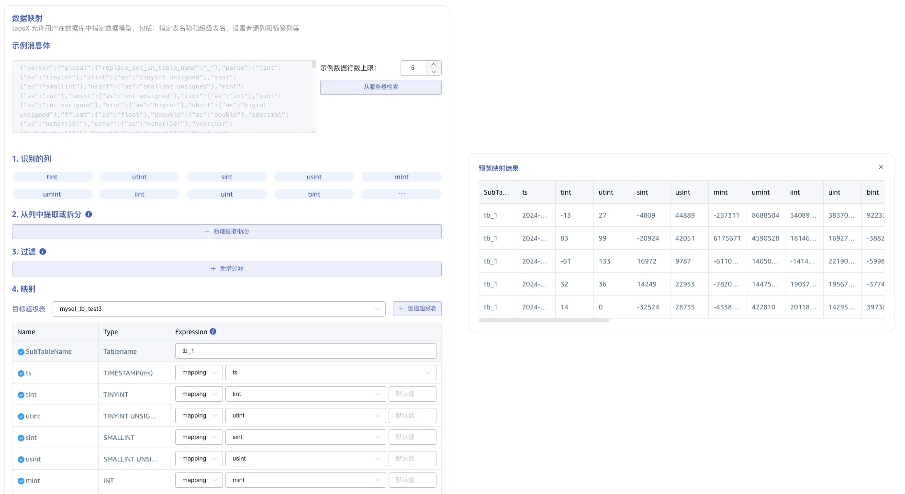
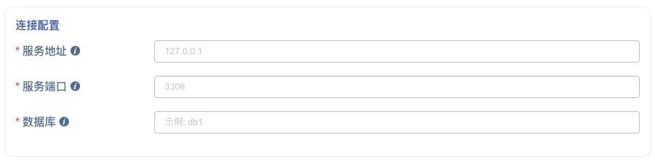
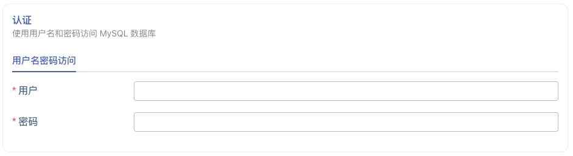
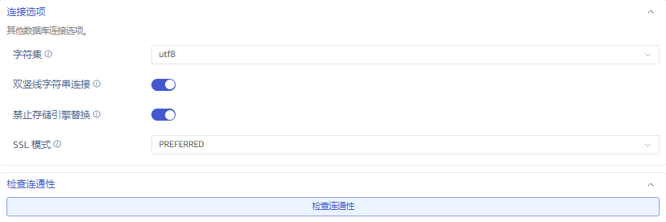
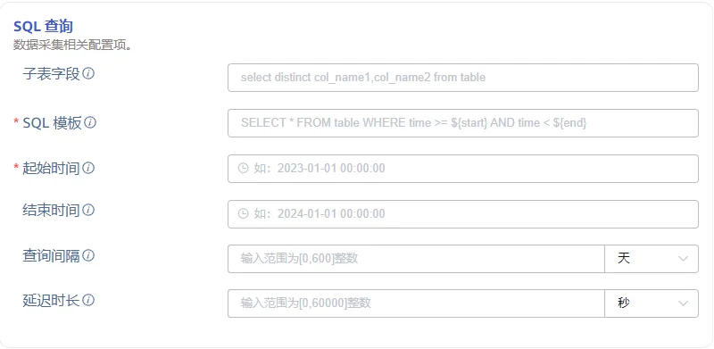

本节讲述如何通过 taosExplorer 界面创建数据写入任务，从 MySQL 将数据接入当前 TDengine 集群。

## 功能概述

MySQL 是最流行的关系型数据库之一。很多系统都曾经或正在使用 MySQL 数据库存储物联网、工业互联网等设备上报的数据。但随着接入系统的设备量日益增长、用户对数据实时性反馈的要求也越来越高，MySQL 已经无法满足业务需求。从 TDengine 企业版 3.3.0.0 开始，TDengine 可以高效地从 MySQL 读取数据并将其写入 TDengine，以实现历史数据迁移或实时数据同步，解决业务面临的技术痛点。MySQL 数据源还支持定时窗口同步和数据校验。

同步模式、字段映射、类型转换、事务一致性和数据校验等通用说明见 [关系型数据库集成](./23-rdb-integration.md)。

## 创建任务

### 新增数据源

在数据写入页面中点击 **+新增数据源** 按钮进入新增数据源页面，如下图所示：

### 配置基本信息

在 **名称** 字段中输入任务名称，例如 *`test_mysql_01`* 。

选择 **类型** 下拉框中的 *`MySQL`* ，如下图所示（选择完成后页面中的字段会发生变化）。

**代理** 是非必填项，如有需要，可以在下拉框中选择指定的代理，也可以先点击右侧的 **+创建新的代理** 按钮创建一个新的代理。代理与 taosX 之间的网络要求（端口放通与检查方法）见 [数据接入前置条件](./00-prerequisites.md)。

**目标数据库** 是必填项，可以先点击右侧的 **+创建数据库** 按钮创建一个新的数据库。

### 配置连接信息

在 **连接配置** 区域填写 *`源 MySQL 数据库的连接信息`*，如下图所示：

### 配置认证信息

**用户** 输入源 MySQL 数据库的用户，该用户必须在该组织中拥有读取权限。

**密码** 输入源 MySQL 数据库中上方用户的登录密码。

### 配置连接选项

**字符集** 设置连接的字符集。默认字符集为 utf8mb4。MySQL 5.5.3 支持此功能。如果需要连接到旧版本，建议改为 utf8。
可选项有 utf8、utf8mb4、utf16、utf32、gbk、big5、latin1、ascii。

**双竖线字符串连接**（`pipes_as_concat`）控制是否在当前连接的 SQL 模式中追加 `PIPES_AS_CONCAT`。开启时，`||` 表示字符串连接；关闭时，不额外启用该模式，也不会移除服务器会话中已有的模式，因此 `||` 的实际含义取决于最终的会话 SQL 模式。默认开启，以保持现有 MySQL 数据同步任务的行为。修改此选项可能改变已有 SQL 查询的结果。

**禁止存储引擎替换**（`no_engine_substitution`）控制是否在当前连接的 SQL 模式中追加 `NO_ENGINE_SUBSTITUTION`，以禁止 MySQL 在指定存储引擎不可用时自动替换存储引擎。关闭时不会移除服务器会话中已有的同名模式。默认开启。

Apache Doris 提供兼容 MySQL 协议的端口，taosX 使用 MySQL 驱动连接该端口。驱动默认在连接初始化时向会话 SQL 模式追加 `PIPES_AS_CONCAT` 和 `NO_ENGINE_SUBSTITUTION`，但 Doris 不支持这两种模式，因此连接会在执行同步查询前失败。同步 Doris 数据时，将上述两个选项均设置为 **关闭**（`false`），使驱动不再追加这两种模式，然后点击 **检查连通性**。其他兼容 MySQL 协议的数据库应根据其兼容性要求设置，不建议修改已有任务的配置。

**SSL 模式** 设置是否与服务器协商安全 SSL TCP/IP 连接或以何种优先级进行协商。默认值是 PREFERRED。可选项有 DISABLED、PREFERRED、REQUIRED。

然后点击 **检查连通性** 按钮，用户可以点击此按钮检查上方填写的信息是否可以正常获取源 MySQL 数据库的数据。

### 配置 SQL 查询

**子表字段** 用于拆分子表的字段，它是一条 select distinct 的 SQL 语句，查询指定字段组合的非重复项，通常与 transform 中的 tag 相对应：
> 此项配置主要为了解决数据迁移乱序问题，需要结合 **SQL 模板** 共同使用，否则不能达到预期效果，使用示例如下：
>
> 1. 子表字段填写语句 `select distinct col_name1, col_name2 from table`，它表示使用源表中的字段 col_name1 与 col_name2 拆分目标超级表的子表
> 2. 在 **SQL 模板** 中添加子表字段占位符，例如 `select * from table where ts >= ${start} and ts < ${end} and ${col_name1} and ${col_name2}`。运行时 `${col_name1}`、`${col_name2}` 会展开为等值条件（如 `col_name1='deviceA'`、`col_name2=1`），而不是裸列名
> 3. 在 **transform** 中配置 `col_name1` 与 `col_name2` 两个 tag 映射

**SQL 模板** 用于查询的 SQL 语句模板，SQL 语句中必须包含时间范围条件，且开始时间和结束时间必须成对出现。SQL 语句模板中定义的时间范围由源数据库中的某个代表时间的列和下面定义的占位符组成。
> SQL 使用不同的占位符表示不同的时间格式要求，具体有以下占位符格式：
>
> 1. `${start}`、`${end}`：生成 MySQL 表达式，如：`STR_TO_DATE('2024-03-14 08:00:00','%Y-%m-%d %H:%i:%s')`
> 2. `${start_no_tz}`、`${end_no_tz}`：生成与 `${start}`、`${end}` 相同的表达式，如：`STR_TO_DATE('2024-03-14 08:00:00','%Y-%m-%d %H:%i:%s')`
> 3. `${start_date}`、`${end_date}`：表示仅日期，如：`STR_TO_DATE('2024-03-14','%Y-%m-%d')`
>
> 以上示例对应窗口起点 2024-03-14T00:00:00Z、任务时区 `+08:00`：占位符使用窗口边界在任务时区下的本地时间，精确到秒。taosX 会将 MySQL 会话的 `time_zone` 设为任务时区，因此 `TIMESTAMP` 列按绝对时刻比较，`DATETIME` 列按任务时区下的本地时间比较。
>
> 为了解决迁移数据乱序的问题，应在查询语句中添加排序条件，例如 `order by ts asc`。

**起始时间** 迁移数据的起始时间，此项为必填字段。

**结束时间** 迁移数据的结束时间，可留空。如果设置，则迁移任务执行到结束时间后，任务完成自动停止；如果留空，则持续同步实时数据，任务不会自动停止。

起始时间和结束时间是带 UTC 偏移的绝对时刻，任务时区不改变它们表示的时刻。任务时区由任务参数 `time_zone` 决定，taosExplorer 中没有对应字段；未设置时取起始时间的 UTC 偏移，即设置起始时间时 taosExplorer 页面所用的时区。编辑已有任务时如不修改起始时间，起止时间和任务时区均保持不变。`time_zone` 仅支持 `+08:00`、`+0800` 等固定 UTC 偏移或 `UTC`、`Z`，不支持 `Asia/Shanghai` 等 IANA 时区名；该偏移会设为 MySQL 会话时区，因此必须在 MySQL 支持的范围内（MySQL 8.0.19 及以上为 `-13:59` 至 `+14:00`，更早版本为 `-12:59` 至 `+13:00`，taosX 按前者校验）；取值无效时任务启动或预览数据时报错；偏移在任务中固定，不随夏令时变化。任务时区决定时间占位符的取值和查询窗口的切分：每个查询窗口不超过查询间隔，且不跨越任务时区的零点，因此查询间隔超过 1 天时按 1 天处理。如需使用 UTC 任务时区，可在设置起始时间前将 taosExplorer 页面时区切换为 UTC，或通过 API / 命令行设置 `time_zone=UTC`。详见 [时间与时区](./23-rdb-integration.md#时间与时区)。

**查询间隔** 分段查询数据的时间间隔，默认 1 天。为了避免查询数据量过大，一次数据同步子任务会使用查询间隔分时间段查询数据。

**延迟时长** 与 **查询间隔** 配合使用。在实时同步数据场景中，为了避免延迟写入的数据丢失，taosX 只读取到当前时间减去延迟时长为止的数据：未设置结束时间或结束时间晚于当前时间时，历史部分读取到该时刻；此后 taosX 约每秒检查一次，当上次断点到当前时间减去延迟时长的待读范围超过 10 秒（任务参数 `live_sync_min_window` 的默认值）时读取该范围。查询间隔只用于将该范围切分为查询窗口，不决定查询的触发时刻。例如：延迟时长为 60 秒时，09:01 执行的查询只读取 09:00 之前的数据。在定时窗口同步模式下，延迟时长控制读取的安全水位，即当前时间减去延迟时长。

**定时计划** 可选择 **持续同步** 或 **定时窗口同步**。定时模式可设置首次计划时刻和固定调度周期（分钟），或设置五字段分钟级 Cron 表达式，并通过 **单轮最多窗口数** 限制每次触发读取的窗口数。调度使用 taosExplorer 页面当前时区。已完成的窗口保存断点；一轮未处理完的窗口在下一次触发时继续处理；某一轮失败后，下一次触发时从未确认的窗口重试。配置示例见 [Oracle · 定时窗口同步示例](./15-oracle.md#定时窗口同步示例)。

起始时间、结束时间和定时计划的组合决定同步模式：设置结束时间并选择持续同步为全量迁移；结束时间留空并选择持续同步为增量同步；选择定时窗口同步为定时同步。详见 [同步模式](./23-rdb-integration.md#同步模式)。

### 配置数据映射

在 **数据映射** 区域填写数据映射相关的配置参数。

点击 **从服务器检索** 按钮，从 MySQL 服务器获取示例数据。

在 **从列中提取或拆分** 中填写从消息体中提取或拆分的字段，例如：将 vValue 字段拆分成 `vValue_0` 和 `vValue_1` 这 2 个字段，选择 split 提取器，separator 填写分割符 `,`, number 填写 2。

在 **过滤** 中，填写过滤条件，例如：填写`Value > 0`，则只有 Value 大于 0 的数据才会被写入 TDengine。

在 **映射** 中，选择要映射到 TDengine 的超级表，以及映射到超级表的列。

点击 **预览**，可以查看映射的结果。

### 配置高级选项

import AdvancedOptions from './resources/_02-advanced_options.mdx'

<AdvancedOptions/>

**数据校验** 逐窗口核对源数据与写入 TDengine 的数据，可选 **关闭**、**行数校验**、**行数和摘要校验**，默认关闭；并可设置 **校验失败策略** 和 **校验重试次数**。说明见 [关系型数据库集成 · 数据校验](./23-rdb-integration.md#数据校验)。

### 异常处理策略

import ExceptionHandling from './resources/_03-exception-handling-strategy.mdx'

<ExceptionHandling />

### 创建完成

点击 **提交** 按钮，完成创建  MySQL 到 TDengine 的数据同步任务，回到 **数据源列表** 页面可查看任务执行情况。
