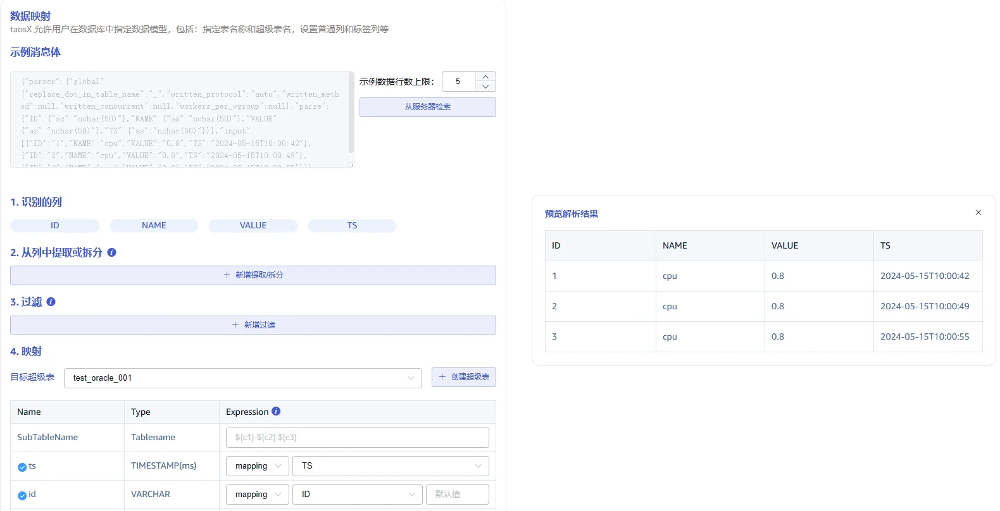
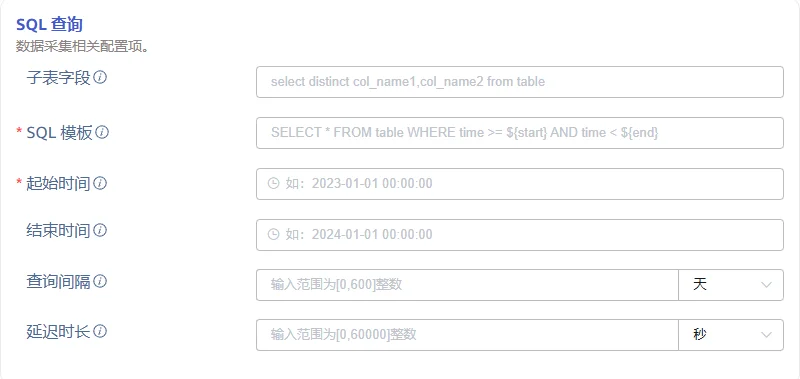
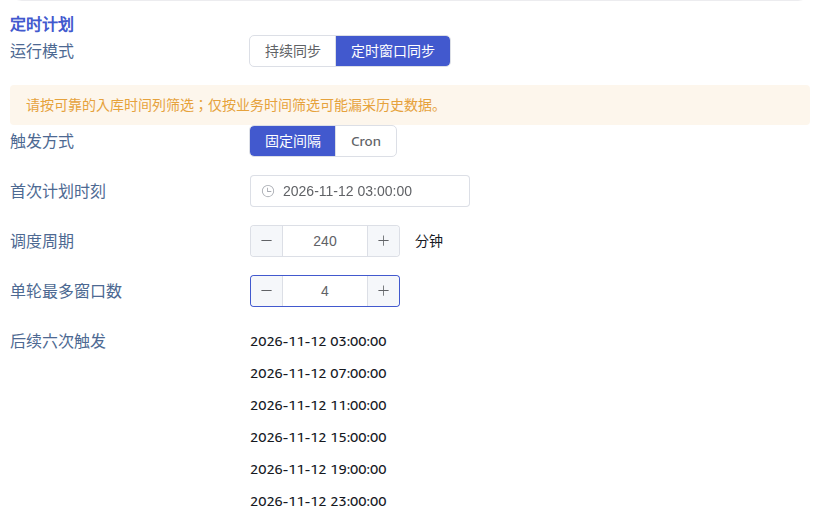
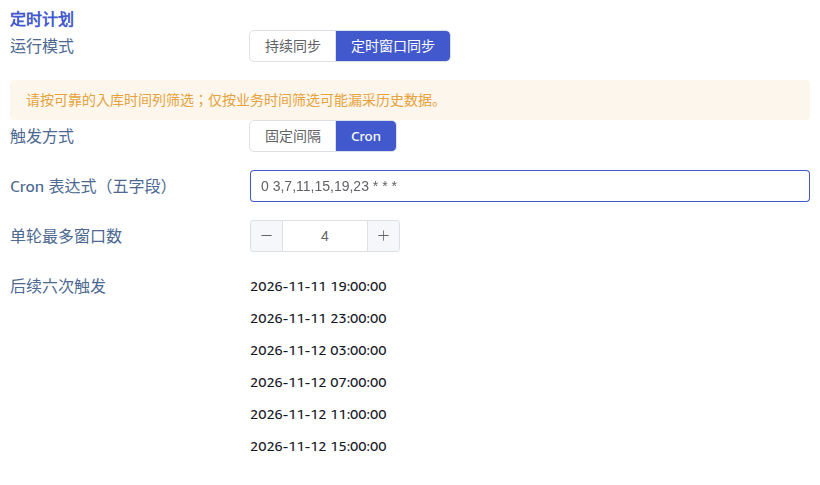

本节讲述如何通过 taosExplorer 界面创建数据写入任务，从 Oracle 将数据接入当前 TDengine 集群。

## 功能概述

Oracle 数据库系统是世界上流行的关系数据库管理系统，系统可移植性好、使用方便、功能强，适用于各类大、中、小微机环境。它是一种高效率的、可靠性好的、适应高吞吐量的数据库方案。

TDengine 可以高效地从 Oracle 读取数据并将其写入 TDengine，以实现历史数据迁移或实时数据同步。

taosX 还支持按固定间隔或 Cron 计划触发定时窗口同步。当业务系统每隔数小时才向 Oracle 批量入库时，可在批次完成后启动同步，减少空档期对 Oracle 的查询。

定时同步按 SQL 查询窗口读取数据：每轮从上次成功保存的断点开始，读取到当前时间减去延迟时长形成的安全水位，并通过单轮最多窗口数限制本轮的查询量。若停机后积压较多，剩余窗口将在后续触发时继续处理。

同步模式、字段映射、类型转换、事务一致性和数据校验等通用说明见 [关系型数据库集成](./23-rdb-integration.md)。

## 创建任务

### 新增数据源

在数据写入页面中点击 **+新增数据源** 按钮进入新增数据源页面，如下图所示：


### 配置基本信息

在 **名称** 字段中输入任务名称，例如 *`test_oracle_01`* 。

选择 **类型** 下拉框中的 *`Oracle`* ，如下图所示（选择完成后页面中的字段会发生变化）。

**代理** 是非必填项，如有需要，可以在下拉框中选择指定的代理，也可以先点击右侧的 **+创建新的代理** 按钮创建一个新的代理。代理与 taosX 之间的网络要求（端口放通与检查方法）见 [数据接入前置条件](./00-prerequisites.md)。

**目标数据库** 是必填项，可以先点击右侧的 **+创建数据库** 按钮创建一个新的数据库。



### 配置连接信息

在 **连接配置** 区域填写 *`源 Oracle 数据库的连接信息`*，如下图所示：


### 配置认证信息

**用户** 输入源 Oracle 数据库的用户，该用户必须在该组织中拥有读取权限。

**密码** 输入源 Oracle 数据库中上方用户的登录密码。


然后点击 **检查连通性** 按钮，用户可以点击此按钮检查上方填写的信息是否可以正常获取源 Oracle 数据库的数据。

### 配置 SQL 查询

**子表字段** 用于拆分子表的字段，它是一条 select distinct 的 SQL 语句，查询指定字段组合的非重复项，通常与 transform 中的 tag 相对应：
> 此项配置主要为了解决数据迁移乱序问题，需要结合 **SQL 模板** 共同使用，否则不能达到预期效果，使用示例如下：
>
> 1. 子表字段填写语句 `select distinct col_name1, col_name2 from table`，它表示使用源表中的字段 col_name1 与 col_name2 拆分目标超级表的子表
> 2. 在 **SQL 模板** 中添加子表字段占位符，例如 `select * from table where ts >= ${start} and ts < ${end} and ${col_name1} and ${col_name2}`。运行时 `${col_name1}`、`${col_name2}` 会展开为等值条件（如 `col_name1='deviceA'`、`col_name2=1`），而不是裸列名
> 3. 在 **transform** 中配置 `col_name1` 与 `col_name2` 两个 tag 映射

**SQL 模板** 用于查询的 SQL 语句模板，SQL 语句中必须包含时间范围条件，且开始时间和结束时间必须成对出现。SQL 语句模板中定义的时间范围由源数据库中的某个代表时间的列和下面定义的占位符组成。
> SQL 使用不同的占位符表示不同的时间格式要求，具体有以下占位符格式：
>
> 1. `${start}`、`${end}`：按任务的时间配置生成 Oracle `TO_DATE('2024-03-14 08:00:00','YYYY-MM-DD HH24:MI:SS')` 表达式，时间为窗口边界在任务时区下的本地时间，精确到秒
> 2. `${start_no_tz}`、`${end_no_tz}`：同样生成不带时区信息的 Oracle `TO_DATE` 表达式，与 `${start}`、`${end}` 的结果相同
> 3. `${start_date}`、`${end_date}`：表示仅日期，但 Oracle 中没有纯日期类型，所以它会带零时零分零秒，如：2024-03-14 00:00:00，所以使用 `date <= ${end_date}` 时需要注意，它不能包含 2024-03-14 当天数据。在定时窗口同步中，这组占位符只有日期精度：同一天内的查询窗口起止日期相同、读不到数据，跨零点的窗口才一次读取前一整天，建议仅在查询间隔为 1 天时使用
>
> 以上示例对应窗口起点 2024-03-14T00:00:00Z、任务时区 `+08:00`，此时 `${start_date}` 生成 `TO_DATE('2024-03-14','YYYY-MM-DD')`。taosX 会执行 `ALTER SESSION SET TIME_ZONE`，将 Oracle 会话时区设为任务时区。
>
> 为了解决迁移数据乱序的问题，应在查询语句中添加排序条件，例如 `order by ts asc`。

**起始时间** 迁移数据的起始时间，此项为必填字段。

**结束时间** 迁移数据的结束时间，可留空。持续同步任务达到结束时间后自动停止；留空则持续同步实时数据，不会自动停止。定时窗口同步任务不再查询结束时间之后的数据；断点到达结束时间后，任务自动变为已完成，调度计划随之移除。

起始时间和结束时间是带 UTC 偏移的绝对时刻，任务时区不改变它们表示的时刻。任务时区由任务参数 `time_zone` 决定，taosExplorer 中没有对应字段；未设置时取起始时间的 UTC 偏移。taosExplorer 按设置起始时间时页面时区的偏移写入起始时间，并以该偏移显式写入 `time_zone`，因此任务时区即设置起始时间时 taosExplorer 页面所用的时区。编辑已有任务时如不修改起始时间，起止时间和任务时区均保持不变。`time_zone` 仅支持 `+08:00`、`+0800` 等固定 UTC 偏移或 `UTC`、`Z`，不支持 `Asia/Shanghai` 等 IANA 时区名，取值无效时任务启动或预览数据时报错；偏移在任务中固定，不随夏令时变化。任务时区决定时间占位符的取值和查询窗口的切分：每个查询窗口不超过查询间隔，且不跨越任务时区的零点，因此查询间隔超过 1 天时按 1 天处理。如需使用 UTC 任务时区，可在设置起始时间前将 taosExplorer 页面时区切换为 UTC，或通过 API / 命令行设置 `time_zone=UTC`。详见 [时间与时区](./23-rdb-integration.md#时间与时区)。

**查询间隔** 分段查询数据的时间间隔，默认 1 天。为了避免查询数据量过大，一次数据同步子任务会使用查询间隔分时间段查询数据。

**延迟时长** 在持续同步模式下与查询间隔配合使用，避免因延迟写入而漏读数据：taosX 只读取到当前时间减去延迟时长为止的数据，未设置结束时间或结束时间晚于当前时间时，历史部分读取到该时刻；此后 taosX 约每秒检查一次，当上次断点到当前时间减去延迟时长的待读范围超过 10 秒时读取该范围。查询间隔只用于将该范围切分为查询窗口，不决定查询的触发时刻。例如延迟时长为 60 秒时，09:01 执行的查询只读取 09:00 之前的数据。在定时窗口同步模式下，它控制读取安全水位，即当前时间减去延迟时长。应根据用于筛选的入库时间与数据提交后可查询的时间差设置；它不决定定时计划的触发时刻，也不能补救已经越过断点的历史回填。

**定时计划** 可选择持续同步或定时窗口同步。定时模式可设置首次计划时刻和固定调度周期（分钟），或设置五字段分钟级 Cron 表达式；Cron 的日期和星期字段不可同时限定。调度使用 Explorer 页面当前时区，页面中的“后续六次触发”也按该时区显示。调度周期决定何时开始一轮，查询间隔决定 SQL 窗口的长度，单轮最多窗口数限制每次触发读取的窗口数。已完成的窗口保存断点；若一轮未处理完积压窗口，任务等待下一次计划触发继续处理。某一轮失败后，任务显示为失败，调度计划保留，下一次计划触发时从未确认的窗口重试；失败期间可以停止或重新启动任务。



### 定时窗口同步示例

假设业务系统在每天 00:00、04:00、08:00、12:00、16:00、20:00 开始向 Oracle 入库，每批最长 2.5 小时。将 Explorer 页面时区设为 `Asia/Shanghai`，可把首次计划时刻设为下一个 03:00、调度周期设为 `240` 分钟；也可使用 Cron 表达式 `0 3,7,11,15,19,23 * * *`。两种方式均在批次开始约 3 小时后触发，每天六次，具体时刻应按实际提交可见时间调整。

查询应使用可靠的入库时间列作为游标，并保留原始业务时间以供写入 TDengine。例如，`INGEST_TS` 表示数据写入 Oracle 的时间，`READING_TS` 表示电表或水表的采集时间：

```sql
SELECT ID, METER_ID, READING_TS, INGEST_TS, READING_VALUE
FROM METER_READINGS
WHERE INGEST_TS >= ${start} AND INGEST_TS < ${end}
ORDER BY INGEST_TS, ID
```

可先将查询间隔设为 `1` 小时、单轮最多窗口数设为 `4`，使单轮最多查询四个小时窗口；再结合 Oracle 资源情况调整。长时间停机后的积压可能需要多次触发才能处理完；若每轮处理能力不足以追上新增数据，可适当提高单轮最多窗口数。延迟时长应覆盖入库时间与提交可见时间之间的最大滞后；如果安全水位尚未覆盖某批数据，该批会在后续触发时读取。对已越过断点才写入 Oracle 的旧入库时间数据，定时调度不会自动回查。故障重试可能重新读取尚未保存断点的窗口，目标映射应考虑幂等写入。

以下截图分别展示固定间隔和 Cron 配置。示例中的触发预览均使用 Explorer 页面时区：





### 配置数据映射

在 **数据映射** 区域填写数据映射相关的配置参数。

点击 **从服务器检索** 按钮，从 Oracle 服务器获取示例数据。

在 **从列中提取或拆分** 中填写从消息体中提取或拆分的字段，例如：将 vValue 字段拆分成 `vValue_0` 和 `vValue_1` 这 2 个字段，选择 split 提取器，separator 填写分割符 `,`, number 填写 2。

在 **过滤** 中，填写过滤条件，例如：填写`Value > 0`，则只有 Value 大于 0 的数据才会被写入 TDengine。

在 **映射** 中，选择要映射到 TDengine 的超级表，以及映射到超级表的列。

点击 **预览**，可以查看映射的结果。


### 配置高级选项

import AdvancedOptions from './resources/_02-advanced_options.mdx'

<AdvancedOptions/>

**数据校验** 逐窗口核对源数据与写入 TDengine 的数据，可选 **关闭**、**行数校验**、**行数和摘要校验**，默认关闭；并可设置 **校验失败策略** 和 **校验重试次数**。说明见 [关系型数据库集成 · 数据校验](./23-rdb-integration.md#数据校验)。

### 异常处理策略

import ExceptionHandling from './resources/_03-exception-handling-strategy.mdx'

<ExceptionHandling />

### 创建完成

点击 **提交** 按钮，完成创建 Oracle 到 TDengine 的数据同步任务，回到 **数据源列表** 页面可查看任务执行情况。
