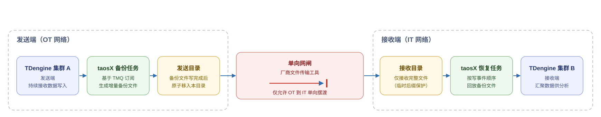

在电力、制造等工业场景中，生产网络（OT）与管理网络（IT）之间常通过硬件单向网闸进行隔离。网闸在物理上只允许数据由 OT 侧流向 IT 侧，不允许任何报文、应答或控制信令从 IT 侧返回 OT 侧，常规的数据库复制与数据订阅无法跨网闸建立连接。

针对这种严格隔离环境，TDengine 企业版提供基于 taosX 增量备份和恢复的跨网闸数据同步方案：发送端的 taosX 将源集群的数据变更生成增量备份文件，借助网闸厂商提供的文件传输工具将文件单向摆渡到接收端，再由接收端的 taosX 按序恢复入库。整个过程中 TDengine 不需要跨网闸建立任何网络会话。

该方案基于 TDengine 的[增量备份和恢复](../../12-operations-and-tooling/02-operations/10-backup.md#基于数据订阅进行数据备份恢复)能力实现。



如上图所示：

1. TDengine 集群 A 位于发送端（OT 网络），持续接收数据写入。
2. taosX 备份任务通过 TMQ 订阅源库的数据变更，生成增量备份文件（`.z` 数据文件和 `.mz` 元数据文件）；文件写完成后通过 `move.to` 参数原子移入发送目录。
3. 网闸厂商的文件传输工具将发送目录中的完整文件单向摆渡到接收端（IT 网络）的接收目录。
4. 接收端的 taosX 恢复任务按写事件顺序回放备份文件，将其写入 TDengine 集群 B 的目标数据库。

## 适用场景

仅当两侧网络之间部署了硬件强制单向网闸、不存在任何回流通道时，才需要使用本方案。若安全边界只是普通防火墙或 DMZ，业务数据允许由 OT 流向 IT，且 TCP 会话双向可达，应优先使用常规同步方式。

| 网络形态 | 特征 | 推荐的同步方式 |
| --- | --- | --- |
| 普通防火墙或 DMZ | 业务数据由 OT 流向 IT，TCP 会话双向可达（应答、登录响应可以回流） | 使用 TDengine 原生复制、taosX 数据迁移、数据订阅或 MQTT 等方式（见 [边云协同](index.md) 页面的其他小节） |
| 硬件单向网闸 | 不允许任何报文、应答或控制信令由 IT 侧返回 OT 侧 | 使用本方案：taosX 增量备份文件 + 网闸文件摆渡 + taosX 恢复 |

**为什么不能直接使用普通复制**

普通数据库复制以及标准 MQTT 均基于双向 TCP 会话，即使业务数据只从 OT 流向 IT，会话所需的应答与登录响应仍需从 IT 侧返回。严格单向网闸会阻断这部分回程流量，导致会话无法建立，因此只能改用文件摆渡方式。

## 前提条件

- 软件：发送端与接收端均部署 TDengine 企业版，且两侧 taosX 命令行可用；已部署支持单向文件传输的网闸设备，且厂商文件传输工具工作正常。
- 账号：发送端账号具有订阅源数据库的 TMQ 权限；接收端账号具有创建并写入目标数据库的权限。
- 时钟：两侧系统时钟稳定。备份文件名包含毫秒级时间戳，大幅回拨时钟可能与历史备份点撞名；各网络内使用统一的授时源，运行期间避免人工回拨时间。
- 存储：发送目录与接收目录预留足够空间，至少容纳约定的最大故障窗口内产生的备份文件积压。

## 部署步骤

### 1. 规划数据库映射与目录

为每个发送端源数据库规划独立的目录链与目标数据库，并书面记录映射关系。示例：

| OT 源 | 源数据库 | 发送目录 | 接收目录 | 目标数据库 |
| --- | --- | --- | --- | --- |
| 站点 A | site_a | `/data/diode/out/site_a` | `/data/diode/in/site_a` | site_a_central |
| 站点 B | site_b | `/data/diode/out/site_b` | `/data/diode/in/site_b` | site_b_central |

在两侧创建对应目录：

```shell
# 发送端
mkdir -p /data/taosx/site_a/backup
mkdir -p /data/diode/out/site_a

# 接收端
mkdir -p /data/diode/in/site_a
```

### 2. 配置网闸并验证文件摆渡

按照所选网闸厂商的部署手册完成硬件安装与文件传输工具配置。配置网闸时，只将厂商文件传输工具的服务端点（单 IP 或 VIP）登记到网闸，不要将 TDengine 节点地址暴露给网闸。

文件传输工具建议按以下原则配置：

- 接收侧开启临时后缀（如 `.temp`），文件传输完成前对消费方不可见。
- 禁止覆盖同名文件，同名文件应代表同一备份对象。
- 发送成功后对发送目录中的源文件归档或删除，避免重复传输。
- 按文件创建顺序传输，且每个源使用独立的传输任务。

启动 taosX 之前，先用普通文件验证摆渡功能：

1. 在发送目录创建测试文件：

   ```shell
   echo "hello" > /data/diode/out/site_a/test.txt
   ```

2. 在接收目录确认文件到达：

   ```shell
   ls -al /data/diode/in/site_a
   ```

3. 确认文件仅能从发送端传向接收端，反向不可达。
4. 确认传输过程中对端文件以临时名称出现，传输完成后才改为正式名称。
5. 摆渡失败时，查看文件传输工具的日志并核对配置。

### 3. 启动发送端备份任务

在发送端执行：

```shell
taosx run \
  -f 'tmq://192.168.1.100:6030/test?upcoming=now&interval=1s&self.repeat=true' \
  -t 'local:/data/taosx/site_a/backup?move.to=/data/diode/out/site_a' \
  -v
```

**参数说明**

| 参数 | 说明 |
| --- | --- |
| `upcoming` | 下一次执行备份任务的时间，取值为 RFC 3339 日期时间或 `now`（立即开始） |
| `interval` | 相邻两次备份任务的间隔，例如 `60s` 表示间隔 60 秒；生产取值需结合数据量与时延目标测试确定 |
| `self.repeat` | 是否持续重复调度备份任务；`true` 时命令不退出、周期性生成备份文件 |
| `move.to` | 备份文件写完成后原子移入的目录，即发送目录；只有完整文件会进入发送目录 |
| `-v` | 输出 info 级别日志，便于部署与排障 |

上述示例命令表示：立即开始，每隔 1 秒生成一个备份点，持续运行，工作文件写入 `/data/taosx/site_a/backup`，完成后移入发送目录 `/data/diode/out/site_a`。

### 4. 启动接收端恢复任务

在接收端执行：

```shell
taosx run \
  -f 'local:/data/diode/in/site_a' \
  -t 'taos://192.168.1.101:6030/site_a_central' \
  -v
```

恢复任务持续监听接收目录，按写事件顺序将备份文件回放到目标数据库 `site_a_central`。

**注意**

一个恢复任务只对应一个接收目录。恢复任务不会按来源区分目录中的文件，混入多个源的备份链会破坏恢复顺序。

### 5. 验证同步结果

1. 在发送端写入测试数据，例如使用 taosBenchmark 模拟写入：

   ```shell
   taosBenchmark -t 1000 -n 100000 -y
   ```

2. 确认发送端生成 `.z` 与 `.mz` 备份文件，且完整文件已移入发送目录并摆渡到接收目录。
3. 确认接收端恢复任务无报错地处理文件。
4. 比对源库与目标库的数据行数是否一致。
5. 抽样比对最近的至少 100 行数据（时间戳、标签、取值）是否一致。

## 关键操作规则

1. **严格按序恢复** 备份文件必须按 TDengine 写事件顺序回放。若后序文件先到，必须扣留等待，先补齐先序文件；缺文件时不允许继续恢复后续文件。
2. **每个源使用独立备份链** 每个发送端源数据库使用独立的发送目录、传输任务、接收目录和恢复任务，强烈建议目标数据库也各自独立。
3. **只暴露完整文件** 发送端通过 `move.to` 原子移入完整文件；接收端保留网闸临时后缀作为保护，taosX 还会等待文件大小与修改时间稳定后才消费文件。
4. **不要重放旧文件** 重复导入同一文件不会产生重复行，但把旧文件在新文件之后重放，会把同表同时间戳的值改回旧值；如需回放历史文件，必须先制定恢复计划。

## 备份文件命名与导入行为

增量备份文件命名格式如下：

```text
{topic}-{timestamp_ms}-{vgroup_id}-{index}.z    # 数据文件
{topic}-{timestamp_ms}-{vgroup_id}-{index}.mz   # 元数据/结构文件
```

- `topic` 由数据库、备份对象及备份计划生成。
- `timestamp_ms` 为备份点创建时间的毫秒时间戳，同一备份点的文件共享该时间戳。
- `vgroup_id` 标识并行产生该文件的 vgroup。
- `index` 为从 1 开始的序号，文件因大小或超时轮换时递增。

导入行为：

- 重复导入同一文件不会产生重复行：表名与时间戳相同的行覆盖已有行。
- 恢复必须遵循写事件顺序，与行内时间戳的先后无关；TDengine 接受写入较早时间戳的数据，但备份文件的回放顺序必须与源端写入顺序一致。
- 部分文件与损坏文件：`move.to` 在文件写完成后才生效；传输过程由网闸临时后缀保护；对可恢复的错误（如连接中断），taosX 默认重试 10 次、间隔 5 秒；文件损坏且重试失败时恢复任务报错退出，需人工处理该文件后再按序恢复。

## 多个发送端汇聚

多个相互独立的发送端可以向同一个接收端 TDengine 集群汇聚数据，但每个源都是独立的备份链：

| 项目 | 要求 | 原因 |
| --- | --- | --- |
| 收发目录 | 每个源独立 | 混链会破坏恢复顺序 |
| 恢复任务 | 每个接收目录一个 | 各链可独立运行、暂停与恢复 |
| 目标数据库 | 强烈建议每源独立 | 避免不同源写同表同时间戳时互相覆盖 |
| 传输任务 | 每个源独立 | 便于控制顺序、积压与故障定位 |

推荐链路：一个源数据库对应一个备份任务、一个发送目录、一条传输规则、一个接收目录、一个恢复任务、一个目标数据库。

## 高可用建议

- 网闸只对厂商文件传输工具的服务端点，不对 TDengine 节点；两侧 TDengine 集群地址保持在本网络内，不参与网闸配置，两端集群可各自独立做高可用。
- taosX 与本地集群之间推荐通过 taosAdapter 使用 WebSocket 连接（备份用 `tmq+ws`，恢复用 `taos+ws`，端口 6041），可配置多个 taosAdapter 地址或本地负载均衡/VIP 实现客户端高可用。
- TMQ 消费进度保存在发送端集群内，数据库节点切换后订阅进度不丢失。
- 如文件传输端点本身需要高可用，使用厂商或网络层提供的 VIP/浮动 IP，网闸仍只见单一服务端点。

## 运维与监控

建议每日检查以下各项：

| 检查项 | 要点 |
| --- | --- |
| 备份任务 | 任务运行中，按预期间隔生成新文件 |
| 发送目录 | 无意外积压，磁盘空间充足 |
| 网闸传输 | 文件按序摆渡成功，无文件滞留临时后缀 |
| 接收目录 | 文件按序到达，并被对应恢复任务消费 |
| 恢复任务 | 无重试耗尽、文件损坏或认证失败 |
| 数据时延 | 目标端数据在预期端到端时延以内 |
| 数据质量 | 周期性源/目标行数比对与抽样值比对通过 |
| 暂存存储 | 收发两侧磁盘余量覆盖约定的最大故障积压 |

任务重启后，确认待恢复文件是源端事件链中的下一个文件；不要把整个历史归档目录直接复制回活动接收目录，除非恢复计划要求全量有序回放。修改备份间隔应在维护窗口内进行，并观察文件大小与数量变化，确认网闸传输与恢复任务跟得上。

## 常见问题

| 现象 | 可能原因 | 处理 |
| --- | --- | --- |
| 未生成备份文件 | TMQ 连接、权限或源库配置问题 | 以 `-v` 运行，检查连接与账号权限，确认源库有数据写入 |
| 备份文件滞留工作目录 | `move.to` 目录不存在、不可写或磁盘满 | 检查目录权限与磁盘空间 |
| 文件未摆渡 | 传输任务停止、目录映射错误或网闸配置问题 | 用普通文本文件测试摆渡，并查看传输工具日志 |
| 文件滞留临时后缀 | 传输未完成或卡住 | 不要消费该文件，修复传输后等待完成 |
| 恢复任务停在某个文件 | 文件损坏、目标连接问题或重试次数用尽 | 查看 taosX 日志，修复后按序重传该文件再恢复 |
| 目标端行数偏少 | 缺文件、乱序、任务停止或库映射错误 | 比对目录文件序列与日志，补齐首个缺失文件后再继续 |
| 同时间戳的值不一致 | 旧文件在新文件之后重放，或多个源写入同表同时间戳 | 按正确备份链恢复；不同源使用独立目标库 |
| 文件名冲突 | 系统时钟回拨或人工复用文件名 | 稳定系统时钟，隔离文件并核对备份链 |

## 限制说明

- taosExplorer 暂不支持导入外部备份文件，跨网闸恢复目前仅支持 taosX 命令行。
- 不支持乱序恢复；缺失文件时必须暂停该链后续文件的恢复。
- taosX 不维护跨运行周期的已恢复文件台账，重复导入同一文件会再次写入（同表同时间戳覆盖，不产生重复行）。
- 重放旧备份文件会把同表同时间戳的值改回旧值。
- 文件损坏且无法通过重试恢复时，恢复任务失败，需人工介入处理。
- 多个独立的源不能共用同一个活动接收目录。
- 本方案依赖网闸厂商文件传输工具的可靠性，包括顺序保持、临时后缀与完整性保障。
- 网闸面向的传输端点高可用由厂商或网络层机制（如 VIP/浮动 IP）提供，不属于 TDengine 集群能力。
- 本方案不提供 taosX 备份/恢复进程本身的跨机自动切换，如有需要请在所选版本与部署平台上单独验证任务编排方案。
