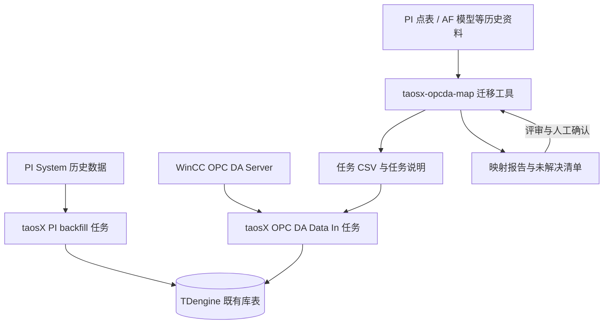

本文介绍将 WinCC + PI System 数据链路整体替换为 WinCC + TDengine 的实施方案，涵盖历史数据回填、点位映射、实时接入与切换验收的完整流程。方案适用于部署了 taosX 与 Explorer 的 TDengine TSDB-Enterprise。

## 方案概述

在典型的工业现场中，WinCC 作为 SCADA 系统采集现场设备数据，经 PI Interface 写入 PI System 进行长期归档。当 PI System 因许可到期或维护成本等原因需要下线时，现场可以用 TDengine 替换 PI System，同时保留仍在运行的 WinCC 采集前端。

迁移前后的数据链路对比如下：

```text
原实时链路：WinCC → PI Interface → PI System
历史数据迁移：PI System → taosX PI backfill 任务 → TDengine
新实时链路：WinCC OPC DA Server → taosX OPC DA Data In 任务 → TDengine
```

整个方案由三个相互配合的部分组成：

| 组成部分 | 作用 | 说明 |
| --- | --- | --- |
| 历史数据迁移 | 把 PI System 中的历史数据写入 TDengine | 通过 taosX PI backfill 任务完成，详见 [PI 历史数据回填指南](../01-no-code-ingestion/04-pi/04-backfill-guide.md) |
| 点位映射 | 确认每个 WinCC 点位应写入哪张已有子表的哪一列 | 由迁移工具 `taosx-opcda-map` 完成，生成可上传的任务 CSV 与映射报告 |
| 实时数据接入 | 从 WinCC OPC DA 服务持续读取实时数据并写入既有库表 | 通过 taosX OPC DA Data In 任务完成，详见 [OPC DA](../01-no-code-ingestion/06-opcda/index.md) |

历史数据迁移完成后，TDengine 中的数据库、超级表、子表和列均已存在。实时接入链路必须把时间、值和质量写入这些既有位置（例如时间写入已有时间戳主键列、数值写入已有值列、质量写入已有质量列），而不是创建新表。点位映射解决的就是这个"接线"问题：为每个 WinCC OPC DA 点位确认目标子表、值列、时间列和质量列，最终生成可在 Explorer 中上传的任务 CSV，并输出一份逐条说明映射依据的可读报告。

## 方案架构与迁移流程



推荐的实施顺序如下：

1. **评估与准备**：盘点源端点位、资料和目标库结构，确认软件版本与账户环境。
2. **历史数据回填**：创建 PI backfill 任务，将 PI 历史数据迁移到 TDengine，并记录迁移截止点。
3. **点位映射采集**：用迁移工具分别采集 TSDB 既有模型、WinCC OPC DA 点位和历史资料。
4. **映射评审**：查看映射报告，对未解决项目逐条确认或排除，必要时补充命名规则后重新匹配。
5. **任务创建**：导出任务 CSV，在 Explorer 中创建 OPC DA Data In 任务并上传 CSV。
6. **试运行与切换**：先验证少量点位，确认数据正确后分批接入，完成验收并下线旧链路。

其中第 1、2 步与第 3 步没有严格的先后依赖，可以在历史回填进行的同时准备点位映射。

## 适用场景与边界

**适用场景**

- PI System 已下线或计划下线，不再作为归档系统维护。
- 历史数据已迁移（或正计划迁移）到 TDengine，目标库中的数据库、超级表、子表和列已经存在。
- WinCC 仍在运行，并能通过 OPC DA 服务提供点位数据。
- 需要在不改动既有库表的前提下恢复实时采集，并与历史数据保持时间、值和质量语义的一致。

**方案边界**

迁移工具与接入链路明确不做以下事情：

- 不连接、也不依赖在线的 PI System；全部历史信息来自客户保留的导出件。
- 不修改 TDengine：不建表、不改表、不删表、不写数据；对 TDengine 的访问全部是只读元数据采集。
- 不自动创建、启动或修改 Data In 任务；任务由你在 Explorer 中按工具生成的任务说明创建。
- 不补齐 PI 停机期间的历史空档；OPC DA 实时接口只提供实时数据。

## 实施前提

| 项目 | 要求 |
| --- | --- |
| TDengine 与 taosX | 现场版本支持 OPC DA Data In 任务以及质量列写入、Digital 字典等能力，具体版本组合请与官方支持确认 |
| Windows 主机 | OPC DA 基于 COM/DCOM，采集和任务运行必须在能访问 WinCC OPC DA 服务的 Windows 主机上进行，通常就是计划运行 taosX-Agent 的主机 |
| 运行账户 | 执行采集的 Windows 账户必须与 taosX-Agent 实际运行的服务账户一致；交互登录账户能浏览点位，不代表服务账户也能访问 |
| TSDB 账户 | 采集元数据只需要目标库的只读权限，不要求写入 |
| 历史资料（可选） | 原 PI 点表（Excel）、AF 模型导出（XML）、PI Interface 配置、原迁移 CSV、WinCC 变量表等，按客户实际保留情况提供；没有这些资料时仍可通过两端元数据和命名规则完成映射，但需要更多人工确认 |
| 质量与枚举约定 | 目标库已有质量列的编码含义、Digital 状态字典，用于保证新链路写入的数据与历史数据语义一致 |

首次在 Windows 主机上使用迁移工具时，需要以管理员身份执行一次工具自带的组件注册脚本，注册 OPC DA 访问所需的 32 位自动化组件，否则采集会报 `Class not registered` 错误。

如果 TDengine 与 WinCC 不在同一网络区域，可以分别在各自网络内完成采集，再把采集清单拷贝到一起执行匹配，不要求一台机器同时连通两端。

## 实施步骤

### 步骤 1：迁移历史数据

按 [PI 历史数据回填指南](../01-no-code-ingestion/04-pi/04-backfill-guide.md) 创建 PI backfill 任务，将 PI System 中的历史数据写入 TDengine。历史迁移完成后，确认目标库中的超级表、子表和列与预期一致，并记录历史迁移的截止时间点，供实时接入时核对数据衔接。

### 步骤 2：采集两端元数据与历史资料

迁移工具提供 Windows 可执行文件 `taosx-opcda-map.exe`，无需安装。所有命令在同一工作目录下执行，生成的清单和报告都保存在该目录中。

```bash
# 1. 导入历史资料：PI 点表与 AF 模型（没有保留资料时跳过本步）
taosx-opcda-map import-pi --excel archive_attributes.xlsx --af-xml AFDatabase_Assets.xml

# 2. 只读采集 TDengine 既有模型（密码通过环境变量 TAOS_PASSWORD 提供）
taosx-opcda-map scan-tsdb --dsn "taos://root@192.168.1.172:6030" --database archive_backfill

# 3. 在每台 WinCC 主机上采集 OPC DA 点位（多台主机分别执行，用 --name 区分服务）
taosx-opcda-map scan-opcda --name casthouse --host 127.0.0.1 --prog-id OPCServer.WinCC.1 --browse
```

三步采集彼此独立、互不依赖，都可以受控地反复执行：TSDB 模型或 WinCC 点位发生变化时，重新执行对应的采集刷新清单即可。工具按库、超级表、来源组分批处理并支持限速，不会扫描历史数据，也不会对现场 OPC 服务造成压力。

### 步骤 3：建立映射并评审

把各台主机产出的采集清单拷贝到同一工作目录，执行匹配：

```bash
taosx-opcda-map match
```

工具结合历史资料、两端元数据、客户命名规则和人工确认记录，按依据强弱生成映射候选，并输出：

- `mapping-report.html`：本地浏览的映射报告，逐条展示每条映射使用了哪个字段、哪条规则、为什么通过或没有通过；可按设备、数据库和处理状态筛选。
- `unresolved.csv`：未解决项目清单，包括待确认、冲突、不兼容和无匹配的映射及原因。
- `target-mappings.csv`：完整的目标关系清单。

映射记录的状态口径如下：

| 状态 | 含义 | 能否进入任务 CSV |
| --- | --- | --- |
| 可采用 | 有明确依据，映射唯一，结构与数据含义检查通过 | 可以 |
| 待确认 | 只有候选，或类型、字典、服务绑定等尚未确定 | 不可以 |
| 冲突 | 多个候选或规则结论矛盾，或多个来源争用同一目标值列 | 不可以 |
| 不兼容 | 已找到对应关系，但类型、模型或连接器能力不支持 | 不可以 |
| 无匹配 | 扫描范围内没有找到可用候选 | 不可以 |
| 已排除 | 明确决定本次不接入并记录理由 | 不进入 CSV，但计入报告 |

评审时把 `unresolved.csv` 中需要处理的行拷贝到 `decisions.csv`，填写确认、排除或例外映射决定及理由，然后重新执行 `match`。规则调整、评审和重新生成文件都可以在离线环境反复进行，直到所有需要接入的映射都进入"可采用"状态。注意"从 OPC 读取的独立地址数"和"要续写的历史子表数"本来就是两个不同的数量：同一个 OPC 地址可能原来供给多个历史目标（一源多目标），工具会保留全部关系并拆分到不同任务批次，不会为凑数量去重丢目标。

### 步骤 4：导出任务 CSV

```bash
taosx-opcda-map export
```

导出前工具自动执行完整性校验：本批次源地址有效、目标库表列真实存在、所有行均已确认、单个文件内点位不重复、不携带禁用行或自动命名模板，并用对应版本的 CSV 解析器重新解析导出文件核对内容。校验不通过时导出失败并列出原因，不会悄悄丢弃未通过的行。

导出产物包括：

- `opcda-task-<服务名>-NNN.csv`：上传 Explorer 的任务配置，一个文件对应一个任务批次；超出单批点位上限时按服务自动拆分。
- `task-guide.md`：在 Explorer 中创建任务的参数说明。
- `task-manifest.json`：每个 CSV 对应的服务、Agent、目标实例与数据库、采集设置和校验状态。

离线环境生成的文件标记为"待现场复核"。到现场后重新执行 `scan-tsdb` 与 `scan-opcda` 刷新清单，再次 `match` 和 `export`，确认目标结构、点位状态和服务身份与当前现场一致后，文件才可交付使用。

### 步骤 5：创建实时采集任务

按 `task-guide.md` 的说明，在 Explorer 中逐个创建 OPC DA Data In 任务：

1. 选择执行任务的 Agent（其运行账户已通过采集验证可访问点位）、OPC 服务（主机与 ProgID）和目标数据库。
2. 按任务说明设置采集间隔和时间来源，开启"上报异常值"，关闭"动态点位更新"。
3. 上传该任务对应的 `opcda-task-<服务名>-NNN.csv`。
4. 任务 CSV 的字段规则见 [OPC DA CSV 配置文件参考](../01-no-code-ingestion/06-opcda/01-csv-reference.md)。

不要手工编辑导出的 CSV；修改映射请通过客户配置和人工决定文件完成后重新匹配、导出，保证同一组输入始终生成相同内容的文件。也不要在 CSV 中手工加入禁用行表示"暂不接入"：任务初始化会对禁用行执行 `DROP TABLE IF EXISTS`，可能删除已有历史子表。

### 步骤 6：试运行、切换与验收

先接入少量点位试运行，确认数据进入正确的子表、值列和质量列后，再分批接入其余点位。上线时需要记录历史迁移截止位置和实时接入开始时间，并重点核对：

- 启动时 OPC 服务可能返回带旧时间戳的缓存值，试运行阶段检查重复时间戳和目标库的更新行为，确认不会覆盖已有历史行。
- 时间、值和质量是否分别写入预期的既有列，历史数据查询能否读到新接入的数据。
- 一源多目标场景下，所有目标子表是否都有数据，重复读取是否在 WinCC 承载范围内。

验收标准：每个导出的映射都有可追溯的依据；所选批次没有未处理的冲突；写入位置、值和质量含义正确，质量列没有因配置遗漏产生的 NULL；未导出项目及原因完整可见；全程无需访问 PI System。

## 数据类型转换

点位名称对上只解决了"写到哪"。历史数据沿用了原 PI 链路的数据类型、值和质量编码，新链路必须完成相应的数据类型转换，否则同一列中新旧数据会含义不一致。

### 质量列

两条链路的质量编码体系不同：TDengine 直采 OPC DA 时，质量列保存的是 OPC DA 原始质量码；而 PI 搬迁链路保存的是 PI SYSTEM 数字状态集的状态编号。同一条 Good 数据在 OPC DA 中是 `192`，经 PI Interface 翻译后在历史库中的状态编号是 `0`，两者是同一质量状态在两种体系中的不同表示。

OPC DA 质量是一个 16 位整数，低 8 位按 `QQSSSSLL` 划分：QQ 表示质量类别（Bad、Uncertain、Good），SSSS 表示子状态，LL 表示限值。PI Interface 不是做数值换算，而是把 OPC 质量位"解释"成 PI 的质量模型：好值存数值、状态编号写 `0`；坏质量不存数值，改存对应的数字状态编号。常见映射如下：

| OPC DA 质量位 | OPC 定义 | PI 状态名 | 历史库质量列 |
| --- | --- | --- | --- |
| `192`（0xC0） | Good | （直接存数值） | `0` |
| `216`（0xD8） | Good-Local Override | 存数值；`/SG` 时记为 substituted | `0` / `306` |
| `0`（0x00） | Bad（非特定） | Bad | `307` |
| `4`（0x04） | Bad-Configuration Error | Configure | `240` |
| `8`（0x08） | Bad-Not Connected | Not Connect | `314` |
| `12`（0x0C） | Bad-Device Failure | Unit Down | `213` |
| `16`（0x10） | Bad-Sensor Failure | Equip Fail | `215` |
| `20`（0x14） | Bad-Last Known Value | Scan Timeout | `300` |
| `24`（0x18） | Bad-Comm Failure | Comm Fail | `313` |
| `28`（0x1C） | Bad-Out of Service | Out of Serv | `312` |
| `32`（0x20） | Bad-Waiting for Initial Data | Bad Input | `255` |
| `64`（0x40） | Uncertain（非特定） | 默认存数值；`/SQ=Y` 时为 Doubtful | `0` / `308` |
| `68`（0x44） | Uncertain-Last Usable Value | No_Sample（`/SQ=Y` 时） | `301` |
| `80`–`83` | Uncertain-Sensor Not Accurate | Invalid Data / Under Range / Over Range | `299` / `251` / `252` |
| `84`–`87` | Uncertain-EU Exceeded | Inp OutRange / Under LCL / Over UCL | `294` / `259` / `258` |
| `88`–`91` | Uncertain-Sub-Normal | Bad_Quality（`/SQ=Y` 时） | `224` |

读表说明：

- 表中质量位未叠加 LL 限值位（`+1` 低限、`+2` 高限、`+3` 恒定），如 `193` = Good 低限，映射规则不变。
- Uncertain 类质量的入库行为取决于原 PI Interface 的 `/SQ` 参数：默认存数值、状态编号仍为 `0`；`/SQ=Y` 时不存数值、改存上表对应的状态编号。实施时应向客户确认原接口参数，保证新链路行为与历史数据一致。
- 状态编号来自 PI SYSTEM 数字状态集，编号 193–320 为 Data Archive 保留段；上表为常见的 SYSTEM 状态值，具体编号以现场 PI 服务器导出的状态集为准。
- 历史库中还可能存在 PI 接口或服务器自身产生的状态（如 `246` I/O Timeout、`311` Intf Shut、`254` Shutdown），这些状态不由 OPC 质量位映射而来，新链路不需要也无法复现。

每个采集目标都必须配置已有的质量列（`quality_col` 必填且不能为空），写入的质量不得为空；质量列写入的状态编号必须与目标库历史数据使用的状态集一致。任务必须开启"上报异常值"，保留服务实际返回的异常时间和质量；原始 OPC 质量码保留在诊断记录中。

质量转换由质量接续策略 `pi_compatible_v1` 在 taosX 与 OPC 连接器中执行，需要相应的版本能力，部署前请与官方支持确认现场版本。能力未就绪之前，可临时使用原始质量码直写模式打通采集流程，但此时质量列写入的是 OPC 原始质量码（如 `192`），与历史数据的状态编号体系不一致，仅限流程验证，不作为正式交付。

### Digital 状态字典

历史库中 Digital 类型目标存储的是状态名称（如 `Idle`、`Charge`），而 OPC DA 通常返回数字或布尔原始码。这类目标必须配置经过确认的代码到状态名称字典（`value_map`），字典来源可以是 AF 枚举集导出或客户确认的对照表。字典缺失的目标会被判为不兼容，不进入任务 CSV；运行时出现字典外的未知代码会写入 NULL 值和异常质量，原始值记录在诊断信息中，不会默认为 0 或任意状态。

### 数据值缩放

原 PI Interface 做过的缩放、偏移等换算，以 PI 点表的换算系数列为依据自动恢复：换算系数不为 1 的点位，工具自动生成 `value_transform` 数值转换表达式，不做相似度推断。自动生成的转换会集中在映射报告中列出，由业务人员在上传前复核。

## 常见问题

**没有保留 PI 点表和 AF 模型，还能迁移吗？**

可以。跳过 `import-pi`，直接执行两端元数据采集，在客户配置中补充命名转换规则，工具生成候选后由人工逐条确认。两端名称毫无关联且没有任何离线材料时，工具不产生猜测映射，报告会列出需要补充的具体资料。

**映射报告中的"独立地址数"和"目标映射数"为什么对不上？**

两者本来就不同：一个 OPC 地址可能供给多个历史目标（一源多目标），工具保留全部关系并拆到不同任务批次。以报告中的分类计数为准，不要求整个 WinCC 服务与所有 TDengine 表数量相等。

**扫描结果标明"不完整"怎么办？**

可能原因包括达到数量上限、部分分支读取失败、权限不足。清单会标明失败范围和原因，缩小本次范围后重新扫描即可，不要把部分结果当作全量完成。

**修改规则或决定后需要重新执行哪些步骤？**

只修改客户配置或人工决定文件时，重新执行 `match` 和 `export` 即可；两端现场对象可能变化时，先重新执行对应的采集命令刷新清单。

**点位数量很大时如何控制批次？**

工具按来源组和批次大小自动拆分任务 CSV，具体批次容量以 WinCC 与 taosX 的现场承载验证为准。上线前先用小规模批次验证，再逐步扩大。

## 获取迁移工具与支持

`taosx-opcda-map` 迁移工具由 TDengine 官方技术支持提供。如果你的现场正在使用 WinCC + PI System，并希望替换为 WinCC + TDengine，请联系官方支持获取迁移工具、版本能力确认与实施协助。
