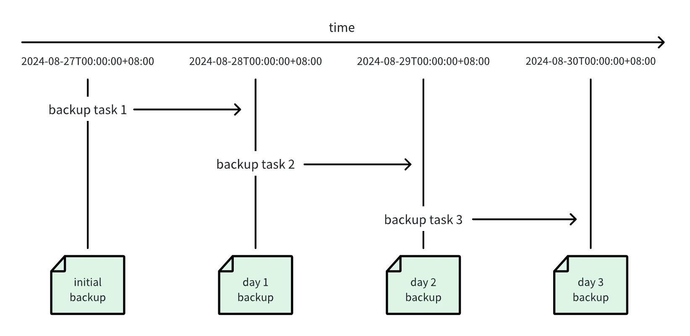

为了防止数据丢失、误删操作，TDengine 提供全面的数据备份、恢复、容错、异地数据实时同步等功能，以保证数据存储的安全。本节简要说明备份和恢复功能。企业版增量备份基于 [数据订阅](../../06-data-subscription/index.md)；逻辑备份工具见 [taosdump](../04-tools/03-taosdump.md)。

## 集群全量备份和恢复

TDengine TSDB Enterprise 支持通过集群级别的全量备份和恢复，备份采用在线模式，恢复为离线模式，适用于将整个集群恢复到原集群或另一套拓扑一致的集群。

### 创建全量备份

使用 SQL 命令 `CREATE FULL BACKUP` 创建全量备份，其语法为：

```sql
CREATE FULL BACKUP ON DNODE <dnode_id> TO <backup_path> [WITH PASSWORD <password>] [PARALLEL <n>];
```

其中，`dnode_id` 指定执行备份任务的 dnode，`backup_path` 指定备份目录，如需对备份数据加密，可使用 `WITH PASSWORD` 子句并提供密码 `password`。

`PARALLEL <n>` 指定备份时并发备份的 vgroup 数量，默认值为 `1`（即串行备份），取值必须大于等于 `1`。当集群中的 vgroup 数量较多时，适当增大该值可显著缩短备份时间；但并发数过大会增加磁盘 I/O 压力，建议根据存储介质和系统负载合理设置。

**注意：**

1. 备份期间时序数据可读可写，但因备份涉及大数据量读写，建议选择系统空闲时段进行备份。
2. 备份期间元数据可读，但请勿进行任何元数据增、删、改操作。
3. 数据加密对备份恢复的性能影响较大，请根据实际情况慎重选择。密码请妥善保管，一旦丢失则数据无法恢复。
4. 同一时刻，只允许创建一个正在执行的备份任务。

例如，可使用下面的命令在 dnode 1 上创建一个全量备份，备份数据保存到 `/backup` 目录下，并使用密码 `Abcd1234` 加密备份数据。

```sql
CREATE FULL BACKUP ON DNODE 1 TO '/backup' WITH PASSWORD 'Abcd1234';
```

如下命令在 dnode 1 上创建全量备份，并以 4 个并发任务并行备份各 vgroup：

```sql
CREATE FULL BACKUP ON DNODE 1 TO '/backup' PARALLEL 4;
```

备份成功后，会根据备份时间在备份目录下创建一个子目录作为备份链目录，例如 `/backup/20260824094003`，数据恢复时，通过备份链目录指定要恢复的数据的保存位置。

### 查看备份状态

使用 `SHOW BACKUPS` 查看备份任务和历史备份记录：

```sql
SHOW BACKUPS;
```

例如：

```shell
taos> show backups;
       id       |  status   |     chain      | database | full | encrypted |    size    | vgroups |       start_time        |       update_time       |
=======================================================================================================================================================
 20260824094003 | succeeded | 20260824094003 | *        |    1 |         1 |  136760311 |   4/4   | 2026-08-24 09:40:03.324 | 2026-08-24 09:42:50.061 |
 20260819153410 | succeeded | 20260819153410 | *        |    1 |         0 |      11592 |   0/0   | 2026-08-19 15:34:10.340 | 2026-08-19 15:34:20.007 |
 20260819153420 | cancelled | 20260819153420 | *        |    1 |         0 |          0 |   0/0   | 2026-08-19 15:34:20.498 | 2026-08-19 15:34:20.498 |
Query OK, 3 row(s) in set (0.007715s)

```

各列含义为：

| 列 | 说明 |
| --- | --- |
| `id` | 备份 ID。 |
| `status` | 备份状态，包括 `running`、`succeeded`、`failed` 和 `cancelled`。 |
| `chain` | 备份链 ID。 |
| `database` | 备份的数据库名称，`*` 表示整个集群。 |
| `full` | 是否为全量备份，`1` 表示全量备份。 |
| `encrypted` | 备份是否加密，`1` 表示已加密。 |
| `size` | 备份文件总大小，单位为字节。 |
| `vgroups` | 已备份的 vgroup 数量与需要备份的 vgroup 总数，格式为 `<已完成>/<总数>`。 |
| `start_time` | 备份开始时间。 |
| `update_time` | 备份记录最后更新时间。 |

只有状态为 `succeeded` 的备份才可以用于恢复。

### 取消备份

对于正在运行的备份，可以使用 `KILL BACKUP` 取消任务：

```sql
KILL BACKUP <backup_id>;
```

取消成功后，该备份记录仍会保留，状态变为 `cancelled`。

例如：

```sql
KILL BACKUP 20260824094003
```

### 数据恢复

数据恢复在操作系统的终端命令行中执行，命令语法为：

```shell
taosd --restore <backup_chain_path> [--password <password>] [--verify=0|1|2] [--parallel <n>] [--verbose]
```

其中：

- `backup_chain_path` 是指备份时创建的备份链目录（由于存储设备挂载路径不同，备份和恢复时的备份链路径可能不完全相同）。
- `password` 是用于备份数据的密码，仅在备份数据被加密时才需要提供。
- `verify` 参数指定数据恢复前是否校验备份数据的完整性，默认为 `1` 表示校验；如确定备份数据完整，则可使用 `0` 跳过校验以节约恢复时间；指定为 `2` 则只校验数据的完整性，不执行恢复。
- `parallel` 参数指定恢复时并发处理的 vnode 数量，默认值为 `1`（即串行恢复），取值必须大于等于 `1`。当 vnode 数量较多时，适当增大该值可显著缩短校验和恢复时间。
- 因恢复过程中涉及到用户交互操作，故默认情况下，恢复时仅输出与恢复密切相关的日志，如出现错误，可使用 `verbose` 参数重新执行恢复操作以输出更多诊断信息。

**注意：**

1. 数据恢复离线进行，整个恢复过程中，必须避免其它应用访问集群。
2. 恢复操作须在目标集群的每个 dnode 节点分别执行一次。
3. 数据恢复时，集群的 dnode 节点数量必须与原集群相同。
4. 数据完整性校验失败会跳过数据恢复，此时，不修改任何现有数据。但数据恢复开始时会清理 dnode 上的现有数据，即使恢复失败，也无法回滚。
5. 数据恢复仅恢复 mnode、vnode、snode 相关数据，anode、bnode、qnode、xnode 为无状态节点，可在恢复完成后手工处理。

例如，可使用下面的命令解密并恢复备份链 `/backup/20260824094003` 的数据：

```shell
taosd --restore /backup/20260824094003 --password Abcd1234
```

下面是数据恢复的具体步骤：

**第 1 步：** 准备好目标集群所有 dnode 的软硬件环境，目标集群的 dnode 数量必须与原集群相同。
**第 2 步：** 启动所有 dnode，并使用 `create dnode` 命令将所有 dnode 加入集群。
**第 3 步：** 停止所有 dnode。
**第 4 步：** 在所有 dnode 上分别执行数据恢复（本步操作可在多个 dnode 上并行以减少总体恢复时间）。

- **第 4.1 步：** 根据实际情况，使用合适的参数执行前面介绍的数据恢复命令启动数据恢复。
- **第 4.2 步：** taosd 校验备份数据的完整性，校验失败则跳过后续步骤直接失败。
- **第 4.3 步：** taosd 检查版本兼容性。建议使用与备份时相同的 taosd 版本执行数据恢复，如果版本号不一致，会询问用户是否继续恢复，用户必须输入**全部大写**的 `YES` 才能继续，其它任何输入都会退出恢复。
- **第 4.4 步：** taosd 提示用户 dnode 上现有数据将被删除且无法回滚。用户必须输入**全部大写**的 `YES` 才能继续，其它任何输入都会退出恢复。
- **第 4.5 步：** taosd 执行数据恢复，过程中会输出进度信息，取决于数据量，此步骤花费的时间可能较长，请耐心等待。
- **第 4.6 步：** 数据恢复完成，taosd 输出“restore completed successfully”。

**第 5 步：** 启动所有 dnode，检查集群状态和数据是否正常。
**第 6 步：** 根据实际情况，手工恢复 anode、bnode、qnode、xnode。
**第 7 步：** 集群恢复完成，接入其它应用，正常使用。

## 基于 taosdump 进行数据备份恢复

taosdump 是一个开源工具，用于支持从运行中的 TDengine 集群备份数据并将备份的数据恢复到相同或另一个正在运行的 TDengine 集群中。taosdump 可以将数据库作为逻辑数据单元进行备份，也可以对数据库中指定时间段内的数据记录进行备份。在使用 taosdump 时，可以指定数据备份的目录路径。如果不指定目录路径，taosdump 将默认将数据备份到当前目录。

以下为 taosdump 执行数据备份的使用示例。

```shell
taosdump -h localhost -P 6030 -D dbname -o /file/path
```

执行上述命令后，taosdump 会连接 localhost:6030 所在的 TDengine 集群，查询数据库 dbname 中的所有数据，并将数据备份到 /file/path 下。

在使用 taosdump 时，如果指定的存储路径已经包含数据文件，taosdump 会提示用户并立即退出，以避免数据被覆盖。这意味着同一存储路径只能用于一次备份。如果你看到相关提示，请谨慎操作，以免误操作导致数据丢失。

要将本地指定文件路径中的数据文件恢复到正在运行的 TDengine 集群中，可以通过指定命令行参数和数据文件所在路径来执行 taosdump 命令。以下为 taosdump 执行数据恢复的示例代码。

```shell
taosdump -i /file/path -h localhost -P 6030
```

执行上述命令后，taosdump 会连接 localhost:6030 所在的 TDengine 集群，并将 /file/path 下的数据文件恢复到 TDengine 集群中。

## 基于数据订阅进行数据备份恢复

### 概述

基于 TDengine 的数据订阅功能，TDengine TSDB Enterprise 实现了数据的增量备份和恢复。用户可以通过 taosExplorer 对 TDengine
集群进行备份和恢复。

TDengine TSDB Enterprise 的备份和恢复功能包括以下几个概念：

1. 增量数据备份：基于 TDengine 的数据订阅功能，将 **备份对象** 的所有数据变更（包括：新增、修改、删除、元数据变更等）记录下来，生成备份文件。
2. 数据恢复：使用增量数据备份生成的备份文件，将 **备份对象** 恢复到指定的时间点。
3. 备份对象：用户备份的对象，可以是一个 **数据库**，也可以是一个 **超级表**。
4. 备份计划：用户为备份对象创建一个周期性执行的备份任务。备份计划从指定的时间点开始，以 **备份周期** 为间隔，周期性地执行备份任务。备份任务每次生成一个 **备份点**。
5. 备份点：每次执行备份任务，生成一组备份文件，它们对应一个时间点，称为 **备份点**。第一个备份点称为 **初始备份点**。
6. 恢复任务：用户选择备份计划的某个备份点，创建一个恢复任务。恢复任务从 **初始备份点** 开始，逐个回放 **备份文件** 中的数据变更，直到指定的备份点结束。



以上图为例：

1. 用户创建了一个 **备份计划**，从 2024-08-27 00:00:00 开始，每隔 1 天执行一次 **备份任务**。
2. 在 2024-08-27 00:00:00 执行了第一次备份任务，生成了一个 **初始备份点**。
3. 之后，每隔 1 天执行一次备份任务，生成了多个 **备份点**。
4. 用户可以选择某个 **备份点**，创建一个 **恢复任务**。
5. 恢复任务会从初始备份点开始，逐个应用备份点，恢复到指定的备份点。

### 数据备份

通过浏览器访问 taosExplorer 服务，访问地址通常为 TDengine 集群所在 IP 地址的端口 6060，如 `http://localhost:6060`。在
taosExplorer 服务页面中，进入“系统管理 - 备份”页面，在“备份计划”标签页下，点击“创建备份计划”，填写备份计划的相关信息。

需要填写的信息包括：

1. 数据库：需要备份的数据库名称。一个备份计划只能备份一个数据库/超级表。
2. 超级表：需要备份的超级表名称。如果不填写，则备份整个数据库。
3. 下次执行时间：首次执行备份任务的日期时间。
4. 备份周期：备份点之间的时间间隔。注意：备份周期必须小于数据库的 WAL_RETENTION_PERIOD 参数值。
5. 错误重试次数：对于可通过重试解决的错误，系统会按照此次数进行重试。
6. 错误重试间隔：每次重试之间的时间间隔。
7. 目录：存储备份文件的目录。
8. 备份文件大小：备份文件的大小限制。当备份文件大小达到此限制时，会自动创建新的备份文件。
9. 文件压缩等级：备份文件的压缩等级。支持：最快速度、最佳压缩比、兼具速度和压缩比。

用户可以通过开启 S3 转储，将备份文件上传至 S3 存储服务上。开启 S3 转储，需要填写以下信息：

1. S3 节点：S3 节点的地址。
2. 访问密钥 ID：访问密钥 ID。
3. 访问密钥：访问密钥。
4. 存储桶：存储桶名称。
5. 区域：存储桶所在的区域。
6. 对象前缀：备份文件的对象前缀，类似于 S3 上的目录。
7. 本地备份文件的保留时长：本地备份的保留时间，所有早于`当前时间 - backup_retention_period`的文件都需要上传到 S3。
8. 本地备份文件的保留个数：本地备份文件的保留个数，本地只保留最新的`backup_retention_size`个备份文件。

创建成功后，备份计划会开始按照配置的参数运行。在“备份计划”下的列表中，可以查看已创建的备份计划。

备份计划支持以下操作：

1. 查看：显示备份计划的详细信息。
2. 修改：修改备份计划的配置。修改备份计划的配置后，当前运行的备份任务会先停止，然后按照新的配置重新运行。
3. 复制：以选中的备份计划为模版，创建新的备份计划。除了数据库和超级表需要用户选择以外，其他配置项和被复制的计划相同。
4. 删除：删除备份计划。删除备份计划时，可以选择是否删除关联的备份文件。
5. 指标：查看备份计划的统计指标。
6. 查看备份点：查看和备份计划关联的所有备份点。

### 备份文件

在“备份文件”列表中，可以查看备份文件的详细信息。

### 数据恢复

在“备份文件”列表中，选择一个备份点，可以创建一个恢复任务，数据库恢复到指定的时间。

在“恢复任务”列表中，可以查看已创建的恢复任务。恢复任务可以终止。

### 使用 taosx 命令行进行异地恢复

除通过 taosExplorer 创建恢复任务外，也可以将备份文件复制到另一套集群，在目标集群上使用 `taosx` 命令行恢复。

#### 备份目录

新建的任务级备份直接保存在任务 ID 目录中：

```text
<备份根目录>/
└── <task_id>/
    ├── .taosx-backup-layout
    ├── <topic>-<timestamp>-<vgroup>-<index>.z
    ├── <topic>-<timestamp>-<vgroup>-<index>.mz
    └── ...
```

新版 `taosx` 写入任务级备份时，会在任务 ID 目录中创建隐藏的布局标记文件 `.taosx-backup-layout`。该文件声明备份文件位于任务目录本身（`task_dir`），还是位于历史兼容子目录 `-1`（`legacy_job_dir`）。标记文件存在时，`taosx` 以其中记录的布局为准，不再探测另一目录。请保留该文件，不要手工修改或重新创建。

布局标记不是 HA 锁。升级期间，不要让不识别该标记的旧版和新版 `taosx` 同时写入同一备份任务。切换版本前应停止备份任务，并确认旧进程已经退出。布局为 `task_dir` 的标记一旦产生，即使新版进程已经退出，也不要再用不识别该标记的旧版继续写入同一任务和备份根目录，否则新旧文件会分散到两个目录。回退到旧版时，请使用新的任务 ID 或新的备份根目录，不要向原备份链追加文件。

只有真正拆分出的作业才使用 `<task_id>/<job_id>` 子目录。任务级备份不需要作业目录，也不需要在恢复命令中指定作业 ID。恢复程序会自动兼容旧版本生成的任务级目录。

如果需要恢复真实作业的备份，请复制实际包含 `.z`、`.mz` 文件的作业目录，并将 `local:` 直接指向复制后的目录。以下步骤以任务级备份为例。

#### 操作步骤

1. 在集群 A 停止备份任务，或确认需要恢复的备份点已经生成。
2. 将完整的任务目录复制到集群 B，保留目录层级和所有备份文件的原始文件名。例如：

   ```shell
   rsync -a /backup/10/ user@cluster-b:/tmp/10/
   ```

   请复制完整任务目录，包括隐藏的 `.taosx-backup-layout` 文件。`rsync -a` 会保留隐藏文件；不要使用 `/backup/10/*` 这样的 shell 通配符复制，因为它会遗漏隐藏文件。增量恢复必须复制从初始备份点到目标备份点的完整文件链；如果目录中存在 `.mz` 文件，也必须一并复制。
3. 在集群 B 递归确认任务目录中存在备份文件：

   ```shell
   find /tmp/10 -type f \( -name '.taosx-backup-layout' -o -name '*.z' -o -name '*.mz' \) -print
   ```

4. 将复制后的任务目录直接写在 `local:` 后。下面的示例将任务 `10` 的备份数据恢复到集群 B 的 `db01` 数据库：

   ```shell
   taosx run \
     -f 'local:/tmp/10?to=now&watch=false' \
     -t 'taos:///db01' \
     -vv
   ```

   对于没有布局标记的历史任务级目录，可以显式指定布局，跳过历史兼容探测：

   ```shell
   # 备份文件直接位于 /tmp/10
   taosx run \
     -f 'local:/tmp/10?to=now&watch=false&layout=task_dir' \
     -t 'taos:///db01' \
     -vv

   # 备份文件位于 /tmp/10/-1
   taosx run \
     -f 'local:/tmp/10?to=now&watch=false&layout=legacy_job_dir' \
     -t 'taos:///db01' \
     -vv
   ```

   `layout` 只适用于任务级备份。布局标记存在时，显式 `layout` 必须与标记一致，否则恢复命令会报错。只读恢复不会创建布局标记。
5. 检查 `taosx` 日志中的实际处理文件数和数据行数，并在目标集群执行查询核对恢复结果。命令退出码为 0 不能单独证明数据已经恢复。

如果布局标记和显式 `layout` 都不存在，`taosx` 会执行历史兼容探测，并记录 `backup layout marker is missing; using legacy layout detection` warning。仅在这种情况下，如果任务目录直属位置和历史 `-1` 子目录中同时存在备份文件，恢复程序才会报告目录布局冲突。请先核对两处文件并将完整备份链整理到独立的恢复目录；同名文件内容不一致时不要直接覆盖。

## 常见错误排查

### 端口访问异常

如果任务启动失败并报以下错误：

```text
Error: tmq to td task exec error

Caused by:
    [0x000B] Unable to establish connection
```

产生原因是与数据源的端口链接异常，需检查数据源 FQDN 是否联通及端口 6030 是否可正常访问。

### 连接异常

如果使用 WebSocket 连接，任务启动失败并报以下错误：

```text
Error: tmq to td task exec error

Caused by:
    0: WebSocket internal error: IO error: failed to lookup address information: Temporary failure in name resolution
    1: IO error: failed to lookup address information: Temporary failure in name resolution
    2: failed to lookup address information: Temporary failure in name resolution
```

使用 WebSocket 连接时可能遇到多种错误类型，错误信息可以在”Caused by“后查看，以下是几种可能的错误：

- "Temporary failure in name resolution": DNS 解析错误，检查 IP 或 FQDN 是否能够正常访问。
- "IO error: Connection refused (os error 111)": 端口访问失败，检查端口是否配置正确或是否已开启和可访问。
- "IO error: received corrupt message": 消息解析失败，可能是使用了 wss 方式启用了 SSL，但源端口不支持。
- "HTTP error: *": 可能连接到错误的 taosAdapter 端口或 LSB/Nginx/Proxy 配置错误。
- "WebSocket protocol error: Handshake not finished": WebSocket 连接错误，通常是因为配置的端口不正确。

### 任务启动失败

如果任务启动失败并报以下错误：

```text
Error: tmq to td task exec error

Caused by:
    [0x038C] WAL retention period is zero
```

是由于源端数据库 WAL 配置错误，无法订阅。

解决方式：
修改数据 WAL 配置：

```sql
alter
database test wal_retention_period 3600;
```
