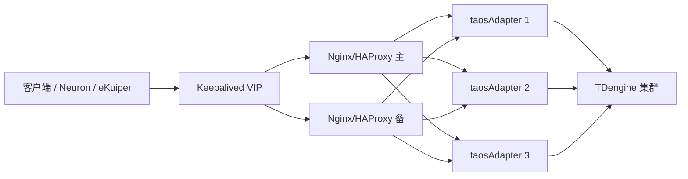

## 概述

taosAdapter 是无状态接入层：任意实例都可以接收请求，并在内部通过 taosc 将请求转发到 TDengine 集群。因此可以在多台主机上部署多个 taosAdapter 实例，前置 Nginx 或 HAProxy 做负载均衡、健康检查和故障切换。

本文覆盖：

- 多实例部署的前提和拓扑；
- 健康检查接口与主动/被动检查的差异；
- Nginx 和 HAProxy 的完整配置；
- TLS/mTLS；
- 负载均衡器自身的高可用；
- 验证、排障和与连接器内置高可用的关系。

适用场景：

- 客户端只能配置一个地址，例如 HTTP/InfluxDB/OpenMetrics 客户端、Neuron、eKuiper；
- 需要统一的 TLS/mTLS 入口；
- 需要主动健康检查，快速摘除故障实例；
- 连接器版本较低，或不支持 `adapterHa`/`adapterList`。

需要注意：负载均衡器只能消除 taosAdapter 的单点，不能替代 TDengine 集群的多副本和故障切换。所有 taosAdapter 都部署在同一台主机上，也无法规避主机故障。

推荐拓扑如下：



## 部署前提

- 至少部署 2 个、建议 3 个 taosAdapter 实例，分布在不同主机上；所有实例连接同一个 TDengine 集群。
- 所有实例使用相同版本和一致的配置；为每个实例设置不同的 `instanceId`，便于区分日志。参考 [基础配置](02-configuration.md#基础配置)。
- 每个 taosAdapter 实例都应能访问 taosd 集群；TDengine 侧应配置多副本或集群，避免数据库层单点。
- taosAdapter 会注册到 TDengine，可通过 `performance_schema.perf_instances` 查看实例；注册参数见 [注册配置](02-configuration.md#注册配置)。
- 负载均衡器到 taosAdapter、taosAdapter 到 taosd 的网络需互通；跨主机部署时注意防火墙、DNS 和时间同步。
- 不要把多个 taosAdapter 实例都放在同一台主机上；主机故障会同时带走所有实例。

## 健康检查

taosAdapter 提供 `GET /-/ping` 作为健康检查接口：

- 正常时返回 HTTP `200`；
- 当内存使用超过 `pauseAllMemoryThreshold` 时返回 HTTP `503`；超过 `pauseQueryMemoryThreshold` 时，带 `action=query` 的请求返回 `503`。参数见 [内存限制配置](02-configuration.md#内存限制配置)。
- 该接口无需认证，适合负载均衡器和外部探针周期调用。

对于 InfluxDB 客户端，taosAdapter 还兼容 `GET|HEAD /influxdb/v1/ping`，正常返回 `204`（`verbose=true` 时返回 `200`）。负载均衡器的健康检查建议统一使用 `/-/ping`，不要用带业务语义的写入接口。

| 能力 | Nginx 开源版 | Nginx Plus / 第三方模块 | HAProxy |
| --- | --- | --- | --- |
| 被动健康检查（`max_fails`/`fail_timeout`） | 支持 | 支持 | 支持 |
| 主动健康检查 | 不支持 | Nginx Plus 或 `nginx_upstream_check_module` | 支持 |
| WebSocket 长连接 | 支持 | 支持 | 支持 |
| TLS/mTLS | 支持 | 支持 | 支持 |
| 适用场景 | 已有 Nginx、可接受被动摘除 | 企业版 Nginx | 需要主动检查和精确故障切换 |

## Nginx 负载均衡与故障切换

### 完整配置

以下示例以三个 taosAdapter 实例为例，Nginx 终止 TLS，并把 REST、WebSocket 和 InfluxDB 写入分别路由到合适的超时和重试策略。

```nginx
# WebSocket upgrade, while keeping upstream keepalive for ordinary HTTP.
map $http_upgrade $connection_upgrade {
    default upgrade;
    ''      '';
}

upstream taosadapter {
    least_conn;
    server adapter-a.internal:6041 max_fails=3 fail_timeout=10s;
    server adapter-b.internal:6041 max_fails=3 fail_timeout=10s;
    server adapter-c.internal:6041 max_fails=3 fail_timeout=10s;
    keepalive 64;
}

server {
    listen 443 ssl http2;
    server_name tsdb.example.com;
    ssl_certificate     /etc/nginx/certs/server.crt;
    ssl_certificate_key /etc/nginx/certs/server.key;
    ssl_protocols       TLSv1.2 TLSv1.3;
    ssl_ciphers         HIGH:!aNULL:!MD5;
    client_max_body_size 64m;

    # REST, JSON, OpenTSDB and other ordinary HTTP requests.
    # POST is not retried here; arbitrary SQL may not be idempotent.
    location / {
        proxy_pass http://taosadapter;
        proxy_http_version 1.1;
        proxy_set_header Host $host;
        proxy_set_header X-Real-IP $remote_addr;
        proxy_set_header X-Forwarded-For $proxy_add_x_forwarded_for;
        proxy_set_header X-Forwarded-Proto $scheme;
        proxy_set_header Connection "";
        proxy_connect_timeout 5s;
        proxy_send_timeout    300s;
        proxy_read_timeout    300s;
        proxy_next_upstream error timeout http_502 http_503 http_504;
        proxy_next_upstream_tries 3;
    }

    # WebSocket: long-lived connections need their own timeouts.
    location /ws {
        proxy_pass http://taosadapter;
        proxy_http_version 1.1;
        proxy_set_header Upgrade $http_upgrade;
        proxy_set_header Connection $connection_upgrade;
        proxy_set_header Host $host;
        proxy_set_header X-Real-IP $remote_addr;
        proxy_set_header X-Forwarded-For $proxy_add_x_forwarded_for;
        proxy_set_header X-Forwarded-Proto $scheme;
        proxy_connect_timeout 5s;
        proxy_send_timeout    3600s;
        proxy_read_timeout    3600s;
        proxy_next_upstream error timeout http_502 http_503 http_504;
        proxy_next_upstream_tries 3;
    }

    # InfluxDB v1 writes: POST may be retried after connection/read failures.
    # Same-timestamp points overwrite, so retries are generally safe for
    # schemaless writes. Do not apply non_idempotent to arbitrary SQL.
    location /influxdb/v1/ {
        proxy_pass http://taosadapter;
        proxy_http_version 1.1;
        proxy_set_header Host $host;
        proxy_set_header X-Real-IP $remote_addr;
        proxy_set_header X-Forwarded-For $proxy_add_x_forwarded_for;
        proxy_set_header X-Forwarded-Proto $scheme;
        proxy_set_header Connection "";
        proxy_connect_timeout 5s;
        proxy_send_timeout    300s;
        proxy_read_timeout    300s;
        proxy_next_upstream error timeout http_502 http_503 http_504 non_idempotent;
        proxy_next_upstream_tries 3;
    }

    # Optional: expose the adapter health check through the LB.
    location = /-/ping {
        proxy_pass http://taosadapter/-/ping;
        access_log off;
    }
}
```

配置说明：

- `least_conn` 按当前连接数分发，适合长连接和混合负载；不需要会话粘性，taosAdapter 是无状态的。
- `max_fails=3 fail_timeout=10s` 是被动健康检查：失败 3 次后摘除 10 秒；Nginx 开源版没有主动健康检查。
- `keepalive 64` 需要 `proxy_http_version 1.1`，普通 HTTP 请求通过 `proxy_set_header Connection ""` 复用上游连接；WebSocket 使用 `$connection_upgrade`。
- `proxy_read_timeout` 对普通查询设置为 300 秒，对 WebSocket 设置为 3600 秒；请根据实际查询时长和连接空闲时间调整。
- `proxy_next_upstream_tries 3` 表示单个请求最多尝试 3 次（含首次）。
- `location /` 不重试 POST；`location /influxdb/v1/` 使用 `non_idempotent` 重试写请求。重试前请确认写入语义：InfluxDB 行协议和无模式写入中，同一子表、同一时间戳的重复点会覆盖，因此通常可重试；任意 REST SQL 可能不具备幂等性，不要全局开启 `non_idempotent`。
- `client_max_body_size` 需要覆盖批量写入的请求体大小；示例为 64 MiB。
- `location = /-/ping` 便于外部探针或二级负载均衡检查 Nginx 到后端的连通性；Nginx 自身的健康检查可用 `nginx -t` 和进程/端口探针。

### Nginx 主动健康检查

Nginx 开源版不提供主动健康检查。需要主动探测时，可选择：

- Nginx Plus：在 `location` 中使用 `health_check`，例如：

  ```nginx
  upstream taosadapter {
      zone taosadapter 64k;
      least_conn;
      server adapter-a.internal:6041 max_fails=3 fail_timeout=10s;
      server adapter-b.internal:6041 max_fails=3 fail_timeout=10s;
      server adapter-c.internal:6041 max_fails=3 fail_timeout=10s;
  }

  server {
      location / {
          proxy_pass http://taosadapter;
          health_check interval=3s fails=3 passes=2 uri=/-/ping;
      }
  }
  ```

- 使用 `nginx_upstream_check_module` 等第三方模块；
- 或直接使用 HAProxy，见下一节。

不同 Nginx 版本的 `health_check` 语法可能不同，部署前请以对应版本文档为准。

### Nginx 自身高可用

单台 Nginx 会成为新的单点。生产环境建议两台 Nginx + Keepalived VIP，或使用云负载均衡。配置和证书需要在两台 Nginx 之间同步；具体见后文“负载均衡器自身高可用”。

## HAProxy 负载均衡与故障切换

HAProxy 支持主动健康检查，适合需要快速摘除故障实例、精确控制重试和会话的场景。以下示例以 HAProxy 2.2+ 为基准，旧版本请按实际语法调整。

### 完整配置

```haproxy
global
    log stdout format raw local0
    maxconn 20000
    stats socket /var/run/haproxy/admin.sock mode 660 level admin

defaults
    log global
    mode http
    option httplog
    option redispatch
    retries 3
    timeout connect 5s
    timeout client 3600s
    timeout server 3600s
    timeout http-request 10s
    timeout http-keep-alive 10s
    timeout queue 30s
    timeout tunnel 1h
    default-server inter 3s fall 3 rise 2

frontend taosadapter_fe
    bind *:6041
    # TLS termination:
    # bind *:6041 ssl crt /etc/haproxy/certs/taos.pem ssl-min-ver TLSv1.2
    # mTLS: add "verify required ca-file /etc/haproxy/certs/client-ca.crt" to bind.
    default_backend taosadapter_be

backend taosadapter_be
    balance leastconn
    option httpchk GET /-/ping
    http-check expect status 200
    http-reuse safe
    # Optional: drop existing sessions when an instance is marked down.
    # on-marked-down shutdown-sessions
    server adapter-a adapter-a.internal:6041 check
    server adapter-b adapter-b.internal:6041 check
    server adapter-c adapter-c.internal:6041 check
```

配置说明：

- `option httpchk GET /-/ping` + `http-check expect status 200` 是主动健康检查；`inter 3s fall 3 rise 2` 表示每 3 秒检查一次，连续 3 次失败摘除，连续 2 次成功恢复。
- `balance leastconn` 按连接数分发；不需要会话粘性。
- `option redispatch` 和 `retries 3` 允许连接失败时改投其他实例。HAProxy 2.1+ 可用 `retry-on` 扩大重试范围，例如 `retry-on conn-failure empty-response 502 503 504`；但这同样可能放大重复写入，建议只在 InfluxDB/无模式写入等可重试路径使用。
- `timeout tunnel 1h` 用于 WebSocket 隧道；`timeout client/server 3600s` 覆盖长连接。普通 REST 查询可按需缩短。
- `http-reuse safe` 复用上游连接；`timeout http-keep-alive` 控制空闲连接。
- `on-marked-down shutdown-sessions` 会在实例被摘除时关闭已建立的会话，促使客户端重连到健康实例；对长连接场景可视需求开启。
- `stats socket` 可用于运行时查看后端状态；如需 HTTP 统计页，可在 frontend 中增加 `stats uri /haproxy?stats`。

### 主动健康检查与故障切换

HAProxy 的主动检查可以比 Nginx 被动检查更快发现故障。建议：

- `inter` 设为 2–5 秒，`fall` 设为 2–3，`rise` 设为 2；
- 健康检查路径固定为 `/-/ping`，期望状态码 `200`；
- 对长连接开启 `timeout tunnel`，避免 WebSocket 被普通超时切断；
- 需要精确控制重试时，使用 `retry-on`，并只对幂等路径开启；
- 实例恢复后，HAProxy 会自动重新加入后端；可通过 `stats socket` 或统计页观察。

## 健康检查与重试语义

负载均衡器重试请求时，需要区分“请求是否已经到达 taosAdapter”：

- 连接失败、连接超时、尚未收到响应：通常可以安全改投其他实例；
- 已经收到响应但状态码为 5xx：可能是 taosAdapter 内部错误，也可能是下游 TDengine 返回的错误；重试前要确认请求是否幂等；
- 写入请求：同一子表、同一时间戳的重复写入通常会覆盖；InfluxDB 行协议、OpenMetrics、无模式写入可按此语义设计重试；
- DDL、权限、任务类 SQL：通常不具备幂等性，不建议自动重试。

实践建议：

- 把普通 REST SQL 和可重试的写入路径分开配置（示例中分别是 `location /` 和 `location /influxdb/v1/`）；
- 只在可重试路径启用 Nginx 的 `non_idempotent` 或 HAProxy 的 `retry-on`；
- 在客户端或数据源侧尽量使用确定性的时间戳，让重复写入可以覆盖；
- 监控重试次数和重复写入指标，避免故障切换放大数据问题。

## TLS 与 mTLS

### Nginx

- HTTPS/WSS 终止在 Nginx：配置 `ssl_certificate`、`ssl_certificate_key`，证书 SAN 必须匹配客户端访问的域名。
- 双向 TLS：增加 `ssl_client_certificate /etc/nginx/certs/client-ca.crt;` 和 `ssl_verify_client on;`。
- Nginx 到 taosAdapter 默认使用 HTTP，应位于受控网络；如需加密，把 `proxy_pass` 改为 `https://taosadapter`，并配置 `proxy_ssl_verify on`、`proxy_ssl_trusted_certificate` 和 `proxy_ssl_name`。
- taosAdapter 自身的 SSL 配置见 [SSL](02-configuration.md#ssl)；证书生成与全链路传输安全见 [全链路传输安全](../../../11-security-guide/02-full-trace-transport.md#11-appendix-self-signed-cert)。

### HAProxy

- 终止 TLS：`bind *:6041 ssl crt /etc/haproxy/certs/taos.pem ssl-min-ver TLSv1.2`。证书文件需包含证书、私钥和（可选）中间证书。
- 双向 TLS：在 bind 上增加 `verify required ca-file /etc/haproxy/certs/client-ca.crt`。
- 到 taosAdapter 的上游 TLS：在 `server` 行增加 `ssl verify required ca-file /etc/haproxy/certs/adapter-ca.crt`；如果证书 SAN 与地址不一致，使用 `sni`/`verifyhost` 指定校验名称。
- 证书轮换时，同步更新 HAProxy 配置和证书文件，执行 `haproxy -c -f` 校验后平滑重载。

## 负载均衡器自身高可用

Nginx 或 HAProxy 本身也可能故障。建议：

- 两台负载均衡器 + Keepalived VIP，客户端只访问 VIP；
- 两台 LB 使用相同的后端、健康检查、TLS 证书和路由配置；
- Keepalived 监控 LB 进程或本地健康接口，异常时切换 VIP；
- 云环境优先使用托管负载均衡，并配置跨可用区和 `/-/ping` 健康检查；
- 单台 LB 至少配置 DNS 多 A 记录或备用地址，但这不是强一致的故障切换。

Keepalived 示例（两台节点，主节点 `state MASTER`、`priority 100`，备节点改为 `state BACKUP`、`priority 90`，其余保持一致）：

```text
vrrp_script chk_haproxy {
    script "/usr/bin/pgrep -x haproxy >/dev/null"
    interval 2
    weight -20
}

vrrp_instance VI_TAOSADAPTER {
    state MASTER
    interface eth0
    virtual_router_id 51
    priority 100
    advert_int 1
    authentication {
        auth_type PASS
        auth_pass <password>
    }
    virtual_ipaddress {
        192.168.10.100/24 dev eth0
    }
    track_script {
        chk_haproxy
    }
}
```

注意：

- `pgrep` 只能检查进程是否存在，不能判断后端是否可用；生产环境建议用本地健康接口、HAProxy stats socket 或 Nginx 状态页做更细的检查。
- 主备节点需要同步配置、证书和防火墙规则；VRRP 需要允许组播/协议通信。
- 切换后要验证 VIP、健康检查和后端连接是否正常。

## 验证与排障

### 验证清单

1. 通过 LB 访问 `GET /-/ping`，确认返回 `200`；再直接访问每个 taosAdapter 的 `/-/ping`。
2. 通过 LB 执行 REST 查询和写入，确认结果正确；通过 WebSocket 客户端建立连接，确认完成 `101 Switching Protocols`。
3. 保持 WebSocket 连接超过 `proxy_read_timeout`/`timeout tunnel`，确认连接不会被提前断开。
4. 停止一个 taosAdapter 实例，确认新请求仍可成功；观察 Nginx/HAProxy 的日志和健康状态。
5. 验证 TLS/mTLS：检查证书 SAN、客户端证书、CA 和上游校验配置。
6. 模拟故障切换后的写入重试，确认重复数据按预期覆盖，或确认已把非幂等路径排除在重试之外。
7. 停止所有 taosAdapter，确认 LB 返回明确的 5xx；恢复实例后确认自动重新加入。
8. 停止一台 LB，确认 VIP 漂移，客户端仍能访问。

### 常见问题

| 现象 | 可能原因 | 处理 |
| --- | --- | --- |
| 502/504 | taosAdapter 不可达、查询超时、上游端口错误 | 检查 `/-/ping`、`proxy_connect_timeout`、`proxy_read_timeout` 和 taosAdapter 日志 |
| WebSocket 握手 400 | 缺少 `Upgrade`/`Connection` 头，或 `/ws` 被普通 location 处理 | 为 `/ws` 单独配置 Upgrade 头和长超时 |
| 连接频繁断开 | `proxy_read_timeout`/`timeout server` 过短 | 调大 WebSocket 和长查询超时 |
| 重复写入 | 开启了 `non_idempotent`/`retry-on` 且请求非幂等 | 只对可覆盖写入开启重试；使用确定性时间戳 |
| 所有请求 503 | 所有 taosAdapter 被摘除，或内存阈值触发 `/-/ping` 返回 503 | 检查实例健康、内存和 `pauseAllMemoryThreshold` |
| TLS 握手失败 | 证书 SAN、CA、客户端证书不匹配 | 检查证书链、SAN、`verify` 配置 |
| 无法切换 | VRRP 被防火墙拦截、Keepalived 配置不一致 | 检查 VRRP 通信、`virtual_router_id`、认证和优先级 |

## 与连接器内置高可用的关系

TDengine 的 C/C++、Go、Python、Node.js、JDBC、Rust、C# 等连接器支持 `adapterHa`、`adapterList` 或多端点配置。启用后，连接器会向 taosAdapter 请求当前可用的实例列表，在客户端完成负载均衡和故障转移，此时不强制要求 Nginx 或 HAProxy。连接器内置 HA 适合 TDengine 连接器，尤其是直连 WebSocket 的应用；Nginx/HAProxy 适合非连接器客户端，或需要统一 TLS/mTLS 入口的场景。

两种方案可以同时使用，但不要让两层都重试写请求，否则可能放大重复写入。连接器内置 HA 与 LB 的取舍：

| 场景 | 建议 |
| --- | --- |
| 应用使用 TDengine 连接器，且版本支持 `adapterHa`/`adapterList` | 优先使用连接器内置 HA，减少一跳网络和运维成本 |
| 客户端是 HTTP/InfluxDB/Neuron/eKuiper 等非连接器 | 使用 Nginx/HAProxy |
| 需要统一 TLS/mTLS 入口或隐藏后端拓扑 | 使用 Nginx/HAProxy，连接器可继续指向 LB |
| 同时使用连接器和 LB | 只在其中一层重试写请求，避免重复放大 |

连接器的具体参数和版本要求见 [连接器参考](../../../10-developer-guide/08-connectors-reference/01-cpp.mdx)；Neuron 接入场景见 [Neuron 接入](../../../13-ecosystem-integrations/01-collection/11-Neuron.md#加密传输与高可用可选)。

## 参考

- [taosAdapter 配置](02-configuration.md)
- [taosAdapter SSL](02-configuration.md#ssl)
- [全链路高可用](../../../11-security-guide/04-full-trace-availability.md)
- [全链路传输安全](../../../11-security-guide/02-full-trace-transport.md)
- [连接器参考](../../../10-developer-guide/08-connectors-reference/01-cpp.mdx)
