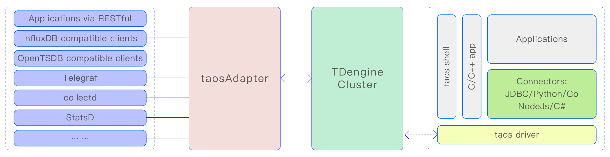

taosAdapter 是一个 TDengine 的配套工具，是 TDengine 集群和应用程序之间的桥梁和适配器。它提供了一种易于使用和高效的方式来直接从数据收集代理软件（如 Telegraf、StatsD、collectd 等）摄取数据。它还提供了 InfluxDB/OpenTSDB 兼容的数据摄取接口，允许 InfluxDB/OpenTSDB 应用程序无缝移植到 TDengine。
TDengine 的各语言连接器通过 WebSocket 接口与 TDengine 进行通信，因此必须安装 taosAdapter。

架构图如下：



## 本手册结构

- [数据写入接口](01-data-ingestion.md)：WebSocket、RESTful、InfluxDB、OpenTSDB 以及各类采集代理的写入方式。
- [配置参考](02-configuration.md)：基础、SSL、注册、CORS、连接池、日志、环境变量等全部配置项。
- [运维与监控](03-operations.md)：SQL/STMT 记录到 CSV、监控指标。
- [高可用](04-high-availability.md)：多实例部署、Nginx/HAProxy 负载均衡、健康检查、故障切换与 TLS/mTLS。

## 功能列表

taosAdapter 提供了以下功能：

- WebSocket 接口：
  支持通过 WebSocket 协议执行 SQL、无模式数据写入、参数绑定和数据订阅功能。
- InfluxDB v1 数据写入：
  [https://docs.influxdata.com/influxdb/v2.0/reference/api/influxdb-1x/write/](https://docs.influxdata.com/influxdb/v2.0/reference/api/influxdb-1x/write/)
- 兼容 OpenTSDB JSON 和 telnet 格式写入：
  - [http://opentsdb.net/docs/build/html/api_http/put.html](http://opentsdb.net/docs/build/html/api_http/put.html)
  - [http://opentsdb.net/docs/build/html/api_telnet/put.html](http://opentsdb.net/docs/build/html/api_telnet/put.html)
- collectd 数据写入：
  collectd 是一个系统统计收集守护程序，请访问 [https://collectd.org/](https://collectd.org/) 了解更多信息。
- StatsD 数据写入：
  StatsD 是一个简单而强大的统计信息汇总的守护程序。请访问 [https://github.com/statsd/statsd](https://github.com/statsd/statsd) 了解更多信息。
- icinga2 OpenTSDB writer 数据写入：
  icinga2 是一个收集检查结果指标和性能数据的软件。请访问 [https://icinga.com/docs/icinga-2/latest/doc/14-features/#opentsdb-writer](https://icinga.com/docs/icinga-2/latest/doc/14-features/#opentsdb-writer) 了解更多信息。
- TCollector 数据写入：
  TCollector 是一个客户端进程，从本地收集器收集数据，并将数据推送到 OpenTSDB。请访问 [http://opentsdb.net/docs/build/html/user_guide/utilities/tcollector.html](http://opentsdb.net/docs/build/html/user_guide/utilities/tcollector.html) 了解更多信息。
- OpenMetrics 采集写入：
  OpenMetrics 是云原生监控领域的新兴标准，扩展并规范了 Prometheus 的指标格式，已成为现代监控工具的事实标准。请访问 [https://github.com/prometheus/OpenMetrics/blob/main/specification/OpenMetrics.md](https://github.com/prometheus/OpenMetrics/blob/main/specification/OpenMetrics.md) 了解更多信息。
- Prometheus remote_read 和 remote_write：
  remote_read 和 remote_write 是 Prometheus 数据读写分离的集群方案。请访问 [https://prometheus.io/blog/2019/10/10/remote-read-meets-streaming/#remote-apis](https://prometheus.io/blog/2019/10/10/remote-read-meets-streaming/#remote-apis) 了解更多信息。
- node_exporter 采集写入：
  node_export 是一个机器指标的导出器。请访问 [https://github.com/prometheus/node_exporter](https://github.com/prometheus/node_exporter) 了解更多信息。
- JSON 数据写入：
  支持通过 RESTful 接口写入 JSON 格式的数据到 TDengine。
- RESTful 接口：
  [RESTful API](../../../10-developer-guide/08-connectors-reference/10-rest-api.mdx)

各接口的详细说明见 [数据写入接口](01-data-ingestion.md)。

## 安装

taosAdapter 是 TDengine 服务端软件的一部分，如果你使用 TDengine server 你不需要任何额外的步骤来安装 taosAdapter。你可以从 [涛思数据官方网站](https://taosdata.com/downloads?product=TDengine+TSDB-OSS) 下载 TDengine server 安装包。如果需要将 taosAdapter 分离部署在 TDengine server 之外的服务器上，则应该在该服务器上安装完整的 TDengine 来安装 taosAdapter。如果你需要使用源代码编译生成 taosAdapter，你可以参考 [构建 taosAdapter](https://github.com/taosdata/taosadapter/blob/3.0/README.md) 文档。

安装完成后使用命令 `systemctl start taosadapter` 可以启动 taosAdapter 服务。

## 服务管理

### 启动/停止 taosAdapter

在 Linux 系统上 taosAdapter 服务默认由 systemd 管理。使用命令 `systemctl start taosadapter` 可以启动 taosAdapter 服务。使用命令 `systemctl stop taosadapter` 可以停止 taosAdapter 服务。使用命令 `systemctl status taosadapter` 来检查 taosAdapter 运行状态。

### 升级 taosAdapter

taosAdapter 和 TDengine server 需要使用相同版本。请通过升级 TDengine server 来升级 taosAdapter。
与 taosd 分离部署的 taosAdapter 必须通过升级其所在服务器的 TDengine server 才能得到升级。

### 移除 taosAdapter

使用命令 rmtaos 可以移除包括 taosAdapter 在内的 TDengine server 软件。

## 动态配置

### 动态修改日志级别

从 **3.3.5.0 版本** 开始，taosAdapter 支持通过 HTTP 接口动态修改日志级别。用户可以通过发送 HTTP PUT 请求到 /config 接口，动态调整日志级别。该接口的验证方式与 /rest/sql 接口相同，请求体中需传入 JSON 格式的配置项键值对。

以下是通过 curl 命令将日志级别设置为 debug 的示例：

```shell
curl --location --request PUT 'http://127.0.0.1:6041/config' \
-u root:taosdata \
--data '{"log.level": "debug"}'
```

### 监听配置文件变更

从 **3.3.6.34**/**3.4.0.0** 版本开始，taosAdapter 支持监听配置文件的变更，支持以下配置自动更新

- `log.level` 日志级别参数
- `rejectQuerySqlRegex` 拒绝查询 SQL 列表配置参数

## IPv6 支持

taosAdapter 自 **3.3.6.13** 版本起支持 IPv6，用户无需进行任何额外配置。
taosAdapter 将自动检测系统的 IPv6 支持情况，并在系统支持时自动启用 IPv6，且同时监听 IPv4 和 IPv6 地址。

## httpd 升级为 taosAdapter 的变化

在 TDengine server 2.2.x.x 或更早期版本中，taosd 进程包含一个内嵌的 http 服务（httpd）。如前面所述，taosAdapter 是一个使用 systemd 管理的独立软件，拥有自己的进程。并且两者有一些配置参数和行为是不同的，请见下表：

| **#** | **embedded httpd**  | **taosAdapter**               | **comment**                                                                                    |
|-------|---------------------|-------------------------------|------------------------------------------------------------------------------------------------|
| 1     | httpEnableRecordSql | --logLevel=debug              |                                                                                                |
| 2     | httpMaxThreads      | n/a                           | taosAdapter 自动管理线程池，无需此参数                                                                      |
| 3     | telegrafUseFieldNum | 请参考 taosAdapter telegraf 配置方法 |                                                                                                |
| 4     | restfulRowLimit     | restfulRowLimit               | 内嵌 httpd 默认输出 10240 行数据，最大允许值为 102400。taosAdapter 也提供 restfulRowLimit 但是默认不做限制。你可以根据实际场景需求进行配置 |
| 5     | httpDebugFlag       | 不适用                           | httpdDebugFlag 对 taosAdapter 不起作用                                                              |
| 6     | httpDBNameMandatory | 不适用                           | taosAdapter 要求 URL 中必须指定数据库名                                                                   |
