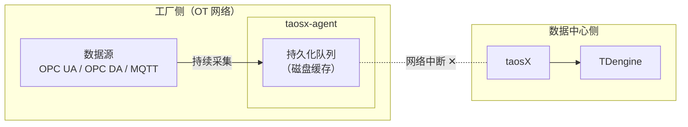
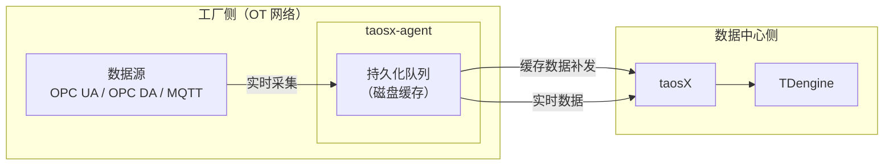

## 功能概述

在工业数据采集场景中，taosX-Agent 通常部署在工厂侧（OT 网络），通过 VPN 或专线与数据中心侧的 taosX 通信。当网络中断时（如 VPN 断开、周末停机等），如果没有缓存机制，中断期间的数据将会丢失。

**存储转发（Store and Forward）** 功能解决了这一问题：当 taosX-Agent 与 taosX 之间的网络中断时，taosX-Agent 继续接收数据源的数据并缓存到本地磁盘；网络恢复后，自动将尚未确认的数据补发给 taosX。

:::note
存储转发只缓存 taosX-Agent 已接收到的数据。缓存数据定期同步到磁盘，主机突然断电或磁盘故障时，最近缓存的部分数据可能丢失。
:::

**网络中断期间**：Agent 继续采集数据，写入本地磁盘缓存。

**网络恢复后**：缓存数据自动补发，实时数据同步恢复。

## 适用场景

| 场景           | 说明                                             |
| -------------- | ------------------------------------------------ |
| VPN 网络不稳定 | 工厂与数据中心之间的 VPN 可能周期性中断          |
| 计划性停机     | 周末或维护期间数据中心网络下线，工厂仍需持续采集 |
| 网络质量差     | 远程站点带宽有限，偶发断连                       |

:::note
存储转发功能目前支持 **OPC UA**、**OPC DA** 和 **MQTT** 数据源类型的实时采集任务。
:::

## 启用方式

存储转发通过数据接入任务的高级选项启用，而非 Agent 本身的配置。

在 taosExplorer 中创建或编辑 OPC UA / OPC DA / MQTT 数据接入任务时，在 **高级选项** 中配置以下参数：

| 参数             | DSN 参数名            | 默认值                               | 说明                                   |
| ---------------- | --------------------- | ------------------------------------ | -------------------------------------- |
| 缓存实时数据     | `persist_data_enable` | `false`                              | 是否启用磁盘级别的数据缓存（存储转发） |
| 缓存数据存储目录 | `persist_data_dir`    | `$DATA_DIR/tasks/:id/persist_queue/` | 缓存数据的存储目录                     |

将 **缓存实时数据** 开关打开即可启用存储转发功能。

## 工作原理

启用存储转发后，Agent 内部会创建一个 **persist_queue**（持久化队列），数据流分为写入和读取两条路径：

### 写入路径（数据源 → 本地磁盘）

1. 连接器（如 taosx-opc）从数据源采集数据，通过 IPC 管道传给 Agent。
2. Agent 将数据序列化后写入 persist_queue 的磁盘文件。
3. 一批数据完整写入缓存文件后，Agent 通知连接器该批数据已接收。此时数据尚未写入 TDengine。

### 读取路径（本地磁盘 → taosX）

1. persist_queue 从磁盘文件中读取缓存的数据。
2. Agent 将数据发送给 taosX。
3. taosX 将数据写入 TDengine 后，返回该批数据的处理结果。
4. Agent 按发送顺序更新断点位置（breakpoint）：只有之前的批次都已确认，断点才会向前推进。

### 断点恢复机制

persist_queue 使用 breakpoint 数据库记录已确认的读取位置。网络恢复或 Agent 重启后，从该位置继续读取并发送缓存的数据。

如果 taosX 已写入一批数据，但确认消息因网络中断未送达，Agent 会重新发送这批数据。因此存储转发保证数据至少写入一次，少数情况下可能产生重复数据。

### 确认与失败处理

Agent 只有在收到 taosX 返回的写入结果后，才认为一批数据已交付。各类情况的处理方式如下：

| 情况 | 处理方式 |
| --- | --- |
| 数据写入成功 | 确认该批数据，继续发送后续数据 |
| 数据源正常结束 | 发送完剩余的缓存数据并全部确认后，任务正常结束 |
| 数据本身有错误，且任务配置了异常数据归档 | 归档出错的数据，其余数据正常写入，任务继续运行 |
| 网络中断、taosX 暂时不可用或交付超时 | 保留未确认的数据，自动重连后重新发送 |
| 认证失败、配置错误、版本不一致或其他无法自动恢复的写入错误 | 任务报错并停止，未确认的数据保留在缓存中。排除问题后重新启动任务 |

异常数据归档会尽量保存出错的数据，但不保证完整：归档队列已满或写入归档文件失败时，部分出错数据可能未被归档，不影响其余数据的正常写入。

可通过任务状态和日志查看失败、重试和恢复情况。Agent 显示在线只表示连接正常，不代表数据已写入 TDengine。发送窗口和交付超时的设置方法见 [配置参考](./01-configuration.md#交付窗口与超时)。

### 网络中断时的行为

当 Agent 与 taosX 之间的网络中断时：

1. **继续缓存数据**：连接器继续接收数据源的数据，在本地磁盘空间允许的范围内写入 persist_queue。
2. **暂停发送**：未确认的数据不会被跳过；已发送但未确认的数据达到发送窗口上限后，Agent 暂停发送新数据。
3. **网络恢复后自动补发**：Agent 重新连接到 taosX 后，从断点位置继续读取 persist_queue 中缓存的数据并发送。

## 启用前后行为对比

| 行为                 | 未启用（默认）                 | 已启用                                 |
| -------------------- | ------------------------------ | -------------------------------------- |
| 数据缓冲             | 仅内存缓冲（默认 64 批次）     | 磁盘持久化队列（容量仅受磁盘空间限制） |
| Agent ↔ taosX 断链时 | 未确认的数据保留在内存中，内存缓冲满后暂停接收新数据 | 数据继续写入本地磁盘，网络恢复后自动补发 |
| 重连策略             | 网络异常时自动重连；无法自动恢复的写入错误会停止任务 | 网络异常时自动重连；无法自动恢复的写入错误会停止任务 |
| Agent 重启后         | 内存中的数据无法恢复           | 从磁盘上的断点继续发送                 |
| 数据确认             | taosX 写入 TDengine 后才确认   | taosX 写入 TDengine 后才确认           |
| 写入延迟             | 低（内存直传）                 | 略有增加（需经过磁盘写入和读取）       |

:::warning
启用缓存实时数据后，数据需要先写入本地磁盘、再从磁盘读取后才能上报给 taosX，这会增加从数据源到 TDengine 写入之间的端到端延迟。如果你的场景对写入延迟非常敏感且网络环境稳定，可以不开启此功能。
:::

## 磁盘空间注意事项

启用存储转发后，缓存数据会占用 Agent 所在主机的磁盘空间。请注意：

- **缓存容量仅受磁盘空间限制**：长时间网络中断时，缓存数据会持续增长。
- **建议预留充足的磁盘空间**：根据数据采集量和预期最长断链时长估算所需空间。例如，1000 个 OPC UA 点位、每秒更新一次，每天约产生数百 MB 到数 GB 的缓存数据（具体取决于数据类型和大小）。
- **数据补发完成后**：已确认发送成功的缓存文件会被自动清理。

:::tip
可通过配置 **缓存数据存储目录** 将缓存目录指向一个有充足空间的磁盘分区。
:::
