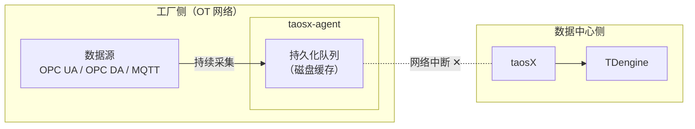
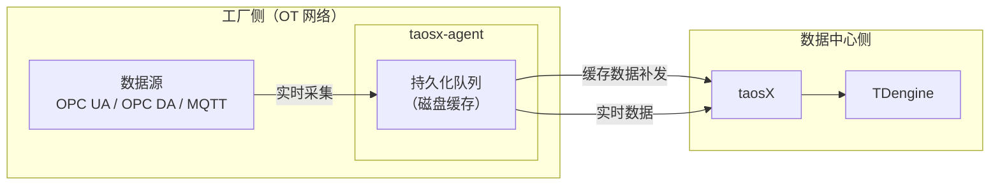
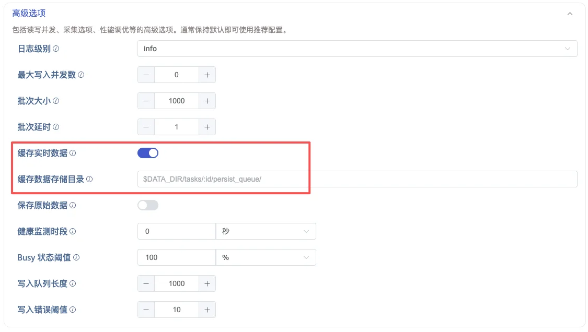

## 功能概述

在工业数据采集场景中，taosX-Agent 通常部署在工厂侧（OT 网络），通过 VPN 或专线与数据中心侧的 taosX 通信。当网络中断时（如 VPN 断开、周末停机等），如果没有缓存机制，中断期间的数据将会丢失。

**存储转发（Store and Forward）** 功能用于缓冲已经被 taosX-Agent 接管的数据：当 taosX-Agent 与 taosX 之间的网络中断时，在数据源适配和本地磁盘允许的条件下继续接收数据并写入磁盘；网络恢复后补发尚未确认的批次。它不能单独保证源端所有事件都已捕获，也不承诺断电或磁盘故障时数据零丢失。

**网络中断期间**：Agent 继续采集数据，写入本地磁盘缓存。

**网络恢复后**：缓存数据自动补发，实时数据同步恢复。

## 适用场景

| 场景           | 说明                                             |
| -------------- | ------------------------------------------------ |
| VPN 网络不稳定 | 工厂与数据中心之间的 VPN 可能周期性中断          |
| 计划性停机     | 周末或维护期间数据中心网络下线，工厂仍需持续采集 |
| 网络质量差     | 远程站点带宽有限，偶发断连                       |

:::note
存储转发功能目前支持 **OPC UA**、**OPC DA** 和 **MQTT** 数据源类型的实时采集任务。统一交付协议 v2 不会自动增加 PI 原始消息持久化、模型恢复或 C# 适配；这些仍需独立实现和验收。
:::

## 启用方式

存储转发通过数据接入任务的高级选项启用，而非 Agent 本身的配置。

在 taosExplorer 中创建或编辑 OPC UA / OPC DA / MQTT 数据接入任务时，在 **高级选项** 中配置以下参数：

| 参数             | DSN 参数名            | 默认值                               | 说明                                   |
| ---------------- | --------------------- | ------------------------------------ | -------------------------------------- |
| 缓存实时数据     | `persist_data_enable` | `false`                              | 是否启用磁盘级别的数据缓存（存储转发） |
| 缓存数据存储目录 | `persist_data_dir`    | `$DATA_DIR/tasks/:id/persist_queue/` | 缓存数据的存储目录                     |

将 **缓存实时数据** 开关打开即可启用存储转发功能。

## 工作原理

启用存储转发后，Agent 内部会创建一个 **persist_queue**（持久化队列），数据流分为写入和读取两条路径：

### 写入路径（数据源 → 本地磁盘）

1. 连接器（如 taosx-opc）从数据源采集数据，通过 IPC 管道传给 Agent。
2. Agent 将数据序列化后写入 persist_queue 的磁盘文件。
3. 完整批次 append 到队列文件后，按该 IPC 路径向连接器回复接管 ACK。队列使用批量写入、flush 和周期同步，此确认不代表目标入库或逐条 fsync，不承诺突然掉电时数据可恢复。

### 读取路径（本地磁盘 → taosX）

1. persist_queue 的 reader 从磁盘文件中读取数据。
2. 数据通过 Arrow Flight RPC 发送给 taosX。
3. taosX 完成目标写入后返回批次结果；明确异常数据按配置提交归档且其余正常数据写入完成时，返回独立的按策略处理结果。
4. taosX-Agent 校验结果，只更新连续已完成批次的断点位置（breakpoint），不能越过失败或尚未完成的批次。

### 断点恢复机制

persist_queue 使用 breakpoint 数据库记录连续确认的读取位置。网络恢复或 taosX-Agent 重启后，从该位置继续读取未提交数据。目标已完成写入但确认丢失时可能重放，因此交付语义为至少一次，可能出现重复，不承诺 exactly-once。进程重启恢复依赖于数据源适配支持及队列文件可用。

### 确认与失败处理

本节描述采用统一交付协议 v2 的转发路径。接收或进入内存队列不等于完成目标写入；心跳不能代替批次进展。

| 情况 | 处理 |
| --- | --- |
| 正常写入完成 | 返回完成结果，允许推进连续进度 |
| 输入正常结束 | 完成剩余队列写入、交付确认和检查点提交后结束；正常 EOF 本身不作为故障 |
| 明确的数据错误，且任务配置归档策略 | 提交现有归档并完成剩余正常写入后继续；不计为正常写入成功 |
| 归档队列满、消费者退出或异步文件写入失败 | 异常日志可丢弃，不等待归档文件写完，不重新阻塞数据交付 |
| 断流、暂时不可用或交付超时 | 保留未确认批次，退避重连并重放 |
| 认证、配置、协议、依赖操作或未知写入错误 | 报错并停止任务，不推进失败批次；修复原因后再恢复 |

归档只尽力留证，不保证保存所有错误数据，也不承诺可用归档文件自动补写。任务 Activity 和日志记录失败、重试及恢复，Agent 在线不能证明数据已入库。窗口和超时见 [配置参考](./01-configuration.md#交付窗口与超时)。

### 网络中断时的行为

当 Agent 与 taosX 之间的网络中断时：

1. **缓冲采集数据**：在适配器支持、本地磁盘及缓冲容量允许时，连接器继续接收数据并写入本地 persist_queue；源端未被捕获的事件不属于队列保障范围。
2. **保留交付进度**：未确认批次不推进消费位置；达到在途窗口上限后，读取侧等待已有交付完成。
3. **网络恢复后自动补发**：Agent 重新连接到 taosX 后，从断点位置继续读取 persist_queue 中缓存的数据并发送。

## 启用前后行为对比

| 行为                 | 未启用（默认）                 | 已启用                                 |
| -------------------- | ------------------------------ | -------------------------------------- |
| 数据缓冲             | 仅内存缓冲（默认 64 批次）     | 磁盘持久化队列（容量仅受磁盘空间限制） |
| Agent ↔ taosX 断链时 | 同一进程保留未确认批次，窗口满后背压 | 适配与容量允许时持续写入磁盘，恢复后补发 |
| 重连策略             | 传输异常退避重试；明确写入错误停止 | 传输异常退避重试；明确写入错误停止 |
| 进程重启恢复         | 内存批次不能恢复 | 从连续提交的磁盘检查点恢复 |
| 交付进度             | 等目标批次终态，不以进入内存作为完成 | 磁盘消费位置等目标批次终态；接管 ACK 在 append 后返回 |
| 写入延迟             | 低（内存直传）                 | 略有增加（需经过磁盘写入和读取）       |

:::warning
启用缓存实时数据后，数据需要先写入本地磁盘、再从磁盘读取后才能上报给 taosX，这会增加从数据源到 TDengine 写入之间的端到端延迟。如果你的场景对写入延迟非常敏感且网络环境稳定，可以不开启此功能。
:::

## 磁盘空间注意事项

启用存储转发后，缓存数据会占用 Agent 所在主机的磁盘空间。请注意：

- **缓存容量仅受磁盘空间限制**：长时间网络中断时，缓存数据会持续增长。
- **建议预留充足的磁盘空间**：根据数据采集量和预期最长断链时长估算所需空间。例如，1000 个 OPC UA 点位、每秒更新一次，每天约产生数百 MB 到数 GB 的缓存数据（具体取决于数据类型和大小）。
- **数据补发完成后**：已确认发送成功的缓存文件会被自动清理。

:::tip
可通过配置 **缓存数据存储目录** 将缓存目录指向一个有充足空间的磁盘分区。
:::
