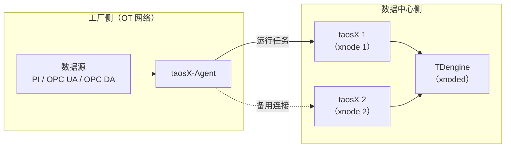

## 功能概述

一个 taosX-Agent 可以同时连接多个 taosX。集群中每个 taosX 实例注册为一个 xnode，通过该 Agent 采集的任务由 xnoded 调度到其中一个 taosX 上运行。某个 taosX 停机后，任务会改派到同一 Agent 连接的另一个 taosX 上继续采集，无需修改任务配置。



## 典型部署

- 部署至少两个 taosX，并分别通过 `CREATE XNODE` 注册到同一个 TDengine 集群。参阅 [数据接入（Xnode）](../../../05-tdengine-sql/08-cluster-management/02-xnode.md)。
- 在数据源所在网络部署一个 taosX-Agent，`endpoint` 填写全部 taosX 的地址。
- 创建采集任务时选择该 Agent（taosExplorer 中从 **代理** 下拉框选择，或在 SQL 中使用 `VIA` 指定 Agent ID）。

:::warning
部署两个 Agent、各自连接一个 taosX，不能实现高可用。采集任务绑定的是单个 Agent，不会改派给另一个 Agent。
:::

## 配置

### 先注册 xnode，再创建 Agent

在 taosExplorer 中创建 Agent 时，系统会读取当前已注册的全部 xnode，将其地址以英文逗号分隔，生成 `endpoint`。因此建议先注册全部 taosX，再创建 Agent。

Agent 创建之后新注册的 xnode，不会自动加入已有 Agent 的配置。需要手工将新地址追加到 `agent.toml` 的 `endpoint` 中，并重启 taosX-Agent。

### 配置示例

```toml
# 多个 taosX 的 gRPC 服务地址，以英文逗号分隔
endpoint = "http://taosx-1:6055,http://taosx-2:6055"

# 在 taosExplorer 中创建 Agent 时生成的 Token
token = "<your_token>"
```

:::note

- 生成的地址来自 `CREATE XNODE` 时填写的 URL。若注册时使用了 `localhost` 等仅本机可访问的地址，需改为 taosX-Agent 主机可以访问的地址。
- 已注册但当前离线的 xnode 地址同样会出现在生成的 `endpoint` 中。
- taosX-Agent 需要能够访问每一个 taosX 的 gRPC 服务端口（默认 6055）。

:::

## 故障切换过程

1. xnoded 发现某个 taosX 离线，持续约 30 秒后开始改派该 taosX 上的任务。
2. 对每个通过 Agent 采集的任务，xnoded 在该 Agent 当前连接的其他 taosX 中，选择可用内存最多的一个启动任务。
3. taosX-Agent 先停止原连接上的采集，确认其已退出后，再在新连接上启动。无法确认原采集已退出时，本次启动失败，不会同时运行两份。
4. 原 taosX 恢复后发来的过期启动、停止、取消命令以及迟到的任务状态会被忽略，任务继续留在新的 taosX 上运行。

只有运行中的任务会被改派。已停止或正在停止的任务不会改派。

## 适用范围与限制

| 场景 | 结果 |
| --- | --- |
| 一个 taosX 停机，Agent 仍连接其他 taosX | 任务改派到其他 taosX，继续采集 |
| taosX-Agent 停机，或与全部 taosX 断开 | 采集中断，任务不会改派给其他 Agent |
| 部署多个 Agent，每个 Agent 只连接一个 taosX | 不构成高可用，任务只在所绑定的 Agent 上运行 |

使用时请注意：

- 故障切换期间不保证数据不丢失，也不保证数据只写入一次。Agent 与 taosX 之间网络中断时的本地缓存与补发，请参阅 [存储转发](./02-store-and-forward.md)。
- 「先确认原采集退出、再启动」需要升级 taosX-Agent 后才能生效。与旧版本组件混合部署时，正常的启动和停止仍然可用，但不能严格拦截过期命令的重放。
