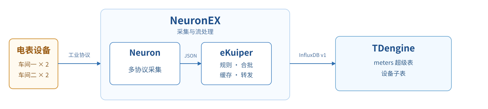
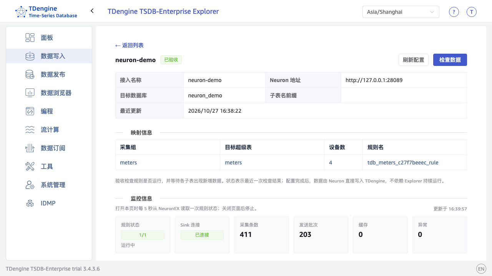
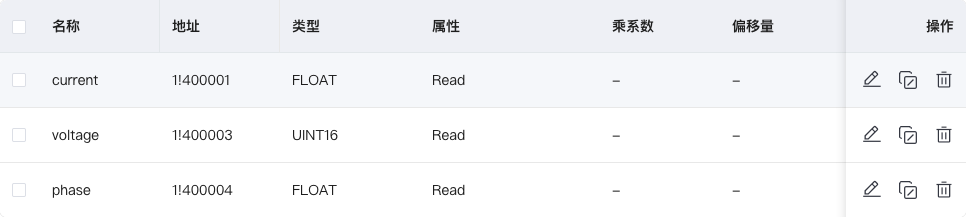
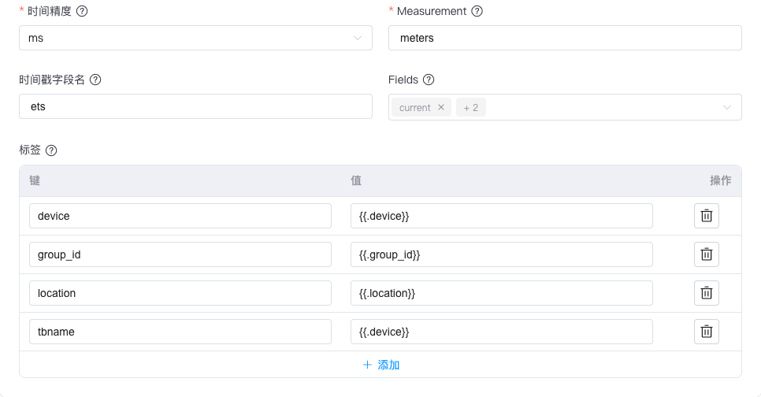
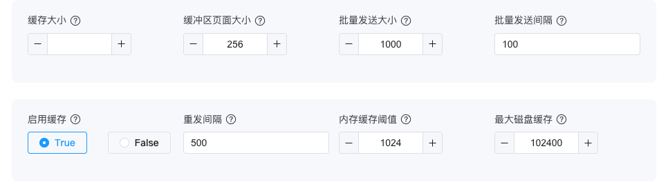
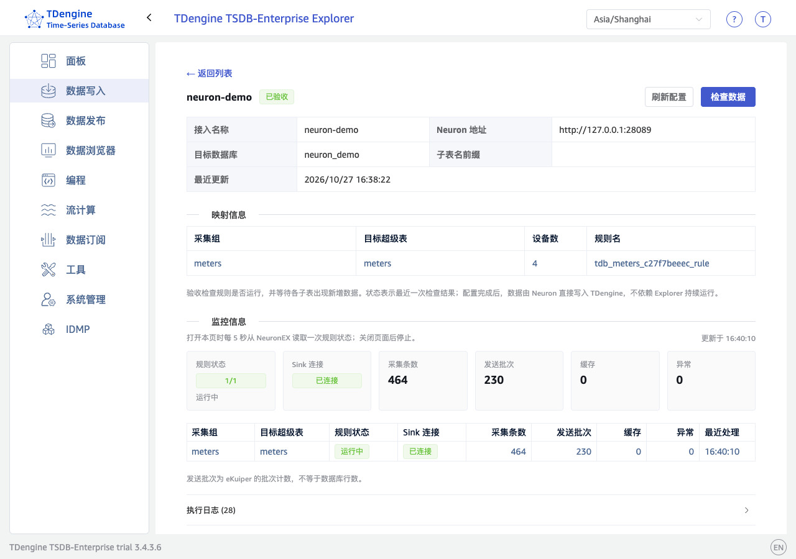

import NeuronPrerequisites from './resource/_neuron-prerequisites.mdx'
import NeuronMapping from './resource/_neuron-mapping.mdx'
import NeuronOneClick from './resource/_neuron-one-click.mdx'

[Neuron](https://github.com/emqx/neuron) 是 EMQ 开发的工业物联网连接平台，支持 Modbus、OPC UA、BACnet 等多种工业协议。[eKuiper](https://github.com/lf-edge/ekuiper) 是开源的轻量级边缘流处理引擎，使用 SQL 处理数据，并通过输出动作（sink）转发。[NeuronEX](https://docs.emqx.com/zh/neuronex/latest/) 是 EMQ 的工业边缘数据采集与处理软件，集成 Neuron 的协议采集和 eKuiper 的流处理能力，提供统一的 Web 界面配置设备采集、数据处理及转发。

本文介绍三种将 Neuron 采集数据写入 TDengine 的方式：

- **安装时接入**：适用于尚未安装 NeuronEX 企业版的环境。执行安装命令时，自动完成 NeuronEX 安装、授权校验（显式提供 License 时导入）、注册到 taosExplorer、创建 `neuron` 业务数据库、`neuron_demo` 示例数据库和四个示例设备，并配置写入链路，安装后无需在 taosExplorer 页面操作。
- **一键接入**：适用于已部署 Neuron 或 NeuronEX 的环境。在 taosExplorer 的「数据写入 → 数据采集代理 → Neuron」页面填写 Neuron 地址和凭据，taosExplorer 自动完成数据流、处理规则和采集订阅的配置。
- **手工接入**：适用于已部署 Neuron 或 NeuronEX、需要自定义标签、业务属性或数据转换的场景。在 NeuronEX 页面手工配置数据流、处理规则和 InfluxDB v1 写入动作。

| 方式 | Neuron 是否需预装 | 适用场景 | taosExplorer 操作 | License 激活 |
| --- | --- | --- | --- | --- |
| 安装时接入 | 不需要 | 尚未安装 NeuronEX 企业版 | 不需要 | 显式提供时自动导入并校验 |
| 一键接入 | 需要 | 已部署 Neuron 或 NeuronEX | 需要向导 | 用户自行激活 |
| 手工接入 | 需要 | 已部署，需要自定义标签或转换 | 需要手工配置 | 用户自行激活 |

三种方式的数据面完全相同：Neuron 将采集报告发给 eKuiper，eKuiper 提取测量列和标签，编码为 Influx 行协议并批量写入 TDengine，通过无模式写入自动创建超级表和子表。该方式可接入 Neuron 支持的工业协议：按协议族计为 70 多种，按 PLC 子系列等细分驱动计为 100 多种，可核对的名称见[驱动明细](#驱动明细)。购买 TDengine 企业版后，EMQX Neuron 的软件许可证可由涛思数据代为采购；安装时接入通过环境文件中的 `NEURONEX_LICENSE_FILE` 显式指定 License，自动导入并校验授权。

<figure style={{width: 'fit-content', margin: '0 auto'}}>

<br/>
*Neuron 与 TDengine 集成架构*

</figure>

如上图所示，Neuron 将设备数据转为 JSON 采集报告，eKuiper 提取测量列和标签，编码为 Influx 行协议并批量写入 TDengine，通过无模式写入自动创建超级表和子表。需要双向 TLS 认证（mTLS）或高可用部署时，按后文[加密传输与高可用](#加密传输与高可用可选)配置。

<NeuronPrerequisites />

## 安装时接入

本节通过 Apex 的 `tsdb-edge` 独立包 `neuronex` 安装 NeuronEX，并在配置完整连接信息后完成示例接入。中心侧的 TDengine、taosAdapter 和支持 Neuron 接入的 taosExplorer 必须可用；NeuronEX 集成目标支持 Linux x64 和 arm64，目标机需要 Bash、`curl`、`jq` 和 `flock`。

:::note

以下流程对应当前 Apex 分支实现。公网 `tsdb-edge/stable` 已解析到 `v3.4.3.10`，对应组件清单可下载，最低要求 Apex `v0.3.87`；需同时准备匹配的 `scripts/apex-neuronex.sh` 和 `tdengine-tsdb-edge-enterprise-<version>.yaml`，并将清单预置到 `<apex_home>/manifests/`。内网 `release.tdengine.net` 虽已有该 profile 的目录，但审查时对应清单和 NeuronEX 制品 URL 返回 404；使用内网源前应确认两个制品均可下载，或改用公网可用版本。Apex 发布包不内置组件清单，不能仅执行 `latest` 安装脚本就认为这些条件已满足。

:::

### 同机安装

#### 准备中心服务

如果尚未部署中心服务，可先执行以下命令安装 Apex 并部署 All-in-One：

```bash
curl -fsSL https://downloads.taosdata.com/apex/latest/install.sh | sudo bash -s -- -m apex
```

其中 `-m apex` 表示主机部署模式，默认 profile 为 `All-in-One`，**不是 NeuronEX 安装命令**。如果只需要 TSDB 服务栈，可在安装器一侧指定 profile：

```bash
curl -fsSL https://downloads.taosdata.com/apex/latest/install.sh | sudo env APEX_DEPLOY_PROFILE=TSDB-Enterprise bash -s -- -m apex
```

已有可用中心服务时跳过这一步。随后确认所使用的 Apex 版本、脚本和 Edge 清单满足上述要求；安装器当前不支持通过 `APEX_DEPLOY_PROFILE=tsdb-edge` 选择 NeuronEX。

#### 配置 NeuronEX 部署

将以下内容保存为 `deployment-neuronex.yaml`。也可使用匹配 Apex 包中的 `manifests/deployment-tsdb-edge-only.yaml` 模板；arm64 主机将 `platform` 改为 `linux-arm64`。

```yaml
apiVersion: tdengine.taosdata.com/v1
kind: Deployment
metadata:
  name: NeuronEX demo
spec:
  release:
    profile: tsdb-edge
    channel: stable
  nodes:
    - name: node1
      transport: local
      host: localhost
      platform: linux-x64
      roles:
        - id: node1-tsdb-edge
          component: tsdb-edge
          version: auto
          packages: [neuronex]
          envFile: tsdb-edge.env
```

在运行 Apex 的控制端创建 `<apex_home>/conf/tsdb-edge.env`，设置仅所有者可读写的权限（`0600`）。默认以 root 运行且未覆盖配置时，`apex_home` 为 `/root/.apex`；使用自定义 Apex home 时应采用其实际路径。将下面占位符替换为真实 TDengine 凭据，不要将此文件提交到版本库：

```dotenv
NEURONEX_EXPLORER_URL=http://localhost:6060
NEURONEX_ADAPTER_URL=http://localhost:6041
NEURONEX_ENDPOINT=http://localhost:8085
NEURONEX_TSDB_USER=<tsdb-user>
NEURONEX_TSDB_PASSWORD=<tsdb-password>
```

这五项均为必填。随包的 `conf/tsdb-edge.env` 提供 localhost 示例和 `root` / `taosdata` 初始凭据，使用前必须核对实际服务和密码。URL 必须是 HTTP(S) 基础地址，不能包含用户名、密码、查询参数或片段。完全不提供相关集成变量时仅安装软件；只填写部分变量会在部署前报错。

| 配置项 | 说明 |
| --- | --- |
| `NEURONEX_EXPLORER_URL` | NeuronEX 所在主机可访问的 taosExplorer 地址 |
| `NEURONEX_ADAPTER_URL` | NeuronEX 所在主机可访问的 taosAdapter 地址 |
| `NEURONEX_ENDPOINT` | taosExplorer 可回连的 NeuronEX 地址，默认端口 `8085` |
| `NEURONEX_TSDB_USER`、`NEURONEX_TSDB_PASSWORD` | TDengine 当前凭据；需要查询系统信息、创建数据库和访问目标数据库的权限 |
| `NEURONEX_ADMIN_PASSWORD`（可选） | 接管既有 NeuronEX 时的当前管理员密码，不是自动重置密码选项 |
| `NEURONEX_LICENSE_FILE`（可选） | 相对于控制端 `<apex_home>/conf/` 的 License 文件路径，例如 `neuronex.lic` |

配置的 TDengine 用户需为已启用的超级用户，或具有 `createdb=1`、`sysinfo=1` 的已启用用户。所有已存在的目标库（`neuron` 和 `neuron_demo`）都必须归该用户所有，包括使用超级用户时；Apex 不会自动创建用户或授予权限。

#### 执行部署

在配置好上述 Apex home 的同一执行身份下运行：

```bash
sudo apex deploy -f deployment-neuronex.yaml --yes
```

如果已有包含 `tsdb-edge` 角色的部署上下文，也可显式指定该文件安装独立包：

```bash
apex validate -f deployment-neuronex.yaml
sudo apex package install neuronex -f deployment-neuronex-resolved.yaml
```

`apex validate` 会解析 `version: auto`；将其输出的已解析 YAML 保存为 `deployment-neuronex-resolved.yaml`，并将该文件传给 `-f`。通过 SSH transport 部署时，远端 NeuronEX 生命周期命令以 SSH 登录账户执行，该账户必须具有 root 权限；控制端的 `sudo` 不会提升远端权限。

成功部署后可省略 `-f`，通过保存的 Default Deployment 执行 `sudo apex package install neuronex`。仅包含 TSDB 角色的默认部署不会自动变为 Edge 部署。

集成动作在软件安装、启动和健康检查通过后执行：

- 首次安装建立管理员身份，将密码保存到目标机 `/var/lib/apex/neuronex-admin-password`；重试时复用已确认的身份，不自动重置既有密码。
- 校验已安装授权；显式提供 License 时导入并重新验证。未提供 License 时可使用满足要求的内置 30 标签免费授权，示例占用 12 个标签，免费数据处理约限 60 分钟。显式 License 无效、过期或权限、容量不足会使集成失败，不会静默回退免费授权。授权范围、有效期和硬件绑定以 NeuronEX 的 **Administration → License** 页面为准。
- 创建或复用兼容的空业务库 `neuron` 和示例库 `neuron_demo`；库名固定，不会修改已有库的保留策略或精度。已有对象冲突时保留现场并报错。
- 使用一个内置 Modbus 模拟器准备四个逻辑设备 `demo_meter01` 至 `demo_meter04`，采集组均为 `meters`，每秒采集 `current`、`voltage`、`phase` 三个点位。
- 在 taosExplorer 中创建或恢复名为 `NeuronEX demo` 的接入，**仅注册到 `neuron_demo`**；由 taosExplorer 管理规则和订阅。
- 验证接入就绪，并通过至少两次观测确认四张表均有新鲜数据；各表的行数和最新时间戳都不能回退，且至少一项有所增长。仅软件健康或本地采集有数据不代表完整接入成功。

检查结果中的 `integration: succeeded` 和 `integrationStage: complete`，以及 `integrationId`、`database`、`tables` 和 `evidence`。目标机 `/var/lib/apex/neuronex-integration.json` 保存安全的集成证据。集成失败会返回非零退出码，但保留已安装软件和已有资源；解决问题后重新执行原命令恢复，不要为重试删除数据库或身份文件。免费示例成功不代表生产授权或持续运行验收。

在 NeuronEX 所在主机查看管理员密码：

```bash
sudo cat /var/lib/apex/neuronex-admin-password
```

### 跨机安装

代码允许中心服务与 NeuronEX 分机部署。在 NeuronEX 主机执行上述部署时，将环境文件中的地址改为双方可达的实际地址，例如：

```dotenv
NEURONEX_EXPLORER_URL=https://tsdb.example.com:6060
NEURONEX_ADAPTER_URL=https://tsdb.example.com:6041
NEURONEX_ENDPOINT=https://edge.example.com:8085
```

其余必填凭据仍需保留。跨机配置应为 taosExplorer、taosAdapter 和 NeuronEX 使用 HTTPS 地址，因为请求会发送 TDengine Basic Auth 凭据；HTTP 仅适用于可信的隔离测试网络。NeuronEX 主机必须能够访问中心服务，taosExplorer 也必须能够回连 `NEURONEX_ENDPOINT`；跨机地址不能使用指向各自本机的 `localhost`。如果通过 Apex 的 SSH transport 部署到远端，`envFile` 和 License 文件仍从控制端 `<apex_home>/conf/` 读取，不是远端同名目录。当前实机验收覆盖同机 Linux x64；分机拓扑需要在实际网络中另行验证，不能将配置能力等同于已通过分机验收。

### 在 taosExplorer 查看对接结果

接入成功后，登录所配置的 taosExplorer，进入「数据写入 → 数据采集代理 → Neuron」，查看 `NeuronEX demo` 接入记录，无需另建接入。在 `neuron_demo` 中查看 `meters` 超级表和 `demo_meter01` 至 `demo_meter04` 四个子表，其 `location` 分别为 `Factory01.Workshop01`、`Factory01.Workshop02`、`Factory02.Workshop01` 和 `Factory02.Workshop02`。

后续添加的真实设备可能被该接入发现并写入 `neuron_demo`，**不会自动隔离到 `neuron`**；`neuron` 初始为空。生产使用前，应单独规划目标数据库和接入。设备命名与分组参考 [数据映射与采集配置规范](#附录数据映射与采集配置规范)。已有设备新增采集组或点位后，在 taosExplorer 点击「刷新配置」；不要手工修改其管理的 eKuiper 规则，刷新会覆盖这些修改。

taosExplorer 默认每 5 分钟轮询设备列表，自动发现仅针对含已配置点位的新增设备名；已有设备新增采集组或点位仍需手动刷新。可通过 taosExplorer 环境变量 `NEURON_POLL_INTERVAL_SECS` 调整轮询间隔（默认 `300` 秒），设为 `0` 关闭。

<figure style={{width: 'fit-content', margin: '0 auto'}}>

<br/>
*taosExplorer 中自动创建的 NeuronEX 接入*

</figure>

入库验证方法见后文[验证结果](#验证结果)。

<NeuronOneClick />

## 手工接入

:::note

本节适用于已部署 Neuron 或 NeuronEX、需要自定义标签、业务属性或数据转换的场景。全新安装 NeuronEX 时，推荐使用前文的「安装时接入」。

:::

本节以四台 Modbus TCP 智能电表为例，演示在 NeuronEX 页面手工完成接入的完整过程，供需要自定义标签、业务属性或数据转换的用户参考。**电表只是示例，你的设备不是电表也能照做**：只需把第 3 步换成你自己设备的采集配置（选择对应的协议插件、创建采集组、添加点位），其余步骤（创建数据库、数据流、处理规则、写入动作）与设备类型无关，操作完全相同。

### 示例数据模型

通用的对象映射、命名分组和类型映射见[数据映射与采集配置规范](#附录数据映射与采集配置规范)；本节示例只展示一种具体配置。

示例在同一工厂的两个车间各部署两台电表，每秒采集电流、电压和相位。四台设备共用 `meters` 超级表，各写一个子表，采集组均命名为 `electrical_readings`。

| 设备名、子表名及 `device` 标签 | `group_id` | `location` |
| --- | --- | --- |
| `workshop01_meter01` | `1` | `Factory01.Workshop01` |
| `workshop01_meter02` | `1` | `Factory01.Workshop01` |
| `workshop02_meter01` | `2` | `Factory01.Workshop02` |
| `workshop02_meter02` | `2` | `Factory01.Workshop02` |

TDengine 将 `Factory01.Workshop01` 保存为完整的 `location` 标签值；后续 IDMP 可按点号展开为 `Factory01 → Workshop01`。

业务字段参考 [meters 建模示例](../../04-quick-start/03-data-modeling.md)。首次[无模式写入](../../10-developer-guide/04-schemaless.md)自动建表，类型如下：

| 类别 | 字段 | 自动生成类型 |
| --- | --- | --- |
| 时间列 | `_ts` | `TIMESTAMP` |
| 测量列 | `current`、`phase` | `DOUBLE` |
| 测量列 | `voltage` | `BIGINT` |
| 标签 | `location`、`group_id`、`device` | `NCHAR` |

实际字段类型由 Influx 行协议编码决定，与标准 meters 建模示例不完全相同；标签值仅含 ASCII 字符时，自动生成的类型仍为 `NCHAR`。

### 示例中的数据对应关系

在 NeuronEX 中，先添加电表设备并配置连接信息，再创建采集组、设置采集周期，最后添加电流、电压和相位等点位，为各点位指定寄存器地址和数据类型。采集数据与 TDengine 的对应关系如下：

| Neuron 数据 | TDengine 对象 | 配置方式 |
| --- | --- | --- |
| 设备名 `node_name` | 子表名及 `device` TAG | 规则输出 `device`；sink 将其同时映射到 `tbname` 和 `device` 标签 |
| 采集组名 `group_name` | 用于筛选进入规则的报告 | SQL 筛选 `electrical_readings` 采集组；超级表名由 sink 的 `measurement` 独立指定 |
| 点位 `values.current`、`values.voltage`、`values.phase` | 测量列 `current`、`voltage`、`phase` | SQL 提取点位，sink 的 `fields` 指定写入列 |
| 报告时间戳 `timestamp` | 时间列 `_ts` | SQL 输出 `ets`，sink 设置 `tsFieldName=ets`、`precision=ms` |
| 位置及业务分组 | TAG `location`、`group_id` | SQL 根据设备名设置属性，sink 的 `tags` 指定标签 |

本例中，每台电表的一次完整采集报告写入其同名子表的一行，电流、电压和相位分别对应三个测量列。

Neuron Tag 是采集点位，对应测量列；TDengine TAG 是子表属性。`group_id` 是业务分组编号，与采集组名分开配置。`group_name` 也可映射为 TAG，但同一子表的组名应固定。

### 配置步骤

#### 1. 创建数据库

在 TDengine SQL 客户端执行以下语句，无需手工创建超级表或子表：

```sql
CREATE DATABASE IF NOT EXISTS neuron_meters_demo
  PRECISION 'ms';
```

#### 2. 检查直连接口

在 NeuronEX 所在主机或容器内执行以下命令，将 `adapter-host` 替换为实际 taosAdapter 主机名或 IP：

```bash
curl -i http://adapter-host:6041/influxdb/v1/ping
```

返回 `204 No Content` 表示接口可访问。InfluxDB v1 客户端启动时会调用该接口；若返回 `404`，检查路径及 TDengine 版本（3.4.3.6 及以上）。NeuronEX 可直接连接 taosAdapter，无需部署 nginx。如需加密传输或 taosAdapter 故障切换，参照[加密传输与高可用](#加密传输与高可用可选)一节配置 nginx。

#### 3. 配置 Modbus 采集

1. 进入「数据采集 → 南向设备」，按示例名称添加四台「Modbus TCP」设备，填写连接参数。

   | 配置项 | 设置 | 说明 |
   | --- | --- | --- |
   | 连接模式 | 客户端 | 主动连接电表 |
   | IP、端口 | 实际电表 IP、端口，通常为 `502` | 确定读取的设备 |
   | 连接超时 | `3000ms` | 限制无响应请求的等待时间 |
   | 指令发送间隔 | `20ms` | 同一连接相邻请求的间隔，与采集周期不同 |
   | 32 位字节序 | 按设备手册设置，例如 `ABCD` | 正确解码浮点数 |

2. 在每台设备下创建 `electrical_readings` 采集组，周期设置为 `1000ms`，添加以下三个读点。

   | 点位名称 | 类型 | 示例地址 | 占用寄存器 |
   | --- | --- | --- | --- |
   | `current` | `FLOAT` | `1!400001` | 400001、400002 |
   | `voltage` | `UINT16` | `1!400003` | 400003 |
   | `phase` | `FLOAT` | `1!400004` | 400004、400005 |

   地址按设备寄存器表填写。`1!` 表示站号 1；`FLOAT` 占两个寄存器，点位地址不可重叠。不同设备节点可使用相同的寄存器地址。

   

3. 保存并启动设备，确认均为运行中、已连接。在「数据采集 → 数据监控」逐一选择设备及其采集组，检查三个点位数值正确并持续更新。
4. 进入「数据采集 → 北向应用」，为内置 `DataProcessing` 应用订阅四台设备的 `electrical_readings` 组，将报告送入 eKuiper。仅创建设备和规则不会自动建立此订阅。

#### 4. 创建数据流

数据流定义采集报告的字段结构，后续规则从中读取数据。

1. 进入「数据处理 → 源管理 → 创建」，填写以下配置。

   | 配置项 | 设置 |
   | --- | --- |
   | 名称 | `meters_stream` |
   | 源类型 | `Neuron` |
   | 配置组 | `default` |
   | 数据格式 | `JSON` |
   | 带结构 | 开启 |
   | 共享数据源 | 开启 |

2. 添加下表中的字段。将 `values` 设置为 `STRUCT`，并在其下添加三个测量子字段。

   | 字段 | 类型 | 用途 |
   | --- | --- | --- |
   | `timestamp` | `BIGINT` | 报告时间戳，单位 ms |
   | `node_name` | `STRING` | 设备名 |
   | `group_name` | `STRING` | 采集组名 |
   | `values` | `STRUCT` | 测量值集合 |
   | `values.current` | `FLOAT` | 电流 |
   | `values.voltage` | `BIGINT` | 整数电压 |
   | `values.phase` | `FLOAT` | 相位 |

3. 保存数据流，确认结构包含全部待写入点位。

带结构定义可保留电压的整数类型，避免无结构 JSON 数值按浮点数处理。流中的 `BIGINT` 是 eKuiper 整数类型，与 Modbus 寄存器位宽无关。开启「共享数据源」后，多条规则可复用同一数据源。

#### 5. 创建数据处理规则

1. 进入「数据处理 → 规则 → 新建规则」，规则 ID 填写 `meters_to_tdengine`。
2. 在 SQL 编辑区域输入以下语句。

   ```sql
   SELECT
     values.current AS current,
     values.voltage AS voltage,
     values.phase AS phase,
     timestamp AS ets,
     node_name AS device,
     CASE
       WHEN node_name IN ("workshop01_meter01", "workshop01_meter02") THEN "1"
       ELSE "2"
     END AS group_id,
     CASE
       WHEN node_name IN ("workshop01_meter01", "workshop01_meter02") THEN "Factory01.Workshop01"
       ELSE "Factory01.Workshop02"
     END AS location
   FROM meters_stream
   WHERE group_name = "electrical_readings"
     AND node_name IN ("workshop01_meter01", "workshop01_meter02", "workshop02_meter01", "workshop02_meter02")
   ```

   该 SQL 筛选四台电表的 `electrical_readings` 采集组报告，提取电流、电压和相位，保留原始时间戳和设备名，并按设备名设置位置与业务组编号。设备名用于指定子表名，位置与业务组编号写入 TAG。

3. 点击「添加动作」，选择「InfluxDB v1」，按下一步配置写入动作。

四台设备共用一条规则。新增或替换同类设备时，更新北向应用订阅、SQL 中的设备范围及位置和业务组编号映射，无需逐台创建规则。

若采集报告包含位置和业务组编号等元数据，可在数据流中声明这些字段，再由 SQL 直接取值作为 TAG，减少按设备名逐一配置映射。本例通过 `CASE` 表达式设置这些属性。

#### 6. 配置 InfluxDB v1 动作

以下 JSON 为 InfluxDB v1 动作的完整配置示例，与后续页面配置步骤对应。使用时替换地址、用户名和密码。

```json
{
  "addr": "http://adapter-host:6041/influxdb/v1?table_name_key=tbname",
  "username": "<tdengine_username>",
  "password": "<tdengine_password>",
  "database": "neuron_meters_demo",
  "measurement": "meters",
  "precision": "ms",
  "tsFieldName": "ets",
  "fields": [
    "current",
    "voltage",
    "phase"
  ],
  "tags": {
    "tbname": "{{.device}}",
    "device": "{{.device}}",
    "group_id": "{{.group_id}}",
    "location": "{{.location}}"
  },
  "sendSingle": true,
  "batchSize": 1000,
  "lingerInterval": 100,
  "enableCache": true,
  "memoryCacheThreshold": 1024,
  "bufferPageSize": 256,
  "maxDiskCache": 102400,
  "resendInterval": 500
}
```

1. 在「连接信息」中填写以下参数。将地址和账号替换为实际值。

   | 配置项 | 设置 |
   | --- | --- |
   | 地址（`addr`） | `http://adapter-host:6041/influxdb/v1?table_name_key=tbname` |
   | 用户名（`username`） | TDengine 专用写入账号 |
   | 密码（`password`） | 上述账号的密码 |
   | 数据库（`database`） | `neuron_meters_demo` |

   地址保留 `/influxdb/v1` 路径；客户端自动追加 `/ping`、`/write` 并保留查询参数。用户名和密码使用独立字段。生产环境应使用专用写入账号，并限制配置文件、导出文件和管理 API 的访问权限。

2. 在「数据处理」中配置字段及标签映射。

   | 配置项 | 设置 |
   | --- | --- |
   | 时间精度（`precision`） | `ms` |
   | Measurement（`measurement`） | `meters` |
   | 时间戳字段名（`tsFieldName`） | `ets` |
   | Fields（`fields`） | `current`、`voltage`、`phase` |
   | 标签 `tbname` | `{{.device}}` |
   | 标签 `device` | `{{.device}}` |
   | 标签 `group_id` | `{{.group_id}}` |
   | 标签 `location` | `{{.location}}` |

   `table_name_key=tbname` 将 `tbname` 用于子表命名，不保存为 TAG；`device` 保留设备身份。`fields` 仅选择三个测量列，避免将 `ets` 等辅助字段作为测量列写入。

   

3. 展开「Sink 配置」，将「启用缓存」（`enableCache`）设为 `True`，并按下表设置批量发送及缓存参数。

   | 配置项 | 设置 | 作用 |
   | --- | --- | --- |
   | 批量发送大小（`batchSize`） | `1000` | 达到批大小时发送 |
   | 批量发送间隔（`lingerInterval`） | `100` | 未满批时的等待时间，单位 ms |
   | 启用缓存（`enableCache`） | `True` | 启用 sink 缓存 |
   | 内存缓存阈值（`memoryCacheThreshold`） | `1024` | 内存缓存消息阈值 |
   | 缓冲区页面大小（`bufferPageSize`） | `256` | 每磁盘页的消息数 |
   | 最大磁盘缓存（`maxDiskCache`） | `102400` | 磁盘缓存消息上限 |
   | 重发间隔（`resendInterval`） | `500` | 缓存重发间隔，单位 ms |

   达到 `batchSize` 或等待满 `lingerInterval` 即触发发送，以先满足者为准；低流量时不必凑满 1000 行。缓存消息可能是一批数据，不能直接换算为入库行数或离线时长。参数含义以对应 eKuiper 版本说明为准。

   

4. 提交动作，保存并启动规则。

:::note

NeuronEX 页面默认设置 `sendSingle=true`，用于逐行计算动态标签，不表示逐行发起 HTTP 请求；通过规则 JSON 配置时须保留此参数。数据仍按上述参数批量发送，不同设备写入各自子表。实际延迟还包括排队和网络调用。

:::

:::warning

同一子表、同一毫秒的数据会被覆盖。使用全局唯一子表名，并保留报告时间戳；位置等属性变化时，显式更新子表 TAG。

:::

## 验证结果

无论通过哪种方式接入，都以查询结果确认入库——规则运行状态和 ping 响应不能代替入库检查。以下 SQL 使用手工接入示例的库名和表名；安装时接入的用户把库名换成 `neuron_demo`、超级表名换成 `meters`；`neuron` 初始为空，真实设备使用实际配置的目标库；一键接入的用户把库名换成目标数据库、超级表名换成映射的超级表即可。

1. 在 TDengine SQL 客户端检查自动生成的结构和设备标签。

   ```sql
   DESCRIBE neuron_meters_demo.meters;

   SELECT
     DISTINCT TBNAME,
     device,
     group_id,
     location
   FROM neuron_meters_demo.meters;
   ```

   应有四个子表，字段类型和标签与示例数据模型一致。

2. 查询最新数据，与「数据采集 → 数据监控」比较。安装时接入使用 `demo_meter01` 至 `demo_meter04`，逐一替换为四个实际子表名检查设备；手工接入示例中的 `workshop01_meter01` 不适用于此处。

   ```sql
   SELECT
     _ts,
     current,
     voltage,
     phase
   FROM neuron_demo.demo_meter01
   ORDER BY _ts DESC
   LIMIT 5;
   ```

3. 间隔数秒至少执行两次以下查询，并同时检查每张表最新时间戳：四张表都应有新鲜数据，行数和最新时间戳均不回退，且至少一项增长。

   ```sql
   SELECT
     TBNAME,
     COUNT(*)
   FROM neuron_meters_demo.meters
   PARTITION BY TBNAME;
   ```

## 查看监控

在 taosExplorer 中查看规则运行指标，无需登录 NeuronEX。进入「数据写入 → 数据采集代理 → Neuron」，打开接入记录，在「监控信息」区域查看。页面打开时每 5 秒刷新一次，关闭页面后停止请求。

| 指标 | 正常状态或处理方式 |
| --- | --- |
| 规则状态 | 运行中；显示已停止时，检查 NeuronEX 是否重启、规则被手工停止，或试用版规则达到运行时限 |
| Sink 连接 | 已连接；断开时检查 NeuronEX 到 taosAdapter 的网络及 TDengine 服务 |
| 采集条数、发送批次 | 持续增加；发送批次是 eKuiper 的批次计数，不等于数据库行数 |
| 缓存 | 可短时波动，但应能回落；持续积压时参见[缓存与转发](#缓存与转发store-and-forward) |
| 异常、最近异常 | 正常时为 0；非 0 时查看最近异常，并检查数据转换、账号或网络 |

<figure style={{width: 'fit-content', margin: '0 auto'}}>

<br/>
*taosExplorer 中的 Neuron 监控信息*

</figure>

:::note

Sink 连接正常和规则运行中不能替代入库检查，仍应通过[验证结果](#验证结果)确认数据已写入 TDengine。如需查看各阶段明细，可在 NeuronEX 的「数据处理 → 规则」中点击「更多 → 数据统计」。

:::

## 在 IDMP 中展示数据（可选）

在 IDMP「管理后台 → 连接」中配置 TDengine TSDB 连接，通过连接条目的「更多 → 简单导入」，选择 `neuron_meters_demo.meters`。

将 `device` 标签设为路径，路径开始层级填 `0`，表达式填 `${device}`；`location` 标签设为路径，路径开始层级填 `1`，表达式填 `${location}`；`group_id` 作为静态属性导入。`location` 按点号展开为工厂与车间层级，`device`（即子表名）作为叶子电表元素。

导入后，在「元素浏览器」中可查看以下层级，选择电表可查看 `current`、`voltage`、`phase` 测量属性：

```text
Factory01
├── Workshop01
│   ├── workshop01_meter01
│   └── workshop01_meter02
└── Workshop02
    ├── workshop02_meter01
    └── workshop02_meter02
```

详细导入步骤参见 [从 TDengine TSDB 构建数据模型](https://idmpdocs.taosdata.com/data-ingestion/building-data-models-from-tsdb/)。本例写入不携带单位信息，如需补充单位或配置换算，参见 [计量单位](https://idmpdocs.taosdata.com/libraries/uom/)。

## 缓存与转发（Store and Forward）

本方案由 eKuiper 的 InfluxDB v1 sink 提供缓存与转发。下游暂时不可用时，在容量允许且错误可重试的前提下缓存数据；连接恢复后，保留原有的子表名和报告时间戳重新发送。安装时接入和一键接入创建的规则已启用缓存（按 1000 行或 100 ms 合批），无需额外配置。

使用此功能须满足以下要求：

- eKuiper 须包含 Influx v1 错误重试修复 [PR #4201](https://github.com/lf-edge/ekuiper/pull/4201)，否则可能无法重发。部署前，向 EMQX 提供所用 NeuronEX 及内置 eKuiper 版本，确认已包含该修复。
- 手工接入时，在「数据处理 → 规则」中编辑对应规则的「InfluxDB v1」动作，展开「Sink 配置」，将「启用缓存」（`enableCache`）设为 `True`，并配置缓存容量和重发间隔。参数表及截图见[配置 InfluxDB v1 动作](#6-配置-influxdb-v1-动作)。部署时持久挂载 eKuiper 数据目录。
- 监控磁盘空间、缓存长度和异常。持续积压时，调整采集周期、批量发送参数或采集组分配。

含该修复的构建已通过断链恢复验证，测试数据全部回补。账号、权限或模式错误也可能持续重试并阻塞后续数据，须人工修正；数据转换或构造 Influx 数据点时发生的错误，不一定触发重试。

:::warning

进程崩溃或整机故障可能丢失内存及在途数据；缓存耗尽时也可能丢数据。

:::

参数说明见 [eKuiper sink 缓存与发送机制](https://ekuiper.org/docs/zh/latest/guide/sinks/overview.html)。

## 加密传输与高可用（可选）

需要 mTLS 或 taosAdapter 故障切换时，按 [taosAdapter 高可用](../../12-operations-and-tooling/03-components/03-taosadapter/04-high-availability.md) 部署 Nginx/HAProxy，并把 Neuron 的 sink 地址改为负载均衡地址。基础 HTTP 直连接入无需此配置；一键接入的用户把向导中的「TDengine 地址」填为负载均衡地址即可。

### Neuron 侧配置

Neuron 写入使用 InfluxDB v1 路径。按 [taosAdapter 高可用](../../12-operations-and-tooling/03-components/03-taosadapter/04-high-availability.md#nginx-负载均衡与故障切换) 中的 Nginx/HAProxy 配置、`location /influxdb/v1/` 重试配置和健康检查部署负载均衡；TLS/mTLS 配置见同页的 [TLS 与 mTLS](../../12-operations-and-tooling/03-components/03-taosadapter/04-high-availability.md#tls-与-mtls) 一节。示例仍使用 `ingest.example.com:8443` 作为负载均衡入口。

在规则的 InfluxDB v1 动作中，将地址改为 `https://ingest.example.com:8443/influxdb/v1?table_name_key=tbname`。在动作「连接信息」中上传客户端证书、私钥及服务端 CA 证书，将「跳过证书验证」设为 `False`。文件配置使用以下参数；证书路径须对 eKuiper 可读，容器部署时须挂载证书。

```json
{
  "rootCaPath": "/etc/ekuiper/certs/server-ca.crt",
  "certificationPath": "/etc/ekuiper/certs/client.crt",
  "privateKeyPath": "/etc/ekuiper/certs/client.key",
  "insecureSkipVerify": false
}
```

保存动作并启动规则，按[验证结果](#验证结果)检查数据持续写入。生产环境关闭临时明文入口。

仅使用 HTTPS 服务端认证时，按 taosAdapter 高可用页的 [TLS 与 mTLS](../../12-operations-and-tooling/03-components/03-taosadapter/04-high-availability.md#tls-与-mtls) 关闭客户端证书校验，eKuiper 侧保留 CA 校验。重试保留子表名、时间戳和测量值，利用同键写入处理重复；失败批次依赖 sink 缓存重发。通用的重试和 `non_idempotent` 语义见 [健康检查与重试语义](../../12-operations-and-tooling/03-components/03-taosadapter/04-high-availability.md#健康检查与重试语义)。

### 配置各层高可用

| 层次 | 部署要求 | 注意事项 |
| --- | --- | --- |
| nginx | 双机 Keepalived VIP 或已有高可用负载均衡，sink 使用统一域名 | 同步配置及证书，域名与证书匹配 |
| taosAdapter | 三个节点各部署一个实例，连接同一 TDengine 集群 | 多个实例部署在同一主机不能覆盖主机故障 |
| TDengine | 按版本和许可配置集群、副本，参见 [部署管理](../../12-operations-and-tooling/02-operations/index.md) | 示例的单机建库配置不提供数据库高可用 |
| NeuronEX | 按[官方主备实践](https://docs.emqx.com/zh/neuronex/latest/best-practise/master-backup.html)同步配置，正常仅由主机采集 | 切换期间可能暂停采集，Modbus 当前寄存器通常无法补读历史 |
| 边缘到中心网络 | 开启 sink 缓存并监控容量 | 恢复范围见[缓存与转发](#缓存与转发store-and-forward) |

各组件的主备及集群切换须按实际部署拓扑验收。

## 性能参考

### 测试配置

以下为既有性能测试结果，供容量规划参考，覆盖开启缓存及 nginx mTLS 的正常连接场景。测试版本见下表，与前述直连功能验证环境不同。

| 项目 | 配置 |
| --- | --- |
| 硬件 | Intel Xeon E5-2696 v4，22 物理核、44 逻辑核，64 GiB 内存，NVMe |
| 部署 | Ubuntu 24.04，Linux x86_64，各组件同机原生进程 |
| Neuron | 开源 2.15.0，含 Modbus 事务序号回卷修复的自建版本 |
| eKuiper | `2.4.2+pr4201-perfcore` 测试构建，含 Influx 错误分类修复 |
| TDengine | 企业版 3.4.3.6；ms、`VGROUPS 16`、`WAL_LEVEL 1`、`WAL_FSYNC_PERIOD 3000` |
| 采集 | 16 个驱动 × 4 组 × 128 台逻辑电表 × 3 个测量值，共 24,576 配置点位；周期 100ms |
| 北向 | 8 个应用分别订阅不同的采集组，每应用 8 组，各自使用独立的数据源、规则和输出动作 |
| 批量发送与安全 | 批量发送间隔 100ms、`batchSize=10000`，每请求平均约 1024 行；缓存开启、`bufferLength=20000`、`disableBufferFullDiscard=true`、nginx mTLS、CA 校验 |

测试通过 Modbus 读取 Neuron 内置模拟器，各组复用寄存器。8,192 台逻辑电表不代表物理设备数量。每行含三个采集值，标签不计入点值吞吐。

### 参考结果

| 指标 | 实测结果 |
| --- | ---: |
| 数据库行数净增 | 147,524,815 行 |
| 平均入库吞吐 | **81,913.81 行/秒** |
| 等价采集点值更新吞吐 | **245,741.42 个/秒** |
| 分段采样吞吐范围 | 80,359.68–83,470.95 行/秒 |
| 上报至成功响应 p99 | **1,171ms** |
| 同口径最大延迟 | 2,054.33ms |
| sink 队列采样峰值 | 82 批，后续回落至零，最终队列为零 |

吞吐按数据库行数净增计算，每行三个采集值；点值吞吐不等于配置点位数。p99 从报告时间戳计至 taosAdapter 成功响应，按 1ms 精度统计，包含批量发送等待、排队和下游调用，不含 Modbus 采集时间。

停止采集并排空缓存后，规则有效输出行数、成功请求对应的行数、子表名与时间戳的唯一组合数及数据库行数一致。对账不含规则过滤的缺失值报告。

Neuron 与 eKuiper 平均各使用约 6.6 个逻辑核；Neuron 驻留内存约 73MiB，eKuiper 采样峰值约 275MiB，nginx 开销较小。未观察到驻留内存或 sink 队列持续增长。

结果供容量规划参考，不代表 TDengine 写入上限或官方发行包性能保证。部署时按实际设备、规则、字段数、网络及硬件复测并预留余量。扩大规模可按采集组分片部署多个 Neuron 与配套 eKuiper 实例，分配独立 CPU、使用唯一子表名；多实例扩展比例未经验证。

## 常见问题

| 现象 | 检查与处理 |
| --- | --- |
| 安装时接入后 taosExplorer 中没有接入记录 | 确认 Apex 结果为 `integration: succeeded`、`integrationStage: complete`；检查 `NEURONEX_EXPLORER_URL` 指定的服务、Apex 运行日志和 taosExplorer 日志 |
| 安装时接入后状态一直是「配置已保留，待验收」 | 确认四个示例设备运行中、已连接；查看 NeuronEX「数据监控」是否有数据，并检查 taosExplorer 日志 |
| 安装后 NeuronEX 仍显示 30 标签免费授权 | 未设置 `NEURONEX_LICENSE_FILE` 时可使用内置免费授权；如需正式授权，在控制端配置有效 License 文件并重试，在 NeuronEX 的 **Administration → License** 核对授权。显式 License 失败不会回退免费授权 |
| 忘记 NeuronEX 管理员密码 | 执行 `sudo cat /var/lib/apex/neuronex-admin-password` 查看安装时自动生成的密码 |
| 修改 NeuronEX 密码后数据停止写入 | 先在 taosExplorer 接入详情页点击「修改配置」更新已保存的凭据，再将 `NEURONEX_ADMIN_PASSWORD` 同步为当前密码并重新执行原 Apex 命令；仅修改环境文件并重跑会因注册凭据不一致而被拒绝 |
| 一键接入提示「没有找到含可读点位的采集组」 | 先在 Neuron 完成设备采集配置，确认设备运行中、已连接，且「数据监控」中有点位值 |
| 一键接入创建失败，提示子表重名或冲突 | 子表名与库中现有表冲突，为接入设置「子表名前缀」区分；同时确认同名测量列类型兼容 |
| 修改 TDengine 密码后数据停止写入 | 在接入详情页点击「刷新配置」，用当前登录凭据更新规则 |
| 详情页状态为「配置已保留，待验收」 | 确认 Neuron 正在采集、规则在 eKuiper 中运行，然后点击「检查数据」重新验收 |
| 删除设备或采集组后同步失败 | 当前版本不会自动清理旧规则；在 eKuiper 中删除对应规则后，再点击「刷新配置」重试 |
| 采集数值异常 | 检查站号、寄存器地址、字节序及浮点地址是否重叠 |
| 规则启动后自动停止 | 检查许可是否包含数据处理功能；仅测试使用的规则可能运行 60 分钟后自动停止 |
| HTTPS 连接失败 | 检查 CA、服务端 SAN、客户端证书及容器内证书路径 |
| taosExplorer 详情页中的缓存长度持续增长 | 调整采集周期、批量发送参数或采集组分配，避免长期发送慢于采集 |
| 缓存开启后仍无法重发 | 按[缓存与转发](#缓存与转发store-and-forward)确认版本已包含重试修复，并检查错误分类、磁盘空间及缓存容量 |

## 附录：数据映射与采集配置规范

<NeuronMapping />

## 参考文档

- [eKuiper InfluxDB v1 sink](https://ekuiper.org/docs/zh/latest/guide/sinks/plugin/influx.html)
- [eKuiper sink 缓存与发送机制](https://ekuiper.org/docs/zh/latest/guide/sinks/overview.html)
- [Neuron 开源版文档](https://docs.emqx.com/zh/neuron/latest/)
- [NeuronEX 配置说明](https://docs.emqx.com/zh/neuronex/latest/configuration/introduction.html)

## 驱动明细

以下名称摘自 EMQX Neuron [南向驱动](https://docs.emqx.com/zh/emqx-neuron/latest/introduction/driver-list/driver-list.html) 和 [数据表](https://assets.emqx.com/resources/datasheet/EMQX%20Neuron%20DataSheet%202026-EN.pdf)。参数、地址格式和连接示例以对应驱动文档为准。

**Modbus 系列**

| 协议或驱动 | 接口 | 设备与说明 |
| --- | --- | --- |
| Modbus TCP | 以太网 | - |
| Modbus RTU | 串口 | - |
| Modbus RTU over TCP | 以太网 | 见 Modbus RTU 的以太网链路 |
| Modbus Ascii | 串口 | - |

**PLC 与运动控制**

| 协议或驱动 | 接口 | 设备与说明 |
| --- | --- | --- |
| CIP Ethernet/IP | 以太网 | CIP，通用工业协议 |
| Siemens S7 ISO TCP | 以太网 | 西门子 S200<br/>S200smart<br/>S1200<br/>S1500 |
| Siemens S7 ISOTCP for 300/400 | 以太网 | S7-300/400 |
| Siemens MPI | 串口 | 支持西门子 MPI 接口的设备 |
| Siemens FetchWrite | 以太网 | 带 CP443 网络扩展模块的西门子 PLC |
| Allen-Bradley DF1 | 串口 | - |
| Allen-Bradley CIP EtherNet/IP | 以太网 | CIP，通用工业协议 |
| Allen-Bradley 5000 EtherNet/IP | 以太网 | ControlLogix 55xx<br/>CompactLogix 53xx |
| Allen-Bradley ControlLogix 5500 | 以太网 | - |
| Allen-Bradley MicroLogix 1400 | 以太网 | - |
| Schneider PLC Modbus RTU | 串口 | 通用 Modbus RTU |
| Schneider PLC Modbus TCP | 以太网 | 通用 Modbus TCP |
| Inovance PLC Modbus TCP | 以太网 | 汇川 PLC |
| XINJE PLC Modbus RTU | 串口 | 信捷 XC/XD/XL 系列 |
| HollySys PLC Modbus TCP | 以太网 | HollySys LK/LE 系列 |
| HollySys PLC Modbus RTU | 串口 | HollySys LK/LE 系列 |
| ABB COMLI | 串口 | 与 ABB PLC 通信 |
| Omron Host Link | 串口 | Host Link C-mode |
| Omron FINS on TCP | 以太网 | 欧姆龙 PLC |
| Omron FINS on UDP | 以太网 | 欧姆龙 PLC |
| Mitsubishi 1E | 以太网 | 三菱 A 系列<br/>FX3U<br/>FX3G<br/>iQ-F |
| Mitsubishi 3E | 以太网 | 三菱 Q 系列（MC）<br/>iQ-F（SLMP）<br/>iQ-L |
| Mitsubishi 4E | 以太网 | 三菱 iQ-F（SLMP）<br/>iQ-R |
| Mitsubishi FX | 串口 | 三菱 FX0<br/>FX2<br/>FX3 等 |
| Panasonic Mewtocol | 以太网 | 松下 FP-XH<br/>FP0H |
| Beckhoff ADS | 以太网 | 倍福 TwinCAT PLC |
| Keyence CIP Ethernet/IP | 以太网 | CIP，通用工业协议 |
| Keyence MC Protocol | 以太网 | 三菱 MC 协议 |
| Delta Modbus TCP | 以太网 | 台达 DVP<br/>AS 系列 |
| KUKA Ethernet KRL TCP | 以太网 | 库卡设备 |
| GE SRTP | 以太网 | 支持 SRTP 的 GE PLC |
| MTconnect | 以太网 | 通过 HTTP 访问 MTConnect Agent |
| Codesys V3 | 以太网 | CODESYS V3 平台 |

**OPC**

| 协议或驱动 | 接口 | 设备与说明 |
| --- | --- | --- |
| OPC UA | 以太网 | - |
| OPC DA | 以太网 | 通过 NeuronHUB 访问 |

**电力与能源**

| 协议或驱动 | 接口 | 设备与说明 |
| --- | --- | --- |
| DL/T645-1997 | 串口 | 中国电力仪表标准 |
| DL/T645-2007 | 串口 | 中国电力仪表标准 |
| IEC 60870-5-101 | 串口<br/>以太网 | - |
| IEC 60870-5-102 | 串口<br/>以太网 | - |
| IEC 60870-5-103 | 串口<br/>以太网 | - |
| IEC 60870-5-104 | 以太网 | - |
| IEC 61850 | 以太网 | - |
| DNP 3.0 | 以太网 | - |

**楼宇与环保**

| 协议或驱动 | 接口 | 设备与说明 |
| --- | --- | --- |
| BACnet IP | 以太网 | - |
| KNXnet IP | 以太网 | - |
| HJ212-2017 | 以太网/串口 | 环保行业标准 |

**其他**

| 协议或驱动 | 接口 | 设备与说明 |
| --- | --- | --- |
| NON A11 | 串口 | 农业机械标准 |
| SECS GEM HSMS | 以太网 | 半导体行业协议 |
| SNMP | 以太网 | 交换机<br/>服务器等网络设备 |
| NeuronHUB | 以太网 | Windows 侧代理，<br/>用于 OPC DA<br/>OPC AE<br/>GE Historian 及部分 CNC |

**CNC 设备对照**

下表是官方页面上的设备型号对照。其中一部分复用已有驱动，不另计为新的协议族。

| 厂商 | 型号 | 接口 | 对应驱动 | 说明 |
| --- | --- | --- | --- | --- |
| 发那科 FANUC | 0i<br/>30i<br/>31i<br/>32i<br/>35i | 以太网 | Fanuc Focas Ethernet | 串口方式暂不支持采集 |
| 西门子 Siemens | 802D SL<br/>808 | 以太网 | Siemens MPI | - |
| 西门子 Siemens | 828D<br/>840DSL | 以太网 | OPC UA | CNC 软件版本不低于 4.5 SP3 |
| 三菱 Mitsubishi | M70<br/>M80<br/>M700<br/>M800<br/>E70 | 以太网 | NeuronHUB | - |
| 海德汉 HEIDENHAIN | TNC640<br/>iTNC530 | 以太网 | HEIDENHAIN CNC | - |
| 凯恩帝 KND | K2000<br/>K1000 C/Ci/F/Fi<br/>K1000TTCi | 以太网 | KND CNC | - |
| 广州数控 | GSK-980 等 | 以太网 | Modbus TCP | - |
| 新代 SYNTEC | 新代 CNC 设备 | 以太网 | NeuronHUB | - |
| 德玛吉森精机 DMG MORI | DMG MORI 设备 | 以太网 | MTconnect | 设备需支持 MTConnect |
| 兄弟 Brother | Brother CNC 设备 | 以太网 | Brother CNC | - |
| 马扎克 Mazak | Mazak CNC 设备 | 以太网 | Mazak CNC | - |

**南向总表未单列的驱动**

下面这些名称有独立说明页。南向总表只在 CNC 对照或 NeuronHUB 备注里提到它们，没有各自占一行。

| 驱动 | 接口 | 覆盖设备 | 说明 |
| --- | --- | --- | --- |
| Fanuc Focas Ethernet | 以太网 | FANUC 0i<br/>30i<br/>31i<br/>32i<br/>35i | [Fanuc Focas Ethernet](https://docs.emqx.com/zh/emqx-neuron/latest/configuration/south-devices/fanuc-focas/fanuc-focas.html)。串口方式暂不支持 |
| HEIDENHAIN CNC | 以太网 | TNC640<br/>iTNC530 | [HEIDENHAIN CNC](https://docs.emqx.com/zh/emqx-neuron/latest/configuration/south-devices/heidenhain-cnc/heidenhain-cnc.html)，经 LSV2 |
| KND CNC | 以太网 | K2000<br/>K1000 C/Ci/F/Fi<br/>K1000TTCi | [KND CNC](https://docs.emqx.com/zh/emqx-neuron/latest/configuration/south-devices/knd/knd.html) |
| Brother CNC | 以太网<br/>串口 | Brother 加工中心 | [Brother CNC](https://docs.emqx.com/zh/emqx-neuron/latest/configuration/south-devices/brother-cnc/brother-cnc.html) |
| Mazak CNC | UDP | Mazak CNC | [Mazak CNC](https://docs.emqx.com/zh/emqx-neuron/latest/configuration/south-devices/mazak-udp/mazak-udp.html) |
| OPC AE | 以太网 | Windows 上的 OPC AE | 经 [NeuronHUB](https://docs.emqx.com/zh/emqx-neuron/latest/configuration/south-devices/neuhub/neuhub.md) 接入，不是单独的 Linux 南向驱动 |
| GE Historian | 以太网 | GE Historian | 同上，经 NeuronHUB |
| SYNTEC CNC | 以太网 | 新代 CNC | [SYNTEC CNC](https://docs.emqx.com/zh/emqx-neuron/latest/configuration/south-devices/neuhub/syntec-cnc.html)，经 NeuronHUB |
| MITSUBISHI CNC | 以太网 | NeuronHUB 参数页写 M700L<br/>M700M<br/>M800L<br/>M800M | [MITSUBISHI CNC](https://docs.emqx.com/zh/emqx-neuron/latest/configuration/south-devices/neuhub/mitsubishi-cnc.html)。<br/>南向总表还列出 M70<br/>M80<br/>M700<br/>M800<br/>E70 |

**按设备系列拆开**

官方没有公布「100 多种」的逐条原文。下表 64 条，只拆南向总表和各驱动页里点名的 PLC 子系列、CNC 型号。同一驱动覆盖多个系列时，每个系列占一行，不表示 Neuron 里有同名的独立插件。未在页面上写全名的系列没有列入。Modbus、OPC UA、IEC 60870、BACnet、SECS GEM 等没有子系列的协议，仍见上面的南向总表。

| 设备系列 | 所属驱动 | 接口 | 设备与说明 |
| --- | --- | --- | --- |
| S200 | Siemens S7 ISO TCP | 以太网 | 西门子 S200<br/>S200smart<br/>S1200<br/>S1500 |
| S200smart | Siemens S7 ISO TCP | 以太网 | 西门子 S200<br/>S200smart<br/>S1200<br/>S1500 |
| S1200 | Siemens S7 ISO TCP | 以太网 | 西门子 S200<br/>S200smart<br/>S1200<br/>S1500 |
| S1500 | Siemens S7 ISO TCP | 以太网 | 西门子 S200<br/>S200smart<br/>S1200<br/>S1500 |
| S7-300 | Siemens S7 ISOTCP for 300/400 | 以太网 | S7-300/400 |
| S7-400 | Siemens S7 ISOTCP for 300/400 | 以太网 | S7-300/400 |
| ControlLogix 55xx | Allen-Bradley 5000 EtherNet/IP | 以太网 | ControlLogix 55xx<br/>CompactLogix 53xx |
| CompactLogix 53xx | Allen-Bradley 5000 EtherNet/IP | 以太网 | ControlLogix 55xx<br/>CompactLogix 53xx |
| ControlLogix 5500 | Allen-Bradley ControlLogix 5500 | 以太网 |  |
| MicroLogix 1400 | Allen-Bradley MicroLogix 1400 | 以太网 |  |
| XC | XINJE PLC Modbus RTU | 串口 | 信捷 XC/XD/XL 系列 |
| XD | XINJE PLC Modbus RTU | 串口 | 信捷 XC/XD/XL 系列 |
| XL | XINJE PLC Modbus RTU | 串口 | 信捷 XC/XD/XL 系列 |
| LK | HollySys PLC Modbus TCP | 以太网 | HollySys LK/LE 系列 |
| LE | HollySys PLC Modbus TCP | 以太网 | HollySys LK/LE 系列 |
| LK | HollySys PLC Modbus RTU | 串口 | HollySys LK/LE 系列 |
| LE | HollySys PLC Modbus RTU | 串口 | HollySys LK/LE 系列 |
| A 系列 | Mitsubishi 1E | 以太网 | 三菱 A 系列<br/>FX3U<br/>FX3G<br/>iQ-F |
| FX3U | Mitsubishi 1E | 以太网 | 三菱 A 系列<br/>FX3U<br/>FX3G<br/>iQ-F |
| FX3G | Mitsubishi 1E | 以太网 | 三菱 A 系列<br/>FX3U<br/>FX3G<br/>iQ-F |
| iQ-F | Mitsubishi 1E | 以太网 | 三菱 A 系列<br/>FX3U<br/>FX3G<br/>iQ-F |
| Q 系列（MC） | Mitsubishi 3E | 以太网 | 三菱 Q 系列（MC）<br/>iQ-F（SLMP）<br/>iQ-L |
| iQ-F（SLMP） | Mitsubishi 3E | 以太网 | 三菱 Q 系列（MC）<br/>iQ-F（SLMP）<br/>iQ-L |
| iQ-L | Mitsubishi 3E | 以太网 | 三菱 Q 系列（MC）<br/>iQ-F（SLMP）<br/>iQ-L |
| iQ-F（SLMP） | Mitsubishi 4E | 以太网 | 三菱 iQ-F（SLMP）<br/>iQ-R |
| iQ-R | Mitsubishi 4E | 以太网 | 三菱 iQ-F（SLMP）<br/>iQ-R |
| FX0 | Mitsubishi FX | 串口 | 三菱 FX0<br/>FX2<br/>FX3 等 |
| FX2 | Mitsubishi FX | 串口 | 三菱 FX0<br/>FX2<br/>FX3 等 |
| FX3 | Mitsubishi FX | 串口 | 三菱 FX0<br/>FX2<br/>FX3 等 |
| FP-XH | Panasonic Mewtocol | 以太网 | 松下 FP-XH<br/>FP0H |
| FP0H | Panasonic Mewtocol | 以太网 | 松下 FP-XH<br/>FP0H |
| DVP | Delta Modbus TCP | 以太网 | 台达 DVP<br/>AS 系列 |
| AS | Delta Modbus TCP | 以太网 | 台达 DVP<br/>AS 系列 |
| FANUC 0i | Fanuc Focas Ethernet | 以太网 | 串口方式暂不支持采集 |
| FANUC 30i | Fanuc Focas Ethernet | 以太网 | 串口方式暂不支持采集 |
| FANUC 31i | Fanuc Focas Ethernet | 以太网 | 串口方式暂不支持采集 |
| FANUC 32i | Fanuc Focas Ethernet | 以太网 | 串口方式暂不支持采集 |
| FANUC 35i | Fanuc Focas Ethernet | 以太网 | 串口方式暂不支持采集 |
| Siemens 802D SL | Siemens MPI | 以太网 |  |
| Siemens 808 | Siemens MPI | 以太网 |  |
| Siemens 828D | OPC UA | 以太网 | CNC 软件版本不低于 4.5 SP3 |
| Siemens 840DSL | OPC UA | 以太网 | CNC 软件版本不低于 4.5 SP3 |
| Mitsubishi M70 | NeuronHUB | 以太网 |  |
| Mitsubishi M80 | NeuronHUB | 以太网 |  |
| Mitsubishi M700 | NeuronHUB | 以太网 |  |
| Mitsubishi M800 | NeuronHUB | 以太网 |  |
| Mitsubishi E70 | NeuronHUB | 以太网 |  |
| HEIDENHAIN TNC640 | HEIDENHAIN CNC | 以太网 |  |
| HEIDENHAIN iTNC530 | HEIDENHAIN CNC | 以太网 |  |
| KND K2000 | KND CNC | 以太网 |  |
| KND K1000 C | KND CNC | 以太网 |  |
| KND K1000 Ci | KND CNC | 以太网 |  |
| KND K1000 F | KND CNC | 以太网 |  |
| KND K1000 Fi | KND CNC | 以太网 |  |
| KND K1000TTCi | KND CNC | 以太网 |  |
| GSK-980 | Modbus TCP | 以太网 |  |
| SYNTEC CNC | NeuronHUB | 以太网 |  |
| DMG MORI | MTconnect | 以太网 | 设备需支持 MTConnect |
| Brother CNC | Brother CNC | 以太网 |  |
| Mazak CNC | Mazak CNC | 以太网 |  |
| Mitsubishi M700L | NeuronHUB / MITSUBISHI CNC | 以太网 |  |
| Mitsubishi M700M | NeuronHUB / MITSUBISHI CNC | 以太网 |  |
| Mitsubishi M800L | NeuronHUB / MITSUBISHI CNC | 以太网 |  |
| Mitsubishi M800M | NeuronHUB / MITSUBISHI CNC | 以太网 |  |
