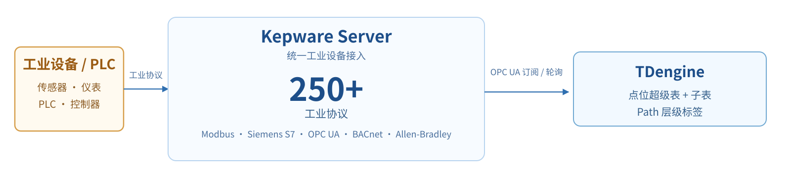
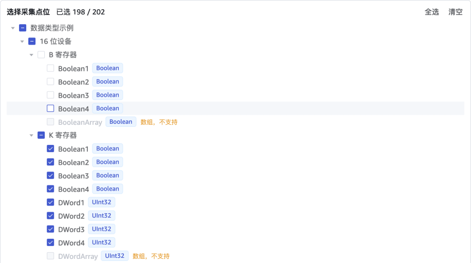

[Kepware Server](https://www.ptc.com/en/products/kepware) 是 PTC 的工业连接平台，提供 150 多种工业协议的通信驱动，包括 Modbus、Siemens S7、OPC UA、BACnet 等。本文以 Kepware Server 7.1 为例，介绍如何通过 taosX 的 OPC UA 连接器读取 Kepware 点位，并写入 TDengine。购买 TDengine 企业版后，EMQX Neuron 的软件许可证可由涛思数据代为采购。

本文介绍两种接入方式：

- **安装时接入**：在 Kepware Windows 主机执行安装命令，自动完成客户端证书、数据库、taosExplorer 接入和 OPC UA 任务的配置，安装后无需在 taosExplorer 页面操作。
- **一键接入**：适用于已部署 Kepware 的环境。在 taosExplorer 的「数据写入 → 数据采集代理 → Kepware」页面填写地址和凭据，taosExplorer 自动扫描点位、生成映射并创建采集任务。

| 方式 | Kepware 是否需预装 | 适用场景 | taosExplorer 操作 |
| --- | --- | --- | --- |
| 安装时接入 | 不需要 | 尚未安装 Kepware Server | 不需要 |
| 一键接入 | 需要 | 已部署 Kepware，需接入现有项目 | 需要向导 |

两种方式的数据面相同：taosX 通过 OPC UA 采集 Kepware 点位，点位以单列模型写入 TDengine。每个 OPC UA 点位对应一张子表，点位完整浏览路径（`Path`）保存为标签，供后续按设备层级查询或导入 IDMP。

<figure style={{width: 'fit-content', margin: '0 auto'}}>

<br/>
*Kepware 与 TDengine 集成架构*

</figure>

taosExplorer 通过 Kepware Config API 以只读方式读取点位元数据，用于校验点位；扫描、CSV 生成和任务创建仍由 taosX 的 OPC UA 连接器完成。

Kepware 接入支持订阅和轮询两种采集模式，可以在 taosExplorer 向导中选择。安装时接入默认使用订阅；轮询模式需要设置采集间隔（1–86400 秒）。

## 安装时接入

:::note

安装时接入依赖的 `apex` 工具尚未发布，计划于 2026 年 11 月上旬发布，敬请期待。

:::

本节适用于尚未安装 Kepware Server 的环境。安装过程由 TDengine 企业版安装包提供的 `apex` 工具执行，自动完成 Kepware 检查、证书信任、数据库创建、taosExplorer 接入和 OPC UA 任务创建。`apex` 会读取 TDengine 安装包中的组件版本和默认配置，因此必须使用与 TDengine 服务端同版本的 `apex`。

Kepware 安装时接入随 TDengine TSDB **3.4.3.9** 发布。3.4.3.9 正式发布前，请使用对应版本的预发布安装包；低于该版本的安装包不包含本节的 Kepware 安装时接入能力。

### 前置条件

- TDengine TSDB 3.4.3.9 及以上版本。
- 使用 TDengine 企业版安装包提供的 `apex` 工具。
- **无需预先安装 Kepware Server**：安装过程会自动完成 Kepware 安装/检查、Config API 开启、客户端证书生成与信任、数据库创建、taosExplorer 接入和 OPC UA 任务创建。
- 同机安装无需额外网络配置；跨机安装时，Kepware 主机需能访问 TDengine 的 `6060` 端口，TDengine 需能访问 Kepware 的 `49320` 和 Config API 的 `57412`/`57512` 端口。
- 安装时自动创建 `kepware` 数据库和接入记录，默认使用订阅模式；需要固定周期采样时，可在一键接入中选择轮询。

:::tip

同机安装可不填写任何连接参数；跨机安装必须指定 TDengine 所在主机的地址。其他参数可参考[跨机安装](#跨机安装)内容。

:::

### 同机安装

TDengine 和 Kepware Server 部署在同一台主机时，在 Kepware Windows 主机以管理员权限执行：

```bash
apex install all
```

安装过程会自动完成以下工作：

- 安装或检查 TDengine、taosExplorer 和 taosX；
- 安装/检查 Kepware Server 和示例项目；
- 生成 taosX OPC UA 客户端 keypair；
- 启用并检查 Config API；
- 确认 OPC UA 地址使用 `Basic256Sha256 + SignAndEncrypt + UserName`；
- 把 taosX 公钥证书加入 Kepware Trusted Clients；
- 创建 `kepware` 数据库；
- 扫描点位并自动全选，创建 taosX OPC UA 任务；
- 启动任务并验证首批数据。

安装时接入会把当前 Kepware 项目中的全部可采集点位（数组除外）写入 `kepware`，包括示例项目中的测试点位。Kepware 项目中的 Channel、Device 和 Tag 不会被修改或删除；接入真实业务时，可以删除该接入后重新创建，只勾选业务点位。目标库中已有的示例数据会保留，确认不需要时可手工清理。

安装完成后，Kepware 已与本机 TDengine 对接，无需再填写 Kepware 地址、数据库或接入配置。典型输出如下：

```text
[apex] Checking Kepware Server...
[apex] Installing/checking taosExplorer and taosX...
[apex] Generating taosX OPC UA client certificate...
[apex] Enabling Kepware Config API...
[apex] Checking OPC UA endpoint: Basic256Sha256 / SignAndEncrypt / UserName...
[apex] Trusting taosX client certificate...
[apex] Creating database kepware...
[apex] Scanning Kepware project...
[apex] 202 collectable points selected.
[apex] Creating OPC UA task: kepware_<host>_<id>
[apex] OPC UA task started.
[apex] Verification passed: 202/202 tables have new data.
[apex] Kepware integration registered with taosExplorer.
```

### 跨机安装

TDengine 在另一台主机时，在 Kepware Windows 主机以管理员权限执行：

```bash
apex install kepware --tdengine-host 192.168.1.100
```

将 `192.168.1.100` 替换为 TDengine 所在主机 IP 或域名。其余参数使用默认值；如需自定义 TDengine 用户名、密码或其他参数，参考下表在命令中追加：

常用参数：

| 参数 | 默认值 | 说明 |
| --- | --- | --- |
| `--tdengine-host` | 本机 | TDengine 主机 IP 或域名，跨机安装时必填 |
| `--tdengine-port` | `6041` | taosAdapter REST 端口 |
| `--tdengine-user` | `root` | TDengine 用户名，需有创建数据库和目标库写入权限 |
| `--tdengine-password` | `taosdata` | TDengine 用户密码 |
| `--explorer-port` | `6060` | taosExplorer 端口 |
| `--database` | `kepware` | 业务数据库，不存在时创建 |
| `--kepware-user` | `Administrator` | OPC UA/Config API 用户名 |
| `--kepware-password` | 交互输入 | OPC UA/Config API 密码，避免写入 shell 历史 |
| `--config-api-url` | 按 Kepware 主机推导 | 默认 `http://<kepware-host>:57412` |
| `--certificate` / `--private-key` | 安装时生成 | TDengine 主机上的证书和私钥绝对路径，私钥不离开 TDengine |

跨机安装同样会完成上述检查和配置。安装完成后，Kepware 会自动注册到该 TDengine 的 taosExplorer，并完成写入链路配置。输出与同机安装类似，其中接入注册地址为 `http://192.168.1.100:6060`。如果 TDengine 已单独安装在同一台主机，可省略 `--tdengine-host`。

### 在 taosExplorer 查看对接结果

安装完成后登录 taosExplorer，进入「数据写入 → 数据采集代理 → Kepware」，可以看到自动创建的接入。接入状态为「已验收」时，表示任务正在运行，且本接入所有预期子表都已写入数据。

打开接入详情可以查看任务名称、点位数、最近检查结果和日志。执行日志按时间倒序展示最新 10 条。

对应的 taosX 任务会出现在「数据写入 → 数据写入任务」中，类型为 OPC UA，目标库为 `kepware`。任务由 taosExplorer 管理，安装时接入不需要再手工配置 OPC UA 同步任务。

## 一键接入

适用于已经部署 Kepware、但尚未在 taosExplorer 中创建接入的环境。

### 前置条件

- TDengine TSDB 3.4.3.9 及以上版本。
- Kepware Server 已完成安装和授权，示例项目 Simdemo 已加载，或已配置真实的 Channel、Device 和 Tag。
- OPC UA 地址使用 `Basic256Sha256` 安全策略、`SignAndEncrypt` 安全模式；用户认证使用 `UserName`，不要使用 `Anonymous`。
- 已启用 Configuration API（Config API），并可访问：

  ```text
  http://192.168.1.100:57412/config/v1/project?content=serialize
  ```

  HTTPS 默认端口为 `57512`。Config API 需要使用只读权限账号，本文示例使用与 OPC UA 相同的用户名和密码。
- 已完成客户端证书信任，参见[客户端证书](#客户端证书)。
- Kepware 主机可访问 TDengine 的 `6060` 端口；TDengine 可访问 Kepware 的 `49320` 和 Config API 的 `57412`/`57512` 端口。

### 1. 创建目标数据库

在 taosExplorer 的 SQL 编辑器或 TDengine 客户端中创建业务库（不存在时）：

```sql
CREATE DATABASE IF NOT EXISTS kepware;
```

### 2. 打开 Kepware 页面

登录 taosExplorer，进入「数据写入 → 数据采集代理 → Kepware」，点击「添加 Kepware 接入」。

### 3. 填写连接信息

| 配置项 | 示例 | 说明 |
| --- | --- | --- |
| OPC UA 地址 | `opc.tcp://192.168.1.100:49320` | Kepware OPC UA 地址 |
| 用户名 | `Administrator` | OPC UA 用户名，同时作为 Config API 默认账号 |
| 密码 | — | OPC UA 密码 |
| 目标数据库 | `kepware` | 表将写入该库，必须已存在 |
| 采集模式 | 订阅 / 轮询 | 默认订阅；需要固定周期采样时选择轮询 |
| 采集间隔 | `10` | 仅轮询模式显示，单位秒 |
| Config API 地址 | `http://192.168.1.100:57412` | 留空时按 OPC UA 地址推导 |
| 客户端证书 | `/etc/taos/taosx/opc/client.pem` | TDengine 所在主机上的绝对路径 |
| 客户端私钥 | `/etc/taos/taosx/opc/client-key.pem` | TDengine 所在主机上的绝对路径 |

当前版本向导固定使用 `Basic256Sha256 + SignAndEncrypt`，不在页面中切换安全策略。若目标环境仍使用其他策略，需先调整为该组合。

### 4. 选择点位

点击「扫描点位」。taosExplorer 会：

1. 通过 taosX 浏览 OPC UA 点位；
2. 通过 Config API 读取 Tag 元数据；
3. 校验数据类型、Path 长度和重复点位；
4. 生成点位预览和 CSV 映射。

预览中可以看到点位数和 Path 样例。预览下方会显示点位选择树，默认全选；可以取消勾选或清空后重新选择。不可采集的点位会禁用并显示原因。没有可选点位时扫描会直接失败；创建时还会检查点位冲突。

<figure style={{width: 'fit-content', margin: '0 auto'}}>

<br/>
*点位选择树默认全选，可按需取消勾选*

</figure>

### 5. 创建任务

确认选中点位后点击「创建任务」。taosExplorer 会把选中点位的 CSV 上传到提供扫描能力的 taosX 实例，并创建、启动 Xnode OPC UA 任务。任务使用当前登录用户的 TDengine 凭据写入目标库；Token/TOTP 登录不能用于创建接入。

### 6. 检查数据

创建完成后进入接入详情，点击「检查数据」。状态含义：

| 状态 | 含义 |
| --- | --- |
| 运行中 | 任务已启动，尚未完成首次数据验收 |
| 已验收 | 任务运行中，本接入所有预期子表都已有数据 |
| 待验收 | 任务运行中，但部分预期子表暂无数据；可稍后重新检查 |
| 失败 | 任务不存在、未启动、未在运行，或检查失败 |

检查只统计本接入计划中的子表，不会把同一数据库里其他接入的子表算进来。任务必须处于运行状态，否则检查返回失败。轮询模式要求最近 `max(3 × 采集间隔, 60 秒)` 内有数据；订阅模式只在点位值变化时写入，创建后点位值一直不变时可能长期显示「待验收」，这不表示订阅链路失败，可以在 Kepware 中改变点位值后重新检查。

正常运行或已验收时，详情页只显示「检查数据」和「删除接入」。只有接入状态为「失败」或「已中断」时，才显示「重新启动」；该操作只启动已有任务，不重新扫描点位。删除接入会先停止并删除任务，只有任务删除成功或确认已经不存在时才删除接入记录；如果任务仍存在，页面会提示重试并保留记录。任务删除成功后，系统再尽最大努力清理 taosX 上传目录中的点位 CSV；清理失败不影响任务删除，也不会清理历史任务留下的文件。目标数据库中的数据会保留。

## 验证结果

接入详情显示「已验收」表示验收通过。也可以直接在 taosExplorer 的 SQL 编辑器中检查各子表的最新接收时间：

```sql
SELECT tbname, COUNT(*) AS rows, MAX(rts) AS latest_rts
FROM kepware.opc_double
PARTITION BY tbname
LIMIT 20;
```

不同数据类型的点位位于不同的超级表。可以先查询有哪些超级表：

```sql
SELECT DISTINCT stable_name
FROM information_schema.ins_tables
WHERE db_name = 'kepware'
  AND stable_name LIKE 'opc%';
```

`rts` 是 taosX 接收时间。所有预期子表的 `latest_rts` 都应晚于任务创建时间；轮询模式下还应在最近一个采集窗口内更新。订阅模式点位值不变时不会持续写入，不能只根据 `latest_rts` 判断订阅链路是否正常。

## 在 IDMP 中展示数据（可选）

IDMP 是独立系统。Kepware 接入后，IDMP 从 TDengine 的点位子表导入节点数据和属性，再按 `Path` 在元素浏览器中生成资产层级；不是单独导入一棵空树。IDMP 2.0.2.0 及以上会为 OPC 导入自动创建虚拟表，无需手工建表。

1. 在 IDMP「管理后台 → 连接」中配置 TDengine TSDB 连接。
2. 打开该连接的「更多 → 从 OPC 导入」。
3. 选择数据库 `kepware`。数据库中的 `opc_bool`、`opc_int`、`opc_double`、`opc_varchar` 等超级表会分别列出。
4. 对需要导入的超级表设置：
   - 路径：`Path`
   - 数据列：`val`
   - 质量列：`quality`
   - 路径层级：`1`
5. 完成导入。IDMP 会按 `Path` 生成元素层级：路径中除点位名以外的各级路径生成元素，点位成为最后一级元素的属性，而不是独立叶子元素；`val` 和 `quality` 映射到自动创建的虚拟表。

以 Kepware 示例项目为例，`Path` 为 `Objects.数据类型示例.16 位设备.K 寄存器.Double1`。路径层级设为 `1` 会忽略第一段 `Objects`，从 `数据类型示例` 开始生成元素。实际导入后的元素树如下（括号内为该元素的点位数）：

```text
通道 1
└── 设备 1（2 个点位：标记 1、标记 2）
数据类型示例
├── 16 位设备
│   ├── B 寄存器（4 个点位：Boolean1–Boolean4）
│   ├── K 寄存器（36 个点位：Long1、Double1、…）
│   ├── R 寄存器（36 个点位：Boolean1、DWord1、…）
│   └── S 寄存器（4 个点位：String1–String4）
└── 8 位设备
    ├── B 寄存器（4 个点位：Boolean1–Boolean4）
    ├── K 寄存器（44 个点位：Char1、Byte1、…）
    ├── R 寄存器（44 个点位：Char1、Byte1、…）
    └── S 寄存器（4 个点位：String1–String4）
模拟器示例
└── 函数（24 个点位：Ramp1–Ramp8、Random1–Random8、Sine1–Sine4、User1–User4）
```

选择 `K 寄存器` 等元素，可以在属性面板查看各点位的实时值和质量。本例导入后，IDMP 自动创建了 10 张虚拟表，点位值作为属性列写入虚拟表，不需要手工建表。

更多说明见 [TDengine IDMP](../../19-tdengine-idmp/index.md)。

## 高可用与断线续传（可选）

Kepware 接入的数据可靠性由 taosX 的部署方式决定，与点位映射本身无关。

### Store and Forward

如果需要网络中断期间数据不丢失，需要部署 **taosX-Agent**，并在 OPC UA 采集任务中开启「缓存实时数据」（`persist_data_enable`）。Agent 会把数据先写入本地持久化队列，网络恢复后按断点补发。当前 Kepware 向导不提供该开关，生产环境需按 taosX-Agent 的部署方式配置。配置和限制见 [存储转发（Store and Forward）](https://docs.taosdata.com/operations-and-tooling/components/taosx-agent/store-and-forward/)。

### taosX 高可用

taosX 本身支持多 XNode 高可用：任务在健康 XNode 上调度，节点故障后可自动迁移，计划维护可使用 `DRAIN XNODE`。参见 [全链路高可用](https://docs.taosdata.com/security-guide/full-trace-availability/) 和 [数据接入（XNode）](https://docs.taosdata.com/tdengine-sql/cluster-management/xnode/)。

Kepware 向导上传的点位 CSV 只保存在接收上传的 XNode 本地。任务迁移或被调度到另一个 XNode 时，该节点必须能读取同一份 CSV。多 XNode 生产环境应为 taosX 数据目录配置共享存储；没有共享存储时，CSV 类任务不具备跨节点迁移可靠性，任务可能因找不到 `csv_config_file` 而采集失败。

## 当前限制

- 数组、ByteString、Guid、NodeId、ExtensionObject、Variant 和结构体不支持；数组在扫描时自动排除，其他不支持的点位在手动选点时禁用；
- Path 含 `\.` 不支持；
- 外部修改 taosX 任务或 Kepware 密码后，taosExplorer 记录不会自动同步；需要重新创建接入；
- 多个 Kepware 写入同一数据库时，NodeId、Path 和生成的子表名必须唯一；该检查只覆盖 taosExplorer 管理的接入，不覆盖手工创建的 taosX 任务；
- 多 XNode 部署时，点位 CSV 只上传到一个 XNode；没有共享存储时，任务迁移到其他 XNode 可能无法读取 CSV；

## 常见问题

| 现象 | 原因 | 处理 |
| --- | --- | --- |
| Config API 返回 401 | 用户名、密码或权限错误 | 检查 Config API 账号；确认已启用 HTTP/HTTPS 服务 |
| Config API 连接被拒绝 | 端口未开放或服务未启动 | 检查 `57412`/`57512` 防火墙和 Kepware 服务 |
| OPC UA 连接被拒绝 | OPC UA 服务未启动或端口未开放 | 检查 `49320` 和 Kepware runtime |
| `BadSecurityChecksFailed` | taosX 客户端证书未信任 | 在 Kepware Trusted Clients 中 Trust 证书后重启 runtime |
| `StatusBadCertificateURIInvalid` | 客户端证书缺少 taosX 的 ApplicationUri | 重新生成证书，SAN 添加 `URI:urn:taosx-opc:client`，再 Trust |
| 提示无法读取客户端证书 | 证书路径不是绝对路径或不是 PEM | 检查 taosX 主机路径、PEM 编码和私钥权限 |
| 扫描不到点位 | 项目未加载或没有 Variable | 打开 Simdemo/真实项目，确认 Tag 处于运行状态 |
| 创建失败：不支持类型 | ByteString、Guid、结构体等 | 在 Kepware 侧改用标量类型；手动选点时该点位会被禁用 |
| 创建失败：`\.` | IDMP 不能还原转义点 | 修改 Kepware Tag 名称 |
| 值不变的点位没有新数据 | 订阅模式只在点位变化时上报 | 需要固定周期数据时重新创建并选择「轮询」；仅检查显示待验收时，可先在 Kepware 改变点位值确认链路 |
| 任务创建但无数据 | 任务未启动、目标库为空或网络不通 | 在「数据写入 → 数据写入任务」中查看任务状态和日志，确认 taosX 可写入 TDengine |
| 详情一直为「待验收」 | 任务未运行、部分点位暂无新数据，或订阅点位值未变化 | 确认任务运行且点位持续变化；订阅模式可先改变点位值再检查 |
| IDMP 节点层级不正确 | 路径开始层级设置错误 | 设置为 `1`，忽略 `Objects` 前缀 |

## 附录

### 数据模型与 Path

Kepware 的一个 OPC UA 点位对应 TDengine 的一张子表，同一数据类型的点位共用超级表。taosX 根据 CSV 映射自动建表：

| OPC UA / taosX | TDengine 对象 |
| --- | --- |
| NodeId | 子表名，按 `t_{ns}_{id#/_}` 规则生成 |
| 完整浏览路径 | `Path` 标签，例如 `Objects.Channel1.Device1.TagGroup.Tag` |
| 采集值 | `val` 测量列 |
| 质量码 | `quality` 测量列 |
| 源时间戳 / 接收时间戳 | `ts` / `rts` |
| 数据类型 | 超级表 `opc_{type}`，例如 `opc_double`、`opc_int` |

`Path` 保留完整的 `Objects.` 前缀，不自动剥离，便于后续在 IDMP 或 SQL 中还原层级：

```text
Objects.Simdemo.Device1.TagGroup.Temperature
```

支持的类型和限制见[当前限制](#当前限制)。

### 客户端证书

尚未安装 Kepware 的环境由 `apex` 自动生成并信任客户端证书；已经安装 Kepware 的环境需要按以下步骤确认信任关系。

生产环境建议始终启用 `Basic256Sha256 + SignAndEncrypt`。TDengine 使用客户端证书向 Kepware 证明身份，Kepware 只信任已加入 Trusted Clients 的证书。

1. 在 TDengine 主机生成或准备客户端 keypair，证书 SAN 必须包含 ApplicationUri `urn:taosx-opc:client`；私钥只保存在 TDengine 主机；
2. 在 Kepware 的 OPC UA Configuration Manager 中打开 **Trusted Clients**，导入 TDengine 的公钥证书并选择 **Trust**；首次连接失败后，也可以从 Rejected/Untrusted 列表选择该证书并 Trust；
3. 也可以把公钥证书写入 Kepware 项目下的 `UA Server\TrustedClients.xml`，路径和格式以目标现场为准；
4. 重启或重新初始化 Kepware runtime。

:::note

taosExplorer 向导中的「客户端证书」和「客户端私钥」填写的是 **TDengine 所在主机上的绝对路径**，例如 `/etc/taos/taosx/opc/client.pem`，不是浏览器所在主机的路径。证书和私钥必须使用 PEM 编码，且两个文件成对提供。

:::

### 单 Kepware 写多数据库

一个接入只能指定一个目标数据库，接入中选中的所有点位都写入该库。同一个 Kepware 实例可以创建多个接入，只要目标数据库不同，就可以按 Channel、Device 或点位组分别写入不同的数据库。

例如：

| 接入 | Kepware 实例 | 选择点位 | 目标数据库 |
| --- | --- | --- | --- |
| 接入 A | 同一实例 | Channel 1 下的点位 | `db_a` |
| 接入 B | 同一实例 | Channel 2 下的点位 | `db_b` |

注意事项：

- 同一个 Kepware 实例的同一个数据库只能创建一个接入；不能把同一实例、同一数据库拆成多个接入；
- 点位选择是点位级的，不会按 Channel 或 Device 自动路由到不同数据库，需要在每个接入中分别勾选；
- 同一批点位可以写入不同数据库，但会重复读取和写入，通常不建议。
