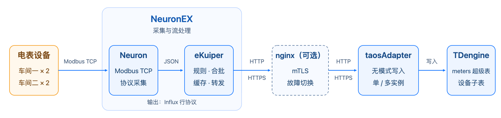
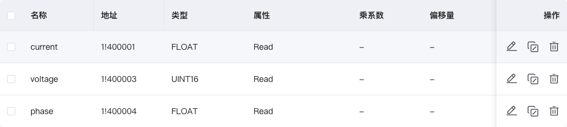
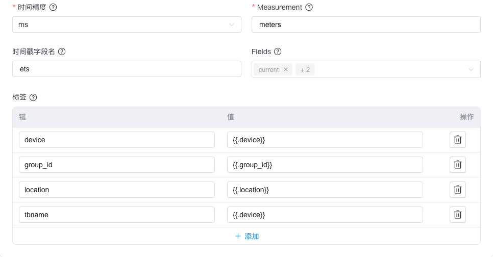
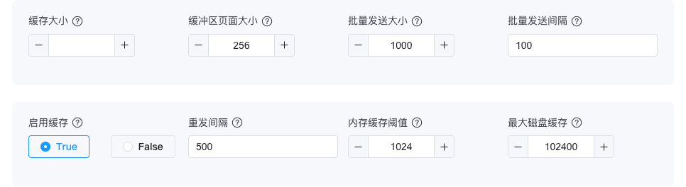

[Neuron](https://github.com/emqx/neuron) 是 EMQ 开发的工业物联网连接平台，支持 Modbus、OPC UA、BACnet 等多种工业协议。[eKuiper](https://github.com/lf-edge/ekuiper) 是开源的轻量级边缘流处理引擎，使用 SQL 处理数据，并通过输出动作（sink）转发。[NeuronEX](https://docs.emqx.com/zh/neuronex/latest/) 是 EMQ 的工业边缘数据采集与处理软件，集成 Neuron 的协议采集和 eKuiper 的流处理能力，提供统一的 Web 界面配置设备采集、数据处理及转发。

本文介绍如何通过 NeuronEX 的 InfluxDB v1 sink 将 Modbus 电表数据写入 TDengine。该方式可接入 NeuronEX 支持的 70 多种工业协议，具体以版本及授权为准。



Neuron 将 Modbus 数据转为 JSON 采集报告，eKuiper 提取测量列和标签，编码为 Influx 行协议并批量发送到 taosAdapter，通过无模式写入自动创建超级表和子表。需要双向 TLS 认证（mTLS）或 taosAdapter 故障切换时，按后文部署 nginx。

## 前置条件

- 已部署 TDengine 3.4.3.3 及以上版本并启动，参见 [下载与安装](../../04-quick-start/01-download-and-install/02-package.md)。准备具有建表和写入权限的专用账号。
- 已安装 NeuronEX 4.0.0 及以上版本，参见 [NeuronEX 安装文档](https://docs.emqx.com/zh/neuronex/latest/installation/introduction.html)。确认所用版本及许可支持 Modbus TCP、数据处理和 InfluxDB v1 sink，并覆盖本例的 12 个采集点。需要断链缓存与恢复补发时，确认内置 eKuiper 已包含[缓存与转发](#缓存与转发store-and-forward)一节所述的错误重试修复。独立部署 Neuron 与 eKuiper 时，需另配数据通道。
- NeuronEX 能够访问 taosAdapter 的 HTTP 端口，默认为 `6041`。
- 已准备四台 Modbus TCP 电表的 IP、端口、站号、寄存器地址及字节序，并同步采集端时钟。

## 数据映射

在 NeuronEX 中，先添加电表设备并配置连接信息，再创建采集组、设置采集周期，最后添加电流、电压和相位等点位，为各点位指定寄存器地址和数据类型。采集数据与 TDengine 的对应关系如下：

| Neuron 数据 | TDengine 对象 | 配置方式 |
| --- | --- | --- |
| 设备名 `node_name` | 子表名及 `device` TAG | 规则输出 `device`；sink 将其同时映射到 `tbname` 和 `device` 标签 |
| 采集组名 `group_name` | 用于筛选进入规则的报告 | SQL 筛选 `electrical_readings` 采集组；超级表名由 sink 的 `measurement` 独立指定 |
| 点位 `values.current`、`values.voltage`、`values.phase` | 测量列 `current`、`voltage`、`phase` | SQL 提取点位，sink 的 `fields` 指定写入列 |
| 报告时间戳 `timestamp` | 时间列 `_ts` | SQL 输出 `ets`，sink 设置 `tsFieldName=ets`、`precision=ms` |
| 位置及业务分组 | TAG `location`、`group_id` | SQL 根据设备名设置属性，sink 的 `tags` 指定标签 |

本例中，每台电表的一次完整采集报告写入其同名子表的一行，电流、电压和相位分别对应三个测量列。

Neuron Tag 是采集点位，对应测量列；TDengine TAG 是子表属性。`group_id` 是业务分组编号，与采集组名分开配置。`group_name` 也可映射为 TAG，但同一子表的组名应固定。

## 示例数据模型

示例在同一工厂的两个车间各部署两台电表，每秒采集电流、电压和相位。四台设备共用 `meters` 超级表，各写一个子表，采集组均命名为 `electrical_readings`。

| 设备名、子表名及 `device` 标签 | `group_id` | `location` |
| --- | --- | --- |
| `workshop01_meter01` | `1` | `Factory01.Workshop01` |
| `workshop01_meter02` | `1` | `Factory01.Workshop01` |
| `workshop02_meter01` | `2` | `Factory01.Workshop02` |
| `workshop02_meter02` | `2` | `Factory01.Workshop02` |

TDengine 将 `Factory01.Workshop01` 保存为完整的 `location` 标签值；后续 IDMP 可按点号展开为 `Factory01 → Workshop01`。

业务字段参考 [meters 建模示例](../../04-quick-start/03-data-modeling.md)。首次[无模式写入](../../10-developer-guide/04-schemaless.md)自动建表，类型如下：

| 类别 | 字段 | 自动生成类型 |
| --- | --- | --- |
| 时间列 | `_ts` | `TIMESTAMP` |
| 测量列 | `current`、`phase` | `DOUBLE` |
| 测量列 | `voltage` | `BIGINT` |
| 标签 | `location`、`group_id`、`device` | `NCHAR` |

实际字段类型由 Influx 行协议编码决定，与标准 meters 建模示例不完全相同；标签值仅含 ASCII 字符时，自动生成的类型仍为 `NCHAR`。

## 配置步骤

### 1. 创建数据库

在 TDengine SQL 客户端执行以下语句，无需手工创建超级表或子表：

```sql
CREATE DATABASE IF NOT EXISTS neuron_meters_demo PRECISION 'ms';
```

### 2. 检查直连接口

在 NeuronEX 所在主机或容器内执行以下命令，将 `adapter-host` 替换为实际 taosAdapter 主机名或 IP：

```bash
curl -i http://adapter-host:6041/influxdb/v1/ping
```

返回 `204 No Content` 表示接口可访问。InfluxDB v1 客户端启动时会调用该接口；若返回 `404`，检查路径及 TDengine 版本（3.4.3.3 及以上）。NeuronEX 可直接连接 taosAdapter，无需部署 nginx。如需加密传输或 taosAdapter 故障切换，参照[加密传输与高可用](#加密传输与高可用可选)一节配置 nginx。

### 3. 配置 Modbus 采集

1. 进入「数据采集 → 南向设备」，按示例名称添加四台「Modbus TCP」设备，填写连接参数。

   | 配置项 | 设置 | 说明 |
   | --- | --- | --- |
   | 连接模式 | 客户端 | 主动连接电表 |
   | IP、端口 | 实际电表 IP、端口，通常为 `502` | 确定读取的设备 |
   | 连接超时 | `3000ms` | 限制无响应请求的等待时间 |
   | 指令发送间隔 | `20ms` | 同一连接相邻请求的间隔，与采集周期不同 |
   | 32 位字节序 | 按设备手册设置，例如 `ABCD` | 正确解码浮点数 |

2. 在每台设备下创建 `electrical_readings` 采集组，周期设置为 `1000ms`，添加以下三个读点。

   | 点位名称 | 类型 | 示例地址 | 占用寄存器 |
   | --- | --- | --- | --- |
   | `current` | `FLOAT` | `1!400001` | 400001、400002 |
   | `voltage` | `UINT16` | `1!400003` | 400003 |
   | `phase` | `FLOAT` | `1!400004` | 400004、400005 |

   地址按设备寄存器表填写。`1!` 表示站号 1；`FLOAT` 占两个寄存器，点位地址不可重叠。不同设备节点可使用相同的寄存器地址。

   

3. 保存并启动设备，确认均为运行中、已连接。在「数据采集 → 数据监控」逐一选择设备及其采集组，检查三个点位数值正确并持续更新。
4. 进入「数据采集 → 北向应用」，为内置 `DataProcessing` 应用订阅四台设备的 `electrical_readings` 组，将报告送入 eKuiper。仅创建设备和规则不会自动建立此订阅。

### 4. 创建数据流

数据流定义采集报告的字段结构，后续规则从中读取数据。

1. 进入「数据处理 → 源管理 → 创建」，填写以下配置。

   | 配置项 | 设置 |
   | --- | --- |
   | 名称 | `meters_stream` |
   | 源类型 | `Neuron` |
   | 配置组 | `default` |
   | 数据格式 | `JSON` |
   | 带结构 | 开启 |
   | 共享数据源 | 开启 |

2. 添加下表中的字段。将 `values` 设置为 `STRUCT`，并在其下添加三个测量子字段。

   | 字段 | 类型 | 用途 |
   | --- | --- | --- |
   | `timestamp` | `BIGINT` | 报告时间戳，单位 ms |
   | `node_name` | `STRING` | 设备名 |
   | `group_name` | `STRING` | 采集组名 |
   | `values` | `STRUCT` | 测量值集合 |
   | `values.current` | `FLOAT` | 电流 |
   | `values.voltage` | `BIGINT` | 整数电压 |
   | `values.phase` | `FLOAT` | 相位 |

3. 保存数据流，确认结构包含全部待写入点位。

带结构定义可保留电压的整数类型，避免无结构 JSON 数值按浮点数处理。流中的 `BIGINT` 是 eKuiper 整数类型，与 Modbus 寄存器位宽无关。开启「共享数据源」后，多条规则可复用同一数据源。

### 5. 创建数据处理规则

1. 进入「数据处理 → 规则 → 新建规则」，规则 ID 填写 `meters_to_tdengine`。
2. 在 SQL 编辑区域输入以下语句。

   ```sql
   SELECT values.current AS current,
          values.voltage AS voltage,
          values.phase AS phase,
          timestamp AS ets,
          node_name AS device,
          CASE WHEN node_name IN ("workshop01_meter01", "workshop01_meter02")
               THEN "1" ELSE "2" END AS group_id,
          CASE WHEN node_name IN ("workshop01_meter01", "workshop01_meter02")
               THEN "Factory01.Workshop01" ELSE "Factory01.Workshop02" END AS location
   FROM meters_stream
   WHERE group_name = "electrical_readings"
     AND node_name IN ("workshop01_meter01", "workshop01_meter02",
                       "workshop02_meter01", "workshop02_meter02")
   ```

   该 SQL 筛选四台电表的 `electrical_readings` 采集组报告，提取电流、电压和相位，保留原始时间戳和设备名，并按设备名设置位置与业务组编号。设备名用于指定子表名，位置与业务组编号写入 TAG。

3. 点击「添加动作」，选择「InfluxDB v1」，按下一步配置写入动作。

四台设备共用一条规则。新增或替换同类设备时，更新北向应用订阅、SQL 中的设备范围及位置和业务组编号映射，无需逐台创建规则。

若采集报告包含位置和业务组编号等元数据，可在数据流中声明这些字段，再由 SQL 直接取值作为 TAG，减少按设备名逐一配置映射。本例通过 `CASE` 表达式设置这些属性。

### 6. 配置 InfluxDB v1 动作

以下 JSON 为 InfluxDB v1 动作的完整配置示例，与后续页面配置步骤对应。使用时替换地址、用户名和密码。

```json
{
  "addr": "http://adapter-host:6041/influxdb/v1?table_name_key=tbname",
  "username": "<tdengine_username>",
  "password": "<tdengine_password>",
  "database": "neuron_meters_demo",
  "measurement": "meters",
  "precision": "ms",
  "tsFieldName": "ets",
  "fields": [
    "current",
    "voltage",
    "phase"
  ],
  "tags": {
    "tbname": "{{.device}}",
    "device": "{{.device}}",
    "group_id": "{{.group_id}}",
    "location": "{{.location}}"
  },
  "sendSingle": true,
  "batchSize": 1000,
  "lingerInterval": 100,
  "enableCache": true,
  "memoryCacheThreshold": 1024,
  "bufferPageSize": 256,
  "maxDiskCache": 102400,
  "resendInterval": 500
}
```

1. 在「连接信息」中填写以下参数。将地址和账号替换为实际值。

   | 配置项 | 设置 |
   | --- | --- |
   | 地址（`addr`） | `http://adapter-host:6041/influxdb/v1?table_name_key=tbname` |
   | 用户名（`username`） | TDengine 专用写入账号 |
   | 密码（`password`） | 上述账号的密码 |
   | 数据库（`database`） | `neuron_meters_demo` |

   地址保留 `/influxdb/v1` 路径；客户端自动追加 `/ping`、`/write` 并保留查询参数。用户名和密码使用独立字段。生产环境应使用专用写入账号，并限制配置文件、导出文件和管理 API 的访问权限。

2. 在「数据处理」中配置字段及标签映射。

   | 配置项 | 设置 |
   | --- | --- |
   | 时间精度（`precision`） | `ms` |
   | Measurement（`measurement`） | `meters` |
   | 时间戳字段名（`tsFieldName`） | `ets` |
   | Fields（`fields`） | `current`、`voltage`、`phase` |
   | 标签 `tbname` | `{{.device}}` |
   | 标签 `device` | `{{.device}}` |
   | 标签 `group_id` | `{{.group_id}}` |
   | 标签 `location` | `{{.location}}` |

   `table_name_key=tbname` 将 `tbname` 用于子表命名，不保存为 TAG；`device` 保留设备身份。`fields` 仅选择三个测量列，避免将 `ets` 等辅助字段作为测量列写入。

   

3. 展开「Sink 配置」，将「启用缓存」（`enableCache`）设为 `True`，并按下表设置批量发送及缓存参数。

   | 配置项 | 设置 | 作用 |
   | --- | --- | --- |
   | 批量发送大小（`batchSize`） | `1000` | 达到批大小时发送 |
   | 批量发送间隔（`lingerInterval`） | `100` | 未满批时的等待时间，单位 ms |
   | 启用缓存（`enableCache`） | `True` | 启用 sink 缓存 |
   | 内存缓存阈值（`memoryCacheThreshold`） | `1024` | 内存缓存消息阈值 |
   | 缓冲区页面大小（`bufferPageSize`） | `256` | 每磁盘页的消息数 |
   | 最大磁盘缓存（`maxDiskCache`） | `102400` | 磁盘缓存消息上限 |
   | 重发间隔（`resendInterval`） | `500` | 缓存重发间隔，单位 ms |

   达到 `batchSize` 或等待满 `lingerInterval` 即触发发送，以先满足者为准；低流量时不必凑满 1000 行。缓存消息可能是一批数据，不能直接换算为入库行数或离线时长。参数含义以对应 eKuiper 版本说明为准。

   

4. 提交动作，保存并启动规则。

:::note

NeuronEX 页面默认设置 `sendSingle=true`，用于逐行计算动态标签，不表示逐行发起 HTTP 请求；通过规则 JSON 配置时须保留此参数。数据仍按上述参数批量发送，不同设备写入各自子表。实际延迟还包括排队和网络调用。

:::

:::warning

同一子表、同一毫秒的数据会被覆盖。使用全局唯一子表名，并保留报告时间戳；位置等属性变化时，显式更新子表 TAG。

:::

## 验证结果

1. 在 TDengine SQL 客户端检查自动生成的结构和设备标签。

   ```sql
   DESCRIBE neuron_meters_demo.meters;

   SELECT DISTINCT TBNAME, device, group_id, location
   FROM neuron_meters_demo.meters;
   ```

   应有四个子表，字段类型和标签与示例数据模型一致。

2. 查询最新数据，与「数据采集 → 数据监控」比较。将子表名替换为其他设备名，逐一检查四台设备。

   ```sql
   SELECT _ts, current, voltage, phase
   FROM neuron_meters_demo.workshop01_meter01
   ORDER BY _ts DESC LIMIT 5;
   ```

3. 间隔数秒重复执行以下查询，确认四个子表的行数持续增长。

   ```sql
   SELECT TBNAME, COUNT(*)
   FROM neuron_meters_demo.meters PARTITION BY TBNAME;
   ```

以查询结果确认入库，规则运行状态和 ping 响应不能代替入库检查。

## 运行监控

进入「数据处理 → 规则」，找到 `meters_to_tdengine`，点击「更多 → 数据统计」，查看各阶段的统计卡片。

| 指标 | 正常状态或处理方式 |
| --- | --- |
| `connection_status` | sink 连接状态为 `Connected` |
| 输入、输出计数 | 持续增加；批量发送前后计数单位可能不同，批次数不等于数据库行数 |
| `buffer_length` | 缓存长度可短时波动，但应能回落 |
| `exceptions_total`、`last_exception` | 正常时无异常；发生异常时查看次数及最近报错 |

## 在 IDMP 中展示数据（可选）

在 IDMP「管理后台 → 连接」中配置 TDengine TSDB 连接，通过连接条目的「更多 → 简单导入」，选择 `neuron_meters_demo.meters`。

将 `location` 标签设为路径，路径层级填 `0`，表达式填 `${location}`；`device`、`group_id` 作为静态属性导入。`location` 按点号展开为工厂与车间层级，子表名作为叶子电表元素。

导入后，在「元素浏览器」中可查看以下层级，选择电表可查看 `current`、`voltage`、`phase` 测量属性：

```text
Factory01
├── Workshop01
│   ├── workshop01_meter01
│   └── workshop01_meter02
└── Workshop02
    ├── workshop02_meter01
    └── workshop02_meter02
```

详细导入步骤参见 [从 TDengine TSDB 构建数据模型](https://idmpdocs.taosdata.com/data-ingestion/building-data-models-from-tsdb/)。本例写入不携带单位信息，如需补充单位或配置换算，参见 [计量单位](https://idmpdocs.taosdata.com/libraries/uom/)。

## 缓存与转发（Store and Forward）

本例由 eKuiper 的 InfluxDB v1 sink 提供缓存与转发。下游暂时不可用时，在容量允许且错误可重试的前提下缓存数据；连接恢复后，保留原有的子表名和报告时间戳重新发送。

使用此功能须满足以下要求：

- eKuiper 须包含 Influx v1 错误重试修复 [PR #4201](https://github.com/lf-edge/ekuiper/pull/4201)，否则可能无法重发。部署前，向 EMQX 提供所用 NeuronEX 及内置 eKuiper 版本，确认已包含该修复。
- 在「数据处理 → 规则」中编辑对应规则的「InfluxDB v1」动作，展开「Sink 配置」，将「启用缓存」（`enableCache`）设为 `True`，并配置缓存容量和重发间隔。参数表及截图见[配置 InfluxDB v1 动作](#6-配置-influxdb-v1-动作)。部署时持久挂载 eKuiper 数据目录。
- 监控磁盘空间、缓存长度和异常。持续积压时，调整采集周期、批量发送参数或采集组分配。

含该修复的构建已通过断链恢复验证，测试数据全部回补。账号、权限或模式错误也可能持续重试并阻塞后续数据，须人工修正；数据转换或构造 Influx 数据点时发生的错误，不一定触发重试。

:::warning

进程崩溃或整机故障可能丢失内存及在途数据；缓存耗尽时也可能丢数据。

:::

参数说明见 [eKuiper sink 缓存与发送机制](https://ekuiper.org/docs/zh/latest/guide/sinks/overview.html)。

## 加密传输与高可用（可选）

需要 mTLS 或 taosAdapter 故障切换时，部署 nginx，并将 sink 地址改为 nginx 地址。基础 HTTP 直连接入无需此配置。

### 配置 mTLS 和多 taosAdapter 转发

以下以三节点 TDengine 集群为例，在三个节点上各部署一个 taosAdapter，均连接同一集群。nginx 验证客户端证书，将请求分发至三个实例，并在上游故障时切换至其他实例。

1. 安装 nginx，将以下配置添加到 `http` 上下文。修改域名、上游地址及证书路径，服务端证书 SAN 须匹配 `ingest.example.com`。

   ```nginx
   upstream taosadapter {
       least_conn;
       server adapter-a.internal:6041 max_fails=2 fail_timeout=10s;
       server adapter-b.internal:6041 max_fails=2 fail_timeout=10s;
       server adapter-c.internal:6041 max_fails=2 fail_timeout=10s;
   }

   server {
       listen 8443 ssl;
       client_max_body_size 32m;
       server_name ingest.example.com;
       ssl_certificate /etc/nginx/certs/server.crt;
       ssl_certificate_key /etc/nginx/certs/server.key;
       ssl_client_certificate /etc/nginx/certs/client-ca.crt;
       ssl_verify_client on;
       ssl_protocols TLSv1.2 TLSv1.3;

       location /influxdb/v1/ {
           proxy_pass http://taosadapter;
           proxy_connect_timeout 3s;
           proxy_read_timeout 60s;
           proxy_next_upstream error timeout http_502 http_503 http_504 non_idempotent;
           proxy_next_upstream_tries 3;
       }
   }
   ```

2. 执行 `nginx -t` 检查配置，启动或重新加载 nginx。在规则的 InfluxDB v1 动作中，将地址改为 `https://ingest.example.com:8443/influxdb/v1?table_name_key=tbname`。nginx 将 ping 和写入请求一并转发至 taosAdapter。
3. 在动作「连接信息」中上传客户端证书、私钥及服务端 CA 证书，将「跳过证书验证」设为 `False`。文件配置使用以下参数；证书路径须对 eKuiper 可读，容器部署时须挂载证书。

   ```json
   {
     "rootCaPath": "/etc/ekuiper/certs/server-ca.crt",
     "certificationPath": "/etc/ekuiper/certs/client.crt",
     "privateKeyPath": "/etc/ekuiper/certs/client.key",
     "insecureSkipVerify": false
   }
   ```

4. 保存动作并启动规则，按[验证结果](#验证结果)检查数据持续写入。生产环境关闭临时明文入口。

仅用 HTTPS 服务端认证时，删除 nginx 的 `ssl_client_certificate`、`ssl_verify_client` 及 sink 客户端证书、私钥配置，保留 CA 校验。nginx 到 taosAdapter 使用 HTTP，须位于受控网络；需加密时另配上游 HTTPS。

`proxy_next_upstream_tries 3` 表示单个请求最多尝试三次（含首次请求）。`non_idempotent` 允许失败的 POST 改投另一实例。重试保留子表名、时间戳和测量值，利用同键写入处理重复；失败批次依赖 sink 缓存重发。

### 配置各层高可用

| 层次 | 部署要求 | 注意事项 |
| --- | --- | --- |
| nginx | 双机 Keepalived VIP 或已有高可用负载均衡，sink 使用统一域名 | 同步配置及证书，域名与证书匹配 |
| taosAdapter | 三个节点各部署一个实例，连接同一 TDengine 集群 | 多个实例部署在同一主机不能覆盖主机故障 |
| TDengine | 按版本和许可配置集群、副本，参见 [部署管理](../../12-operations-and-tooling/02-operations/index.md) | 示例的单机建库配置不提供数据库高可用 |
| NeuronEX | 按[官方主备实践](https://docs.emqx.com/zh/neuronex/latest/best-practise/master-backup.html)同步配置，正常仅由主机采集 | 切换期间可能暂停采集，Modbus 当前寄存器通常无法补读历史 |
| 边缘到中心网络 | 开启 sink 缓存并监控容量 | 恢复范围见[缓存与转发](#缓存与转发store-and-forward) |

各组件的主备及集群切换须按实际部署拓扑验收。

## 性能参考

### 测试配置

以下为既有性能测试结果，供容量规划参考，覆盖开启缓存及 nginx mTLS 的正常连接场景。测试版本见下表，与前述直连功能验证环境不同。

| 项目 | 配置 |
| --- | --- |
| 硬件 | Intel Xeon E5-2696 v4，22 物理核、44 逻辑核，64 GiB 内存，NVMe |
| 部署 | Ubuntu 24.04，Linux x86_64，各组件同机原生进程 |
| Neuron | 开源 2.15.0，含 Modbus 事务序号回卷修复的自建版本 |
| eKuiper | `2.4.2+pr4201-perfcore` 测试构建，含 Influx 错误分类修复 |
| TDengine | 企业版 3.4.3.3；ms、`VGROUPS 16`、`WAL_LEVEL 1`、`WAL_FSYNC_PERIOD 3000` |
| 采集 | 16 个驱动 × 4 组 × 128 台逻辑电表 × 3 个测量值，共 24,576 配置点位；周期 100ms |
| 北向 | 8 个应用分别订阅不同的采集组，每应用 8 组，各自使用独立的数据源、规则和输出动作 |
| 批量发送与安全 | 批量发送间隔 100ms、`batchSize=10000`，每请求平均约 1024 行；缓存开启、`bufferLength=20000`、`disableBufferFullDiscard=true`、nginx mTLS、CA 校验 |

测试通过 Modbus 读取 Neuron 内置模拟器，各组复用寄存器。8,192 台逻辑电表不代表物理设备数量。每行含三个采集值，标签不计入点值吞吐。

### 参考结果

| 指标 | 实测结果 |
| --- | ---: |
| 数据库行数净增 | 147,524,815 行 |
| 平均入库吞吐 | **81,913.81 行/秒** |
| 等价采集点值更新吞吐 | **245,741.42 个/秒** |
| 分段采样吞吐范围 | 80,359.68–83,470.95 行/秒 |
| 上报至成功响应 p99 | **1,171ms** |
| 同口径最大延迟 | 2,054.33ms |
| sink 队列采样峰值 | 82 批，后续回落至零，最终队列为零 |

吞吐按数据库行数净增计算，每行三个采集值；点值吞吐不等于配置点位数。p99 从报告时间戳计至 taosAdapter 成功响应，按 1ms 精度统计，包含批量发送等待、排队和下游调用，不含 Modbus 采集时间。

停止采集并排空缓存后，规则有效输出行数、成功请求对应的行数、子表名与时间戳的唯一组合数及数据库行数一致。对账不含规则过滤的缺失值报告。

Neuron 与 eKuiper 平均各使用约 6.6 个逻辑核；Neuron 驻留内存约 73MiB，eKuiper 采样峰值约 275MiB，nginx 开销较小。未观察到驻留内存或 sink 队列持续增长。

结果供容量规划参考，不代表 TDengine 写入上限或官方发行包性能保证。部署时按实际设备、规则、字段数、网络及硬件复测并预留余量。扩大规模可按采集组分片部署多个 Neuron 与配套 eKuiper 实例，分配独立 CPU、使用唯一子表名；多实例扩展比例未经验证。

## 常见问题

| 现象 | 检查与处理 |
| --- | --- |
| 采集数值异常 | 检查站号、寄存器地址、字节序及浮点地址是否重叠 |
| 规则启动后自动停止 | 检查许可是否包含数据处理功能；仅测试使用的规则可能运行 60 分钟后自动停止 |
| HTTPS 连接失败 | 检查 CA、服务端 SAN、客户端证书及容器内证书路径 |
| 数据统计中的缓存长度持续增长 | 调整采集周期、批量发送参数或采集组分配，避免长期发送慢于采集 |
| 缓存开启后仍无法重发 | 按[缓存与转发](#缓存与转发store-and-forward)确认版本已包含重试修复，并检查错误分类、磁盘空间及缓存容量 |

## 参考文档

- [eKuiper InfluxDB v1 sink](https://ekuiper.org/docs/zh/latest/guide/sinks/plugin/influx.html)
- [eKuiper sink 缓存与发送机制](https://ekuiper.org/docs/zh/latest/guide/sinks/overview.html)
- [NeuronEX 配置说明](https://docs.emqx.com/zh/neuronex/latest/configuration/introduction.html)
