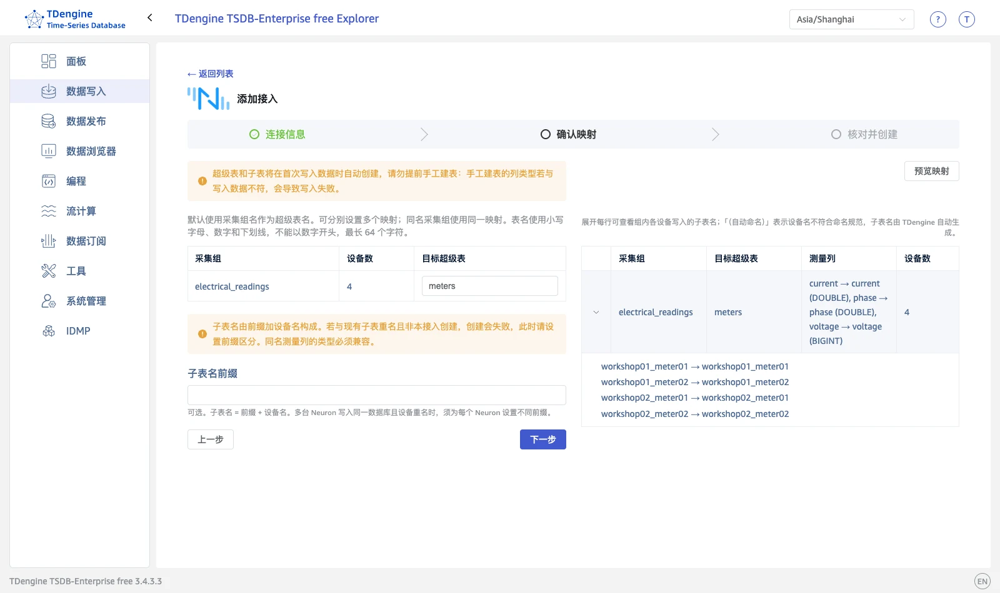

## 一键接入

一键接入在 TDengine Explorer 中完成，无需在 NeuronEX 或 eKuiper 中做任何手工配置。

### 1. 打开接入向导

登录 TDengine Explorer，在左侧导航选择「数据写入」，切换到「边缘网关」页签，点击 Neuron 卡片。

### 2. 填写连接信息

上半部分为 Neuron 连接信息：

| 配置项 | 说明 |
| --- | --- |
| 接入名称 | 可选，用于列表与详情展示；留空时使用 Neuron 地址 |
| Neuron 地址 | Neuron 管理接口地址，如 `http://neuron-host:7000` |
| Neuron 用户名、密码 | Neuron 的登录凭据 |
| eKuiper 端口 | **仅开源 Neuron 需要**：与 Neuron 同机部署的 eKuiper 的管理端口，默认 `9081`；NeuronEX 会自动发现内置 eKuiper，无需关心此项 |

分割线以下为 TDengine 写入信息：

| 配置项 | 说明 |
| --- | --- |
| TDengine 地址 | 当前集群 taosAdapter 的 REST 地址（默认端口 `6041`）。**Neuron 网关必须能够访问该地址**，请使用 Neuron 可达的主机名或 IP，不要直接使用回环地址 |
| 目标数据库 | 从当前集群中选择，数据库需提前创建。超级表和子表由无模式写入自动创建，**请勿提前手工建表**——手工建表的列类型若与写入数据不符，会导致写入失败 |

填写完成后，点击「下一步」。连接或校验失败会停留在本页并显示错误原因，请按提示修正后重试。

### 3. 确认映射

页面左侧列出每个采集组的设备数和目标超级表。超级表名默认与采集组同名，可逐个修改；同名采集组共用同一映射。多台 Neuron 写入同一数据库且设备重名时，在「子表名前缀」中为每个网关设置不同前缀。点击「预览映射」可在右侧核对各采集组的测量列和各设备写入的子表名（每组最多列出 10 台设备），也可以直接点击「下一步」。

<figure style={{width: 'fit-content', margin: '0 auto'}}>

 
*确认采集组映射与列映射*

</figure>

### 4. 核对并创建

确认页汇总将创建的配置：Neuron 地址、eKuiper 数据流、TDengine 地址、目标数据库、子表名规则、固定标签和写入账号。核对无误后点击「创建接入」。

Explorer 自动完成以下工作：

- 创建或复用共享的 eKuiper 数据流（全部 Neuron 接入共用一条流）；
- 为每个采集组创建 InfluxDB v1 写入规则，启用 sink 缓存，按 1000 行或 100 ms 合批发送；
- 补充缺失的采集订阅（Neuron 北向订阅），已有订阅保持不变；
- 校验子表命名冲突，发现归属他方的同名子表时拒绝创建并给出提示。

已有的 eKuiper 配置不会被自动覆盖或删除。规则使用你当前登录的 TDengine 账号写入数据；**修改该账号密码后，请在详情页点击「刷新配置」更新规则**。

### 5. 查看状态与日志

创建完成后进入详情页：上方是接入配置和映射关系，下方「执行日志」折叠面板展示最近 10 条配置与验收记录，最新记录在前。

状态变为「已验收」，表示规则运行正常、各子表持续出现新增数据。其他状态含义：「配置中/验收中」表示后台任务正在执行；「配置已保留，待验收」表示配置已下发但尚未观察到新数据；「执行失败/执行中断」可查看日志定位原因后重试。

详情页提供两个操作：

- **刷新配置**：按原配置重新下发数据流和规则。修改 TDengine 密码、规则在 eKuiper 侧被改动或删除后，用它恢复。
- **检查数据**：重新执行数据验收，检查各子表是否有新增数据。

配置完成后，数据由 Neuron 经 eKuiper 直接写入 TDengine，**不依赖 Explorer 持续运行**；关闭 Explorer 页面不影响数据采集。
